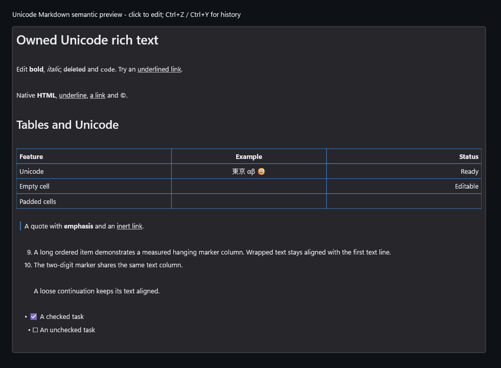

# Native Unicode markers, links and bounded HTML (M4d.3)

Qualified source: `a72ab562e5440cf4cb91917590c4729310d85ce3`, coordinated source
API revision 4. This extends the explicit RichTextEditor semantic preview through
native ControlHost and supplied-device embedded hosting. Raw UTF-16 source remains
the document, history, TSF and TextPattern coordinate space.

Native DirectWrite measurements establish a shared list gutter for hanging
markers, wrapping and loose/nested continuation blocks, mirrored for RTL. Existing
standalone marker rows before block-first lists/tables/code/HTML/rules remain.
Markdown and accepted HTML links are underlined using inherited theme text ink;
destination/title are inert metadata. There is no navigation or resource fetch.

HTML is a bounded native text policy, not browser HTML: balanced attribute-free
b/strong/i/em/u/s/del/code/span, br, quoted href/title anchors, and at most one outer
p/div/h1-h6/pre wrapper in an HTML block. The pinned character-reference decoder is
shared with Markdown. Validation precedes hiding any tags. Unknown attributes,
unsafe schemes, malformed/crossed/overlapping nesting, more than 32 simultaneous
opens or 4,096 tags produce whole-leaf literal display. No CSS, DOM, script,
networking, browser whitespace equivalence or generic HTML list/table/image
layout is claimed. See [the owning layout contract](../../../Specs/UI/UI_ControlsAndLayout.md).

## Qualification

Implementation commit `a72ab562e5440cf4cb91917590c4729310d85ce3` passed the frozen
six-job component matrix: complete EditorControls, Embedded and Accessibility
in x64 Debug, Release and ASan Debug, nine ordinary scope/profile runs with zero
capability skips. The sanitizer's isolated detection probe passed. All three
ARM64 builds passed; these are compile-only results. The independent audit
verified 76 archived-file hashes and all nine receipt/executable bindings,
including the named marker/HTML/raster/source-caret tests and both new and old
actual native/embedded UIA clients in every x64 profile. No tracked source input
changed during the matrix. Full five-validator/tooling validation and pinned
clang-format 22.1.3 checks passed.

The [frozen driver](Raw/runs.receipt.txt) records source and outcomes. The
[independent audit](Raw/runtime-artifact-audit.receipt.txt) verifies private
artifact hashes, nine receipt/executable bindings, explicit native and actual
native/embedded UIA client completions, and sanitizer detection. JSON payloads
are archived byte-for-byte as `.receipt.txt`; short `Default` aliases respect
the supported consumer path bound. Original binaries/PDBs/libraries/runtime DLLs
and failed candidates remain private under
`.build/reports/rich-semantic-m4d3-20261019`; this packet publishes their hash
manifests, raw logs and receipts, not those binaries. Run [Verify.ps1](Verify.ps1)
to replay the [packet-file hashes](files.sha256.receipt.txt) and retained bindings;
it cannot execute tests or rehash absent private artifacts.

Tests cover every supported tag alias and heading, quoted attribute order and
case, reference decoding, safe/unsafe destinations, whole-leaf rejection and both
limits. Independent SDK raster comparisons prove underline pixels with inherited
ink. Coordinate tests cover wrapping, shared columns, nesting, RTL, tables,
source geometry and direction, empty HTML insertion, cancellation and capacity.
Retained editor tests cover pointer/double-click, raw source/selection, Unicode
composition cancel/commit/history, atomic reference/br deletion, read-only,
disabled, flow/visibility/source mode and stale/current revision handling. Actual
UIA clients inspect raw labels/hidden attributes and empty-tag caret sites in
both hosts. Physical OS IME/AT sessions remain a separate qualification gate.

The ordinary Release embedded suite handles 320 observed geometry allocation
failures and 47 query failures (v0 rectangles/lines 6/7, semantic 33/1). Debug and
ASan handle 853 geometry and 82 query failures (12/9 and 58/3). Semantic document
sweeps cover 232 failures plus five pending-begin allocations in Release and
637 plus 16 in Debug/ASan. Parser sweeps remain 274 plus 12 in Release and 773 plus
34 in Debug/ASan. Maximum parser retained/replacement peaks remain 14,550,932 /
31,560,707 bytes in Release and 14,551,132 / 31,561,451 in Debug/ASan, below the
unchanged ceilings. Raw profile logs retain the individual outcomes.
Source/geometry scalar queries, idle/retirement and 1,000 warm composites
allocate zero tracked C++ storage; released tracked totals return to their
initial values. These bounded observations exclude SDK/driver/GPU/process memory
and do not establish all-input latency or performance acceptance.

## Actual capture and gallery

The actual 980 x 720 application-harness capture uses Release
`DxUi.EmbeddedControls.exe --rich-text --output`; it never captures the desktop.
[Capture provenance](capture.receipt.txt) binds source, executable and PNG hashes.
The five themed [published gallery sheets](../../../docs/gallery/README.md) use
the same clean qualified Release source. All five RichTextEditor regions were
reviewed for link underlines, native HTML text, hanging list wrapping, Unicode
table alignment and viewport fit. Their published pixels match the reviewed
private regions in [the gallery audit](Raw/published-gallery-tile-audit.receipt.txt).
The generic embedded gallery image demonstrates a different sample mode.

## Diagnostics, preserved failures and remaining work

The retained Release Default baseline/candidate diagnostic completed with `advice-required` (exit 1). Flagged metrics: dirty.privateBytes, dirty.privatePeakBytes. dirty.privateBytes: 28,569,600 to 29,392,896 bytes (+2.88%). dirty.privatePeakBytes: 28,688,384 to 29,413,376 bytes (+2.53%).

clean.frameP95Ms: 0.7127 to 0.5211 (-26.88%); dirty.frameP95Ms: 2.5741 to 1.8649 (-27.55%). Frame values are milliseconds. These are single before/after observations of completed WARP frames with clear/blocking readback. They establish neither causality nor performance acceptance. Baseline, candidate, comparison and exit record are preserved; no rebaseline or passing-repeat substitution was made. D4c remains HOLD. Any acceptance change needs the separately controlled paired/scheduler investigation and developer advice if degradation is confirmed, with measured optimization, scope reduction or deferral/revert choices.

Two behavior failures were reproduced and corrected before qualification. The
private `AnchorOwnershipBefore` probe proved that emphasis spanning a closing
HTML anchor could leave a following image owned by that closed link. Generic
Markdown style traversal now retains its syntactic parent; only actual element
creation resolves active native anchor ownership. The rebuilt independent probe
and graph tests confirm correct ownership. `NavigationBefore` preserves the
ordinary embedded failure where Left at raw source zero followed a generated
marker forward. Inter-box navigation now applies directed raw-source filtering,
with equal-ACP explicit padded sites retained. Existing and strengthened native
and embedded caret oracles pass. Failed compiler attempts/markers and their
original logs/artifacts are retained separately; none counts as final-source proof.

M4d.3 closes this native presentation slice. M4e structural editing, M4f semantic
UIA and M4g whole-stage acceptance remain open, as do M5/M6, physical/platform,
consumer and controlled performance gates. No foreground suite, native ARM64
execution, consumer pin adoption or merge is claimed. D4c remains HOLD.
