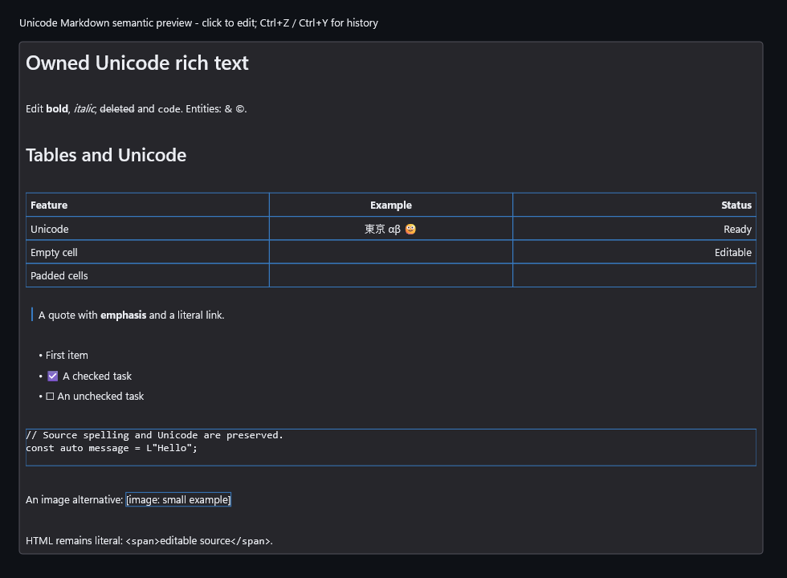

# Unicode semantic source caret sites (M4d.2)

Qualified implementation: `f7802f2bf1fcd923757de9176ab574c3ae418021`, source API
revision 4. This is the opt-in retained RichTextEditor semantic preview in DxUi,
tested through native ControlHost and the supplied-device embedded host. It adds
native caret geometry for empty/trailing/container-only source lines and
empty/padded cells, including distinct visual sites sharing one raw UTF-16 ACP.
Placement does not edit source/history. Padded cells use insertion before the
original row EOL; structural materialization remains in M4e.

## Qualification

Implementation commit `f7802f2bf1fcd923757de9176ab574c3ae418021` passed the frozen
six-job component matrix. Complete EditorControls, Embedded and Accessibility
passed in x64 Debug, Release and ASan Debug: nine ordinary scope/profile runs,
zero capability skips. ASan's isolated detection probe passed. All three ARM64
builds passed; these are cross-compilation results, not native execution. The
independent audit verifies all 76 archived artifact hashes and the nine scope
receipt/executable bindings, including both real UIA source-caret clients in
every x64 profile. No implementation/test input changed between those jobs.

[The frozen driver receipt](Raw/runs.receipt.txt) records every job's source,
start/end and result. [The independent artifact audit](Raw/runtime-artifact-audit.receipt.txt)
checks receipt/executable identities, actual native/embedded UIA client test
completions, ASan detection and all archived-file hashes. Archived JSON is stored
as `.receipt.txt`, following the existing rich-text packet convention; the
payload bytes are unchanged. Each profile's Raw
directory includes scope JSON receipts, raw logs, driver output and the private
artifact manifest. Its `Default` receipts use short aliases for the original
performance filenames to respect the consumer checkout path bound; their bytes
are unchanged. Actual exe/PDB/library/runtime DLLs remain privately retained
at `.build/reports/rich-semantic-m4d2-20261019/Qualificationf7802f2b`; their hashes
in this packet deliberately refer to that original archive. They are not
redistributed here. [The SHA-256 manifest](files.sha256.receipt.txt) binds the raw
receipts/logs, sample files and verifier, excluding this explanatory README and
the manifest itself. Run [Verify.ps1](Verify.ps1) to replay those hashes, original
scope/artifact bindings, six-job source identity, actual client completions and
sample provenance. It does not rerun native tests or rehash absent private
binaries.

Native/embedded scenarios cover mixed EOLs, blank/space/container/EOF sources,
quotes/lists, code/definitions, RTL/wrapping, source-range geometry and gap-free
line units, equal-ACP cells, pointer/double-click and directional navigation,
scrolling, transport sync, composition cancel/commit/undo/redo, raw CRLF deletion,
read-only/disabled, invalidation/reflow/cancellation and >4,096-box fallback.
Real UIA clients verify raw source, caret, selection and RangeFromPoint in both
hosts. Synthetic transport tests do not qualify physical OS IME/AT sessions.

The ordinary Release embedded suite handles all 191 observed semantic geometry
allocation failures and 21 retained query failures (v0 rectangles/lines 6/4,
semantic 10/1). Debug and ASan each handle 514 geometry and 41 query failures
(12/6 and 20/3). The semantic document sweeps cover 198 failures plus five pending
begin allocations in Release, and 514 plus 15 in Debug/ASan. Parser sweeps cover
274 plus 12 in Release, and 773 plus 34 in Debug/ASan. Current maximum parser
retention/replacement peaks are 14,550,932 / 31,560,707 bytes in Release and
14,551,132 / 31,561,451 in Debug/ASan, below unchanged limits; each returns to its
initial tracked C++ allocation total after release. Source/geometry scalar
queries, idle/retirement and 1,000
warm composites allocate zero tracked C++ storage. These are bounded C++
observations, excluding SDK/driver/GPU/process memory and all-input latency.

## Actual sample and gallery



This actual 980 x 720 application-harness capture uses the current Release
EmbeddedControls executable with `--rich-text --output`; it does not capture the
desktop. [Capture receipt](capture.receipt.txt) binds the source commit,
executable and PNG hashes. To open the interactive sample after a Release build:

```powershell
& '.\.build\x64\Release\DxUi.EmbeddedControls.exe' --rich-text
```

The [published five-theme gallery](../../../docs/gallery/README.md) comes from
the same clean qualified Release source. Its RichTextEditor tile was enlarged
to fit the resolved heading/styles, Unicode table and quote; empty source lines
now reserve native line height. All five component regions were visually
reviewed. [The pixel audit](Raw/published-gallery-tile-audit.receipt.txt) compares their
published pixels with those private reviewed captures. The generic embedded
gallery PNG is a separate example, not evidence for semantic rich text.

## Diagnostics, failures and remaining gates

The retained Release Default baseline/candidate comparison completed its native
measurement but exited 1 with `advice-required`: clean frame p95 rose from
0.470 to 0.518 ms (+10.21%, above the unchanged 5% diagnostic band). Clean
preparation p95 remained 0.0003 ms, composition CPU p95 0.0119 ms and composition
allocations zero; dirty frame p95 was 1.7899 to 1.7947 ms (+0.27%). These are
single before/after observations of completed WARP frames with clear/blocking
readback. They establish neither causality nor performance acceptance. Keep the
baseline, candidate, comparison and exit record; do not rebaseline or replace
the warning with a passing repeat. D4c remains HOLD. A future acceptance change
requires the separately controlled paired/scheduler investigation and developer
advice if degradation is confirmed, with measured optimization, optional-scope
reduction or deferral/revert choices.

The [active plan](../../../Specs/Plans/WIP/RichTextEditor_2026-10-17.md) records
the preserved failed/interrupted candidates, including padded-row ordering,
parser replacement peak, generated-prefix direction, phantom EOL units,
transformed-token Left and empty-line double-click regressions. Their original
logs, diagnostic inputs and artifacts remain private under the report root;
they are not counted as final-source qualification. No sealed M1/M2/M3 packet
was changed.

M4d.3 hanging markers/links/validated native HTML, M4e structural commands, M4f
semantic/style accessibility and M4g whole-stage acceptance remain open, along
with M5/M6 and physical/platform/consumer gates. No foreground suite, native
ARM64 runtime or consumer pin update is claimed. D4c remains HOLD.
