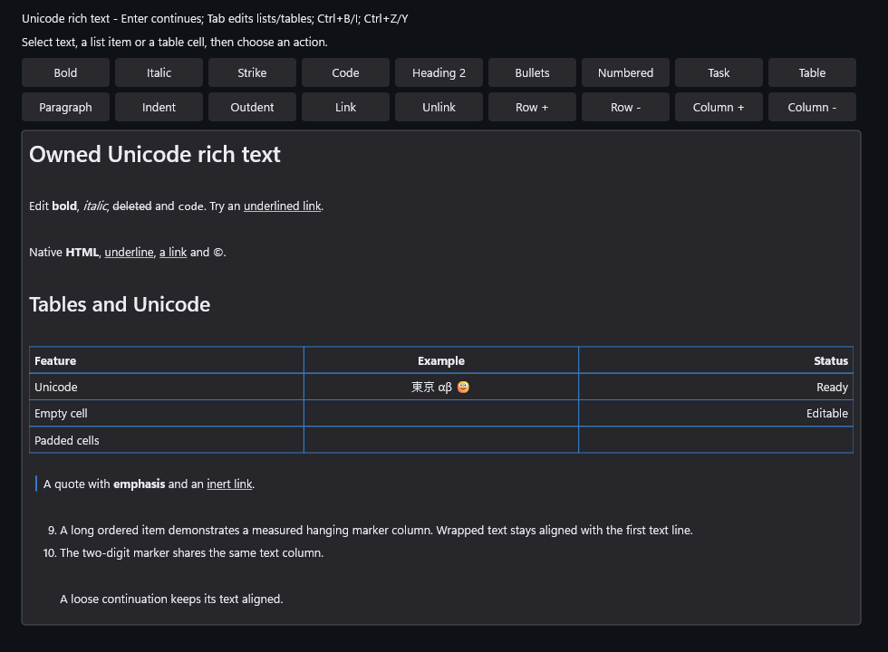

# Source-exact Unicode Markdown commands (M4e)

Qualified implementation: `159b77c7700e5e1746bd9846265938cd6d0dbe0b`, coordinated
source API revision 4. This extends the explicit RichTextEditor semantic preview
through native ControlHost and supplied-device embedded hosting. Raw UTF-16
source remains the document, history, TSF and TextPattern coordinate space.

The owned planner supports list continuation/exit/kind/indentation and compatible
joins, headings, strong/emphasis/strike/code, inert links, tasks, tables and cell
navigation. Plans bind the exact snapshot, syntax, revision and directional
selection. Apply is one atomic transaction; untouched source and mixed line
endings stay exact. Undo restores both source and selection. Stale, incompatible,
over-capacity and allocation-failed plans leave the document intact. This is a
bounded structural editor, not a whole-document Markdown reformatter. The
[usage and admission policy](../../../docs/rich-text.md#source-exact-structural-commands-m4e)
and [normative layout contract](../../../Specs/UI/UI_ControlsAndLayout.md)
describe supported and rejected transformations.

## Qualification

The frozen implementation passed x64 Debug, Release and ASan Debug runtime
testing, plus all three ARM64 builds. ARM64 results are compile-only. Complete
EditorControls, Embedded, Accessibility, TextField, MultilineText and WindowHost
coverage ran in each x64 profile. The affected-change explanation selected all
remaining ordinary scopes for the shared native-input/host-dispatch changes:
Foundation, Grid, Theme, Control, MenuExitLifetime, NewControls, ReadOnly,
ComboBox, Tree, Tooltip, Rendering, Animation and InteractiveLease. These ran
against the exact same binaries, yielding 57 distinct ordinary scope/profile
passes with zero capability skips. Foreground NativeTextInput is explicitly
INTERACTIVE_NOT_RUN because desktop-time agreement is required.

Independent audits rehashed 98 component, 111 supplementary and six sample
archive files and verified every runtime receipt/executable binding, named
structural/semantic tests, real native/embedded UIA clients and intentional ASan
detection. No tracked source input changed during qualification or capture.
All five validators and complete tooling tests passed on the frozen source;
the pinned clang-format 22.1.3 check passed. All five validators and formatting
also passed after metadata closeout. The
[final equivalence audit](Raw/final-native-equivalence.receipt.txt) confirms
unchanged native inputs and rehashes 25 current library/executable files against
their qualified archives. The [final validator outcomes](Raw/final-validators.receipt.txt)
and their individual logs are retained.

The [frozen matrix](Raw/runs.receipt.txt) and
[supplementary ordinary scopes](Raw/Additional/runs.receipt.txt) record exact
source and outcomes. The [component audit](Raw/runtime-artifact-audit.receipt.txt)
and [aggregate audit](Raw/all-runtime-artifact-audit.receipt.txt) bind scope
receipts to archived executable hashes. JSON payloads retain their bytes under
the `.receipt.txt` convention; Default aliases keep consumer paths bounded.
Original binaries, libraries, PDBs, runtime DLLs and failed candidates remain
private under `.build/reports/rich-structural-m4e-20261019`. This packet publishes
logs, receipts and their manifests, not those binaries. [Verify.ps1](Verify.ps1)
replays the [packet hashes](files.sha256.receipt.txt) and retained bindings; it
does not execute suites or rehash absent private artifacts.

Independent source/history and semantic-value oracles cover every command
family, mixed EOLs, Unicode, literal punctuation, code/link escapes, autolink
entity-looking bytes, HTML attribute spelling, padded/overflow table cells,
limits, incompatible targets and recursive empty-wrapper cleanup. Native
WM_KEYDOWN/WM_CHAR and embedded DispatchKey/DispatchCharacter tests exercise list
Tab/Shift+Tab, Enter, padded-cell typing, Ctrl+B, ordinary traversal and declined
callbacks that retire their owner. Retained tests cover read-only/disabled/source
view, composition, pending/stale publications, RTL, capture cancellation and
callbacks that undo or destroy the editor. Actual native and embedded UIA
clients verify raw source selections, events and single-step undo after commands.

The clean Debug core fault sweep covers 652 observed allocation failure points
across 12 scenarios; each failure preserves source, selection and history and is
followed by a successful retry/undo. A separate host cache-copy/command guard
probe confirms graceful allocation failure and recovery. The ASan embedded suite
passes 26,892 checks and 1,000 warm composites with zero tracked C++ allocations.
Existing parser and semantic-map oracles retain all 652 CommonMark and 672 GFM
cases. These bounded observations exclude SDK/driver/GPU/process memory and do
not establish all-input latency or overall performance acceptance.

## Actual capture and gallery

The actual 980 x 720 Release application-harness capture uses
`DxUi.EmbeddedControls.exe --rich-text --output`. It shows the two-row command
toolbar and semantic preview without desktop takeover.
[Capture provenance](capture.receipt.txt) binds source, executable and image.
All five full [themed gallery sheets](../../../docs/gallery/README.md), the
generic embedded example and all five native-scale RichTextEditor regions were
visually reviewed. The preview retains heading/styles, inherited link
underlines, hanging marker alignment, Unicode table cells and quote content
without overlap. The two sample toolbar rows fit above the document. Full raw
captures remain private; derived crops are identified as such and retain source
hashes. The [review receipt](Raw/gallery-review.receipt.txt) and
[published-region audit](Raw/published-gallery-tile-audit.receipt.txt) record
the reviewed and matching published pixels. The generic embedded capture uses
a different sample mode.

## Diagnostics and preserved failures

The retained Release Default baseline/candidate diagnostic returned
`advice-required` (exit 1). Flagged observations are dirty FPS 583.469 to 444.612
(-23.80%), frame p50 1.7004 to 2.2121 ms (+30.09%), frame p95 1.9221 to 2.7686 ms
(+44.04%) and preparation p95 1.2897 to 1.8525 ms (+43.64%). Clean frame p95 was
0.6213 to 0.5475 ms (-11.88%); dirty private/peak bytes were lower by 1.09%/1.37%.
These are one before/after observation of the Default completed-WARP-frame
fixture with clear/blocking readback, not a command-latency benchmark or a
controlled causal conclusion. The source, baseline, candidate, comparison,
log and exit record are retained in [Raw/Diagnostic](Raw/Diagnostic/).
No rebaseline or passing-repeat substitution was made. D4c remains HOLD;
separately controlled paired clear/readback and scheduler profiling is still
required. Confirmed degradation needs developer advice on measured optimization,
optional-scope reduction or deferral/revert before acceptance.

Prior failures remain separately identified under [Raw/PriorFailures](Raw/PriorFailures/).
An initial Debug allocation sweep terminated in an allocating noexcept MSVC
string move; its executable/PDB/hash and symbolized stack remain private, with
the log and manifest published here. Fallible append/copy construction corrected
that path. Build guard markers were archived before removal. The first clean
`63ea4e3b` qualification passed Debug EditorControls and isolated fault preflights,
then was deliberately interrupted when source review exposed embedded Tab
bypassing the control. Its partial receipts and artifacts are retained and do
not count as final qualification. A standalone probe against the retained
library reproduced that defect. The dispatcher correction and independent
native/embedded routing tests now pass. The `2ef049f4` strict build then rejected
a shadowed test variable; `159b77c7` corrects that warning. Earlier manual link
attempts missing SDK libraries and the successful diagnostic probe are also
retained privately. Focused probes and interrupted candidates are not substituted
for the final frozen matrix.

M4e closes this structural-command slice. M4f semantic/style UIA, M4g whole-stage
acceptance, M5/M6, physical IME/AT, native ARM64 execution and consumer adoption
remain open. No foreground suite, consumer pin update, push or merge is claimed.
D4c remains HOLD.
