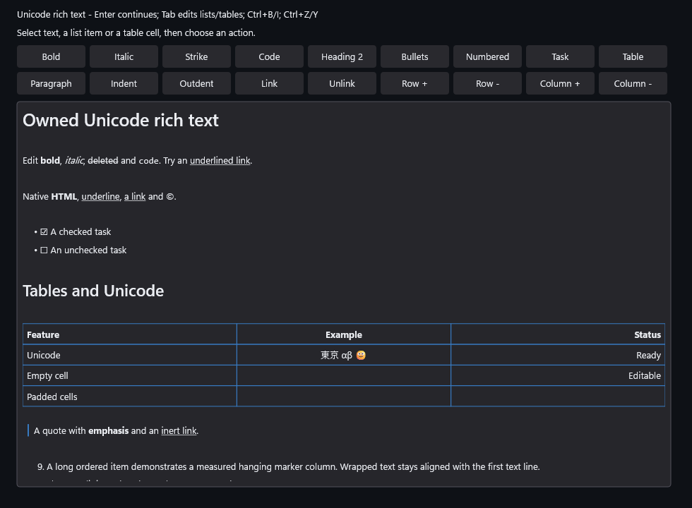
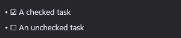

# Stable RichTextEditor task checkbox alignment

Qualified implementation: `5bc432845cf29683b2121101130085f153d8bda7`.
The reported checked/unchecked bullet shift came from font fallback inside the
shared no-wrap marker column. At 18 DIP, the independent native SDK probe measures
the Segoe UI checked glyph at 24.7148 DIP and unchecked glyph at 15.5039 DIP. The
right-aligned combined prefix therefore moved the bullet and checkbox when state
changed. With `Segoe UI Symbol`, both states measure 15.5039 DIP.

Semantic marker preparation now applies that monochrome face to owned checkbox
glyphs only. Body text, ordinary Unicode and generated list numbers retain their
requested fonts. Source/display ACP ownership, task transactions, layout budgets
and composition behavior remain unchanged. The sample shows both task states
near the top, and all five themed gallery tiles include both states.

## Qualification and evidence

The frozen implementation passed all 57 ordinary scope/profile runs across x64
Debug, Release and ASan Debug, with zero capability skips. All 19 ordinary scopes
selected by the affected-change explanation ran in each profile; the unknown
shared test-header/sample paths conservatively widened coverage. Intentional
isolated ASan detection also passed. All three ARM64 builds passed; these are
compile-only results. ARM64 Debug/Release were freshly compiled alongside x64
work in separate output/intermediate/attestation paths; their 18 archived
library/executable/PDB hashes exactly match the final matrix artifacts. ARM64
ASan Debug compiled afterwards. No foreground suite or native ARM64 runtime
qualification is claimed.

The independent audit rehashed 184 archived files, bound all 57 scope receipts to
their executables, and checked the new native geometry/retained tests plus the
existing raster oracle in every x64 profile. All five repository validators,
complete tooling tests and pinned clang-format 22.1.3 checks passed. Final
metadata-only edits retain the same native inputs and qualified artifacts.
The [final equivalence audit](Raw/final-native-equivalence.receipt.txt) rehashed
25 current library/executable files against their qualified archives. All five
validators and formatting also passed again after the metadata closeout; their
[outcomes](Raw/final-validators.receipt.txt) and individual logs are retained.
The embedded runs report 26,900 checks in Debug/ASan and 19,728 in Release; all
three report 1,000 warm composites with zero tracked C++ allocations. These
bounded observations exclude SDK/driver/GPU/process memory and do not establish
all-input latency or performance acceptance.

The [frozen six-job receipt](Raw/runs.receipt.txt) records all source and profile
outcomes. The [independent audit](Raw/runtime-artifact-audit.receipt.txt) rehashes
private archived files and binds scope receipts to executable hashes. Original
binaries, PDBs, libraries and sanitizer runtime DLLs remain private under
`.build/reports/rich-task-alignment-20261019/Qualification`. JSON payloads retain
their exact bytes under the `.receipt.txt` convention; Default aliases keep
consumer paths bounded. [Verify.ps1](Verify.ps1) replays the packet hashes and
retained bindings; it neither runs native suites nor rehashes absent binaries.

The new geometry oracle fails against the retained original library and passes
with the correction. Final native/embedded tests cover checked/unchecked sibling
columns, a single-task list without a wider sibling, Segoe UI/Consolas body fonts,
12/18/28-DIP sizes, both reading directions, wrapping and total height, source
caret placement, stable click targets and check/uncheck with exact undo. Existing
raster, source/selection, actual UIA client, allocation-failure, WARP/device-loss
and clean/dirty/hidden resource suites remain covered.

The SDK probe, failed original-library probe and successful isolated corrected
probe are retained separately from final qualification. Initial manual compilation
omitted the project's NOMINMAX define; another manual link omitted the intended
layout override and exercised the old library again. Their commands/logs remain
private and are not treated as production failures or candidate qualification.

## Actual captures

The actual Release application harness generated this 980 x 720 image with
`DxUi.EmbeddedControls.exe --rich-text --output`. It never takes desktop focus.
[Capture provenance](capture.receipt.txt) binds source, executable and PNG.
All five complete [themed sheets](../../../docs/gallery/README.md), all five
native-scale RichTextEditor tiles and the generic embedded example were visually
reviewed. Checked/unchecked bullets, checkbox edges and text align in every theme
with inherited monochrome ink. Hanging markers, Unicode cells, underlined links
and the quote still fit inside the gallery frame. Content continuing below the
sample viewport remains scrollable. The [review receipt](Raw/gallery-review.receipt.txt)
records hashes that must match the published images.

The publication guard initially rejected four full sheets whose slider halos
and tooltip presentation differed from the first capture. Those final sheets
were reviewed again. All five RichTextEditor regions remain pixel-identical to
their initial reviewed regions; the initial receipt and changed-pixel bounds
are retained separately. Final review hashes match the published sheets.

This is an identified unscaled crop of the actual sample, with parent/crop hashes
and rectangle in [crop provenance](crop.receipt.txt); it is not a mockup.

## Performance and remaining gates

The retained single Release Default before/after diagnostic returned
`advice-required` (exit 1). It flagged clean frame p95 0.4696 to 0.5122 ms
(+9.07%), private bytes 26,890,240 to 27,783,168 (+3.32%), private peak
26,972,160 to 27,824,128 (+3.16%) and working set 40,656,896 to 41,521,152 (+2.13%).
These completed-WARP-frame observations use clear/blocking readback after the
agent's compilation/test work finished. They are unpaired and establish neither
causality nor performance acceptance. Raw baseline/candidate/comparison/exit
records remain in [Raw/Diagnostic](Raw/Diagnostic/); no rebaseline or passing-repeat
substitution was made. Controlled paired/scheduler profiling remains required
for D4c, with advice on measured optimization, optional-scope reduction or
deferral/revert before accepting any confirmed degradation.

The separate D4c performance HOLD remains open. No rebaseline, controlled causal
conclusion or performance acceptance is claimed. Physical IME/AT, foreground
native-text/menu sessions, native ARM64 execution and consumer adoption remain
separate. M4f semantic/style accessibility and M4g whole-stage acceptance continue
in [the active plan](../../../Specs/Plans/WIP/RichTextEditor_2026-10-17.md).
This correction does not change consumer pins, push or merge any branch.
