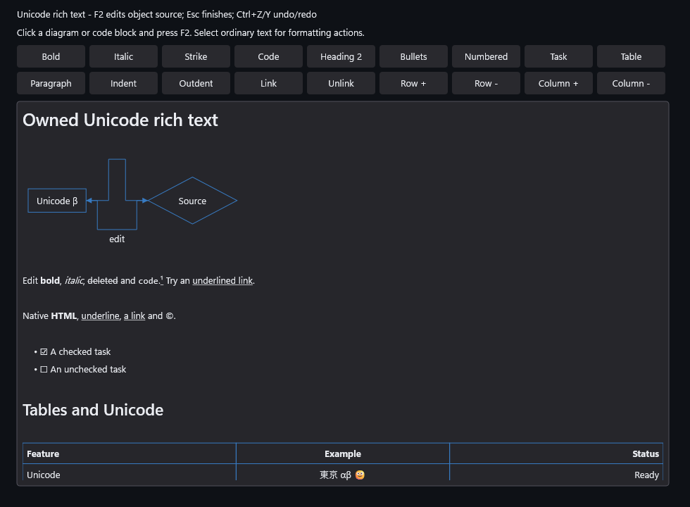
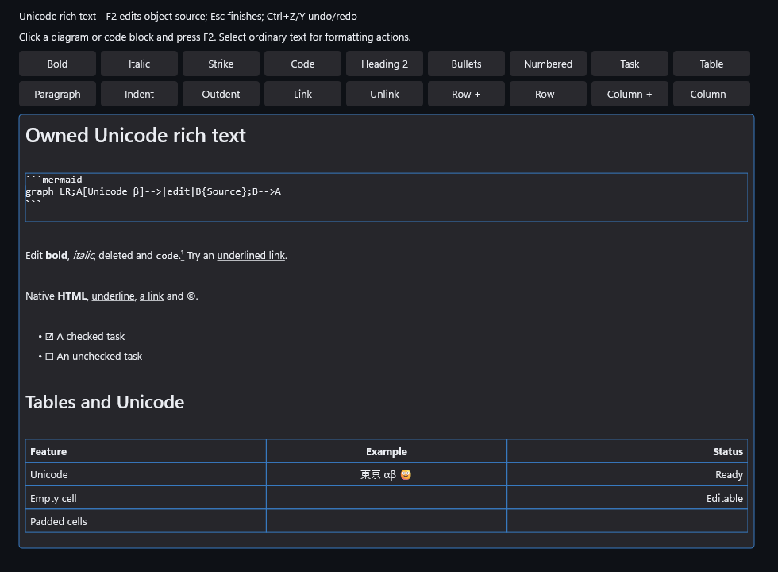

# Retained block source editing

RichTextEditor now opens acknowledged code, Mermaid fences, HTML blocks and
front matter as exact source in place. F2 or UIA Invoke enters; Esc, F2 or
Ctrl+Enter finishes presentation. Committed edits keep ordinary undo/redo.
Other paragraphs stay rendered. Temporary fence/prefix/body damage remains
literal and repairable inside one opaque physical-line parser region.

The same Document and full source ACP store handle Unicode typing, selection,
deletion, previews, cancellation, undo and redo. Read-only inspection is allowed;
active composition blocks entry/exit. Native other-thread actions dispatch to
their owner; embedded actions reject foreign-thread mutation. Old fragments
retire immediately, including transitions at equal source revisions. Entry/exit
cancels a captured drag. Both object caret edges work; a touching next object's
leading edge takes priority over the preceding trailing edge.

## Focused evidence

The frozen x64 Debug build takes 5:00. All 37 recorded runs pass: 30 directed
checks, the observed allocation schedules, complete Foundation, EditorControls,
Accessibility and Embedded, and recorded-source/history probes. EditorControls
takes 47.856 s; Accessibility takes 118.927 s. Embedded reports 443,652 checks.
Allocation injection covers 2,350 parser/semantic/geometry/graph requests,
including 163 opaque source parser points. The complete existing Markdown
corpus remains part of EditorControls.

The 1,000 warm composites take 7,937 us with zero tracked C++ allocations. This
is an unpaired diagnostic, **not performance acceptance**. D4c remains HOLD.
Release/ASan, ARM64 builds/runtime, final extension resources/device loss and
physical IME/assistive-technology qualification remain separate plan gates.
Native composition here uses the production IMM adapter on a borrowed surface
without OS focus; it does not establish physical HWND IME behavior.

[Qualification identities](qualification.json) bind the changed native sources,
base/patch, verified build state, artifacts and actual capture hashes.
[Run receipts](runs.receipt.txt) preserve every result. Full raw/failure packets
remain locally under `.build/reports/rich-source-region-m5e2-20261020`.
The final before/after input/artifact v2 identity check passes. Original failed
drag/trailing-edge probes, metadata help-test drift and documentation validation
failure remain retained; a passing repeat does not erase them.

## Actual application captures

These are the real `EmbeddedScene` sample, prepared and composited through its
supplied WARP device with no renderer HWND or desktop activation. The
[capture harness receipt](capture.cpp.receipt.txt) records the exact public API
scenario. The current-library rerender matches the reviewed captures byte for
byte. The resting gallery retains its existing tokens and appearance.
All five themes and the generic embedded sheet were regenerated through
`gallery.ps1 -PublishDocs`. Pixel differences in three sheets were confined to
the existing Slider touch-pressed and Tooltip hover variants, outside the rich
text tiles. The regenerated sheets and difference receipts remain private;
the existing published sheets are retained without unrelated visual updates.

Rendered diagram with surrounding semantic content:

The same document after F2, with the diagram's exact fenced source editable:

This closes the bounded block source-editing component, not the entire plan.
Math/inline object entry, note-aware commands and decoded images/image-path paste
remain pending. Current images still use atomic alt-text presentation.
