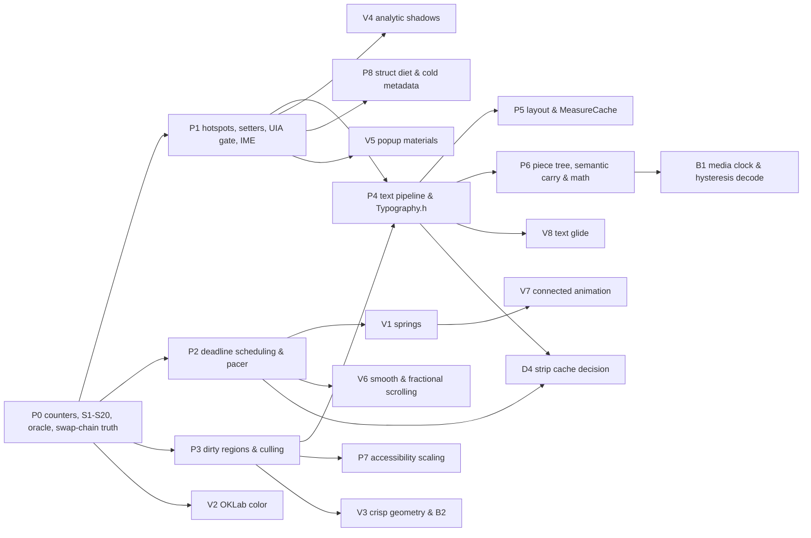

# Runtime efficiency and rendering quality, 7 November 2026 (revised 11 November 2026)

Archived on 13 November 2026 and superseded by the
[performance and motion plan](../WIP/PerformanceAndMotion_2026-11-13.md), whose appendix maps each item here to where
its surviving content now lives. This file remains the full evidence ledger and the record of the external studies;
nothing in it is scheduled work, and its references to a Windows 10 baseline no longer apply. The text below is kept
as written.

Status: SPEC READY — the 7 November draft (`rune` `0772373`, `gpui-fast` `61dccec`) was red-team reviewed on
8 November 2026 (`DxUi` `c0ead00a`, `rune` `a7f276c`, `gpui-fast` `fb8cf94`) and then re-audited from
the ground up on 11 November 2026 across the full `DxUi` C++ tree (`4acabe0e`) and 15 external reference codebases:
[`longbridge/gpui-fast`](https://github.com/longbridge/gpui-fast/tree/af019de83a26f0d94c65ef408fdecebca1c25e9c) at
`af019de` (Apache-2.0), [`anomalyco/rune`](https://github.com/anomalyco/rune/tree/0ea75abef0a6caa014067a88f89518b9a04cce2b) at
`0ea75abe` (including `research/01..38`, `gpu-floor` and `engine-spike`),
[`makepad/makepad`](https://github.com/makepad/makepad/tree/506ec05105b9adb08d1d21f9879df181b5244ea7) at `506ec051`
(MIT; see [Makepad study](#makepad-study-makepadmakepad-at-506ec051)),
[`microsoft/terminal`](https://github.com/microsoft/terminal/tree/5f7dc283013152f89bfb76950515c33f45157ad7) at
`5f7dc283` (MIT), [`chromium/chromium`](https://chromium.googlesource.com/chromium/src/+/301a3f2f20827052d76f75d0d1669dea5e42578b)
at `301a3f2f` (BSD-3-Clause — Viz/DComp, VSync, TSF `ITextStoreACP` and Windows UIA),
[`AccessKit/accesskit`](https://github.com/AccessKit/accesskit/tree/dea4384134abe5d7b0734f56a0fdd8b80a16dfdd) at
`dea43841` (MIT / Apache-2.0; Chromium-derived parts BSD-3-Clause, `LICENSE.chromium`),
[`microsoft/vscode`](https://github.com/microsoft/vscode/tree/75436fa46d2d234409ae10401414954ddc9e1efb) at `75436fa4`
(MIT — `pieceTreeTextBuffer`),
[`xi-editor/xi-editor`](https://github.com/xi-editor/xi-editor/tree/a2dea3059312795c77caadc639df49bf8a7008eb) at
`a2dea305` (Apache-2.0 — `rust/rope`),
[`linebender/parley`](https://github.com/linebender/parley/tree/36f82852f0516108586e9f5a7b0056e872c1f933) at `36f82852`
(Apache-2.0 / MIT),
[`rive-app/rive-runtime`](https://github.com/rive-app/rive-runtime/tree/66a4fbf3b18083eeacdcd6e9816d9106261090f9) at
`66a4fbf3` (MIT),
[`thorvg/thorvg`](https://github.com/thorvg/thorvg/tree/22c20d62c97137eb95c9b7eac795479fee5a50de) at `22c20d62` (MIT),
[`DioxusLabs/taffy`](https://github.com/DioxusLabs/taffy/tree/d0345bac609a10b25278ecc0850e862be9504e74) at `d0345bac`
(MIT), [`nicbarker/clay`](https://github.com/nicbarker/clay/tree/e6cc36941ab2af5d81107617039d6f527a1c660b) at `e6cc3694`
(zlib), [`ocornut/imgui`](https://github.com/ocornut/imgui/tree/abaca051e8799037e5b57d007fe35827422057ad) at `abaca051`
(MIT; see [Cross-ecosystem reference synthesis](#cross-ecosystem-reference-synthesis)), and the GPL-licensed `BUI`,
which is not a source for this plan (see [Optional items and license boundary](#optional-items-and-license-boundary)).
Decisions D1, D2 and D4 stand; revised D3 and D5–D12 await
the developer's confirmation (see [Decisions](#decisions)). Plan only; no code has been implemented. The plan was
challenge-reviewed on 12 November 2026 in the [challenge review](RuntimeEfficiencyReview_2026-11-12.md); the ledger,
verdict, decisions, risk register and item text were then corrected for fact, and item dispositions remain open in that
review's decisions and the frontier triage.

- **Owning contracts**: [performance and resources](../../Core/Core_PerformanceAndResources.md),
  [architecture](../../Core/Core_Architecture.md), [failure handling](../../Core/Core_FailureHandling.md),
  [controls and layout](../../UI/UI_ControlsAndLayout.md), [theme and typography](../../UI/UI_ThemeAndTypography.md),
  [input and accessibility](../../UI/UI_InputAndAccessibility.md), [design system](../../UI/UI_DesignSystem.md),
  [embedded rendering](../../Rendering/Rendering_EmbeddedD3D11.md), [Win32 host](../../Rendering/Rendering_Win32Host.md),
  [toolchain and consumption](../../Build/Build_ToolchainAndConsumption.md),
  [validation](../../Testing/Testing_Validation.md) and [documentation](../../Core/Core_Documentation.md).
- **Coordinated plans**: [remaining work](../WIP/RemainingWork_2026-11-04.md) owns D-P1 (the timing policy), D-Q1
  (platform/consumer acceptance) and every closed item cited below; [explicit state machines](../WIP/ExplicitStateMachines_2026-11-10.md)
  owns private non-breaking state-machine refactors and lifetime fixes (`DXUI-SM-01`..`DXUI-SM-08`) coordinated with
  `P2.1`/`P2.3`/`P1.15`; [frontier](Frontier_2026-11-11.md) orders this plan's items through its triage (kept
  separate by its `FD1`, confirmed 11 November 2026): it records a 16-claim re-read of this ledger, disputes `E7` and
  the "asymmetric `Present1`" design against Microsoft's flip-model documentation, and names which `P`/`V`/`B` items
  it keeps, replaces, moves or drops. Read an item's disposition there before starting it. The
  [challenge review](RuntimeEfficiencyReview_2026-11-12.md) is a coordinated record of the 12 November re-read of every
  ledger row and 123 external citations, with its decisions (`RD1` confirmed; `RD2`–`RD7` open). The archived
  [production review](../Done/ProductionReview_2026-11-02.md) holds the original `CTRL-*`/`HOST-*` findings. This plan takes over only the open IDs it names. It never reopens a closed one or weakens
  an accepted bound in [performance and resources](../../Core/Core_PerformanceAndResources.md) (including `Grid`'s
  last-paint cell text-layout retention limit and application-supplied native occlusion visibility).

## Verdict on the 7 November draft and 11 November full reanalysis

The original draft studied the right projects and identified genuine hotspots, and the 8 November pass separated verified
claims from refuted ones. Full subsystem auditing on 11 November closed the remaining blind spots:

1. **About a fifth of the 7 November draft was already done.** `EDIT-01`/`RENDER-01`/`RENDER-14` were closed in
   [EditorCosmeticPreparation](../Done/EditorCosmeticPreparation_2026-11-06.md): source guides are viewport-scoped,
   capped at 4 layouts per turn and never withhold a frame (though retaining `PreparedLayout` entries outside the
   viewport remains open in `E26`/`P1.11`). `RENDER-02` for Source mode was closed in
   [SourceSpacingAndRadioNaming](../Done/SourceSpacingAndRadioNaming_2026-11-07.md). `RENDER-05` (color-glyph
   capability) was closed in [ScriptColorPreparation](../Done/ScriptColorPreparation_2026-11-06.md). `SEM-02` was
   closed in [SemanticAndDiagramResources](../Done/SemanticAndDiagramResources_2026-11-07.md), and `MD-05`..`07` in
   [MarkdownScanBounds](../Done/MarkdownScanBounds_2026-11-06.md).
2. **Several 7 November "facts" were wrong or overstated.** There is no `6.10 ms/step` measurement and no
   `Menu-Popup4096-Keyboard` fixture anywhere. The host brush and format caches are hash maps capped at 256 and 96, not
   64-entry linear scans. `GetMenuIconWicFactory` is already a cached static (though its CRT `atexit` lifetime after
   `CoUninitialize` is a teardown hazard; see `E14`). `TagPicker::ComputeLayout` and the `tag + L" \x00D7"`
   concatenation do not exist. `PreparedFlowchart::Draw` zeroes no stack arrays and creates no per-draw geometry (its
   actual waste is 4 of 5 `DrawLine` segments per edge, zero-length on straight routes, and a `~155 KiB` preparation
   buffer; see `E71`). `GetVisibleItemRect` is constant time. `Control` has 5 cold strings, not 4. The 8 ms `SetTimer`
   is not "125 Hz": `USER_TIMER_MINIMUM` raises it to 10 ms, and about 64 Hz assumes a 15.625 ms system tick, which is
   not verified (`E1`). The API revision is already 5, so a breaking change makes it 6.
3. **The reference projects were partly misread.** `device_wake.rs` handles zero-poll D3D11 device removal, not widget
   deadline timers. `ChangedBounds` is draw-order batching, not dirty rects. `em_metrics.rs` is a font-fallback fix.
   gpui-fast's number set excludes space. rune's 4-band shadow split saves fragment overdraw in its own shader; with a
   `CLSID_D2D1Shadow` effect it would multiply effect passes by four, an anti-pattern.
4. **The partial-present path is correct for display; only its source comment gives the wrong reason.** With dirty
   rectangles on a flip-model swap chain, the runtime copies the previous frame's updated areas that the current frame
   does not update onto the current back buffer at present
   ([DXGI 1.2 presentation improvements](https://learn.microsoft.com/en-us/windows/win32/direct3ddxgi/dxgi-1-2-presentation-improvements)).
   An application that fully re-renders its own dirty rectangles therefore presents a coherent frame, and
   `ControlHost::Render` does: it clips, clears and repaints under the dirty rectangle, and forces a full first present
   after create and resize. The comment near `DxUi.WindowHost.cpp:5071` attributes this to buffer-content preservation,
   which is the wrong reason. Windows Terminal redraws every row and passes one clamped rectangle; Chromium's swap-chain
   backing relies on the same runtime copy. A `dirty_N ∪ dirty_{N-1}` redraw is needed only by code that reads the
   target before present (the back-buffer capture, an own-surface blur), so `P0.4` must observe the presented image
   (`E7`).
5. **No qualified timing acceptance signal yet.** D-P1 in [remaining work](../WIP/RemainingWork_2026-11-04.md) records that
   paired timing is inconclusive: 71 of 72 controls are unstable and the base policy is unqualified. A "control" there
   is a same-binary run pair, flagged unstable if any of 26 metrics moves beyond its band (5% timing, 2% memory) in
   either direction (`Tools/BenchmarkGate.psm1:305-324`), so the figure describes the sampling design, not proof that
   timing cannot be used. Every item here gates on **deterministic work counters** (layouts created,
   effects/layers/bitmaps created, tree visits, timer wakes, UIA passes, heap allocations and bytes). Wall/CPU timing
   stays advisory until D-P1 qualifies its policy.
6. **Beauty and motion belong beside CPU efficiency.** `V1`–`V8` cover closed-form springs, perceptual OKLab color
   transitions, crisp fractional-DPI hairlines, single-pass analytic Gaussian shadows, real popup materials, smooth and
   fractional scrolling, command-list connected animations and subpixel-stable text glide.
7. **Whole `DxUi` subsystems and cross-ecosystem mechanisms were missing (`E46`–`E84`).** The 11 November audit across
   `DxUi` and 15 external codebases uncovered major steady-state churn and subtle Win32/DXGI/TSF/UIA/editor bugs across
   `ThroughputGraph`, `StatusStrip`, `PageHost`, `ColorPicker`, `NumericStepper`, ~30 unguarded control setters, `Panel`
   per-child `weak_ptr` copies and `expired()` loads (no `lock`), `Grid` badge/resize/grouping/`1.53 MiB`
   `previousSelection` paths (`Grid` does no row sort), `Tree` expansion snapshots, `MenuPopup` shared-device teardown
   and re-creation once per menu session on threads with no other native host (driver thread count not verified),
   `WindowHost` device loss with no retry after a failed recreation (blank window), `TrimCaches`
   `_forceAllVisualPreparation = true` re-preparation every frame while more than 96 format keys are live (unmeasured;
   an ordinary screen uses ~10–40), `DCompositionCreateDevice2(dxgiDevice)` coupling with target and visual reset on
   device loss, possible modal size-move `WM_PAINT` starvation (not verified), `Present1` with no `Present(1, 0)`
   fallback on non-loss failure (its `rcPaint` rect is already clipped to the client area), `FrameClock::SmoothDeltaUs`
   with no jitter filter over `WM_TIMER` (not vblank) ticks, `include/DxUi/Typography.h` global mutex and font-collection
   probes on format-cache misses only (no leak: at most 28 owned entries), `EmbeddedHost` 4-pass UIA rebuilds once per
   application `UpdateAccessibility` call (opt-in contract, no library gate) and a native `providerRequested` latch,
   `~936 B` `AccessibilityControlNavigationSnapshot` records + UIA teardown/compliance bugs, TSF `TextStoreACP` about
   19–21 full-document copies per lock + whole-document `TS_TEXTCHANGE` + dead `GUID_PROP_INPUTSCOPE`, `RichDocument`
   non-coalescing 1-char buffers (the split-CRLF hazard belongs to the proposed `P6.1` append slab, not current code),
   `SameLayoutOptions` `0%` width-resize reuse, `SourceDisplayMap` `1.00 MiB` anchor vectors at the 64 Ki-unit cap
   (`3.875 MiB` whole map), YAML front matter revalidated on every parse, per-distinct-SVG-raster `CreateDeviceContext`
   churn, `RichImageDecoder::Decode` synchronous copies of up to `16 MiB`, and `MathFontData` rebuilds (~22,500
   in-memory MATH-table lookups plus a font face and table copy) + per-atom-run `IDWriteTextLayout`s.
8. **The 12 November challenge review re-read everything.** Of 269 ledger sub-claims, 156 hold as written. By row, 33
   of 84 hold, 15 hold with a corrected number, symbol or scope, 6 are overstated and 26 are partly wrong (3 were
   already refuted here and 1 needs a measurement). Of 123 fetched external citations, 85 were confirmed. Items whose
   premise was refuted carry a `Challenged` note. See the [challenge review](RuntimeEfficiencyReview_2026-11-12.md).

## Evidence ledger

Static findings carry exact file references at `DxUi` `4acabe0e`. "Counter" means `P0.1` instrumentation must confirm
the baseline before the item closes; ledger numbers are hypotheses to measure, never receipts. Every row was re-read
against source on 12 November 2026 in the [challenge review](RuntimeEfficiencyReview_2026-11-12.md) (appendix A): the
`Verdict` column carries that result with its materiality, the `Claim` column states what the code does, and time
figures remain inference until measured.

| # | Claim | Verdict | Evidence (`4acabe0e`) | Consequence |
| --- | --- | --- | --- | --- |
| E1 | Animation dispatcher requests an 8 ms `SetTimer` (raised to the 10 ms `USER_TIMER_MINIMUM`; ~64 Hz assumes a 15.625 ms tick, not verified); it is not an idle poll: the timer stops when no `Tick` returns `true`, so it runs continuously only while some control ticks forever (E2) | **Holds, corrected**; High for motion quality, Low CPU (per frame) | `kFrameIntervalMs = 8u` `:182`, `SetTimer` `:348`, start/stop `:331-391` in [AnimationDispatcher.h](../../../src/Support/AnimationDispatcher.h) | P2.1 |
| E2 | `TextField` caret (530 ms, while focused), `ComboBox` caret (530 ms, while editable and focused), `RichTextEditor` caret (500 ms) and `TooltipLayer` (show delay `SPI_GETMOUSEHOVERTIME` clamped to 100–2,500 ms, 500 ms fallback; 5,000 ms hide) return `true` every tick while active; `TextField` also ticks/draws its caret when `_readOnly`, as `Specs/UI/UI_ControlsAndLayout.md:491` requires | **Holds, corrected**; Medium idle power; None FPS | [DxUi.TextInput.cpp](../../../src/Controls/DxUi.TextInput.cpp) `:17, 1707, 1787-1813`, [DxUi.ComboBox.cpp](../../../src/Controls/DxUi.ComboBox.cpp) `:1883-1910`, [DxUi.RichTextEditor.cpp](../../../src/Controls/DxUi.RichTextEditor.cpp) `:5505-5511`, [DxUi.Controls.cpp](../../../src/Controls/DxUi.Controls.cpp) `:12156-12158, 12167, 12183-12186`, [DxUi.WindowHost.cpp](../../../src/Controls/DxUi.WindowHost.cpp) `:499-507` | P1.3, P2.2, P2.3 |
| E3 | `TextField`/`ComboBox` ignore `GetCaretBlinkTime`, reduced motion and `SPI_GETCARETTIMEOUT` | **Holds**; Medium (accessibility); efficiency gain only through E2 | same files | P2.2 |
| E4 | Every animation tick walks the whole tree | **Holds**; Medium on large trees with a blinking caret (per frame) | `Panel::Tick` visits every visible child; `EmbeddedHost::AdvanceAnimation` calls `_root->Tick` | P2.1 |
| E5 | `EmbeddedHost::Prepare` clears and repaints the whole surface for any change | **Holds**; High (per frame) | `dc->Clear(...)` then `_root->Paint` in [Embedded.cpp](../../../src/Rendering/Embedded.cpp) | P3.2 |
| E6 | Control invalidation is always full-window | **Holds**; High (per change) | `ControlHost::Invalidate()` calls `InvalidateRect(_hwnd, nullptr, FALSE)` | P3.1 |
| E7 | With `BufferCount = 2` and `FLIP_SEQUENTIAL`, the back buffer outside `dirty_N` holds frame N−2 before present; `Present1` then copies `dirty_{N−1} \ dirty_N` forward, so the displayed frame is correct; only pre-present readers (capture, V5 blur) see stale pixels; the code comment attributes this to buffer-content preservation, which is the wrong reason | **Partly wrong**; None for FPS; correctness risk for pre-present readers only | `BufferCount = 2`, `FLIP_SEQUENTIAL` `DxUi.WindowHost.cpp:4445-4447`, comment `:5071-5073`, `Present1` `:5217-5221` | P0.4 decides; P1.12/P3.3 fix |
| E8 | `Panel`/`ScrollPanel` paint every visible child regardless of clip | **Holds**; Medium–High for long scroll content (per frame) | `DxUi.Controls.cpp:1535-1545, 11311, 11326` | P3.4 |
| E9 | The host brush cache is cleared on every swap-chain resize: `PrepareForSwapChainResize` clears it, then `RecreateBrushCache` clears the already-empty map again at no cost; brushes are device-context resources, so neither clear is needed | **Holds, corrected**; Low–Medium (per live-resize frame) | `PrepareForSwapChainResize` `DxUi.WindowHost.cpp:4612`, `RecreateBrushCache` `:4552, 4687` | P1.12 |
| E10 | Host brush/format caches are `std::unordered_map`s, not 64-entry linear scans; limits are 256 brushes / 96 formats, with a real clear-on-overflow cliff | **Agreed refuted**; None for the scan; for the cliff see E72 | `std::unordered_map` [DxUi.h](../../../include/DxUi/DxUi.h) `:6721, 6746`, limits `:6364-6365`, `TrimCaches` `DxUi.WindowHost.cpp:4671-4683` | P4.5 |
| E11 | `DrawTextW` has 7 raw call sites, not "90+"; `DrawCenteredText` has 61 callers, all reaching `dc->DrawTextW`; `CreateTextLayout` appears on 28 lines (30 counting GDI-compatible calls and `Typography.h`); `DrawText` lays out the whole string on every call | **Holds, corrected**; Medium–High (per frame) | raw sites `DxUi.Controls.cpp:884, 1093, 6280, 6297, 6315`, [DxUi.Tree.cpp](../../../src/Controls/DxUi.Tree.cpp) `:259`, [DxUi.SingleLineTextEditing.cpp](../../../src/Controls/DxUi.SingleLineTextEditing.cpp) `:693`; `DrawCenteredText` definition `DxUi.Controls.cpp:1072` | P4.1 |
| E12 | `ComboBox` popup runs `1 + 2V` `UpdatePopupLayout` calls per paint (`8,500` layouts at `N = 500, V = 8`), plus `2–3×` (`2N–3N`) per `WM_MOUSEMOVE` pixel while open and `2–3×` per typed char even while closed | **Holds**; High for M of ~30 or more (per frame, per input event) | `DxUi.ComboBox.cpp:1127, 1845, 2114, 2213, 2311, 2322, 2577-2665` | P1.1 |
| E13 | Popup Gaussian blur (only with a backdrop capture and a non-`Solid` material), `CreateLayer` (`ComboBox`, `Menu`), rounded geometry, 2 gradient stop collections and brushes (also on `OverlayMaterial::Solid`, where they are visible pixels) and both shadow passes (`CreateCommandList` + shadow effect each) are recreated every paint; `PaintTransientSurfaceBackdrop` recreates its blur and geometry but creates no layer | **Partly wrong**; Medium responsiveness; None steady FPS (per popup paint) | `DxUi.ComboBox.cpp:217-245, 341, 348/359, 414-428`, [DxUi.Menu.cpp](../../../src/Controls/DxUi.Menu.cpp) `:590-619, 710, 717/728, 778-793`, `DxUi.Controls.cpp:258/283`, [DxUi.cpp](../../../src/Controls/DxUi.cpp) `:152-201` (`PushLayer(..., nullptr)` `:198`) | P1.2, V4 |
| E14 | Menu icons share one static `IWICImagingFactory` (not one per icon), released at static teardown after `CoUninitialize` (no crash verified); when the last native host on a thread detaches, `ReleaseSharedWindowHostAttachment` destroys `ID3D11Device` + `ID2D1Device` + `IDWriteFactory` + `IDCompositionDesktopDevice`, so threads with no other native host recreate them once per menu session; `D3D11CreateDevice` omits `SINGLETHREADED \| PREVENT_INTERNAL_THREADING_OPTIMIZATIONS` (driver thread count not verified); `NativeMenuInterop` has no `HBITMAP` code | **Partly wrong**; Medium (per open) latency; None steady FPS | `DxUi.Menu.cpp:812-833`, `DxUi.WindowHost.cpp:668-672, 716-722, 741-744`, [NativeRendering.h](../../../src/Support/NativeRendering.h) `:13-20`, [NativeMenuInterop.cpp](../../../src/Controls/NativeMenuInterop.cpp) (no `HBITMAP` or `CopyImage`) | P1.2, P1.12 |
| E15 | Popup backdrop does a synchronous GDI `BitBlt(..., SRCCOPY \| CAPTUREBLT)`, a heap `vector<uint8_t>` plus an extra full DIB copy, and a scalar alpha loop; the loop exists because the bitmap uses `PREMULTIPLIED` instead of `IGNORE`, the vector because the D2D bitmap is created lazily at paint; a 300×400 popup peaks at ≈1.44 MB transient | **Holds, corrected**; Medium (per open) latency; Low memory | `DxUi.cpp:136, 305-342`, `DxUi.ComboBox.cpp:200, 331` | V5 (and P1.2 until V5) |
| E16 | `TextField` cache hit runs `SecureClear` plus a string copy; masking applies to every field; composition state deep copy | **Holds**; Low CPU (per frame); breaks the zero-allocation rule | `DxUi.SingleLineTextEditing.cpp:527`, `DxUi.TextInput.cpp:3620`, [DxUi.NativeTextInput.cpp](../../../src/Controls/DxUi.NativeTextInput.cpp) `:2094` | P1.3 |
| E17 | Multiline `TextField` bypasses `_cachedMultilineLayout` across **10 hot paths**, including 2 layouts before `wheelStepCount == 0` and 5 per `PageDown` | **Holds**; Medium–High for large multiline text (per frame, per input event) | `DxUi.TextInput.cpp:352, 482, 585, 713, 728, 765, 811, 1958, 2088, 2180-2203, 2955, 3063, 3215, 3679` | P1.4 |
| E18 | `TagPicker::Paint` does no string concatenation; `LayoutParts()` runs on mutation and bounds changes only, measuring each tag twice per bounds change | **Agreed refuted**; Low | `DxUi.Controls.cpp:7542-7576, 7721, 7756, 7790` | dropped |
| E19 | `Splitter` preview rebuilds the whole-window UIA snapshot every pointer move | **Holds**; High (AT only) during drag | [DxUi.EditorControls.cpp](../../../src/Controls/DxUi.EditorControls.cpp) `:747` | P1.5 |
| E20 | `ProgressBar`/`Slider` value changes run `RequestInvalidate` plus a `General` UIA rebuild (gated on `providerRequested` or `UiaClientsAreListening()`) of 3 tree walks plus an index; `IndexAccessibilitySnapshot` sizes its hash tables at `bit_ceil(4n)` slots, a load factor, not a pass | **Holds, corrected**; Medium (AT only) (per input event) | `DxUi.Controls.cpp:5186-5198, 6467-6474`, [DxUi.Accessibility.cpp](../../../src/Controls/DxUi.Accessibility.cpp) `:864, 1432-1577, 2199-2229, 13785-13794` | P1.6, P7.3 |
| E21 | `Label::Label` eagerly sets `NeedsVisualPreparation(true)` on plain labels, and both `Label` and `Button::PrepareVisualContent` run `IsControlInTree` DFS before cheap guards (`CTRL-02`) | **Holds**; Medium during resize; None steady | `DxUi.Controls.cpp:2808-2811, 2970, 3180-3192` | P1.7 |
| E22 | `Grid` key navigation allocates and walks all rows per key (`CTRL-04`); `Tree::SetFocusedItemId` double lookup | **Holds**; Medium (per input event) | [DxUi.Grid.cpp](../../../src/Controls/DxUi.Grid.cpp) `:5937`, `DxUi.Tree.cpp:892/901` | P1.7 |
| E23 | `O(N²)` child/field revalidations in `FlexPanel` (`BuildLayout`, `ApplyLayout`), `FormPanel` (`BuildLayout`, `ApplyLayout`, `AddField`) and `TabControl::UpdateVisiblePageBounds` | **Holds**; None–Low | [DxUi.Layout.cpp](../../../src/Controls/DxUi.Layout.cpp) `:670-682, 726, 1030`, [DxUi.Forms.cpp](../../../src/Controls/DxUi.Forms.cpp) `:651-653, 747-759, 974-991`, `DxUi.Controls.cpp:9376-9447` | P1.8 |
| E24 | `Grid::Paint` calls `GetColumn` (by-value strings) `C + C·rows` times per frame | **Holds**; Medium (per frame) | `DxUi.Grid.cpp:4155, 4435` | P8.3 |
| E25 | Semantic geometry reuse is gated on `state_->document == document` and every edit creates a new `SemanticDocument` | **Holds**; High (per edit) | [DxUi.RichSemanticGeometry.cpp](../../../src/Controls/DxUi.RichSemanticGeometry.cpp) `:2437/2447`, [DxUi.RichSemanticDocument.cpp](../../../src/Controls/DxUi.RichSemanticDocument.cpp) `:2848-2855` | P6.1 |
| E26 | Semantic code-fence line numbers allocate one `PreparedLayout` per numbered line (capped at 4,096); `RichSourceGuides` creates layouts only for lines in the visible window plus margin, at most 4 per Advance; `CodeLabels` creates one language-badge layout per fence, unshared across identical languages; the copy affordance is drawn with rectangles and lines, not a layout | **Partly wrong**; Medium–High (per edit) in code-heavy documents | `DxUi.RichSemanticGeometry.cpp:2849-2864, 2909, 2924-2944, 4051-4057`, [DxUi.RichSourceGuides.h](../../../src/Controls/DxUi.RichSourceGuides.h) `:144-156`, `DxUi.RichTextEditor.cpp:7554-7560` | P1.11 |
| E27 | `TokenizeCode` discards all coloring above 4,096 tokens | **Holds**; None FPS (correctness) | `output.clear(); return false;` in [DxUi.RichCodeInk.h](../../../src/Controls/DxUi.RichCodeInk.h) | P1.10 |
| E28 | `PreparedMath::DrawColored` zeroes a 32 KiB (`4096 × 8 B`) stack array per paint of each colored formula and calls `pow` 6 times per colored op; `ResolveDiagramLabelBackground` runs a 32-step `Contrast` search (192 double `pow` calls, 222 worst case) but is cached and reruns only on theme or resource change; `PreparedFlowchart::Draw` calls `target->GetFactory` per draw | **Partly wrong**; Low / None | [RichMath.h](../../../include/DxUi/RichMath.h) `:11`, [DxUi.PreparedMath.h](../../../src/Controls/DxUi.PreparedMath.h) `:3019-3035`, [DxUi.PreparedFlowchart.cpp](../../../src/Controls/DxUi.PreparedFlowchart.cpp) `:152-180, 812-815`, `DxUi.RichTextEditor.cpp:4199-4207` | P1.9 |
| E29 | `pow`-based sRGB decode (`Utilities.h`) runs on paint paths in colored math, per flowchart edge and once per `TagPicker::Paint` (`ChooseContrastingTextColor`); `TextField` makes no contrast call; `ComboBox` not verified | **Overstated**; None | [Utilities.h](../../../src/Support/Utilities.h) `:19-30`, `DxUi.PreparedFlowchart.cpp:899`, `DxUi.Controls.cpp:7555` | P1.9 |
| E30 | `PreparedLayout::TryVisibleRange` is linear with a `HitTestTextPosition` per line; semantic `TryVisibleRange` and `TryVisibleSourceRange` scan all `boxes` and ignore `paintBoxes` | **Holds**; Medium for large source documents scrolled deep (per prepare) | [DxUi.RichTextLayout.cpp](../../../src/Controls/DxUi.RichTextLayout.cpp) `:762-785`, `DxUi.RichSemanticGeometry.cpp:3651-3682, 3966` | P1.9 |
| E31 | `PaintIndex::Build` discards vector capacity on every rebuild | **Holds**; None | [DxUi.PaintIndex.h](../../../src/Controls/DxUi.PaintIndex.h) | P1.9 |
| E32 | `ComposeGifCanvas` has no fast path for alpha 0/255 | **Holds**; None | [DxUi.RichImage.cpp](../../../src/Controls/DxUi.RichImage.cpp) `:158` | P1.9 |
| E33 | `RichImage::LoadFile` duplicates the encoded buffer (`RENDER-09`) | **Holds**; Low (per open) | `DxUi.RichImage.cpp:251, 506` | P1.13 |
| E34 | No fixture or receipt supports a 6.10 ms `MenuPopup` keyboard step; only `CHANGELOG.md:11` and this plan mention the figure | **Agreed refuted**; None (unmeasured) | no fixture or receipt; `CHANGELOG.md:11` | P0.2 measures; P7.4 conditional |
| E35 | Unrecorded `sizeof(Control)`: hand count `~296 B` inline x64 Release (`~336 B` Debug) plus a `39 B` allocation request (`24 B` header + `15 B` alignment slack); `Button`-derived toggles are large (`Button` `~816 B`, `Toggle` `~904 B`, `Checkbox : Toggle` `~912 B`, `RadioButton` `~864 B`); no test probe yet | **Partly wrong**; Low memory (~21 KB in ComplexUi, below the 315 KB noise) | `DxUi.h:1822-1868, 2305-2358, 2401`, [ControlAllocation.cpp](../../../src/Foundation/ControlAllocation.cpp) `:17-22, 25-62` | P8.1 |
| E36 | Lifetime token is an eager `make_shared<int>` | **Holds**; Low memory | `DxUi.h:1853` | D3 revision: slab handle withdrawn |
| E37 | `HOST-14` dead `#else` `Render` body | **Holds**; None (maintenance) | `DXUI_ENABLE_DIAGNOSTICS 1` in [Configuration.h](../../../include/DxUi/Configuration.h) `:4`; `DxUi.WindowHost.cpp:4708-4952` | P1.12 |
| E38 | `HOST-03`, `HOST-09` | **Holds**; Low (per input event) | `Embedded.cpp:1055, 664` | P1.12 |
| E39 | Native host never sets text antialias mode or rendering params | **Holds**; None (quality) | `Embedded.cpp:283` | P4.6 |
| E40 | Color transitions are sRGB-space lerps | **Holds**; None (visual) | `BlendColor` in [DxUi.Theme.cpp](../../../src/Controls/DxUi.Theme.cpp) `:198-202` | V2 |
| E41 | No springs; an interrupted `Slider` transition re-anchors and restarts the full 100 ms (wrong speed); `Button`, `Toggle`, `Checkbox` and scrollbar transitions are constant-rate linear, keeping speed but reversing velocity instantly | **Partly wrong**; None (visual) | `Slider::BeginVisualTransition` `DxUi.Controls.cpp:6619-6641`; constant-rate `:4445-4454`, [DxUi.Scrollbar.cpp](../../../src/Controls/DxUi.Scrollbar.cpp) `:117-134` | V1 |
| E42 | Connected animation draws a placeholder outline, not content | **Holds**; None (visual) | `PageHost::PaintOverlay` `DxUi.Controls.cpp:1968-1980` | V7 |
| E43 | 1 DIP strokes at fractional DPI produce blurred 1.25/1.5 px borders | **Holds**; None FPS (visual correctness) | shared rounded-rect stroke helpers `DxUi.Controls.cpp:554-562, 648-656` | V3 |
| E44 | Wheel scrolling is immediate with no inertia; `Grid` applies a fractional delta, then `ClampScrollOffsets` (`normalizeVertical = true`) floors the offset to a row boundary; `Tree` steps whole `WHEEL_DELTA` notches and accumulates `_wheelDeltaRemainder`; both hard-code 3 rows and ignore `SPI_GETWHEELSCROLLLINES`; edge fades not verified | **Partly wrong**; None FPS (correctness, UX) | `DxUi.Grid.cpp:5891-5898, 7311`, `DxUi.h:5525`, `DxUi.Tree.cpp:2154-2173` | P1.7, V6 |
| E45 | `ScriptTextRenderer` (super/subscript runs) lacks the Windows 10 color-glyph path (`TranslateColorGlyphRun`) and uses only `ID2D1DeviceContext7`; ordinary text draws through `DrawTextLayout(..., ENABLE_COLOR_FONT)`; the `ID2D1DeviceContext7` OS minimum is not verified | **Overstated**; Low | [DxUi.RichTextScriptRenderer.h](../../../src/Controls/DxUi.RichTextScriptRenderer.h) `:217-220`, `DxUi.RichTextLayout.cpp:834`; Windows 10 is in the embedded baseline ([toolchain](../../Build/Build_ToolchainAndConsumption.md)) | P4.1 |
| E46 | `ThroughputGraph::Paint` creates per-frame `ID2D1PathGeometry`, an `ID2D1SolidColorBrush` unused on the band path, `CreateLayer`, CPU-rasters `180×64` pixels (not HSV) + `46,080 B` `CreateBitmap`, zeroes `70,696 B` of stack arrays, draws up to `358` series lines and `3` raw `DrawTextW`s; `ThroughputGraphSample` is `408 B` (`73,440 B`/graph) and `ThroughputGraphHueWeight` `{float, double, uint8_t}` pads to `24 B` (`16 B` if reordered) | **Holds, corrected**; Low (niche control) | `DxUi.Controls.cpp:5747-6319`, `DxUi.h:2584-2602` | P1.14, P8.1 |
| E47 | `StatusStrip::Paint` / `ElideLeadingForWidth` (sections with `leadingEllipsis` only) runs binary-search `CreateTextLayout` + `wstring` allocs (12 layouts + 10 strings per frame at n = 260) and cuts at raw `wchar_t` offsets that keep UTF-16 surrogate pairs whole but split grapheme clusters | **Partly wrong**; Low (per frame) | `DxUi.Controls.cpp:10398-10432, 10504` | P1.14 |
| E48 | `PageHost::PaintPage`/`PaintOverlay` calls `dc->CreateLayer` up to 4 times per transition frame instead of `PushLayer(..., nullptr)` | **Holds**; Low (per frame, transitions only) | `DxUi.Controls.cpp:1802-1815, 1935-1948` | P1.14 |
| E49 | `ColorPicker` queries `dc->GetDevice` every paint and draws 3 uncached texts itself; an HSV drag move issues up to 4 `TextField::SetText` calls whose UIA refreshes are gated (rebuild count not verified); saturation at `V = 0` is preserved; `Labels` (`~460–464 B`) holds 6 SSO-exceeding default strings; `NumericStepper::SetValue` lacks an unchanged-value guard and calls `std::pow(10.0, _decimals)` `3×` (with duplicate `ClampValue`); its `std::format` result typically fits SSO | **Partly wrong**; None (niche control) | `DxUi.EditorControls.cpp:188-193, 972-1017, 1124-1130, 1698-1713, 1808, 1884-1889`, `DxUi.h:6082-6106` | P1.14, P8.1 |
| E50 | ~30 control setters lack unchanged-value guards; `StackPanel::SetOrientation`/`SetGap`/`SetPadding` unconditionally call `RequestInvalidate()`; `CardPanel::SetCornerRadius` mutates `_cornerRadius` without invalidating (`0` repaint bug) | **Holds**; Low; CardPanel (correctness) | `DxUi.cpp`, `DxUi.Controls.cpp:2736-2739, 10660-10701`, `DxUi.EditorControls.cpp` | P1.14 |
| E51 | `Panel::Paint`/`PaintOverlay`/`Tick` take no `weak_ptr::lock`; per child they do 2–3 `expired()` loads plus one `weak_ptr` copy, giving `2N + 2P` atomic read-modify-write ops per traversal and `~6N` per frame (≈0.17 ms at 5k controls, inference) | **Partly wrong**; Low (per frame) | `DxUi.Controls.cpp:76-127, 1544, 1560, 1574` | P1.8 |
| E52 | `MenuBar` `Debug::Info` calls do no formatting when no sink is installed; `MenuBar` invalidates and re-measures all item text widths on horizontal resize; `MenuPopup` renders twice on open (`RenderPopup` + `WM_PAINT`) and makes one `ParseMenuLabel` call per row per paint (`:3224` and `:3244` are exclusive branches) | **Partly wrong**; Low–Medium (per open) | [Diagnostics.h](../../../src/Support/Diagnostics.h) `:27-28`, `DxUi.Controls.cpp:8287-8290, 8472`, `DxUi.Menu.cpp:3224, 3244, 4224, 4243` | P1.2, P1.12 |
| E53 | `Grid` (within its last-paint cell layout retention contract) draws badge cells through `DrawCenteredText` (raw `DrawTextW`) every frame, re-creates the resized column's visible cell layouts (~R per drag frame; width is in the cache key), calls `CollectOrderedGroups` ~10 times per frame, pays `O(G²)` group cost via `GetRowTopDip` in `BuildVisibleBodyItems`, and materializes `O(R)` vectors/sets in `GridSelectionModel`; `Grid` does no row sort | **Partly wrong**; Medium; High for grouped Grids (per frame) | `DxUi.Grid.cpp:497-574, 1043-1058, 1080, 1130-1137, 3822-3840, 4091, 4520, 7077-7114, 7393, 7424` | P1.7, P4.3, P8.3 |
| E54 | `Tree::BeginTreeExpansionAnimation` copies about `3N + 3N'` `TreeItemData` records (`4 × wstring` each; `24,576` at `4,096` items): before and after the toggle, then again in `emplace(animation)`, which avoids `std::move` because MSVC `_ITERATOR_DEBUG_LEVEL == 2` allocates a vector proxy inside `noexcept`; `Tree::OnMouseMove` invalidates on every move over a row with tooltip text because the tooltip origin follows the pointer | **Holds, corrected**; Low–Medium (per click); hover Medium (per input event) | `DxUi.Tree.cpp:1085, 1689, 3599-3602, 3658-3660`, `DxUi.Controls.cpp:11891` | P1.7 |
| E55 | `ScrollPanel::OnMouseWheel` repaints and swallows wheel at clamped boundaries; `EmbeddedHost::DispatchPointer` drops `_capturedControl` on first button-up during multi-button chords; embedded and native hosts both ignore `MiddleUp`; `WM_MOUSEMOVE` never changes input modality | **Partly wrong**; Low–Medium wheel; None (correctness) | `DxUi.Controls.cpp:11820-11825`, `Embedded.cpp:954, 987-990`, `DxUi.WindowHost.cpp:3543-3569, 3628-3632` | P1.12 |
| E56 | `WindowHost` device-loss handling has no retry counter or backoff, and a failed recreation returns without retry, leaving the window blank; the swap chain uses `DXGI_SCALING_STRETCH` (mandatory for composition chains); each outermost `Failure::Scope` makes 2 `set_terminate` calls; `UpdateSupplementalTooltipTarget` makes 3 tooltip-text copies and 1 `SPI_GETMOUSEHOVERTIME` call per move; `AnimationDispatcher` keeps its `HWND_MESSAGE` while any host is attached and adds a phantom +8 ms to frame-1 `dt` | **Partly wrong**; Low (per input event) | `DxUi.WindowHost.cpp:1630-1635, 4408-4417, 4446, 5045-5050, 5240-5250, 5958-6007`, [Failure.cpp](../../../src/Foundation/Failure.cpp) `:284-303`, `AnimationDispatcher.h:385-386, 431-447` | P1.12, P2.1 |
| E57 | `include/DxUi/Typography.h` takes a global `std::mutex`, returns a heap `wstring` family name and calls `GetSystemFontCollection(..., TRUE)` only on host format-cache misses and at initialization, not on the paint path; its never-evicted static format cache holds at most 28 entries that own `com_ptr` formats and pin the factory (no raw pointers, no use-after-free) | **Partly wrong**; Low | [Typography.h](../../../include/DxUi/Typography.h) `:81-96, 194-294`, `DxUi.WindowHost.cpp:2747-2752` | P4.5 |
| E58 | `Control::operator new` adds `+39 B` (`24 B` header + `15 B` alignment slack) and calls `HeapSize` only on allocation (`TryAllocate`), never in `Free`; `MakeThemePalette`'s 4 redundant Oklab ramp derivations per theme build are not verified | **Partly wrong**; Low | `DxUi.Theme.cpp:1068-1215`, `ControlAllocation.cpp:17-22, 45, 54-62` | P4.5, P8.1 |
| E59 | `EmbeddedHost::UpdateAccessibility` runs a full 4-pass UIA rebuild once per application call after a changed preparation, placement or focus (opt-in contract, no library gate); native builds are gated on `providerRequested` or `UiaClientsAreListening()`, and `AcquireCanonicalRootProvider` latches `providerRequested = true` forever; the posted `AccessibilityFlush` after a synchronous `focusChanged` flush returns `S_FALSE` when revisions match, rebuilding only after a new mutation | **Partly wrong**; Medium (latch; animated embedded scenes); otherwise None | `DxUi.Accessibility.cpp:6377, 13785-13794, 13822-13840, 14758, 14897-14932` | P1.6, P7.1 |
| E60 | `FindAssociatedLabelText` runs an unindexed `O(K·N)` DFS and is the fall-through for every unnamed control; `AppendAccessibilitySnapshotNavigation` + `GetControlTypeId`/`Supports*Pattern` run ~45 `dynamic_cast`s per `Label` and ~20 per `Button`; `AccessibilityControlNavigationSnapshot` is ~`936 B` x64 Release by hand count (`1,088 B` with 19 Debug proxy allocs); each build makes 2–3 copies of up to `128 KiB` editor text; `Tree` rows are materialized eagerly only when the model offers no prepared rows | **Holds, corrected**; High (AT only) on large forms | `DxUi.Accessibility.cpp:692-798, 2309-2942, 2408-2410, 2663-2726, 4092-4121, 4184, 5205-5323` | P7.3 |
| E61 | `GetEnclosingTextRangeWordSpan` scans from index `0` (`O(offset)`), `AccessibilityTextRangeProvider::ResolveText` copies full `128 KiB` `wstring`s by value per COM call (the resulting `expectedText` is moved into `AccessibilityUiActionRequest`), and `RaiseWindowHostTextInputAutomationEvent` runs un-gated per keystroke, copying the full text-input state per caret move for every user | **Holds, corrected**; High (AT only) for long docs; Low for all users (per input event) | `DxUi.Accessibility.cpp:4604-4630, 6781, 7339, 7501, 8133, 8155, 8186, 8332-8349, 13616-13662` | P7.1, P7.3 |
| E62 | TSF `TextStoreACP` copies the entire document `std::wstring` about 19–21 times per lock (within **15–25** per CJK/Korean IME syllable) and imports state twice on commit, deliberately, to keep one undo step; clipped `GetTextExt` (`TryResolveTextStoreRangeRect`) falls back to `O(range)` character-bound probes; intermediate TSF strokes record no undo (IMM32 path not verified) | **Partly wrong**; Low for short fields; Medium for ≥64 Ki docs (per input event) | [DxUi.TextStoreACP.cpp](../../../src/Controls/DxUi.TextStoreACP.cpp) `:114-164, 349, 936-1002`, `DxUi.NativeTextInput.cpp:2094`, `DxUi.TextInput.cpp:3161-3167`, `DxUi.ComboBox.cpp:2090-2095` | P1.15 |
| E63 | `StepToNextTextElement` has an ASCII fast path but otherwise scans graphemes from `0` (`O(N)`); `SnapCaretIndexToTextElementBoundary` always scans from `0`; `SelectSingleLineWordAt` keeps surrogate pairs whole but classes astral letters as punctuation; embedded `Ctrl+C` calls `ReadSnapshot` twice; `OnCopy` allocates `_text.substr`; `RegisterClipboardFormatW(L"HTML Format")` is uncached | **Partly wrong**; Low (per input event); None for clipboard | `DxUi.SingleLineTextEditing.cpp:81-95, 117-144, 845-857`, [TextInputServices.cpp](../../../src/Controls/TextInputServices.cpp) `:893, 1083`, `DxUi.TextInput.cpp:2896`, [TextClipboard.cpp](../../../src/Controls/TextClipboard.cpp) `:133, 205` | P1.15 |
| E64 | `Document::TryReplaceImpl` calls `make_shared<const Buffer>(text)` per 1-char insert, defeating pointer-identity `Piece::AppendCoalesced` so consecutive typing never coalesces | **Holds**; Low (per edit) | [DxUi.RichDocument.cpp](../../../src/Controls/DxUi.RichDocument.cpp) `:283-291, 1003` | P6.1 |
| E65 | `RichTextEditor` flattens full-doc `source.Text()` / `projection.DisplayText()` at 14 editor sites plus `TryFindInSource` (including `128 KiB` concat on `Ctrl+Left/Right`, `Ctrl+Backspace/Delete` and double-click), and host text-input sync flattens twice per keystroke (`640 KiB` copied at the cap); `Ctrl+A` tessellates offscreen selection rects and offscreen highlight `HitTestTextRange` | **Holds, corrected**; Medium memory churn; Low latency (per edit) | `DxUi.RichTextEditor.cpp:745, 1149, 2585, 3772-3871, 5608-5623, 5665, 5733, 5851-5852, 5920, 6017, 6312, 6746, 6895, 7336`, [DxUi.RichSemantic.cpp](../../../src/Controls/DxUi.RichSemantic.cpp) `:32`, `DxUi.NativeTextInput.cpp:1063, 1076-1077` | P6.1 |
| E66 | `SourceDisplayMap` stores duplicate `wstring source_` (`128 KiB`) + dense `sourceLeading_`/`sourceTrailing_` (`1.00 MiB` at the 64 Ki-unit cap; whole map `3.875 MiB`), is rebuilt every keystroke, scans `spans_` linearly in `TryDisplayRanges`/`TrySourceRanges`, and builds one dirty envelope from first to last edit in `TryApplySourceEdits`; v0 `Projection` + `JoinBlocks` use `3.5 MiB` in `ViewMode::Source`, `1.75 MiB` of it duplicate | **Overstated**; Medium (per edit) | [RichSemantic.h](../../../include/DxUi/RichSemantic.h) `:67-70`, `DxUi.RichSemantic.cpp:146-212, 278-333, 387-399`, `DxUi.RichSemanticDocument.cpp:2608`, [DxUi.RichDocumentLayout.cpp](../../../src/Controls/DxUi.RichDocumentLayout.cpp) `:69-95` | P6.1 |
| E67 | `CloseElement` stores display text 2–3×; prose edits re-parse unchanged math ASTs and revalidate YAML front matter (`ValidateYamlMetadata`) on every parse; every parse builds a `std::multimap` identity map of all old nodes; Mermaid re-parse, `libfyaml` DOM cost and `MarkdownInlines` per-run allocations are not verified | **Partly wrong**; Medium (per edit) | `DxUi.RichSemanticDocument.cpp:920, 940, 1286, 2182`, [DxUi.MarkdownSyntax.cpp](../../../src/Controls/DxUi.MarkdownSyntax.cpp) `:368, 417, 436-458` | P6.1 |
| E68 | `MeasureTableOne` (Subtle presentation only) creates 1 uncached `PreparedLayout` per cell, retaining only winning widths: ≈`R·C` per 1-char prose edit and ≈`2·R·C − C` on resize; horizontal resize invalidates the layout (no `state_->Clear()` call), keeps images, drops markers, and reflows top-to-bottom instead of viewport-first | **Partly wrong**; High with Subtle tables (per edit); None in Default | `DxUi.RichSemanticGeometry.cpp:1421-1426, 1561-1562, 1615-1624, 2436-2446`, `DxUi.RichTextEditor.cpp:3737-3738, 7900-7905` | P6.1 |
| E69 | `BeginPreparation` skips `Phase::Chunks` (building one monolithic whole-doc `Phase::Reference` layout) whenever the non-default `lineHeightMultiplier > 0 && mode != Source`; `translatedOrigin` fails reuse because `:445` checks `VerticalOrigin() == next.height`, and chunks bake in their absolute origin; any selection change invalidates the full viewport; `DrawSourceInkIfSupported` calls `layout.Draw` twice per chunk and uncached `QueryInterface` per run; `ScriptTextRenderer` queries `GetTransform`/`GetDpi` per run | **Holds, corrected**; High in that config (per edit); Low for the raster parts | `DxUi.RichDocumentLayout.cpp:338-344, 445`, `DxUi.RichTextLayout.cpp:308-340`, `DxUi.RichTextEditor.cpp:3663`, [DxUi.RichTextSourceInkRenderer.h](../../../src/Controls/DxUi.RichTextSourceInkRenderer.h) `:285-290, 411, 434`, `DxUi.RichTextScriptRenderer.h:348-374` | P6.2 |
| E70 | `MathFontData::Build` performs `3 × ~7,500` in-memory MATH-table lookups (glyph count not verified) after creating the font face and copying the table, and is discarded whenever `SemanticLayout` rebuilds; `BuildTextAtom` creates one `IDWriteTextLayout` per atom run, not per character (`E=mc^2` gives 4), and each leaf costs one `DrawTextLayout` per paint | **Overstated**; Medium (per edit, per frame) | `DxUi.PreparedMath.h:444-459, 604-648, 2855, 3117`, [DxUi.NativeMath.cpp](../../../src/Controls/DxUi.NativeMath.cpp) `:2071-2073` | P6.5 |
| E71 | `PreparedFlowchart::Draw` emits 5 `DrawLine`s per edge, 4 of them zero-length on straight routes, and `Preparation` reserves `~155 KiB` of fixed arrays; `RasterizeSvg` renders every SVG in multi-strip DOM re-walks; `PopulateRichTextEditorAccessibility` shares the document and copies only its full text (trigger frequency not verified) | **Holds, corrected**; Low–Medium (per edit) | `DxUi.PreparedFlowchart.cpp:910-917`, `DxUi.RichSemanticGeometry.cpp:508-538`, `DxUi.Accessibility.cpp:2410, 2423` | P1.9, P7.2 |
| E72 | `ControlHost::TrimCaches` clears `_configuredTextFormats` **and** sets `_forceAllVisualPreparation = true` whenever `_configuredTextFormats.size() > 96`, forcing full-tree visual re-preparation every frame while the working set exceeds 96 format keys; an ordinary screen uses ~10–40 keys (inference), reaching 97 takes many typography overrides, and no fixture has measured it | **Overstated**; Low normally; High when hit (per frame) | `DxUi.WindowHost.cpp:862-870, 4678-4682` | P4.5 |
| E73 | `DCompositionCreateDevice2(dxgiDevice.get(), ...)` couples `_dcompDevice` to the D3D11 device, and device-loss handling resets `_dcompTarget`, `_dcompVisual` and the device; `ControlHost::OnSize` only calls `Invalidate()` and nothing handles `WM_ENTERSIZEMOVE`; whether modal size-move traffic starves `WM_PAINT` is not verified | **Needs measurement**; Low (device loss); Low–Medium (live resize) | `DxUi.WindowHost.cpp:612, 834-835, 4660-4662, 5329-5332` | P1.12 |
| E74 | `FrameClock::SmoothDeltaUs` clamps only `> hitchClampUs` (50 ms) with no jitter filtering; native ticks come from `WM_TIMER`, not DXGI/DWM timing (no source for `13 ms / 20 ms` variance); `DxUi.Layout.cpp` constructs nested per-child `Failure::Scope`s, which make no `std::set_terminate` call | **Partly wrong**; Medium motion quality; Low for the scopes | [FrameRuntime.cpp](../../../src/Foundation/FrameRuntime.cpp) `:125-135`, `AnimationDispatcher.h:184, 281-285`, `DxUi.Layout.cpp:183, 245, 535, 624, 973`, `Failure.cpp:282-290` | P1.8, P1.12, P2.7 |
| E75 | `RichImageDecoder::Decode` copies up to `16 MiB` (`MaximumEncodedBytes`) of `encoded` into `std::vector<BYTE> owned` before `IWICStream::InitializeFromMemory` even though `CopyPixels` finishes synchronously before `Decode` returns; failed decodes are already embargoed while location and binding are unchanged | **Partly wrong**; Low (per open) | `DxUi.RichImage.cpp:250-256, 292-306`, [RichImage.h](../../../include/DxUi/RichImage.h) `:66`, [DxUi.RichImageResources.h](../../../src/Controls/DxUi.RichImageResources.h) `:250, 327` | P1.13, B1 |
| E76 | `WindowHost` `Present1` passes `rcPaint`, already clipped to the client area, and has no `Present(1, 0)` fallback on non-loss failure; `MenuPopup` creates shadow-padded HWNDs but sets `usesSystemBackdrop = false`, so no DWM backdrop applies (`DWMSBT_TRANSIENTWINDOW` needs Windows 11 22621); a duplicate IMM32-TSF context on `WM_ACTIVATE` is not verified | **Partly wrong**; Low; None FPS | `DxUi.WindowHost.cpp:3446-3450, 3525-3532, 5217-5221, 5271-5277`, `DxUi.Menu.cpp:4117-4120, 4152` | P1.12, P3.3, V5 |
| E77 | `TextStoreACP::RequestLock` queues async requests made while locked in `_pendingLockFlags` and returns `TS_S_ASYNC`, returning the documented `TS_E_SYNCHRONOUS` only when scheduling is impossible; `NotifyExternalChangesIfNeeded` emits whole-doc `TS_TEXTCHANGE{0, oldSize, newSize}`; `RetrieveRequestedAttrs` always sets `*pcFetched = 0` (input scopes dead under TSF; password moot); TSF `GUID_PROP_ATTRIBUTE` clauses are dropped; and `GetACPFromPoint` ignores `GXFPF_NEAREST` / returns `TS_E_INVALIDPOS` instead of `TS_E_INVALIDPOINT` | **Partly wrong**; Low (correctness) | `DxUi.TextStoreACP.cpp:547-556, 1235-1248, 1682-1692, 1728, 2012`, `DxUi.NativeTextInput.cpp:1316-1322` | P1.15 |
| E78 | `DxUi.Accessibility.cpp` compliance & lifetime bugs: `FindRegisteredAccessibilityTarget` relies solely on `GetPropW` (leaking `target` and skipping `UiaDisconnectProvider` when `WM_NCDESTROY` does not reach the host); `MakeEmptyAccessibilitySnapshot` can throw inside `noexcept` where no caller `Failure::Scope` is active; Win64 `WM_GETOBJECT` rejects 32-bit zero-extended `UiaRootObjectId`; toggle `Button` exposes both `Invoke` and `Toggle`; IME commit fires both `TextChanged` and empty `TextEditChangeType_Composition` (Narrator double-speak not verified); and `:1561-1566` has dead `if (! target.embedded)` code | **Holds, corrected**; Low (correctness, AT only) | `DxUi.Accessibility.cpp:1330-1358, 1558-1568, 5270-5284, 8226, 13722-13755, 13954, 14733-14738` | P1.6, P7.1, P7.3 |
| E79 | `SameLayoutOptions` requires `a.widthDip == b.widthDip`, forcing `0%` paragraph/chunk shaping reuse on width resize, and `SemanticDisplayInput` allocates throwaway `SemanticInput` strings/runs *before* checking `previousState` reuse | **Holds**; High on resize; Medium (per edit) | [DxUi.RichLayoutOptions.h](../../../src/Controls/DxUi.RichLayoutOptions.h) `:15`, `DxUi.RichDocumentLayout.cpp:306`, `DxUi.RichSemanticGeometry.cpp:1913-1916, 1969, 2445-2446` | P4.3, P6.1, P6.2 |
| E80 | `PreparedLayout` creates uncached `IDWriteTextFormat`s per paragraph/chunk, scans `images->placements` in `O(P·I + I²)` during prep and `O(B·P)` per paint/caret/selection/table-cell (twice in `MeasureTableOne`!), runs unbounded `TryAdjacentSourceLine` scans, and lacks `Upstream`/`Downstream` soft-wrap caret `Affinity` | **Holds**; Low; affinity (correctness) | `DxUi.RichTextLayout.cpp:289-302, 620, 2007-2114, 3412-3465`, `DxUi.RichSemanticGeometry.cpp:715, 1584-1611, 3727, 4181`, `DxUi.RichTextEditor.cpp:5513-5648` | P1.9, P4.5, P6.1, P6.2 |
| E81 | `NativeImageGeometry::PrepareOne` creates and destroys a fresh `ID2D1DeviceContext` (`ID2D1DeviceContext5`) for every distinct SVG raster (placements with identical pixels and size share one); `Phase::CodeNumbers`/`CodeLabels` construct a full `RichText::Document` + piece-tree `Snapshot()` + `Project()` per code line number (`1..4096`); `PreparedFlowchart::Draw` mutates borrowed `stroke->SetOpacity` `2 × N_slices` times per `Pie` paint | **Holds**; Low–Medium (per edit); None for Pie | `DxUi.RichSemanticGeometry.cpp:448-455, 474-484, 545, 2849-2865, 2924-2944`, `DxUi.PreparedFlowchart.cpp:849-867` | P1.9, P1.11 |
| E82 | `FlexPanel::_records` and `FormField::_measureCache` are 1-slot exact-match caches (thrashing across unbounded/bounded and multi-width passes not verified); `FormPanel::BuildLayout` calls `MeasureParts` twice per field on settled passes, the second hitting the cache; `FlexPanel::BuildLayout` zeroes all `_lines` unconditionally (trivial) and its grow loops are `O(C²)` | **Overstated**; Low | `DxUi.Layout.cpp:662-663, 704-707, 841-871`, `DxUi.Forms.cpp:274-275, 845, 888` | P1.8, P5.1 |
| E83 | `Grid::SelectRow` / `OnSelectAll` copies the entire `previousSelection` (`1,600,000 B` = `1.53 MiB` after 200k-row `Ctrl+A`) on every click/key just to check equality, `AssignInOrder` allocates `std::unordered_set<uint64_t>` despite `SelectedIdFilter` existing right above, `SetSelectedRowIds` builds a second `unordered_set`, `Shift+Click` materializes all `R` visible row IDs to slice `[anchor..current]`, and `Ctrl+Shift` wipes disjoint selections (a behaviour defect) | **Holds, corrected**; Medium (per input event) | `DxUi.Grid.cpp:1080, 5346, 6332, 6728-6804, 7027` | P1.7 |
| E84 | `Slider::OnKeyDown` discards `modifiers`, ignoring `Shift` (`_largeStep`), and `WindowHost` lacks Win32 dual-Shift (`VK_LSHIFT`/`VK_RSHIFT`) release polling | **Holds**; None | `DxUi.Controls.cpp:7101-7153` | P1.12, P1.14 |

## What DxUi borrows, and what it does not

| Mechanism (source) | Transfer | DxUi item |
| --- | --- | --- |
| Lockstep incremental-versus-fresh verifier (`gpui-fast` `tests/oracle.rs`, `layers/verify.rs`) | As-is | P0.3 |
| Per-thread allocation counters, debug stall warnings (`rune` `procwatch`, `tooling/perf_warn.rs`) & `wall_ms - cpu_ms` driver-stall split (proposed here; `rune` `research/38` covers view re-run and commit cost and contains no `wall_ms`) | Adapted to test-only `operator new` hooks plus deterministic counters | P0.1 |
| Deadline wakes run without view, layout or GPU work unless visible state changed (`rune` `motion/timer_wake.rs`); covered/minimized timer latch (proposed here; `rune` `#324` is a Wayland/winit frame-callback spin fix, `OCCLUDED_RETRY`) | Adapted | P2.1 |
| Multi-HWND `16 ms` `WM_PAINT` starvation guard (`rune` `#392`) and unified `Backoff` reset only on `Presented`/`Uncovered` (`rune` `627c2b3e`; `#492`, also cited, is wgpu device-lost recovery with three bounded `SurfaceRetries`) | Adapted | P1.12, P2.1, P2.7 |
| Hover held still for 100 ms after wheel under stationary pointer, immediate `release_unhovered` on leave, draw-only typing suppression (`gpui-fast` `#124`, `#105`, `hover_freeze.rs`) | As-is | P2.5 |
| 5-state tooltip machine (`Idle`, `Armed`, `Open`, `Grace`, `Suppressed`; renamed from `rune` `#383`'s idle, waiting, open, warm and suppressed) | Adapted | P2.3 |
| Unseen motion lands instantly (`rune` `87caf2a`, `motion/unseen_presence.rs`); loop phase kept across hiding (`rune` `motion/loop_clock.rs`) | As-is | P2.6 |
| Sample animations at predicted presentation time (`rune` `research/15` §1); guard `< 1 ms` `qpcRefreshPeriod` and immediate 1st-strike `< 1 ms` / `PBT_APMSUSPEND` sleep fallback (`gpui-fast` `vsync.rs:62-79` guard and `:41-58` first-short-wait fallback, `chromium` `ui/gl/vsync_thread_win.cc:131-142`, `PowerMonitor` suspend `:67, 102-110`); focused-only VRR `Steady` (`rune` `#392`; `#497` is `App::on_visibility` plus a `ToastStack` timer hold) | Adapted to waitable swap chain plus `DwmGetCompositionTimingInfo` | P2.7 |
| Zero-poll TDR device-loss event (`gpui-fast` `device_wake.rs` `ID3D11Device4::RegisterDeviceRemovedEvent`) and borrow-safe FIFO deferral of reentrant Win32 display/power messages (`gpui-fast` `#125`) | Adapted | P1.12 |
| Boundary-clamped wheel no-op (`gpui-fast` `#104`), multi-button chord capture refcount (proposed here; `gpui-fast` `#130` is a macOS WKWebView composition drag-ownership fix) & stationary `WM_MOUSEMOVE` filter (`gpui-fast` `events.rs:365-371`, upstream Zed code), drag-out press disarm (`rune` `0ea75abe`) | As-is | P1.12 |
| Unchanged-value setter guards & old+new bounds dirty union, premultiplied `(0,0,0,0)` dirty-rect clear, and central detach/close pointer scrubbing (no external source cited; each item rests on its own `DxUi` evidence) | `DxUi` invariants | P1.14, P2.1, P3.1, P3.2 |
| Two-generation color-independent shaped-run cache (`gpui-fast` `text.rs` `RecentShapes`, 16 Ki glyphs/generation) + single `heavy` outlier slot (`gpui-fast` `path_cache.rs`) | Adapted: capture `DWRITE_GLYPH_RUN` via private `IDWriteTextRenderer`, replay via `DrawGlyphRun` | P4.1, P4.5 |
| Grapheme-safe shaped-width truncation (proposed here; `gpui-fast` `#132` `truncation.rs:54-60, 118` binary-searches over `chars()` and can split grapheme clusters) | Adapted via DirectWrite cluster hit-testing | P1.14 |
| Width-independent shaping, re-breaking in place on resize (`rune` `research/28`: `16.1 → 4.6 ms`; `parley` `layout/mod.rs`) and `hold_landing_width` during collapse (`rune` `#248`) | Adapted: split `SameShapingOptions` from `widthDip` + `IDWriteTextLayout::SetMaxWidth` in place | P4.3, P5.3, P6.1, P6.2 |
| Context-free numeric shaping table (`gpui-fast` `number_shaping.rs`: `0123456789.,+-%$KMBT`, no `:`, no space) | Redesigned: tabular figures, all 15×15 pairs **proved once per font** | P4.4 |
| Binary-searched visible lines (`rune` `text/glyph_emit.rs:85` `partition_point`; 200 KB note `5.45 → 0.09 ms`, `research/27:81`) | As-is over cached line tops | P1.9 |
| Byte-cut fence coloring keeping complete prefix lines (`rune-kit`; path not found at the pinned commit) and `LRI..PDI` inline-code BiDi isolates (`rune` `#496`) + post-BiDi `U+200B` scrub (`terminal` `AtlasEngine.cpp:514-518`) | As-is | P1.10, P6.5 |
| Viewport-first resize reflow + `[0.25, 4.0]` sample height rescaling (`gpui-fast` `#129` `list_measure.rs:218`: `3.78 → 0.18 ms` on 2,000 items, figures the PR calls ad-hoc) | Adapted for semantic blocks & variable-height lists | P6.1 |
| First-character undo boundary (`rune` `#385`) and fenced secret-clipboard auto-clear (`rune` `clipboard/native.rs:172` `GetClipboardSequenceNumber` + `clipboard.rs:16` `zeroize`; `CLIPBOARD_SEQUENCE` + `ZeroMemory` are renamed from those) | Adapted | P1.15, P6.1 |
| Cold rare-field sidecar with static empty instance (`rune` `cold.rs`) | As-is | P8.1 |
| Clickable-span hover filter (`gpui-fast` `interactive_text.rs`) | As-is | P6.4 |
| A11y container-local bounds + `ScrollScopeSnapshot` `O(1)` scroll transform & 1-sibling offscreen clip horizon (`accesskit` `node.rs:289-342`, `filters.rs:65-89`, `gpui-fast` `a11y.rs`) | Adapted inside immutable snapshot | P7.2 |
| Lazy tab-stop order (`gpui-fast` `tab_stop.rs`, `6b9c204`, `fb8cf94`) | Already lazy on `VK_TAB` in `WindowHost`; verify embedded/modal | P7.5 |
| Opaque fill inset by half stroke under opaque border (`rune` `paint/border.rs` `fill_under`), `PushAxisAlignedClip` when content clears rounded corners (`rune` `17abbcb`), and 3-tier opacity-group & enclosing-clip elision (`thorvg` `tvgScene.h:58-79`, `tvgShape.h:61-74`, `tvgPaint.cpp:44-127`) | Adapted | P1.14, P3.4, V3 |
| Closed-form spring with velocity-preserving retarget; effect channels never overshoot (`rune` `spring.rs`, `research/15` §5) | As-is | V1 |
| Separable 1D-`erf` × 4-step-Y analytic Gaussian rounded-rect shadow (`gpui-fast` `shaders.hlsl:229-243, 913-946`, upstream Zed code) + $\pm 3\sigma$ smooth tail ease & `alpha != 0` dither guard (`rive-runtime` `gpu.cpp:2754-2771`, `common.glsl:297-321`) | Adapted as custom D2D effect | V4 |
| Scroll edge fades (`rune` `ScrollFade`), analytic fling (`rune` `research/15` §8`), `1/64` px reversal hold & `double` tall-scroll delta (`rune` `#401`, `b45bfd66`), DirectManipulation (`gpui-fast` `direct_manipulation.rs`) | Adapted | V6 |
| Text glide dead-zone: snap Y to whole px, snap X within `1/64` px of rest (`rune` `e1bd315`) | Adapted | V8 |
| Sub-rect `D3D11_BOX` `UpdateSubresource` uploads (`gpui-fast` `#131`, a Windows dynamic-texture backend outside the atlas; `rive-runtime` `render_context_d3d_impl.cpp:1271-1303` uploads a 1-D buffer from a CPU-side shadow buffer) & scroll-layer promotion/demotion (`gpui-fast` `layers/policy.rs`, `REPAINT_COST = 2` at `layers/work.rs:17`) | Sub-rect upload in `P1.14`; scroll strip cache **only if** D4 triggers | P1.14, D4 |
| Unspent waitable-credit deadlock guard (`_frameLatencyCreditHeld`, renamed from `makepad`'s `credit`), `32`-handle `DCompositionWaitForCompositorClock` limit & `0xC01E0006` occluded sleep (`makepad` `platform/hal/src/backend/windows/win32/mod.rs:8-11, 194-195, 500-505`) | As-is: never re-wait on latency-1 waitable object when a woken tick skipped `Present` | P2.7 |
| `DCompositionCreateDevice2(nullptr)` TDR-surviving HWND target + diffed DComp `Commit()` + modal `WM_ENTERSIZEMOVE`..`WM_EXITSIZEMOVE` coalesced render (`makepad` `d3d11/dcomp.rs:55-57`, `win32/window.rs:1214-1228`, `chromium` `dc_layer_tree.cc:938-943`) | As-is | P1.12 |
| `0.15` EMA vblank `dt` filter (`[0.5, 1.5] * dt_ema`) + `LagSmoothing` (`> 500 ms -> 33 ms`) (`makepad` `scroll_motion.rs:165-170`, `tween/src/ticker.rs:14-45`) | As-is | P2.7, V1, V6 |
| `NextFrameGate` 2-bit hidden-subtree settle + single re-show sync & `500 µs`/`200 µs` cooperative prep/retire slices (`makepad` `next_frame_gate.rs:1-88`, `async_labels.rs:252-318`, `draw_list.rs:964-975`) | Adapted | P2.1, P2.6 |
| Working-set frame-generation cache protection + `"Source Library wall"` producer epoch invalidation & DXGI 1.4 hysteretic VRAM trim (`makepad` `layouter.rs:392-401, 514-531`, `slug_atlas.rs:101-125`, `platform/hal/src/gpu_pressure.rs:14-33`: megabyte reserves and sustain/repeat timers) | Adapted | P4.1, P4.5, P6.1 |
| Beyond-viewport wheel backlog jump (`find_position` before row draw), Fenwick `HeightTree`, `DataGrid` sparse `AxisSizes` (`O(K)` memory, `O(log K)` hit) & ink-only `ReorderList` slide (`makepad` `portal_list.rs:360-726, 2508-2526`, `data_grid.rs:124-258`, `reorder_list.rs:164-307`) | Adapted | P1.7, P6.1 |
| 1-pass post-loop `StackPanel` shift, active-flex index list & `ConcedingRow` priority toolbar overflow with `6 DIP` hysteresis (`makepad` `turtle.rs:3683-3742, 4885-5086`, `conceding_row.rs:222-335`) | Adapted | P1.8, P5.4 |
| Per-line `CodeLexState` `(start_state, end_state)` lexical continuation & pixel-row deduplicated scrollbar marks (`makepad` `code_editor/src/tokenizer.rs:66-227`, `scroll_marks.rs:189-248`) | Adapted | P1.10, P6.2 |
| Optical cap-height `ink_centered` offset, `letter_spacing` `liga`/`calt` suppression, `< U+0590` fast LTR Bidi check & lazy per-glyph `MathFontTable` (`makepad` `draw_text.rs:314-327`, `shaper.rs:38-62, 220-236`, `latex_math/src/layout.rs:395-473`) | Adapted | P1.9, P4.1, P6.5 |
| `box_all` negative interior SDF, `smoothstep(-3*px, 0, d)` shadow reach (proposed here; `surface.rs` has no such expression), `+ 1e20` callout union, shared disjoint-pane blur pyramid + `r²` variance lerp & `MIN_PX = 0.7` / Manhattan AA ink-conserving hairlines (`makepad` `sdf.rs:436-616`, `surface.rs:101-261`, `backdrop.rs:123-131`, `gauss_chain.rs:518-526`, `ink.rs:17-46`, `rive-runtime` `draw_path_common.glsl:576-584`) | Adapted | P1.9, V3, V4, V5, B2 |
| `64 B` cache-line `Hot` tween record + `QuickTo` `Retime::ByDistance`, invertible rubber-band `stretch_displayed`/`stretch_raw` & `lsq2_release_velocity` (`makepad` `tween/src/{engine.rs:89-117, quick.rs:51-150}`, `scroll_motion.rs:233-338, 569-615`) | Adapted | V1, V6 |
| `15 s` failed-image retry embargo + alpha-weighted mip generation, `1×1` `ClipCursor` + `WM_INPUT` infinite scrubbing + `DragCurrentAccum` quantized remainder preservation, and `RadialMenu` per-sector AABB + resting-radius hit-test (`makepad` `image_tiles/src/store.rs:85-112`, `image_cache.rs:76-134`, `rawinput.rs:132-222`, `imgui` `imgui_widgets.cpp:2564-2661`, `makepad` `radial_menu.rs:464-704`) | Adapted | P1.13, B1, B3, B5 |
| Per-frame `churn = min(creates, destroys)` resource counter & gallery unlabeled-control UIA lint (`makepad` `ledger.rs:118-241`, `a11y/src/render.rs:255-330`) | Adapted | P0.1 |
| `D3D11_CREATE_DEVICE_SINGLETHREADED \| PREVENT_INTERNAL_THREADING_OPTIMIZATIONS` (the latter documented as not recommended for general use), asymmetric `Present1` (`dirty_N ∪ dirty_{N-1}` D2D clip vs clamped `dirty_N` `Present1`; proposed here: `terminal` redraws every row each frame and its `AtlasEngine.r.cpp:487-534` clamps, skips empty rects, passes one dirty rect and falls back to `Present(1, 0)`, and neither source implements a history union), shrink-resize outside-viewport clear & `IDWriteTextAnalyzer1::GetTextComplexity` (`terminal` `AtlasEngine.r.cpp:179-196`, `AtlasEngine.cpp:918-936`, `chromium` `skia_output_device_dcomp.cc:138-170` capability setup including `clear_drawn_areas_outside_viewport`, `crbug.com/457463689`) | As-is (stripping `PREVENT_INTERNAL_THREADING_OPTIMIZATIONS` on WARP fallback) | P1.2, P1.12, P3.3, P4.1 |
| Post-unlock `RequestLock` `_pendingLockFlags` drain loop (`_pendingLockFlags` is `DxUi`'s queue; Chromium's is `lock_queue_`), prefix/suffix `TS_TEXTCHANGE` diff, `GUID_PROP_INPUTSCOPE` (`IS_PASSWORD`, which `tsf_text_store.cc` does not contain), `GUID_PROP_ATTRIBUTE` clauses, `GXFPF_NEAREST`/`TS_E_INVALIDPOINT` & `WM_ACTIVATE` duplicate-IMM32 suppression (`chromium` `tsf_text_store.cc:160-188, 640-702, 884-961, 1384-1419`, `terminal` `windowproc.cpp:284-296`, which is conhost) | As-is | P1.12, P1.15 |
| `64–80 B` `uint64_t presentMask` + `std::popcount` UIA property slab (proposed here; `accesskit` `lib.rs:1062, 1107-1113` indexes properties through a byte-index table, with no popcount), `IRawElementProviderAdviseEvents` listener refcounts, `UiaLookupId` warm-up, Win64 `static_cast<LONG>(lp)` `WM_GETOBJECT` & Narrator IME commit dedup (`accesskit` `adapter.rs:544, 596-604`, `chromium` `ax_platform_node_win.cc:826-845, 7995-8046, 8619-8650`) | Adapted inside lock-free immutable snapshot | P1.6, P7.1, P7.3 |
| Split-CRLF inert `L'_'` slab pad, `<= 65535` CR/surrogate chunk holdback, cached `LineSummary` monoid + stack `PieceCursor`, `use_count() == 1` in-place COW, monotonic `SourceDisplayMapper` & `Upstream`/`Downstream` soft-wrap caret `Affinity` (`vscode` `pieceTreeBase.ts:1209-1224`, `xi-editor` `tree.rs:275-285, 637-659`, `multiset.rs:453-508`, `parley` `parley/src/editing/cursor.rs:10-61`) | Adapted | P6.1, P6.2 |
| Second-Chance + Unwrapped-Fit Monotonicity (`desired.width <= new_max_w <= cached_max_w`; proposed here, since Taffy matches exact keys, `cache.rs:254-277`) + `size_is_valid_for` directional measure cache, `FrontBackVecBuilder` span-1 zero-sort & dry-run arena reset (`taffy` `cache.rs:17-359`, `track_sizing.rs:568-582`, `clay` `clay.h:2220-2263, 2411-2490`) | Adapted | P1.8, P4.1, P5.1, P7.3 |
| Closed-form `nextlog16` Wang's formula Bezier segment bound (`rive-runtime` `wangs_formula.hpp:58-80, 184-248`), `BatchSetItemSelected` + `SelectOnAuto` + `Ctrl+Shift` `RangeSelected` + scroll-relative XOR `BoxSelect` (`imgui` `imgui_widgets.cpp:7973-8919`), and Win32 dual-Shift `VK_LSHIFT`/`VK_RSHIFT` check (`imgui_impl_win32.cpp:292-298`) | Adapted | P1.7, P1.9, P1.12, B4, B6 |

### External repository synthesis (11 November 2026 heads)

- **`longbridge/gpui-fast` at `af019de`**: Recent PRs `#104`–`#133` hardened the exact edges a retained D3D11 UI hits
  after basic caching lands: `#129` cut resize reflow `21×` (`3.78 ms → 0.18 ms`, measured on 2,000 items with figures
  the PR calls ad-hoc) by reflowing the visible viewport first and clamping height-estimate ratios to `[0.25, 4.0]`
  (`list_measure.rs:218`); `#131` added a Windows dynamic-texture backend outside the atlas that uploads through
  `UpdateSubresource` with a `D3D11_BOX` (it changes no atlas staging and no tile key); `#132` added shaped-width
  truncation by binary search over `chars()`, which can split grapheme clusters; `#124`/`#105` split
  pointer-vs-wheel hover freeze (`release_unhovered` still clears exited hover immediately, while typing hides hover at
  draw time without invalidating hit-test state); `#130` fixed macOS WKWebView composition drag ownership (the
  stationary `WM_MOUSEMOVE` filter is upstream Zed code, `events.rs:365-371`); `#104` eliminated boundary-clamped
  scroll repaints; `#125` queued reentrant Win32 power/display callbacks in a FIFO instead of panicking or mutating borrowed host state; and `lists.rs:78, 3129` (`LIST_LAYERS = true`) confirmed
  that virtualized lists should replay compact row-draw operations rather than caching GPU scroll tiles.
- **`anomalyco/rune` at `0ea75abe` (`research/01..38`, `gpu-floor`, `engine-spike`)**:
  - *Empirical baselines and falsified ideas*: `gpu-floor` is cited for a `< 90 µs/frame` native DirectX submission
    floor when per-frame resource creation is eliminated (figure not found: no README at the pin and no research doc
    states it); `research/28` measured `3.5×` faster resize reflow (`16.1 → 4.6 ms`) from width-independent paragraph
    shaping; `research/31` is cited for timer-phased retained-tree invalidation regressing rapid edits `220×`
    (`0.23 → 50.9 ms`), but neither figure appears in it or in `research/15`, `27–30` or `32–38` (it covers where a frame
    goes across Taffy, Parley and Rune); `research/32` proved per-word
    shaping caches yield only `1.46–1.57×` while breaking kerning and line breaks (never borrow); `research/37` showed
    heap allocation was `2–11%` of fresh-build busy time while `clear_old_nodes` was `< 1%` (justifying `P8` inline size
    reductions and cold sidecars without a custom node bump arena); a `wall_ms - cpu_ms` split to catch driver/Present
    stalls is proposed here (`research/38` covers view re-run and commit cost and contains no `wall_ms`).
  - *State machines and rendering*: `#371`–`0ea75abe` replaced ad-hoc booleans with table-tested `#[derive(Machine)]`
    automata (`Tip` `#383`, `ScrollMode` `#401`, unified `Backoff` `627c2b3e`, first-char undo `#385`, fenced 45 s
    secret clipboard `be24e577`..`14e3c5d5`, drag-out disarm `0ea75abe`), rescued multi-window `WM_PAINT` starvation at
    `16 ms` (`#392`), fixed a Wayland/winit frame-callback spin (`#324`, `OCCLUDED_RETRY`), bounded wgpu device-lost
    surface retries at three (`#492`, `SurfaceRetries`), added `3×1` ClearType-to-A8 grayscale averaging (`#472`) and
    hue-preserving dual-source LCD blending (`#491`), switched to `Windfoil` analytical glyph outlines only during active scale motion (`#390`/`#425`/`#482`),
    isolated inline code in RTL paragraphs with `LRI..PDI` (`#496`), and documented Win32 `ISpellChecker` TLS COM
    teardown deadlocks (`#256`: never hold COM spellcheck objects in thread-local destructors).
- **`makepad/makepad` at `506ec051` (MIT; full audit in [Makepad study](#makepad-study-makepadmakepad-at-506ec051))**:
  - *Win32/DXGI/DComp & cache survival*: uncovered the **latency-1 waitable swap-chain unspent-credit deadlock** when a
    woken tick skips `Present` (`win32/mod.rs:8-11, 500-505`), decoupled `IDCompositionDesktopDevice` from `IDXGIDevice`
    (`DCompositionCreateDevice2(nullptr)`) so HWND visual trees survive D3D11 TDR (`d3d11/dcomp.rs:55-57`), coalesced
    modal `WM_SIZING` paints (`win32/window.rs:1214-1228`), replaced byte hashing with pointer-epoch upload identity
    (path not found at the pinned commit; the `0.1–1.5 ms` hashing cost has no source), and protected current/prev-frame
    cache entries from overflow cliffs (`layouter.rs:514-531`, exposing `DxUi`'s `E72` `_forceAllVisualPreparation = true` storm).
  - *Virtualization, shaders, math & empirical `Slug` limits*: contributed beyond-viewport wheel backlog jumps (`0`
    intermediate offscreen row instantiations on `8,000 px` flicks, `portal_list.rs:2508-2526`), `DataGrid` `O(K)`
    `AxisSizes` (`data_grid.rs:124-258`), `ConcedingRow` `6 DIP`-hysteresis toolbar overflow (`conceding_row.rs`),
    per-line `CodeLexState` continuation (`tokenizer.rs`), pixel-row deduplicated `ScrollMarks` (`scroll_marks.rs`), lazy
    per-glyph `MathFontTable` (`latex_math/src/layout.rs:395-473`), shared disjoint-pane backdrop blur pyramids + `r²`
    variance interpolation (`backdrop.rs`, `gauss_chain.rs`), `1×1` `ClipCursor` + `WM_INPUT` infinite scrubbing
    (`rawinput.rs`), tight per-sector `RadialMenu` AABBs (`radial_menu.rs`), and crucial production evidence that `Slug`
    GPU curve text hit shader-compiler banding bugs (`band_count = 0` in `slug_atlas.rs:334-336`) and `3.5 s` unroll
    compile stalls (`draw_text.rs:197-205`).
- **`terminal` (`5f7dc283`), `chromium` (`301a3f2f`), `accesskit` (`dea43841`), `vscode` (`75436fa4`), `xi-editor`
  (`a2dea305`), `parley` (`36f82852`), `rive-runtime` (`66a4fbf3`), `thorvg` (`22c20d62`), `taffy` (`d0345bac`), `clay`
  (`e6cc3694`) and `imgui` (`abaca051`)** (all permissive MIT / Apache-2.0 / BSD-3-Clause / zlib; full audit in
  [Cross-ecosystem reference synthesis](#cross-ecosystem-reference-synthesis)): exposed `E76`–`E84` and hardened every
  domain with production-tested invariants — D3D11 driver-thread suppression (`PREVENT_INTERNAL_THREADING_OPTIMIZATIONS`
  is documented as not recommended for general use; Terminal clears it on WARP), asymmetric `Present1` dirty rects
  (proposed here; neither Terminal nor Chromium implements a history union), post-unlock TSF `RequestLock` draining +
  `GUID_PROP_INPUTSCOPE`, `64–80 B` `popcount` UIA snapshots (proposed here; AccessKit uses a byte-index table) +
  `IRawElementProviderAdviseEvents`, VS Code's split-CRLF `L'_'` append-slab pad + `xi` `LineSummary` monoids + `parley`
  soft-wrap caret `Affinity`, an unwrapped-fit resize monotonicity rule (proposed here; Taffy matches exact keys, and the
  `100%` resize cache hit figure has no source), Rive's `nextlog16` Bezier segment formula + $\pm 3\sigma$ shadow tail
  ease, ThorVG's 3-tier opacity-group elision, and ImGui's `DragCurrentAccum` remainder preservation + `BatchSetItemSelected` / `BoxSelect`.

**Not borrowed**, with reasons:

- **Closure replay logs** (`gpui-fast` `retained.rs`/`splice.rs`): `DxUi` already retains its control tree.
- **GPU tiles for virtual lists**: `gpui-fast` `docs/scroll-layers.md` and `lists.rs:78` reject them in favor of
  tile-less row replay.
- **Time-phased retainer** (`rune` `research/31`): cited for regressing rapid edits `0.23 → 50.9 ms` (`220×`), figures
  that `research/31` does not contain.
- **4-band shadow clip split** (`rune` `paint/bands.rs`): with D2D effects it multiplies effect passes by four.
- **Background `SetWinEventHook` + `EnumWindows` GDI occlusion thread** (`rune` `#570`, `platform/win32/occlusion.rs`):
  [performance and resources](../../Core/Core_PerformanceAndResources.md) explicitly forbids inferring arbitrary window
  coverage via polling or global WinEvent hooks; `SetNativePresentationVisible` stays application-supplied.
- **Expanding `Grid` text-layout retention beyond the last-painted cells**: `EndTextLayoutPaint` in
  [DxUi.Internal.h](../../../src/Controls/DxUi.Internal.h) `:371-382` enforces the accepted memory bound in
  [performance and resources](../../Core/Core_PerformanceAndResources.md) (`Grid` retains at most one text layout per
  cell drawn by the last paint).
- **rune's `KeyHasher` constants**: any good 64-bit hash works, and a cache must compare the full key exactly.
- **Per-word or space-split shaping caches** (`rune` `research/32`, `clay` `clay.h:1731-1758`): `rune` rejected per-word
  shaping at `1.46–1.57×` and summing space-split words breaks OpenType cross-word kerning, Arabic contextual joining,
  Thai/CJK breaking and BiDi reordering.
- **Bump arena for retained nodes**: `rune` `research/37` showed node teardown under `1%`; `P8.1` cold sidecars and
  inline struct shrinking capture the `2–11%` allocator share safely under WIL/RAII.
- **`em_metrics.rs`**: DirectWrite font fallback already covers it.
- **`ChangedBounds`/`BoundsTree`**: a draw-order structure `DxUi` does not have.
- **`CompositeBatch`/`draw_state.rs`**: embedded composite is already `0.0104 ms` p95
  ([Default-B1](../../../Measurements/EmbeddedInteractionLayout/Default-B1.json)); revisit only if a multi-view
  consumer measures otherwise.
- **HDR/advanced color**, **continuous `opsz` axis values**, **replacing the WinUI double focus ring**, and **retired
  Fluent reveal/noise textures**: outside product design or already handled by DWM/Segoe UI Variable instances.
- **Runtime `D3DCompile`, Immediate-mode `Turtle` re-walks, `Vec<String>` monospace code buffers, unbanded `Slug`
  (`band_count = 0`) on 1:1 UI chrome, and in-process hang-polling threads** (`makepad`): rejected for the reasons
  recorded in [Makepad study](#makepad-study-makepadmakepad-at-506ec051).
- **`RwLock<Tree>` blocking UIA readers/writers** (`accesskit`), **synchronous STA `UiaRaise*` for embedded hosts**
  (`chromium` `crbug.com/503419515`), **live text-range offset shifting** (`chromium` `ax_platform_node_textrangeprovider_win.cc`),
  **ROV / 4-UAV pixel-local-storage path rasterization & `ClearState()`** (`rive-runtime`), **`ID2D1BitmapBrush` on
  `DrawGlyphRun`** (`terminal` `BackendD2D.cpp:215`: `>10×` D2D cliff), and **15-`Get*` `BACKUP_DX11_STATE` readbacks**
  (`imgui` `imgui_impl_dx11.cpp:237-352`): rejected for the reasons recorded in
  [Cross-ecosystem reference synthesis](#cross-ecosystem-reference-synthesis).

## Definition of done for every item

1. **Fail-before counter.** The item names its `P0.2` scenario and counter. The baseline value is recorded before
   the code change. The candidate meets the stated bound on the same fixture and build profile. Counter bounds
   are exact or upper bounds and live in the test, so a regression fails the build. Timing (`cpu_ms` and `wall_ms`) is
   reported as advisory evidence until D-P1 qualifies its policy.
2. **Parity.** Any item that adds retention, culling or partial painting passes the `P0.3` incremental-versus-fresh
   oracle with **0** BGRA differences on WARP (including premultiplied alpha channels). It also keeps bit-identical
   bounds and an identical UIA snapshot for its scripts.
3. **Visual changes are separate.** A change meant to alter pixels (`V`-items, `P4.1` replay snapping, `P4.6`, `B2`) is
   reviewed through `gallery.ps1 -PublishDocs` harness captures, with scenario/build/DPI provenance and a
   before/after carousel. A design-system update is required. `P0.3` parity never stands in for this review.
4. **Resource and failure-policy rules.** Steady state allocates nothing, composition does no heap/layout/raster/blocking
   work, idle blocks on events, caches trim only at frame or preparation start, and every `noexcept` boundary preserves
   [failure handling](../../Core/Core_FailureHandling.md) (including MSVC Debug `_ITERATOR_DEBUG_LEVEL == 2` container
   proxy allocations). New caches report their size in `EmbeddedStatistics` or the diagnostics sink.
5. **Repository workflow.** One focused branch per item group, a `Changes/` fragment, `Test-Changes.ps1 -Explain`
   plus affected suites while editing, and `-Mode PrePush` before push. Normative text moves into the owning
   contract when the item closes. Behavior or API changes update `docs/` and `capabilities.json`. Focus-taking
   suites run only with the developer's agreement to the time.
6. **Platform.** No unconditional import beyond the Windows 10 embedded baseline. Windows 11-only facilities are
   detected at run time with a tested fallback.

## Decisions

Confirmed on 7 November 2026 and retained:

- [x] **D1.** This plan stays separate from [remaining work](../WIP/RemainingWork_2026-11-04.md) and is sequenced after
  D9's history rewrite on shared files.
- [x] **D2.** A popup keeps publishing every row to UI Automation. The draft's "6.10 ms/step" was unsubstantiated,
  so `P7.4` runs only if `P0.2` (`S10`) measures a real cost.
- [x] **D4.** A non-virtual `ScrollPanel` bitmap strip cache waits for measurement after `P3`/`P4`/`P2.5`. If it is
  built, it uses gpui-fast's promotion/demotion policy and `REPAINT_COST` work accounting, a 16 MiB cap inside the
  64 MiB per-view cap, and only row-band `UpdateSubresource` uploads.

  **Challenged (12 November 2026)**: a 16 MiB strip cap holds 16,777,216 / (3,840 × 4) ≈ 1,092 rows at 4K, about half
  of one viewport. The 64 MiB figure is a single `EmbeddedHost` surface cap with a 128 MiB replacement peak, not a
  per-view budget, and `WindowHost` has no such cap. See the
  [challenge review §3.3](RuntimeEfficiencyReview_2026-11-12.md#33-dirty-regions-are-a-local-optimum-text-gets-the-wrong-tier).

Proposed (revised 11 November 2026); each needs the developer's confirmation before its phase starts:

- [ ] **D3 (revised). API revision 6, not 5; one bundled break.** Revision 5 already exists. Bundle every public
  break into a single revision 6 so consumers migrate once:
  1. The embedded animation request replaces `NeedsAnimation()`/`AdvanceAnimation()` (`P2.4`). This is a
     deliberate compile break: a silent change in meaning would stop carets blinking in unported consumers.
  2. `Control::GetVisualOverhangDip()` and region invalidation (`P3.1`).
  3. Zero-copy `IGridModel::GetColumn` only if the `P8.3` hoist leaves allocations.
  4. **Withdrawn:** the 64-slot slab `ControlLifetimeHandle`. It would touch 460 call sites and every consumer to
     save one small allocation per control; `P8.2` keeps `std::weak_ptr<int>` while `P1.8` eliminates its per-paint
     atomic lock traffic.
  The `Control` and `ToggleableControlBase` layout changes in `P8.1` need no revision bump beyond rebuilding pinned
  consumers, provided source compatibility of `Checkbox`/`Toggle`/`RadioButton` public methods is preserved (or bundle
  into revision 6 if any consumer downcasts them to `Button*`).

  **Challenged (12 November 2026)**: `P8.1` changes public structs (`ThroughputGraphHueWeight.weight` from `double` to
  `float`, and `ThroughputGraphSample`), so it is not revision-neutral. Splitting the toggles from `Button` breaks
  implicit upcasts and inherited methods for consumers and eleven library `dynamic_cast` sites, not only downcasts.
  `Panel` takes no `weak_ptr::lock` (`E51`). See the
  [challenge review §3.4](RuntimeEfficiencyReview_2026-11-12.md#34-the-memory-phase-targets-the-smallest-line).
- [ ] **D5. Native frame pacer.** `WindowHost` continuous animation is paced by a DXGI frame-latency waitable
  object (`MaximumFrameLatency = 1`), guarded by `_frameLatencyCreditHeld` so a woken tick that skips `Present` never
  re-waits on an unspent semaphore credit (`makepad` `win32/mod.rs:8-11, 500-505`). One pacer thread per UI thread
  blocks on `{waitable, arm/stop event}` and posts one frame message only while a continuous animation is armed. When
  disarmed it blocks indefinitely, so this is event-driven with no polling. Fallback where unavailable, occluded
  (`0xC01E0006`) or when `< 500 µs`–`1 ms` wakes indicate monitor sleep is a one-shot timer at the display refresh
  period. Embedded hosts are unchanged and stay owner-scheduled.

  **Challenged (12 November 2026)**: the waitable flag must also be passed to `ResizeBuffers`
  (`DxUi.WindowHost.cpp:4571` passes 0); latency 1 makes every unpaced present block; a tick that skips `Present` needs
  its own timer or it spins or stalls. The cited Makepad path does not exist at `506ec051`: the file is under
  `platform/hal/src/backend/windows/win32/`, its field is `credit`, and it runs one process-wide pacer. `0xC01E0006`
  belongs to `DCompositionWaitForCompositorClock`. See the
  [challenge review §3.2](RuntimeEfficiencyReview_2026-11-12.md#32-the-present1-claim-is-backwards).
- [ ] **D6. Visual direction.** Adopt springs (`V1`), OKLab color transitions (`V2`), device-pixel hairlines (`V3`),
  analytic elevation shadows (`V4`) and smooth fractional scrolling (`V6`) as design-system changes, with gallery
  review per item. Reduced motion and High Contrast keep their current semantics.

  **Challenged (12 November 2026)**: today's animated colors are near pairs, where OKLab looks the same as an sRGB
  lerp, and `BlendColor` lerps straight alpha (`E40`). `V4`'s "0 intermediate surfaces" is unproven for a custom
  effect. See the
  [challenge review §3.5](RuntimeEfficiencyReview_2026-11-12.md#35-animation-is-a-list-of-effects-not-a-system).
- [ ] **D7. Popup materials.** Retire the GDI `CAPTUREBLT` screen capture. HWND popups use the DWM transient
  system backdrop where available. In-window and embedded overlays blur `DxUi`'s own retained surface. Everything
  else falls back to the solid themed fill. This also stops reading other applications' pixels.

  **Challenged (12 November 2026)**: `DWMSBT_TRANSIENTWINDOW` needs Windows 11 build 22621 and covers the whole window
  bounds, while the baseline is Windows 10 and `MenuPopup` HWNDs are shadow-padded (`E76`). Blurring `DxUi`'s own
  surface reads the target before present, the one case that needs a `dirty_N ∪ dirty_{N-1}` redraw; in an embedded
  host a per-frame blur would rasterize during composition unless it stays in preparation. See the
  [challenge review §3.2](RuntimeEfficiencyReview_2026-11-12.md#32-the-present1-claim-is-backwards) and
  [§3.5](RuntimeEfficiencyReview_2026-11-12.md#35-animation-is-a-list-of-effects-not-a-system).
- [ ] **D8. Text rendering params.** Pick antialias mode by presentation mode: grayscale on premultiplied or
  composition targets, the system setting on opaque HWNDs. Use per-monitor rendering params. Any change to dark-theme
  grayscale contrast requires harness A/B captures.

  **Challenged (12 November 2026)**: Direct2D's defaults already select grayscale on premultiplied targets and
  ClearType on opaque (`IGNORE`) HWND chains, so the presentation-mode choice is the status quo (`E39`). ClearType on a
  premultiplied target gives unpredictable pixels, not an `EndDraw` failure; the documented failure is rendering
  parameters that do not match the antialias mode. An embedded host owns no HWND, so its monitor must come from the
  application. See the [challenge review §3.2](RuntimeEfficiencyReview_2026-11-12.md#32-the-present1-claim-is-backwards).
- [ ] **D9. Order.** `P0`, then `P1`, are mandatory first. `P2` through `P8` and `V1` through `V8` follow the
  [dependency graph](#sequencing). `V`-items may run in parallel with `P`-items when they touch different files.

  **Challenged (12 November 2026)**: the dependency graph starts `P2`, `P3` and `V2` directly after `P0`, not after
  `P1`, and `P1.1`, `P1.7` and `P1.14` depend forward on `P4.1` while the graph has `P1` before `P4`. See the
  [challenge review §3.7](RuntimeEfficiencyReview_2026-11-12.md#37-scope-and-bookkeeping).
- [ ] **D10. Optional `B` items.** Adopt visibility-latched animated image clocks, two-buffer ping-pong and
  hysteresis-bounded target-size WIC decode scaling (`B1`), per-corner radius masks and 1-DIP analytical bevel/emboss
  rims for joined controls (`B2`), and evaluate optional numeric scrubbing and menu typeahead (`B3`),
  zoomed curve text (`B4`), 8-slot radial `PieMenu` (`B5`), and `2 DIP` segment-swept multi-control boolean drag-toggle
  (`B6`). Each item stands only on the permissive or Microsoft source named in
  [Optional items and license boundary](#optional-items-and-license-boundary); `BUI` is not a source
  ([frontier](Frontier_2026-11-11.md) `FD8`, confirmed 12 November 2026).

  **Challenged (12 November 2026)**: failed image decodes are already embargoed while location and binding are
  unchanged (`E75`), and the library has no animation clock for `B1` to latch. ImGui has no `selectAllInverted` (`B6`).
  See the [challenge review §3.8](RuntimeEfficiencyReview_2026-11-12.md#38-external-citations-add-less-rigor-than-they-appear-to)
  and [§7](RuntimeEfficiencyReview_2026-11-12.md#7-item-dispositions).
- [ ] **D11. MIT-licensed Makepad additions.** Fold Makepad's verified Win32/DXGI/cache/virtualization/text/math fixes
  directly into `P0`–`P8` (`_frameLatencyCreditHeld` deadlock guard, `DCompositionCreateDevice2(nullptr)` TDR survival,
  modal `WM_SIZING` synchronous coalesce, `FrameClock::SmoothDeltaUs` EMA jitter filter, working-set-protected
  `TrimCaches` without `_forceAllVisualPreparation = true`, zero-copy `RichImageDecoder::Decode` span stream + `15 s`
  failure embargo, `AxisSizes` / `HeightTree` / beyond-viewport wheel jump, per-line `CodeLexState` continuation,
  pixel-row `ScrollMarks`, lazy `MathFontTable`, and hysteretic DXGI 1.4 VRAM trim), and evaluate opt-in optical
  cap-height label centering (`P4.1`), priority-ranked `ConcedingRow` toolbar overflow (`P5.4`), `1×1` `ClipCursor` +
  `WM_INPUT` infinite scrubbing + direction-splitting select/scrub (`B3`), driver-banded HLSL curve-text qualification
  (`B4`), and tight per-sector `PieMenu` AABBs + resting-radius hit-testing (`B5`).

  **Challenged (12 November 2026)**: about ten cited Makepad paths under `platform/src/os/windows/…` do not exist at
  `506ec051`; the code is under `platform/hal/src/backend/windows/…`, and `_frameLatencyCreditHeld` is Makepad's
  `credit`. TDR survival with `DCompositionCreateDevice2(nullptr)` is undocumented and changes nothing alone, because
  the reset paths still drop target and visual. Failed decodes are already embargoed (`E75`). See the
  [challenge review §3.8](RuntimeEfficiencyReview_2026-11-12.md#38-external-citations-add-less-rigor-than-they-appear-to).
- [ ] **D12. Permissive cross-ecosystem additions (`terminal`, `chromium`, `accesskit`, `vscode`, `xi-editor`, `parley`,
  `rive-runtime`, `thorvg`, `taffy`, `clay`, `imgui`).** Fold the verified Win32/DXGI/TSF/UIA/editor/layout/vector fixes
  and bug repairs (`E76`–`E84`) into `P1`–`P8`, `V3`–`V5`, `B3`, `B4` and `B6`: retain `SharedWindowHostGraphicsResources`
  across `EmbeddedHost` popup cycles with `D3D11_CREATE_DEVICE_SINGLETHREADED |
  D3D11_CREATE_DEVICE_PREVENT_INTERNAL_THREADING_OPTIMIZATIONS`, asymmetric clamped `Present1` dirty rects + shrink-resize
  clear, post-unlock TSF `RequestLock` draining + prefix/suffix `TS_TEXTCHANGE` + `GUID_PROP_INPUTSCOPE` (`IS_PASSWORD`) +
  `GUID_PROP_ATTRIBUTE`, `64–80 B` `popcount` UIA snapshots + `IRawElementProviderAdviseEvents` + Narrator IME commit
  dedup + teardown/Win64 `WM_GETOBJECT` fixes, VS Code's split-CRLF `L'_'` append-slab pad + `xi` `LineSummary` monoid +
  `parley` soft-wrap caret `Affinity` + `SameShapingOptions`, Taffy's Second-Chance + unwrapped-fit resize monotonicity
  measure cache, Rive's `nextlog16` Bezier segment formula + $\pm 3\sigma$ shadow tail ease + `alpha != 0` dither guard,
  ThorVG's 3-tier opacity-group elision, and ImGui's `DragCurrentAccum` remainder preservation + `BatchSetItemSelected` /
  `SelectOnAuto` / `Ctrl+Shift` `RangeSelected` / scroll-relative XOR `BoxSelect`.

  **Challenged (12 November 2026)**: the asymmetric `Present1` invariant is contradicted by Microsoft's documentation,
  and neither Terminal nor Chromium implements it. `PREVENT_INTERNAL_THREADING_OPTIMIZATIONS` is documented as not
  recommended for general use. The present-mask `popcount` slab is not AccessKit's design (a byte-index table); the
  monotonic measure rule is not Taffy's (exact keys); `RequestLock` already queues asynchronous requests. See the
  [challenge review §3.2](RuntimeEfficiencyReview_2026-11-12.md#32-the-present1-claim-is-backwards) and
  [§3.8](RuntimeEfficiencyReview_2026-11-12.md#38-external-citations-add-less-rigor-than-they-appear-to).

## P0 — Measurement foundation (blocks every other phase)

- [ ] **P0.1 Deterministic work counters.**
  - **Change**: Add a private `Detail::WorkCounters` thread-local record of plain increments, dormant until a test sink
    reads it. Route creation through counted helpers in [DxUi.Internal.h](../../../src/Controls/DxUi.Internal.h):
    `CreateTextLayout`, implicit `DrawTextW` layouts, `CreateEffect`, `CreateCommandList`, `CreateLayer`, gradient and
    solid brushes, path/rounded-rect geometries, `CreateBitmap*`, GDI captures, `set_terminate` calls, `Typography`
    format misses, and UIA snapshot builds (with pass counts, node counts and copied text bytes). Track per-frame
    resource `churn = min(creates, destroys)` (`makepad` `ledger.rs:118-241`) so same-frame create+destroy pairs fail
    steady-state gates even when net resident count is `0`, and add a deterministic gallery/test UIA lint asserting every
    interactive control exposes a non-empty accessible name (`makepad` `libs/a11y/src/render.rs:255-330`). Also count tree
    visits in `Tick`/`Paint`/`HitTest`, timer and pacer wakes, `Prepare`/`Render`/`Present`, pixels painted, and record
    advisory `cpu_ms` versus `wall_ms` (a `wall_ms - cpu_ms` driver/Present stall metric proposed here; `rune`
    `research/38` contains no `wall_ms`).
  - **Allocation counting**: test executables replace `operator new`/`delete` to count per-thread allocations and bytes
    inside a `ScopedAllocationCounter`. The shipped library stays unhooked.
  - **Enforcement**: a tooling test (`Tools/tests`) fails if `->CreateTextLayout(`, `->CreateEffect(`,
    `->DrawTextW(`, `->CreatePathGeometry(`, `->CreateRoundedRectangleGeometry(`, `->CreateLayer(`, `->CreateBitmap(`
    or `->CreateLinearGradientBrush(` appears outside the counted helpers.
  - **Gate**: overhead under 1% on ComplexUi clean frames. Clean frames stay at **0** allocations.
  - **Challenged (12 November 2026)**: the 1% gate (3.6 µs of a 0.364 ms clean frame) sits below the 2.6–4.0% spread
    inside one receipt, so it cannot be decided; the `->` lint misses `CreateTextFormat` (16 of 19 sites), `CreateDeviceContext`
    and `D3D11CreateDevice` (called through a function pointer); the review proposes counting wrappers or
    receiver-independent matching — see the [challenge review](RuntimeEfficiencyReview_2026-11-12.md#31-no-target-and-no-way-to-prove-speed).
- [ ] **P0.2 Scenario fixtures and baseline receipt.** Add `Embedded.Tests.WorkCounterScenarios.h` and
  `Controls.Tests.WorkCounterScenarios.cpp`. Record every counter for `S1`–`S20` in
  `Measurements/RuntimeEfficiency_2026-11-11/baseline-counters.json` with source commit and build profile:
  - `S1`: focused idle single-line `TextField` (editable and `_readOnly`) for 10 s.
  - `S2`: tooltip shown, hovered and dismissed across 6 s.
  - `S3`: 500-item `ComboBox` open (60 hover moves) and closed (20 typed characters).
  - `S4`: popup shadow/blur/backdrop steady frame for `ComboBox`, `MenuPopup` (`Acrylic` and `Solid`) and transient flyouts.
  - `S5`: 2,048-row `Grid`, 100 wheel notches, 60 fractional touchpad deltas, and 30 column-resize drag steps.
  - `S6`: 10,000-row `Tree` (including expand/collapse animation) and grouped `Grid`, 200 arrow/page keys.
  - `S7`: `Slider`/`ProgressBar`/`NumericStepper`, 100 value steps with 1 UIA client listening.
  - `S8`: `Splitter` dragged 200 px.
  - `S9`: semantic document with 3 math blocks, 2 Mermaid diagrams, 2 images and 1 off-viewport animated GIF; 50 prose keystrokes.
  - `S10`: 4,096-row `MenuPopup`, 100 keyboard steps and open/close cycle.
  - `S11`: 2,000-line fenced code block in semantic view and 20,000-line Source view with `RichSourceGuides`, scrolled.
  - `S12`: the existing ComplexUi and the 64 Ki-unit Source/Rich typing benchmark.
  - `S13`: swap-chain and semantic horizontal resize sweep, 30 sizes.
  - `S14`: wrapped-label resize, 30 widths.
  - `S15`: `ThroughputGraph` (180 hue-weighted samples) + 4-segment elided `StatusStrip` + `PageHost` slide, 60 frames.
  - `S16`: `ColorPicker` HSV drag (100 pointer moves) + `NumericStepper` unchanged/changed setter sweep.
  - `S17`: `EmbeddedHost` 100 mutations with **0** UIA clients vs **1** UIA client (`ITextRangeProvider` word walk on 64 Ki doc).
  - `S18`: TSF IME 10-syllable CJK composition + commit + non-ASCII grapheme arrow walk + rich `Ctrl+C` on 64 Ki `TextField` and `RichTextEditor`.
  - `S19`: 64 Ki Rich-mode typing (100 1-char inserts) + arrow/click/Backspace + YAML frontmatter + `200×5` semantic table + prose edit outside table.
  - `S20`: semantic document with 8 multi-atom `PreparedMath` formulas, 4 `PreparedFlowchart` diagrams and 2 inline SVGs across prose edits.
  - **Challenged (12 November 2026)**: about 17 of the 20 scenarios mirror one ledger row each; none scrolls a large
    list, resizes a window, runs at 4K, holds thousands of controls or measures startup, and `S12` is the 83-control
    ComplexUi; the review proposes about eight scenarios plus macro fixtures — see the [challenge review](RuntimeEfficiencyReview_2026-11-12.md#37-scope-and-bookkeeping).
- [ ] **P0.3 Incremental-versus-fresh oracle.**
  - **Change**: Add `Controls.Tests.IncrementalParity.cpp` and `Embedded.Tests.IncrementalParity.h`. Seeded mutation
    scripts cover text, bounds, visibility, hover/focus/press, chord capture, scroll, theme, DPI 96/144/192, LTR/RTL,
    caret ticks, popup open/close, control detach during active hover/timers, and rich edits. Each step renders the
    incremental host and a reference rendered after `ControlHost::DebugDropRetainedStateForTest()` clears every cache
    and invalidates fully.
  - **Comparison**: exact 32-bit premultiplied BGRA output on WARP, all bounds and UIA snapshot records. Failures
    retain seed and step.
  - **Challenged (12 November 2026)**: a native partial frame read back before present holds N−2 pixels outside the
    dirty rectangle (E7), caret and progress phases need a frozen clock, effect intermediates may differ, and nothing
    verifies the drop hook clears every new cache; the review proposes reading the presented image or embedded texture
    and pinning or exempting effects — see the [challenge review](RuntimeEfficiencyReview_2026-11-12.md#7-item-dispositions).
- [ ] **P0.4 Swap-chain content truth test.**
  - **Change**: Add a WARP test in [DxUi.Tests.WindowHost.cpp](../../../Tests/Controls/DxUi.Tests.WindowHost.cpp)
    presenting a full frame, then partial A, then partial B, reading back buffer 0 before the next draw to prove
    whether non-dirty pixels come from N−1 or N−2.
  - **Outcome**: Record the result in [Win32 host](../../Rendering/Rendering_Win32Host.md). N−2 is the expected
    pre-present content (E7): `Present1` copies `dirty_{N−1} \ dirty_N` forward at present, so today's `WM_PAINT`
    partial path presents a correct frame; only pre-present readers (capture, V5 blur) see stale pixels.
  - **Challenged (12 November 2026)**: reading the back buffer before the next draw happens before the runtime's
    present-time copy, so the test observes N−2 and would declare the history union mandatory for a path that is
    correct; the review proposes observing the presented image, with the expected result reversed — see the
    [challenge review](RuntimeEfficiencyReview_2026-11-12.md#32-the-present1-claim-is-backwards).

## P1 — Verified hotspots and open review IDs (independent, low risk, one PR per bullet group)

- [ ] **P1.1 `ComboBox` popup layout (`E12`).**
  - **Change**:
    - Cache widest item width keyed by `{itemsRevision, filterText, typography/DPI/themeRevision, fontGeneration}`.
    - Dirty-flag `PopupLayout` instead of recomputing on `WM_MOUSEMOVE` hover changes or on keystrokes while `_open == false`.
    - Compute `PopupLayout` at most once per open paint and derive row text rects arithmetically from the row rect.
  - **Files**: [DxUi.ComboBox.cpp](../../../src/Controls/DxUi.ComboBox.cpp).
  - **Gate (`S3`)**: width-measurement layouts per open hover frame drop from `8,500+` to **0**; layouts per typed
    character while closed are **0**; total open paint layouts stay at most `V` until `P4.1` makes them **0**.
  - **Challenged (12 November 2026)**: "layouts per typed character while closed **0**" cannot be met, since
    `EnsureEditableCaretVisible` re-lays out the edited text on each change; the `filterText` key still re-measures per
    filter keystroke, and the fixture misses the all-rows-fit case ((1 + 2M) × M layouts); the review proposes a
    per-item width cache gated on width-measurement layouts — see the [challenge review](RuntimeEfficiencyReview_2026-11-12.md#7-item-dispositions).
- [ ] **P1.2 Retained popup, backdrop and shadow resources (`E13`, `E14`, `E15`, `E52`; Phase A of `V4`).**
  - **Change**:
    - Retain per popup and per `PaintTransientSurfaceBackdrop` (`DxUi.cpp:152-201`) the blur effect, clip geometry and
      unit-space gradient brushes; pass `nullptr` to `PushLayer` for D2D-pooled layers (`PaintTransientSurfaceBackdrop`
      already does, `DxUi.cpp:198`); skip gradient creation entirely when `OverlayMaterial::Solid` (where the gradients
      are visible pixels).
    - Until `V5` retires `CaptureBackdropScreenRegion`, upload the temporary GDI capture with `D2D1_ALPHA_MODE_IGNORE`
      to delete the scalar alpha loop (`DxUi.cpp:136, 305-342`); the heap `std::vector<uint8_t>` exists because the D2D
      bitmap is created lazily at paint, which `IGNORE` alone does not change.
    - Replace per-call `DrawShadowEffectPass` objects with an 8-entry host `ShadowCache` keyed by
      `{radius, blur, color, quantizedDeviceSize}` holding a retained command list + `D2D1_PROPERTY_CACHED` shadow (with
      skyline wasted-area / discarded-surface compaction metrics from `rive-runtime` `sk_rectanizer_skyline.cpp` &
      `imgui` `imgui_draw.cpp:5916-5988` if packed into an atlas).
    - Tie `IWICImagingFactory` to COM-initialized host state (never a CRT `atexit` static), **keep a thread-scoped
      `SharedWindowHostGraphicsResources` lease across `EmbeddedHost` lifetimes so `ReleaseSharedWindowHostAttachment`
      (`DxUi.WindowHost.cpp:716-722`) never tears down and recreates `ID3D11Device` + `ID2D1Device` + `IDWriteFactory` +
      `IDCompositionDesktopDevice` once per menu session on threads with no other native host**, pass
      `D3D11_CREATE_DEVICE_SINGLETHREADED | D3D11_CREATE_DEVICE_PREVENT_INTERNAL_THREADING_OPTIMIZATIONS` in
      `DxUi.WindowHost.cpp:741-753` (stripping `PREVENT_INTERNAL_THREADING_OPTIMIZATIONS` on WARP fallback in
      `NativeRendering.h:13-20`, as `terminal` `AtlasEngine.r.cpp:179-196` does; the driver worker thread count is not
      verified), avoid redundant `NativeMenuInterop` `HBITMAP` cloning on unchanged icons (no such code:
      `NativeMenuInterop.cpp` has no `HBITMAP` handling), remove `MenuPopup`'s duplicate initial `RenderPopup()` before
      `ShowWindow` (`4224, 4243`), and pre-parse `MenuItem` accelerator labels on mutation (`3224, 3244`; one
      `ParseMenuLabel` call per row per paint, the two lines being exclusive branches).
  - **Files**: `DxUi.cpp`, `DxUi.Controls.cpp`, `DxUi.ComboBox.cpp`, `DxUi.Menu.cpp`, `DxUi.WindowHost.cpp`,
    `NativeRendering.h`, `NativeMenuInterop.cpp`.
  - **Gate (`S4`, `S10`)**: `D3D11CreateDevice` calls on repeated `MenuPopup` open/close inside an `EmbeddedHost` **0**
    after first open; effect, command-list, layer, geometry and gradient creations per steady popup frame **0**;
    `ParseMenuLabel` allocations per paint **0**; popup open renders **1** frame, not 2; exact WARP pixel parity.
  - **Challenged (12 November 2026)**: skipping `Solid` gradients changes pixels (non-zero glaze and shade alphas,
    `DxUi.ComboBox.cpp:252-254`) against the parity gate; removing the pre-show render risks an unpainted first frame;
    the lease pins a second D3D11 device for the application's lifetime; `PREVENT_INTERNAL_THREADING_OPTIMIZATIONS` is
    "not recommended for general use"; the review proposes retained brushes, dropping `InvalidateRect` (`DxUi.Menu.cpp:4243`)
    and borrowing the embedded host's device — see the [challenge review](RuntimeEfficiencyReview_2026-11-12.md#36-fixes-that-would-break-something).
- [ ] **P1.3 `TextField`/`ComboBox` paint churn (`CTRL-13`, `E2`, `E16`).**
  - **Change**:
    - Copy or `SecureClear` cached display text only on a cache miss and only when masked (or clearing prior mask).
    - Add `GetDisplayTextView()` for unmasked fields and `HasNativeTextComposition(const Control*)` to skip composition
      state copies when idle.
    - Suppress caret blink registration and caret painting when `TextField::_readOnly == true` (`DxUi.TextInput.cpp:1707, 1789`).
    - Probe a stack array of 8 hit-test metrics before any heap fallback.
  - **Gate (`S1`)**: **0** heap allocations per focused paint frame; **0** caret wakes on `_readOnly` fields.
  - **Challenged (12 November 2026)**: suppressing caret painting on read-only fields contradicts
    [controls and layout](../../UI/UI_ControlsAndLayout.md) ("editable or read-only") and the validation contract, and
    removes keyboard-selection feedback; the review proposes a steady, non-blinking caret, which keeps the wake saving —
    see the [challenge review](RuntimeEfficiencyReview_2026-11-12.md#36-fixes-that-would-break-something).
- [ ] **P1.4 Multiline `TextField` layout reuse (`E17`).** Route all 10 caret, selection, hit-test, scroll and wheel
  paths (`DxUi.TextInput.cpp:352..3679`) through `_cachedMultilineLayout` (with cached line metrics), and check
  `wheelStepCount == 0` before touching layout (`2180-2203`). **Gate**: focused multiline paint, sub-notch wheel and
  `PageDown` create **0** `IDWriteTextLayout`s when text/width are unchanged.

  **Challenged (12 November 2026)**: the paint layout uses the snapped rect width (`DxUi.TextInput.cpp:810-812`) while
  `_cachedMultilineLayout` uses the unsnapped width, so routing paint through the cache changes wrap width and pixels at
  fractional DPI; the review proposes choosing one wrap width as a visual change and including the two paint-path layouts
  (`:766, 811`) — see the [challenge review](RuntimeEfficiencyReview_2026-11-12.md#7-item-dispositions).
- [ ] **P1.5 `Splitter` preview accessibility (`E19`).** Publish only a bounds update once per frame during drag; run
  the structural refresh on commit. **Gate (`S8`)**: at most **1** UIA bounds update/frame and **1** structural build/drag.

  **Challenged (12 November 2026)**: a pane resize changes the bounds of every descendant, and no bounds-only mutation
  cheaper than a build exists before `P7.2`'s container-relative bounds; the review proposes publishing nothing
  structural during preview, one throttled RangeValue property change, and one build on commit — see the
  [challenge review](RuntimeEfficiencyReview_2026-11-12.md#7-item-dispositions).
- [ ] **P1.6 Value-only accessibility mutation, `IRawElementProviderAdviseEvents` gating and lifecycle fixes (`E20`, `E59`, `E78`).**
  - **Change**:
    - Pre-warm UIA's property table once per process (`UiaLookupId` for `ControlType_Property_GUID`, `accesskit`
      `adapter.rs:596-604`), track live `externalProviderRefs` + `IRawElementProviderAdviseEvents` per-`EVENTID` /
      per-`PROPERTYID` listener refcounts on the canonical root `AccessibilityProvider` (`chromium`
      `ax_platform_node_win.cc:7995-8046, 8619-8650`), gate `EmbeddedHost::UpdateAccessibility` (`14897`) and
      `RefreshWindowHostAccessibilitySnapshot` (`13785`) on `externalProviderRefs > 0 || adviseTotalCount > 0 ||
      UiaClientsAreListening()` so transient `WM_GETOBJECT` probers decay back to `++dirtyRevision`-only zero-build
      dormancy once released, and skip posting `AccessibilityFlush` (`13839`) when synchronous `focusChanged` flush
      (`13824`) already published `dirtyRevision`.
    - Add `AccessibilityMutationKind::Value` updating one node's range/text value in place and raising the property
      event only when advised/listening for `ProgressBar`, `Slider` and `NumericStepper`.
    - Fix the six `E78` compliance/lifetime bugs in `DxUi.Accessibility.cpp`: fall back to `GetRegisteredAccessibilityTargets()`
      when `GetPropW` returns `nullptr` on a destroyed HWND before `Detach` (`1330-1336, 13722-13755`); pre-allocate one
      immutable dead `AccessibilitySnapshot` at registration instead of a `MakeEmptyAccessibilitySnapshot` that can throw
      inside `noexcept` where no caller `Failure::Scope` is active (`1338-1358, 8226, 13737`); compare
      `static_cast<LONG>(lp) == static_cast<LONG>(UiaRootObjectId)` on Win64 `WM_GETOBJECT` (`13954`, `accesskit` `adapter.rs:544`); exclude toggle/disclosure `Button`s from
      `SupportsInvokePattern` (`5270-5284`, `chromium` `ax_platform_node_win.cc:9128-9173`); pass the active composition
      `VT_BSTR` slice and suppress `TextEditChangeType_Composition` on IME commit when `textChanged` fires (`14733-14738`,
      `crbug.com/493951242`); and delete the dead `if (! target.embedded)` block at `1561-1566`.
  - **Gate (`S7`, `S17`)**: **0** UIA passes in `EmbeddedHost` or after released `WM_GETOBJECT` probe when
    `UiaClientsAreListening() == FALSE`; **0** structural snapshot builds per value step with 1 listening UIA client;
    destroyed-HWND-before-`Detach` test leaks **0** targets and disconnects cleanly.
  - **Challenged (12 November 2026)**: the posted `AccessibilityFlush` drain is the only place a `WindowHost` raises
    focus, property, structure, selection and text events (`DxUi.Accessibility.cpp:14786-14856`), so skipping it drops
    events; snapshots are read concurrently by UI Automation worker threads, so an in-place value update is a data
    race; the review proposes structural sharing instead — see the [challenge review](RuntimeEfficiencyReview_2026-11-12.md#36-fixes-that-would-break-something).
- [ ] **P1.7 Label/Button preparation, `Grid` within-contract hot paths, and `Tree` (`E21`, `E22`, `E44`, `E53`, `E54`, `E83`).**
  - **Change**:
    - Do not set `NeedsVisualPreparation(true)` in `Label::Label` unless typography override or mnemonics are enabled;
      check cheap flags before `IsControlInTree` in both `Label` and `Button::PrepareVisualContent`.
    - `Grid` (preserving `EndTextLayoutPaint`'s last-paint cell layout cap): route badge cells, drawn through
      `DrawCenteredText` every frame (no `PaintBadgeCell` exists), through `P4.1`, call `SetMaxWidth` in place on
      retained visible cell layouts during column drag-resize (`5042-5080`), cache `CollectOrderedGroups` (called ~10
      times per frame; `O(G²)` via `GetRowTopDip`, `7077-7114, 7393`; no `GridVisibleRowMap` or `ResolvedColumnLayout`
      exists) + sparse `O(K)` custom-extent `AxisSizes` (`O(log K)` group/custom-row offset & hit-test instead of `O(R)`
      dense prefix arrays, `makepad` `data_grid.rs:124-258`) per `(modelRevision, groupStateRevision, width)`, resolve
      beyond-viewport wheel deltas via prefix lookup *before* row instantiation (`makepad` `portal_list.rs:2508-2526`),
      accumulate fractional touchpad wheel remainders (`5891-5896`; the delta is already applied as a float, and small deltas are lost to the row snap
      in `ClampScrollOffsets`, `7311`), **replace `SelectRow`/`OnSelectAll`'s `1.53 MiB` `previousSelection` copy
      (`5346, 6332, 6728`) with a `uint64_t _selectionEpoch`, replace `AssignInOrder`'s `std::unordered_set` (`1080`) with
      `SelectedIdFilter`, slice `Shift+Click` `[anchor..current]` directly via `GetStableRowId` without
      `CollectVisibleOrderedRowIds` (`6756`), and adopt `imgui`'s `BatchSetItemSelected` single-sort range amend,
      `SelectOnAuto` release-collapsed multi-drag press policy, and `Ctrl+Shift` `RangeSelected` range-deselect
      (`imgui_widgets.cpp:8475-8919`)**.
    - `Tree` & reorderable lists: single lookup in `SetFocusedItemId` (`892/901`), suppress `OnMouseMove` invalidation
      on rows with tooltip text, which repaints on every move because the tooltip origin follows the pointer
      (`DxUi.Controls.cpp:11891`), slide displaced drag-reorder neighbors via ink-only Y offsets without relayout until
      drop (`makepad` `reorder_list.rs:164-307`), and replace `BeginTreeExpansionAnimation`'s copies of about
      `3N + 3N'` `TreeItemData` (`4×wstring`) records (`24,576` at `4,096` items, `3599-3602, 3658-3660`) with a
      pre-allocated slice of lightweight `{itemId, startY, targetY, depth}` records swapped in outside any MSVC
      `_ITERATOR_DEBUG_LEVEL == 2` `noexcept` vector-proxy hazard.
  - **Gate (`S5`, `S6`)**: **0** allocations in `SelectRow` after 200k-row `Ctrl+A`; **0** allocations per navigation key
    or steady `Grid` wheel frame; **0** cell layout recreations on `Grid` column resize for unchanged text; **0**
    `wstring` copies on `Tree` expand/collapse.
  - **Challenged (12 November 2026)**: in-place `SetMaxWidth` breaks prefix-shaped, shared and per-width-trimmed cell
    layouts (`DxUi.Grid.cpp:3773-3799, 3855-3876`), so "0 recreations" cannot be met; the collapse animation draws
    removed rows from full records (`DxUi.Tree.cpp:1443-1479`); a `Shift+Click` slice must skip collapsed groups; the
    review proposes re-creating the resized column, full records for removed visible rows and fixing the row snap — see
    the [challenge review](RuntimeEfficiencyReview_2026-11-12.md#36-fixes-that-would-break-something).
- [ ] **P1.8 `O(N)` panel/form/tab validation, scope hoisting and lock-free child traversal (`E23`, `E51`, `E74`, `E82`).**
  - **Change**:
    - Check O(1) topology/interaction revisions inside loops and run one `O(N)` validation pass across
      `FlexPanel::BuildLayout`/`ApplyLayout`, `FormPanel::BuildLayout`/`ApplyLayout`/`AddField`, and
      `TabControl::UpdateVisiblePageBounds`; fuse `FormPanel`'s settled `MeasureForLayout` + `StageLayout` so
      `FormField::MeasureParts` runs once instead of twice (`DxUi.Forms.cpp:845, 888`; the second call already hits the
      cache), and partition span-1 vs multi-span tracks without sorting when all cells are 1-column (`taffy`
      `FrontBackVecBuilder`, `track_sizing.rs:568-582`).
    - Hoist `Failure::Scope` to outer host entry points instead of constructing nested per-child scopes (which make no
      `std::set_terminate` call, `Failure.cpp:282-290`) inside `Control::Measure`, `Label::MeasureOverride`,
      `WrapPanel`, `StackPanel` and `FlexPanel` (`DxUi.Layout.cpp:183, 245, 535, 624, 973`), store `{firstIndex, count}` per `FlexPanel` line with lazy `_lines[lineCount]` init (`662-663,
      844-871`) + water-filling/active-flex freeze steps (`clay` `clay.h:2411-2490`, `makepad` `turtle.rs:3683-3742`),
      and shift `StackPanel` `Center`/`End` children in one post-loop rect pass (`turtle.rs:4885-5086`).
    - In `Panel::Paint`/`PaintOverlay`/`Tick`, pin the panel itself once and check host topology revision between
      children instead of the per-child `2–3` `expired()` loads plus one `weak_ptr` copy (`2N + 2P` atomic
      read-modify-write ops per traversal, `~6N` per frame; no `weak_ptr::lock` is taken) when topology is untouched
      (`76-127`).
  - **Gate**: child validations per layout pass **≤ 2N**; `FlexPanel` grow visits **≤ 2 × line.count**; settled
    `FormField::MeasureParts` calls **1×**/field; per-child `Failure::Scope` entries **0**; atomic refcount ops in clean
    `Panel::Paint` **≤ 2** per panel.
  - **Challenged (12 November 2026)**: replacing per-child revalidation with O(1) revisions requires every callback
    mutation that reaches a sibling's bounds or visibility to bump a host revision, and a miss is a use-after-free;
    the gain is small (C ≤ 20 children, F ≤ 256 fields, per layout pass, not per frame); the review rates the risk
    above the gain — see the [challenge review](RuntimeEfficiencyReview_2026-11-12.md#7-item-dispositions).
- [ ] **P1.9 Rich-document, math, flowchart and SVG quick fixes (`E28`–`E32`, `E71`, `E80`, `E81`).**
  - **Change**:
    - Cache line tops in `PreparedLayout` for `O(log L)` `TryVisibleRange` with **0** `HitTestTextPosition` calls;
      route semantic `TryVisibleRange` and `TryVisibleSourceRange` (`3651, 3966`) through `paintBoxes`; index
      `{firstPlacement, placementCount}` per `SemanticBox` and partition sorted `images->placements` in `O(P + I)`
      instead of `O(B·P)` / `O(P·I + I²)` full-document scans (`DxUi.RichSemanticGeometry.cpp:715, 1584-1611, 3727,
      4181`, `DxUi.RichTextLayout.cpp:2007-2114`); bound `TryAdjacentSourceLine` scans (`3412-3465`); reuse
      `PaintIndex` capacity; add alpha 0/255 fast paths in `ComposeGifCanvas`; add fast `< U+0590` ASCII/Latin/CJK LTR
      range checks before `std::lower_bound` in `FirstStrongDirection` ([DxUi.RichBidi.h](../../../src/Controls/DxUi.RichBidi.h)
      `:21-45`, `makepad` `shaper.rs:49`).
    - Cache `PreparedMath` node-sized resolved colors and `PreparedFlowchart` `ResolveDiagramLabelBackground` contrast
      results + D2D factory pointer per palette key (`ResolveDiagramLabelBackground` is already cached and reruns only
      on theme or resource change, `DxUi.RichTextEditor.cpp:4199-4207`); replace paint-path sRGB `pow` decode with one
      shared 256-entry LUT in `Utilities.h` and `ChooseContrastingTextColor` (the inputs are float `D2D1_COLOR_F`).
    - Skip zero-length segment `DrawLine` calls in `PreparedFlowchart::Draw` (`910-917`; 4 of 5 are zero-length only on
      straight routes), stop mutating borrowed `stroke->SetOpacity` per `Pie` slice by using 4 cached tint brushes
      (`849-867`), pre-size curved connector flattening in `O(1)` via Rive's zero-`sqrt` IEEE-754 `nextlog16` Wang's
      formula (`rive-runtime` `wangs_formula.hpp:55-79`; no such code: flowchart edges are six-point polylines with no
      curves), conserve visual ink on zoomed-out diagram edges (`widthPx = max(rawPx, 0.7f)`, `alpha *= rawPx / 0.7f`,
      `makepad` `ink.rs:17-46`, `rive-runtime` `draw_path_common.glsl:576-584`), size `Flowchart::Preparation`
      dynamically to graph size instead of fixed `>120 KiB` arrays, and **retain one reusable staging
      `ID2D1DeviceContext5` across SVG placements while rendering each `ID2D1SvgDocument` in a single pass
      (`DxUi.RichSemanticGeometry.cpp:474-548`, `thorvg` `tvgScene.h:58-79`)**.
  - **Gates (`S9`, `S20`)**: line hit-tests per visible-range query **0**; `TryDraw` placement checks equal `P_visible`;
    `pow` calls, `SetOpacity` calls and palette resolutions per steady paint **0**; `CreateDeviceContext` per 20-SVG doc
    **1** and `DrawSvgDocument` passes per SVG **1**.
  - **Challenged (12 November 2026)**: Wang's formula and the label-background cache target code that is absent or
    already cached; a 256-entry LUT quantizes float colors and can flip contrast choices; single-pass SVG breaks the
    per-turn `LayoutWorkBudget`; `PaintIndex` capacity lives in per-generation state; the 0.7 px ink alpha changes
    pixels; the review proposes prefix sums in `TryVisibleRange` and one path geometry per flowchart edge — see the
    [challenge review](RuntimeEfficiencyReview_2026-11-12.md#7-item-dispositions).
- [ ] **P1.10 Fence coloring prefix retention and per-line lexical state cache (`E27`).** Above `MaximumCodeTokens`,
  keep tokens up to the last complete line inside the budget and leave the remainder plain (proposed here; no
  `rune-kit` `scan.rs` exists at the pinned commit), and
  cache per-line `(start_state, end_state)` lexical continuation tags in [DxUi.RichCodeInk.h](../../../src/Controls/DxUi.RichCodeInk.h)
  (`makepad` `code_editor/src/tokenizer.rs:66-227`) so mid-fence edits re-lex only until `new_end_state == old_end_state`.
  **Gate**: a 4,097-token fence keeps every line before the cut colored; single-line edit in a 2,000-line fence re-lexes
  **≤ 2** lines when delimiter state is unchanged; usage docs updated.
- [ ] **P1.11 Viewport-scoped semantic code line numbers, source guides and fence badges (`E26`, `E81`).**
  - **Change**: Draw only visible semantic fence line numbers with per-line clip and format digits into a stack
    `wchar_t[16]` instead of constructing a full `RichText::Document` + piece-tree `Snapshot()` + `Project()` per line
    number (`DxUi.RichSemanticGeometry.cpp:2924-2944`); ring-buffer `RichSourceGuides` `PreparedLayout` entries to the
    visible window (`DxUi.RichSourceGuides.h:148-228`; layouts are already created only for the visible window plus
    margin, at most 4 per Advance, `:144-156`, but are rebuilt rather than reused on each window change); cache shared
    language `CodeLabels` layouts (`2849-2864`; no `"copy"` layout exists: the copy affordance is drawn with rectangles
    and lines, `4051-4057`). (`P4.4` later reduces line-number layouts to **0**.)
  - **Gate (`S11`)**: `RichText::Document` constructions during `Phase::CodeNumbers` **0**; retained guide/number layouts
    bounded by `visibleLines + margin`; badge layouts per language **1**.
  - **Challenged (12 November 2026)**: guides are already windowed and no `"copy"` layout exists, and a stack
    `wchar_t[16]` still needs a layout or `DrawText` per number, so "`RichText::Document` constructions **0**" measures
    the cheap part; the review proposes gating on text layouts per edit and sharing number layouts across fences and
    edits — see the [challenge review](RuntimeEfficiencyReview_2026-11-12.md#7-item-dispositions).
- [ ] **P1.12 Host, DirectComposition TDR survival, failure-scope and pointer/wheel hygiene (`E9`, `E37`, `E38`, `E52`, `E55`, `E56`, `E73`, `E74`, `E76`, `E84`).**
  - **Change**:
    - `HOST-14` (delete dead `#if !DXUI_ENABLE_DIAGNOSTICS` code), `HOST-03` (scope `Ctrl` rich-title resolve),
      `HOST-09` (skip text-input activation on non-text focus), `HOST-13` (eliminate 3× tooltip copies, cache the 1
      `SPI_GETMOUSEHOVERTIME` call on `WM_SETTINGCHANGE`, check bounds containment before `IsControlInTree` in
      `UpdateSupplementalTooltipTarget`), retain solid brushes across `ResizeBuffers`, and guard `MenuBar` `Debug::Info`
      formatting behind an active sink (`Debug::Info` already does no formatting without one, `Diagnostics.h:27-28`)
      while keeping `MenuBar` text widths on horizontal resize (`8287`).
    - Create `_dcompDevice` via `DCompositionCreateDevice2(nullptr, ...)` (`DxUi.WindowHost.cpp:835`, `makepad`
      `platform/hal/src/backend/windows/d3d11/dcomp.rs:55-57`) so `_dcompTarget` and root `_dcompVisual` survive D3D11
      TDR without tearing down the HWND visual tree (survival with `nullptr` is not documented, and
      `DiscardDeviceResources` `4660-4662` and the shared reset `612` reset target, visual and device regardless), diff
      DComp visual properties so `IDCompositionDesktopDevice::Commit()` runs only when visual state actually changed
      (`chromium` `dc_layer_tree.cc:938-943`), verify `CheckDeviceState` on `WM_PAINT` (`dcomp.rs:224-228`), coalesce
      and render synchronously during modal `WM_ENTERSIZEMOVE`..`WM_EXITSIZEMOVE` (`5291-5333`, `makepad`
      `win32/window.rs:1214-1228`; nothing handles `WM_ENTERSIZEMOVE` today), clear newly exposed outside-viewport
      back-buffer strips when oversized swap chains shrink (`chromium` `crbug.com/457463689`), clamp `Present1`
      `dirtyRect` to `[0, widthPx] × [0, heightPx]` with `Present(1, 0)` fallback on `E_INVALIDARG` (`4889, 5217`; the
      rect is `rcPaint`, already clipped to the client area, so only the missing fallback is a gap), and support opt-in
      first-`Present` window reveal.
    - Reset a device-loss retry count only **after** `Present` succeeds (`DxUi.WindowHost.cpp:4408, 5240`; no such
      counter or backoff exists, and a failed recreation returns without scheduling a retry, leaving the window blank,
      `:5045-5050`; `rune` `#492` bounds wgpu surface retries at three), register
      `ID3D11Device4::RegisterDeviceRemovedEvent` where available (`gpui-fast` `device_wake.rs`), evaluate
      `DXGI_SCALING_NONE` (`4446`; valid only for the HWND chain, since `STRETCH` is mandatory for composition chains),
      and defer reentrant Win32 display/power/DPI notifications via a host FIFO (`gpui-fast` `#125`).
    - Replace `Failure::Scope`'s 2 `std::set_terminate` calls per outermost message (`Failure.cpp:284-303`; nested
      scopes make none) with a once-installed terminate handler reading a `thread_local` scope stack, preserving every
      [failure handling](../../Core/Core_FailureHandling.md) diagnostic and dump guarantee.
    - Fix `ScrollPanel::OnMouseWheel` boundary no-op (`11820-11825`, `gpui-fast` `#104`), `EmbeddedHost::DispatchPointer`
      button-mask chord capture + `MiddleUp` release (`Embedded.cpp:953-990`; `MiddleUp` is ignored by the native host
      too; `gpui-fast` `#130` is a macOS fix), stationary `WM_MOUSEMOVE` modality clobber (no such code: `WM_MOUSEMOVE`
      never changes input modality, `DxUi.WindowHost.cpp:3543-3569`), **Win32 dual-Shift (`VK_LSHIFT`/`VK_RSHIFT`)
      release polling + `MouseTrackedArea` `TrackMouseEvent` / `SetCursor` deduplication (`imgui_impl_win32.cpp:292-298,
      603-725`), suppress `DefWindowProcW(WM_ACTIVATE)` duplicate IMM32-TSF context attachment when TSF owns focus
      (`3525-3532`, not verified; `terminal` `windowproc.cpp:284-296`, which is conhost)**, and fix `WM_PAINT` partial
      history if `P0.4` proves N−2 content (E7: N−2 before present is expected, and the presented frame is correct).
  - **Gates (`S13`)**: brush creations on resize **0**; `set_terminate` calls per message **0**; boundary wheel
    invalidations **0**; `TrackMouseEvent` syscalls during interior moves **0**; `_dcompTarget` recreations across
    simulated D3D11 TDR **0**; persistent simulated `DEVICE_REMOVED` backs off deterministically instead of spinning.
  - **Challenged (12 November 2026)**: the terminate handling costs three per-thread pointer operations per outermost
    message, and the restore protects the application's own handler and the failure policy; the modality fix targets
    code that does not exist; the `WM_ACTIVATE` change is unproven and touches TSF focus; the review proposes the host
    bug fixes, a bounded device-loss backoff with a retry on failed recreation, and a probe before `WM_ACTIVATE` — see the
    [challenge review](RuntimeEfficiencyReview_2026-11-12.md#36-fixes-that-would-break-something).
- [ ] **P1.13 `RENDER-09` and zero-copy synchronous `IWICStream` decode (`E33`, `E75`).** `RichImage::LoadFile` moves or
  file-streams its encoded input into `Decode`, and synchronous `RichImageDecoder::Decode` (`DxUi.RichImage.cpp:250-256`)
  initializes `IWICStream` directly over the `encoded` span instead of copying up to `16 MiB` (`MaximumEncodedBytes`,
  [RichImage.h](../../../include/DxUi/RichImage.h) `:66`) into `std::vector<BYTE> owned` (since `CopyPixels` at `:292`
  finishes before `Decode` returns at `:306`). **Gate**: **0** duplicate encoded buffers; peak synchronous memory at
  most `encodedSize + decodedSize`.

  **Challenged (12 November 2026)**: the peak gate cannot be met for a GIF canvas or an EXIF `Orient`, each of which
  adds another decoded-size buffer (`DxUi.RichImage.cpp:151, 192`); the review proposes relaxing the gate for those
  cases or composing and orienting in place — see the [challenge review](RuntimeEfficiencyReview_2026-11-12.md#7-item-dispositions).
- [ ] **P1.14 Control rendering and setter guards (`E46`–`E50`, `E84`).**
  - **Change**:
    - `ThroughputGraph::Paint`: retain grid geometry/brushes, pass `nullptr` to `PushLayer`, update the `180×64`
      spectrum bitmap incrementally (`CopyFromMemory` / `D3D11_BOX` `UpdateSubresource` 1-column strip per new sample
      instead of `11,520`-pixel CPU raster (not HSV) + `46,080 B` `CreateBitmap` + `70.7 KB` stack zeroing per frame),
      and route labels to `P4.1`.
    - `StatusStrip`: cache elided text per `(rawText, quantizedWidthDip, formatRevision)` and snap leading truncation to
      grapheme cluster boundaries via DirectWrite cluster metrics (proposed here; `gpui-fast` `#132` cuts on `chars()`
      and can split clusters), fixing the grapheme-cluster split (the cut already keeps UTF-16 surrogate pairs whole,
      `DxUi.Controls.cpp:10429-10432`).
    - `PageHost` & faded containers: replace `CreateLayer` (`1802, 1935`) with `PushLayer(..., nullptr)` and elide
      offscreen opacity groups when `opacity == 1.0f` or a faded leaf draws only fill or only stroke (`thorvg`
      `tvgScene.h:58-79`, `tvgShape.h:61-74`).
    - `ColorPicker`, `NumericStepper` & `Slider`: cache device/spectrum bitmap across paints, coalesce HSV drag child
      R/G/B/Hex updates into 1 `Value` UIA event (`P1.6`) while preserving hue/saturation across `V = 0` (already
      preserved, `DxUi.EditorControls.cpp:188-193`), guard `NumericStepper::SetValue`, **replace `3×` `std::pow(10.0, _decimals)` + duplicate `ClampValue` (`979, 1008, 1046,
      1124`) with a 7-entry `constexpr double kPow10[7]` LUT, format `NumericStepper::SyncText` (`1201`) into stack
      buffers via `std::to_chars` before string allocation, honor `Shift` (`_largeStep`) in `Slider::OnKeyDown`
      (`DxUi.Controls.cpp:7101-7153`)**, and store default `ColorPicker::Labels` as static views or SSO strings.
    - Add unchanged-value guards across all ~30 unguarded setters (`DxUi.cpp`, `DxUi.Controls.cpp`,
      `DxUi.EditorControls.cpp`), fix `StackPanel` unconditional invalidation (`10660-10701`), and add missing
      invalidation to `CardPanel::SetCornerRadius` (`2736-2739`).
  - **Gate (`S15`, `S16`)**: `CreateBitmap`, `CreateLayer`, `CreatePathGeometry` and `CreateTextLayout` per steady
    `ThroughputGraph`/`StatusStrip`/`PageHost` frame **0**; `std::pow` calls in `NumericStepper` **0**; structural UIA
    builds during `ColorPicker` drag **0**; no-op setter invalidations **0**.
  - **Challenged (12 November 2026)**: the surrogate-split and `V = 0` saturation fixes target defects that do not
    exist; an incremental `UpdateSubresource` would touch an embedded application's borrowed immediate context; the
    review proposes setter guards, the `CardPanel` fix, one-layout elision with cluster metrics, `PushLayer(nullptr)` and
    rebuilding the graph bitmap only on `SetSamples` or theme change — see the
    [challenge review](RuntimeEfficiencyReview_2026-11-12.md#7-item-dispositions).
- [ ] **P1.15 TSF IME, grapheme navigation and clipboard hot paths (`E62`, `E63`, `E77`).**
  - **Change**:
    - `TextStoreACP` & `NativeTextInput`: serve `GetText` from `wstring_view` spans without whole-document copies,
      **drain reentrant async `_pendingLockFlags` in a post-unlock `while (_pendingLockFlags != 0)` loop inside
      `RequestLock` (`DxUi.TextStoreACP.cpp:1228-1299`, `chromium` `tsf_text_store.cc:640-702`; async requests made
      while locked are already queued and get `TS_S_ASYNC`, and `TS_E_SYNCHRONOUS` is returned only when scheduling is
      impossible, a documented outcome, `:1235-1248`), emit minimal prefix/suffix `TS_TEXTCHANGE` diffs in
      `NotifyExternalChangesIfNeeded` (`2012`, `tsf_text_store.cc:1384-1419`) instead of `{0, oldSize, newSize}`,
      return `GUID_PROP_INPUTSCOPE` (`VT_UNKNOWN`, `IS_PASSWORD` / `IS_DEFAULT`) from `RetrieveRequestedAttrs`
      (`1682-1692`, `tsf_text_store.cc:897-932`; password is moot because masked fields deactivate TSF), read TSF
      `GUID_PROP_ATTRIBUTE` `TF_DISPLAYATTRIBUTE` spans for `targetRange`/`clauseBoundaries`
      (`DxUi.NativeTextInput.cpp:1316-1324`), honor `GXFPF_NEAREST` and return
      `TS_E_INVALIDPOINT` / `TS_E_NOLAYOUT` in `GetACPFromPoint` & `GetTextExt` (`136-164, 547-556, 1728`)**, import
      committed text once (the double import on commit is deliberate, to keep one undo step), and coalesce intermediate
      IME updates into a single undo entry in `TextField`/`ComboBox` (intermediate TSF strokes already record no undo,
      `DxUi.TextStoreACP.cpp:349`, `DxUi.TextInput.cpp:3166-3167`; IMM32 path not verified).
    - Synchronize `StepToNextTextElement` / `SnapCaretIndexToTextElementBoundary` (`DxUi.SingleLineTextEditing.cpp:62-144`;
      `StepToNextTextElement` already has an ASCII fast path, `:81-84`) backward to the nearest unconditional UAX #29
      grapheme anchor (`O(1)` instead of `O(N)` from `0`), and decode full UTF-32 code points in `SelectSingleLineWordAt` (`836-865`) so astral letters are
      classed as word characters, not punctuation (surrogate pairs are already kept whole, `:845-857`).
    - Read snapshot once on embedded `Ctrl+C` (`TextInputServices.cpp:893, 1083`), copy selection spans directly into
      `GlobalLock` without `_text.substr`, cache `RegisterClipboardFormatW(L"HTML Format")` once (`133, 205`), and
      support fenced 45 s `ZeroMemory` clipboard clearing (`GetClipboardSequenceNumber`) when copying from a
      secret/masked field (`rune` `clipboard/native.rs:172` and `clipboard.rs:16`; `secret.rs` does not exist).
  - **Gate (`S18`)**: full-document `wstring` copies per IME syllable drop from `15–25` (19–21 traced per lock) to
    **≤ 1**; reentrant async `RequestLock` on `EmbeddedHost` returns `TS_S_ASYNC` and drains **100%** (`0`
    `TS_E_SYNCHRONOUS`); password field exposes `IS_PASSWORD` via `RetrieveRequestedAttrs`; non-ASCII/ASCII arrow
    grapheme step visits **O(1)** code units.
  - **Challenged (12 November 2026)**: zero `TS_E_SYNCHRONOUS` cannot be met for synchronous requests; masked fields
    deactivate TSF, so the password gate cannot be observed; UAX #29 backward search is O(cluster span), not O(1);
    `wstring_view` cannot survive `ApplyState` staging; the 45 s clipboard clear needs a timer an embedded host must not
    own; the review proposes the conformance fixes and a shared immutable text buffer — see the
    [challenge review](RuntimeEfficiencyReview_2026-11-12.md#36-fixes-that-would-break-something).

## P2 — Scheduling and frame pacing

- [ ] **P2.1 Deadline-aware dispatcher and lifecycle scrubbing (`E1`, `E4`, `E56`).**
  - **Change**:
    - `Tick` keeps its meaning (`true` requests continuous next frame); add `ControlHost::RequestWakeAt(uint64_t tickMs)`
      arming one `SetCoalescableTimer` for `min(deadline) - now` with 10% tolerance when only deadlines exist.
    - Keep `AnimationDispatcher`'s `HWND_MESSAGE` alive across idle transitions (`AnimationDispatcher.h:308-448`; it is
      already kept while any host is attached, `E56`), fix frame-1 double-`dt` after idle, latch expired timers without
      firing ticks while the host is hidden/minimized/unvisible (proposed here; `rune` `#324` is a Wayland frame-callback
      fix), and rescue starved `WM_PAINT` messages after `16 ms` during multi-HWND animation (`rune` `#392`).
    - A deadline wake runs `Tick` once and renders only if something invalidated (`rune` `timer_wake.rs`); collapsed
      `TabControl`/`PageHost`/`Expander` subtrees use a 2-bit `NextFrameGate` (`(scheduled, pendingWhileHidden)`,
      `makepad` `next_frame_gate.rs:1-88`) so hidden subtrees schedule **0** ticks and run **1** catch-up sync on re-show.
    - Enforce central `ControlHost::ForgetControl` scrubbing of pending deadlines, hover/freeze targets, dirty-region
      owners and pointer captures on detach, hide and popup close, reclaiming large retired resource
      batches within a bounded `200 µs` per-frame budget (`makepad` `draw_list.rs:964-975`).
  - **Gate (`S1`)**: wakes in 10 s drop from ~640 (assuming a 15.625 ms timer tick, not verified; `E1`) to **≤ 20**;
    wakes while minimized/hidden **0**; detach fuzz passes ASan with **0** stale pointers.
  - **Challenged (12 November 2026)**: an embedded host may own no timer, so `SetCoalescableTimer` wakes apply to
    `WindowHost` only and embedded deadlines go through `P2.4`; the item overlaps the
    [explicit state machines](../WIP/ExplicitStateMachines_2026-11-10.md) plan without declaring it, and the `200 µs` budget is
    a timing gate; the review keeps it native-only with a named fixture — see the
    [challenge review](RuntimeEfficiencyReview_2026-11-12.md#7-item-dispositions).
- [ ] **P2.2 Shared caret policy (`E2`, `E3`).** One `CaretBlinkClock` across `TextField`, `ComboBox` and
  `RichTextEditor` honoring `GetCaretBlinkTime()` (`INFINITE` = steady), `SPI_GETCARETTIMEOUT`, reduced motion,
  `_readOnly` suppression, and `WM_SETTINGCHANGE`. **Gate**: **0** wakes after timeout; input restarts blink.

  **Challenged (12 November 2026)**: `_readOnly` suppression contradicts
  [controls and layout](../../UI/UI_ControlsAndLayout.md) ("editable or read-only"), which requires the read-only
  `TextField` caret (`E2`); the review proposes a steady, non-blinking caret, which keeps the wake saving — see the
  [challenge review](RuntimeEfficiencyReview_2026-11-12.md#36-fixes-that-would-break-something).
- [ ] **P2.3 Tooltip deadlines (`E2`).** Explicit 5-state `Tip` machine (`Idle`, `Armed`, `Open`, `Grace`, `Suppressed`;
  renamed from `rune` `#383`'s idle, waiting, open, warm and suppressed) driven by show/hide deadlines. **Gate (`S2`)**:
  wakes while shown drop from ~320 to **≤ 2**.

  **Challenged (12 November 2026)**: a five-state machine conflicts with the seven-state `TooltipLayer::Mode` in
  [explicit state machines](../WIP/ExplicitStateMachines_2026-11-10.md), and while a tooltip is pending every mouse move over
  the control repaints the whole window (`DxUi.Controls.cpp:12044-12050`); the review proposes merging into that
  machine and adding that fix — see the [challenge review](RuntimeEfficiencyReview_2026-11-12.md#37-scope-and-bookkeeping).
- [ ] **P2.4 Embedded animation request (`D3.1`).**
  - **Change**: Replace `NeedsAnimation()`/`AdvanceAnimation()` with
    `EmbeddedAnimationRequest GetAnimationRequest() const noexcept` (`{None | Continuous | Deadline, dueTickMs}`) and
    `EmbeddedAnimationRequest AdvanceAnimation(uint64_t nowTickMs) noexcept`. Update [hosting](../../../docs/hosting.md),
    [upgrade](../../../docs/upgrade.md), samples and `Tools/ConsumerApi`.
  - **Gate**: scheduler simulation in `Embedded.Tests` sees **≤ 2** host wakes per blink period and **0** when idle.
- [ ] **P2.5 Hover freeze and post-scroll hover.** Hold hover for 100 ms after wheel under an unmoved pointer, re-resolve
  once on a deadline, release exited hover immediately (`release_unhovered`), and suppress hover visuals at draw time
  while typing without invalidating hit-test state (`gpui-fast` `#124`, `#105`). **Gate (`S5`)**: hover re-hit-tests
  during notch burst **0**, **1** after settle, exited hover clears in **0 ms**.
- [ ] **P2.6 Unseen motion, loop gating and cooperative prep slice.** Transitions on controls invisible before and after
  land immediately; periodic loops (`ProgressBar`, `ThroughputGraph`, animated images in `B1`) suspend while unseen and
  resume in phase; background-prepared rich/label batches commit on the UI thread within a `500 µs` cooperative slice
  (`makepad` `async_labels.rs:252-318`). **Gate (`S12`)**: scrolled-away indeterminate progress bar adds **0** wakes.

  **Challenged (12 November 2026)**: `S12` (ComplexUi) has determinate progress bars, no `ScrollPanel` and absolute
  layout, so it cannot scroll an indeterminate progress bar away, and the `500 µs` slice is a timing gate; the review
  keeps the item with a fixture that exercises it — see the
  [challenge review](RuntimeEfficiencyReview_2026-11-12.md#37-scope-and-bookkeeping).
- [ ] **P2.7 Native frame pacer, waitable-credit safety and EMA `dt` filter (`D5`, `E74`).**
  - **Change**: `DXGI_SWAP_CHAIN_FLAG_FRAME_LATENCY_WAITABLE_OBJECT` (`MaximumFrameLatency = 1`), event-blocked pacer
    thread active only while continuous animation is armed, **strictly tracking `_frameLatencyCreditHeld`** (`makepad`
    `platform/hal/src/backend/windows/win32/mod.rs:8-11, 194-195, 500-505`, where the field is `credit` and one
    process-wide pacer thread runs: latched `true` on waitable wake, cleared `false` **only** when
    `Present`/`Present1` executes or `ResizeBuffers`/swap-chain recreate runs, **never** waiting on the waitable handle
    while `_frameLatencyCreditHeld == true` so clean/occluded/zero-size ticks that skip `Present` cannot deadlock);
    cap `DCompositionWaitForCompositorClock` handle arrays at `32`; `DwmGetCompositionTimingInfo` presentation-time
    sampling with `< 1 ms` `qpcRefreshPeriod` DWM bug guard (`gpui-fast` `vsync.rs:62-79`),
    `STATUS_GRAPHICS_PRESENT_OCCLUDED` (`0xC01E0006`, returned by `DCompositionWaitForCompositorClock`, not by the
    frame-latency waitable) sleep, **immediate 1st-wake `< 1 ms`** monitor-sleep timer fallback plus `PBT_APMSUSPEND` /
    `PBT_APMRESUMEAUTOMATIC` power-notification pause/resume (`chromium` `ui/gl/vsync_thread_win.cc:131-142`; `gpui-fast`
    also falls back on the first short wait, `vsync.rs:41-58`, so modern standby never spins the 3 unthrottled ticks that
    Makepad's `DwmFlush` ticker allows, `win32/mod.rs:726-728`); filter `FrameClock::SmoothDeltaUs`
    ([FrameRuntime.cpp](../../../src/Foundation/FrameRuntime.cpp) `:125-135`) with a `0.15` EMA clamped to
    `[0.5, 1.5] * dt_ema` plus `LagSmoothing` (`> 500 ms -> 33 ms`, `makepad` `scroll_motion.rs:702-741`,
    `tween/src/ticker.rs:14-45`); unified `Backoff` reset only on `Presented`/visible (`rune` `627c2b3e`); and
    focused-only VRR `Steady` policy (`rune` `#392`).
  - **Gates**: **0** pacer wakes without continuous animation; 10 consecutive woken ticks skipping `Present` complete
    with **0** deadlocks; 1st `< 1 ms` VSync wake switches immediately to timer fallback; steady 60 Hz `SmoothDeltaUs`
    variance stays within `[0.5, 1.5] * dt_ema`; local hardware frame-interval receipt recorded.
  - **Challenged (12 November 2026)**: the waitable flag must also be passed to `ResizeBuffers`
    (`DxUi.WindowHost.cpp:4571` passes 0), latency 1 blocks every unpaced present, and a tick that skips `Present`
    needs a timer; controls animate from absolute time, so an EMA `dt` drifts from wall time, and the variance gate is
    guaranteed by its own clamp; the review proposes sampling predicted present time — see the
    [challenge review](RuntimeEfficiencyReview_2026-11-12.md#35-animation-is-a-list-of-effects-not-a-system).

## P3 — Dirty regions and culling

- [ ] **P3.1 Region invalidation API (`D3.2`).** `Control::InvalidateVisual()` unions **both previous and current**
  bounds plus `GetVisualOverhangDip()` into an 8-rect device-snapped `DirtyRegion` (merging under 25%
  area overhead, falling back to full above 50% coverage or on topology/theme/DPI/size/device/smoke-overlay change).
  `RequestInvalidate()` stays full. Migrate caret, hover/press/focus, scalar values, scroll thumb and tooltip first.

  **Challenged (12 November 2026)**: `rcPaint` is the bounding box of the update region, so an 8-rect region must live
  in `ControlHost` rather than pass through `WM_PAINT`; overhang depends on state (focus ring, elevation, hover glow)
  and must be unioned old and new, not one number; the item has no gate — see the
  [challenge review](RuntimeEfficiencyReview_2026-11-12.md#33-dirty-regions-are-a-local-optimum-text-gets-the-wrong-tier).
- [ ] **P3.2 Embedded partial preparation (`E5`).** Push aliased axis-aligned clip per dirty rect, explicitly clear the
  clipped premultiplied rect to `D2D1::ColorF(0, 0, 0, 0)` so translucent pixels never accumulate,
  paint with `P3.4` culling, and pop. **Gates**: `P0.3` parity (**0** BGRA diffs); caret blink paints at most caret rect + 2 px.
- [ ] **P3.3 Native partial present (`E7`).** Enforce the **asymmetric `Present1` invariant** (proposed here: Microsoft
  documents that the runtime copies the previous frame's updated areas into the current back buffer at present;
  `terminal` redraws every row each frame and its `AtlasEngine.r.cpp:487-534` clamps, skips empty rects, passes one
  dirty rect and falls back to `Present(1, 0)`, and `chromium` `skia_output_device_dcomp.cc:138-170` is capability
  setup, so neither implements a history union): clip D2D drawing and `(0, 0, 0, 0)` composition clears to
  `dirty_N ∪ dirty_{N-1}` (`BufferCount − 1` history union, if `P0.4` proves N−2 back-buffer content; `E7` records
  N−2 before present and a correct presented frame), **but pass ONLY `dirty_N` (strictly clamped to
  `[0, widthPx] × [0, heightPx]` and non-empty) to `DXGI_PRESENT_PARAMETERS::pDirtyRects`** so the reported damage is
  not inflated by `dirty_{N-1}`; fall back cleanly to full `Present(1, 0)` on `E_INVALIDARG`, failed/occluded/skipped
  present, resize or reset. **Gate**: `P0.3` parity with `P0.4` readback after every present; out-of-bounds dirty rects
  clamped with **0** `E_INVALIDARG` failures.

  **Challenged (12 November 2026)**: the history union is not needed for presentation: DXGI copies
  `dirty_{N−1} \ dirty_N` at present and today's clip, clear and repaint path is correct; native invalidation is
  full-window (`E6`), `rcPaint` is already clipped to the client area (`E76`), and only pre-present readers need the
  union; the review proposes clamp, skip-empty, full-present fallback and the scroll rectangle — see the
  [challenge review](RuntimeEfficiencyReview_2026-11-12.md#32-the-present1-claim-is-backwards).
- [ ] **P3.4 Clip culling and enclosing-clip elision (`E8`).** Track current paint clip in DIPs on `ControlHost`;
  `Panel`, `ScrollPanel`, `FlexPanel` and `FormPanel` skip children whose bounds + overhang miss the clip, elide
  redundant child `PushAxisAlignedClip` calls when `bounds + overhang` already lie strictly inside the active parent clip
  (`thorvg` `tvgPaint.cpp:44-127`), and cull off-clip wrapped lines by Y range before `DrawGlyphRun` (`clay`
  `clay.h:3003-3007`). **Gate (`S12` scrolled)**: child paints per frame bounded by visible children + 1 row margin;
  nested fully enclosed clips emit **0** inner `PushAxisAlignedClip` calls.

  **Challenged (12 November 2026)**: `S12` (ComplexUi) has no `ScrollPanel` and uses absolute layout, so the
  "`S12` scrolled" gate cannot be exercised; without this culling, `P3.2`'s per-rect paint repeats a full traversal per
  dirty rectangle, so the review orders it before `P3.2` — see the
  [challenge review](RuntimeEfficiencyReview_2026-11-12.md#37-scope-and-bookkeeping).

## P4 — Text pipeline and typography

- [ ] **P4.1 Shaped-run cache (`E11`, `E45`; `gpui-fast` `RecentShapes`, `terminal` & `clay` adapted).**
  - **Key**: exact text (stored and compared), `IDWriteTextFormat` identity + revision, reading direction, locale,
    font-collection generation and measuring mode (plus pixels-per-DIP for non-natural modes).
  - **Value**: glyph runs captured via private `IDWriteTextRenderer` (pixel snapping disabled; using
    `IDWriteTextAnalyzer1::GetTextComplexity` fast single-run path when complex shaping is unnecessary, `terminal`
    `AtlasEngine.cpp:918-936`), advance width, height, baseline and overhang. Excludes wrapped, trimmed, inline-object,
    underline/strikethrough and mnemonic text.
  - **Storage & replay**: two pre-sized bump-arena generations (`O(1)` epoch reset without per-run destructors, `clay`
    `clay.h:2220-2263, 4027-4046`; 16 Ki glyphs or 1 MiB cap per generation) plus one `heavy` outlier slot (`gpui-fast`
    `path_cache.rs`), reported in `EmbeddedStatistics`, enforcing the `"Source Library wall"` epoch invalidation
    invariant (`makepad` `slug_atlas.rs:101-125`: any glyph/GPU cache eviction increments a cache epoch so upstream
    control caches never reference evicted runs). Suppress `liga`/`calt` OpenType features when `letterSpacing != 0`
    (`makepad` `shaper.rs:220-224`), and support an opt-in optical cap-height `ink_centered` vertical offset
    `0.5f * ((ascent - descent) - capHeight)` (`makepad` `draw_text.rs:314-327`) for single-line
    `Button`/`TabControl`/`ComboBox` chrome without mutating layout bounds. Replay via axis-aligned baseline-snapped
    `DrawGlyphRun` (**always** passing `ID2D1SolidColorBrush`, **never** `ID2D1BitmapBrush`, which triggers a `> 10×`
    Direct2D performance cliff per `terminal` `BackendD2D.cpp:215-221`), sharing one color-glyph helper across
    `ID2D1DeviceContext7` and Windows 10 `IDWriteFactory4::TranslateColorGlyphRun` + `ID2D1DeviceContext4`.
  - **Callers**: `DrawCenteredText` (61 callers), `DrawRawCenteredText`, `DrawTreeRow`, `ThroughputGraph` labels, `Grid`
    headers/badges/single-line cells, `ColorPicker` labels, `Menu`/`ComboBox` rows, and `MeasureSingleLineTextWidthDip`.
  - **Gates**: **0** layouts and **0** allocations per steady ComplexUi dirty frame; pixel-identical WARP replay across
    Latin, Arabic/Hebrew RTL, CJK, color emoji, combining marks and fallback fonts at DPI 96/144/192.
  - **Challenged (12 November 2026)**: `DrawCenteredText` re-lays its text through `DrawTextW` on every paint, and the
    two-generation layout cache that would retain it already exists for `Grid` (`DxUi.Internal.h:328-388`); glyph-run
    replay is a second renderer to keep pixel-identical, captures unsnapped but replays snapped, and cap-height
    centering and ligature suppression change pixels; the review proposes retained layouts first — see the
    [challenge review](RuntimeEfficiencyReview_2026-11-12.md#33-dirty-regions-are-a-local-optimum-text-gets-the-wrong-tier).
- [ ] **P4.2 `MeasureText` without heap.** Pass a single stack `DWRITE_LINE_METRICS` to extract line-0 `baseline`
  (`DxUi.Layout.cpp:93-107, 285-296`; `GetMetrics` already supplies `lineCount`), with single-line width/height served
  from `P4.1`. **Gate (`S12`)**: measure heap allocations **0**.

  **Challenged (12 November 2026)**: a fresh `CreateTextLayout` per measure allocates inside DirectWrite (inference),
  so "measure heap allocations **0**" is reachable only for DxUi-owned allocations; the review proposes that gate and
  handing the measured layout to paint — see the
  [challenge review](RuntimeEfficiencyReview_2026-11-12.md#7-item-dispositions).
- [ ] **P4.3 Decouple shaping from line-breaking (`E79`; `parley` `layout/mod.rs`, `rune` `research/28`).** Split
  `SameShapingOptions` (excluding `widthDip`) from `SameLayoutOptions` in `DxUi.RichLayoutOptions.h:15` (`E79`) so
  `RichDocumentLayout` (`DxUi.RichDocumentLayout.cpp:262`) and `RichSemanticGeometry` (`DxUi.RichSemanticGeometry.cpp:2445`)
  retain shaped text layouts across horizontal resize and call `SetMaxWidth`/`SetMaxHeight` in place alongside
  `Label::_typographyLayout`, `PreparedLayout` and visible `Grid` cell layouts when only width/height changes.
  **Gate (`S5`, `S14`, `S19`)**: layouts created during horizontal resize **0**, with `P0.3` parity.

  **Challenged (12 November 2026)**: in-place `SetMaxWidth` breaks `Grid` cell layouts, which are often prefix-shaped,
  shared across cells by text and width, and trimmed per width (`DxUi.Grid.cpp:3773-3799, 3855-3876`), and whether
  `SetMaxWidth` avoids re-shaping is not verified; the review proposes excluding `Grid` and gating with a timing
  comparison — see the [challenge review](RuntimeEfficiencyReview_2026-11-12.md#36-fixes-that-would-break-something).
- [ ] **P4.4 Proved tabular numeric table.** Per `(font face, em size)`, shape `0`–`9 . , + - %` with `tnum` singly and
  across all 15×15 pairs once; enable direct glyph lookup only when every pair advance equals the sum of singles and
  maps 1:1 (excluding `:`, `/` and space). **Gate (`S11`)**: **0** layouts for line numbers and source gutters.

  **Challenged (12 November 2026)**: the table breaks with `DWRITE_NUMBER_SUBSTITUTION` native digits, fonts without
  `tnum` and locale-specific separators, and the pair-sum proof does not cover contextual alternates across
  non-adjacent digits; the review proposes one cached layout per distinct number string — see the
  [challenge review](RuntimeEfficiencyReview_2026-11-12.md#7-item-dispositions).
- [ ] **P4.5 Cache cliffs, `Typography.h` overhaul, working-set protection and VRAM pressure (`E10`, `E57`, `E58`, `E72`, `E80`).**
  - **Change**:
    - Convert host brush and format caches into frame-stamped two-generation maps (`makepad` `layouter.rs:392-401,
      514-531`): **never** evict entries touched in `currentFrame` or `currentFrame - 1`, and delete
      `ControlHost::TrimCaches`'s `_forceAllVisualPreparation = true` cliff (`DxUi.WindowHost.cpp:4678-4682`) so dense
      views using `>= 97` text formats never re-prepare the entire control tree every frame.
    - Replace `include/DxUi/Typography.h`'s global mutex, heap `wstring` family name and
      `GetSystemFontCollection(..., TRUE)` ALPC probe (`194-294`; all three run only on host format-cache misses and at
      initialization, and its static format cache holds at most 28 entries that own `com_ptr` formats and pin the
      factory, so nothing leaks, `E57`) — and route `PreparedLayout`'s uncached per-paragraph/chunk `CreateTextFormat`
      (`DxUi.RichTextLayout.cpp:289-302`, `E80`) through the same helper — using a factory-scoped
      `wil::com_ptr_nothrow<IDWriteTextFormat>` two-generation cache keyed by a fixed POD key (inline 2-axis array, font
      generation refreshed only on `WM_FONTCHANGE`/font-set event).
    - Add optional DXGI 1.4 `IDXGIAdapter3::QueryVideoMemoryInfo` hysteretic soft-cache trimming (`Normal < 80%`,
      `Elevated >= 80% / < 70%`, `Critical >= 92% / < 85%`; thresholds proposed here, since `makepad`
      `platform/hal/src/gpu_pressure.rs:14-33` uses megabyte reserves and sustain timers, not percentages) shrinking
      non-working-set glyph/shadow/image caches to 50%/0% only on state transitions, and deduplicate
      `MakeThemePalette`'s 4 Oklab scale passes (`DxUi.Theme.cpp:1068-1215`; redundancy not verified, `E58`).
  - **Gate**: **0** heap allocations and **0** mutex/ALPC calls on format cache hit (including `PreparedLayout` spans);
    **0** `_forceAllVisualPreparation` storms on 120-format screens; **0** leaked COM formats at exit.
  - **Challenged (12 November 2026)**: deleting `_forceAllVisualPreparation` is safe only once every retained layout key
    holds its format by `com_ptr` (`MenuBar` keeps a raw `IDWriteTextFormat*` identity, `DxUi.h:2926`); the format hit
    path takes no mutex, nothing leaks at exit, and no 120-format fixture exists; the review proposes frame-stamped
    entries, `com_ptr` keys and `SetColor` brushes, leaving `Typography.h` alone — see the
    [challenge review](RuntimeEfficiencyReview_2026-11-12.md#7-item-dispositions).
- [ ] **P4.6 Text antialias mode and rendering params (`D8`, `E39`).** Enforce `D2D1_TEXT_ANTIALIAS_MODE_GRAYSCALE` on
  `CompositionSwapChain` (`DXGI_ALPHA_MODE_PREMULTIPLIED`) and premultiplied `EmbeddedHost` targets (Direct2D's default
  already, `E39`; **never** setting `CLEARTYPE` on premultiplied targets, which Direct2D documents as giving
  unpredictable results, not an `EndDraw` failure), with dark-theme contrast A/B captures informed by `rune` `#472`;
  honor the system ClearType/grayscale setting on opaque HWNDs (`rune` `#491`); bind per-monitor
  `CreateMonitorRenderingParams` refreshed on monitor change on **both** `WindowHost` and `EmbeddedHost`
  (`Embedded.cpp:283`); and bind linear `CreateCustomRenderingParams(1.0f, 0.0f, 0.0f, ...)` whenever rasterizing
  white-on-transparent offscreen glyph masks (`terminal` `dwrite_helpers.cpp:37`; DxUi has no glyph-mask rasterizer
  today). **Gate**: **0** per-frame cost; **0** `D2DERR_INVALID_CALL` failures across composition and opaque hosts;
  gallery review.

  **Challenged (12 November 2026)**: the documented failure is rendering parameters that do not match the antialias
  mode, which the item's own monitor and linear params would introduce; an embedded host owns no HWND, so its monitor
  must come from the application; the review proposes keeping today's defaults and dropping the linear mask params —
  see the [challenge review](RuntimeEfficiencyReview_2026-11-12.md#32-the-present1-claim-is-backwards).

## P5 — Layout (measure first)

- [ ] **P5.1 Monotonicity-aware `MeasureCache` (`E82`; `taffy` `src/tree/cache.rs:17-359`, `gpui-fast` `MeasureLog`).**
  Count repeated vs unique measure probes in `S12`, live horizontal resize (`S14`) and form/localized fixtures; where
  repeats or resize probes fire, use a 4-slot inline Second-Chance (`uint16_t` clock) `MeasureCache` as in Taffy, which
  matches exact keys (`cache.rs:254-277`) and checks axis validity with `size_is_valid_for`; the IEEE-754 sign-bit packed
  `CacheKey` (`-0.0f` = unbounded; Taffy's sign bits encode the requested axis) and the
  **Unwrapped-Fit Monotonicity Law** are proposed here, not Taffy's:
  - **Rule M1 (Unwrapped fit)**: if a cached entry recorded `!desired.overflow && desired.sizeDip.width <= newMaxW && newMaxW <= cachedMaxW`
    (with compatible height constraint), return the cached `desired` immediately (intended to hit on continuous window
    resize without touching DirectWrite, where exact-float `MeasureLog` misses; no source measures the hit rate).
  - **Rule M2 (Min-content floor)** + single-axis inline width shortcut (`FormPanel::MeasureSharedLabel`): if wrapped
    content already hit its `minWidth` floor (`newMaxW <= cachedMaxW && desired.sizeDip.width >= cachedMaxW`) or only intrinsic
    inline width was requested, reuse without re-measuring.
  - **Gate (`S12`, `S14`)**: `100` continuous 1 px horizontal resize steps on unwrapped controls invoke **0** `MeasureCore`
    re-executions; **0** `P0.3` bounds diffs against uncached layout.
  - **Challenged (12 November 2026)**: M1 is unsound as a general rule: `FormField` returns
    `max(kMinimumEditorWidth, widthDip, editorMinimum)` (`DxUi.Forms.cpp:427`) and `FlexPanel` grows lines to
    `max(line.extent, mainAllocationLimit)` (`DxUi.Layout.cpp:874`), so constraint-filling controls would get stale sizes
    the `!desired.overflow` guard cannot detect; the review proposes one cache in `Control::Measure` with monotonic reuse
    opt-in per type — see the [challenge review](RuntimeEfficiencyReview_2026-11-12.md#33-dirty-regions-are-a-local-optimum-text-gets-the-wrong-tier).
- [ ] **P5.2 Live label cutoff.** Skip `InvalidateMeasure()` in `Label::SetText` when single-line desired size (`P4.1`)
  is unchanged; invalidate visually (`P3.1`). **Gate**: ticking label causes **0** layout passes.
- [ ] **P5.3 Width settle and collapse landing hold.** Build width settle only if `P0.3` finds a wrapped leaf drawn at
  non-arranged width; adopt `rune` `#248` `hold_landing_width` when animating panel collapse so wrapped descendants do
  not reflow every collapse frame.
- [ ] **P5.4 Priority-ranked `ConcedingRow` bar overflow (`D11`).** Add an optional priority-ranked concession policy for
  `Toolbar` / command bars (`makepad` `conceding_row.rs:222-335`) that sheds lowest-priority slots into an overflow
  flyout in `O(N)` (`N <= 16`) and requires a `6 DIP` upward hysteresis margin before restoring conceded items during
  live window resize. **Gate**: continuous 1 px boundary oscillation triggers **0** overflow-flap cycles.

## P6 — Rich documents, piece tree, math and diagrams

- [ ] **P6.1 Piece-tree append slab + split-CRLF guard, `LineSummary` monoid, zero-copy slices and semantic carry (`E25`, `E64`–`E68`, `E79`, `E81`).**
  - **Change**:
    - *Piece tree & editor (`vscode` `pieceTreeBase.ts:288-336, 1209-1224`, `xi-editor` `tree.rs:275-285, 637-659`, `multiset.rs:453-508`)*:
      replace per-keystroke 1-char `Buffer` creation (`DxUi.RichDocument.cpp:283, 1000`) with an append-only immutable
      `AddBuffer` slab chunked at `<= 65535` UTF-16 code units (with trailing `\r` / high-surrogate holdback so
      `uint16_t lineStarts` at `:156` never overflows) and **insert an inert `L'_'` pad character** whenever the slab ends
      in `\r` and a non-coalesced insert starts with `\n` (no ledger row covers this; meant to prevent `Buffer::Describe`
      `:171` from retroactively merging a cross-piece `\r\n` and corrupting line counts); cache a 12-byte
      `{length, lineBreaks, crlfSplitMask}` `LineSummary` monoid on every `Piece` and internal `Child` (internal nodes
      already carry a `LineSummary`, `DxUi.RichDocument.cpp:119-231`), mutate B-tree nodes in place when
      `shared_ptr::use_count() == 1` (`0` snapshot allocations while undone history is unshared), and traverse via a
      4-frame stack `PieceCursor` (`O(log_32 P)` `OffsetAt`/`LineSlice`, `0` `lower_bound` binary searches on untouched
      siblings); eliminate all 14 editor `source.Text()`/`DisplayText()` flatten sites plus `TryFindInSource` (`E65`,
      `DxUi.RichTextEditor.cpp:745..7336`, `DxUi.RichSemantic.cpp:32`; `DxUi.RichTextCommands.cpp:4238` has no such call)
      and v0 `ViewMode::Source` `3.5 MiB` (`1.75 MiB` of it duplicate) `JoinBlocks` double-flatten (`E66`,
      `DxUi.RichTextEditor.cpp:3374-3395`); shrink `SourceDisplayMap`
      (`DxUi.RichSemantic.cpp:146-212`, `-1.13 MiB` on 64 Ki) via `uint32_t sourceIndex_`, binary-searched
      `TryDisplayRanges`/`TrySourceRanges`, `< 512`-op piece-preserving `TryApplySourceEdits` and a stateful monotonic
      `SourceDisplayMapper`; clip `Ctrl+A` `GetSelectionRectangles` (`2910`) and highlight `HitTestTextRange` (`3775`) to
      visible chunks.
    - *Semantic carry & tables*: check `previousState` carry **before** allocating `SemanticInput` in
      `SemanticDisplayInput` (`DxUi.RichSemanticGeometry.cpp:801-813`, `E79`); replace the `state_->document == document`
      gate (`2437`) with content-keyed carry for images (`{imageIdentity, frameEpoch, rasterTarget}`),
      math/flowcharts/SVGs (`{kind, exactSourceText + hash, widthBucket, typography, zoom, themeRevision}`), and
      `SemanticTable` column intrinsic widths + all `R × C` cell probe layouts (`MeasureTableOne` `1531-1625`, `E68`);
      deduplicate `CloseElement`'s 2–3× text copies (`940`); skip `libfyaml` `ValidateYamlMetadata`
      (`DxUi.MarkdownSyntax.cpp:446-449`; `:417` is the old-node identity `multimap`) when edits occur past the
      frontmatter fence; keep width-independent markers, line-numbers and images on horizontal resize (`2445`; images
      already survive a width change, `E68`) while reflowing viewport-first (`gpui-fast` `#129`) backed by a Fenwick
      `HeightTree` (`0.001 px` jitter gate, `0.5 px` default-height hysteresis, `N/8` in-place `O(N)` rebuild, `makepad`
      `portal_list.rs:360-726`).
  - **Gates (`S9`, `S19`, `S20`)**: 100 consecutive 1-char inserts add **≤ 2** piece-tree leaves; split `\r` + `\n`
    non-adjacent slab fuzz passes `P0.3` line-count oracle with **0** drift; full-doc `GetText()` allocations on
    arrow/click/Backspace/Source-v0 **0**; `SourceDisplayMap` bytes on 64 Ki doc **< 16 KiB**; prose keystroke outside
    math/diagrams/tables/frontmatter causes **0** math/diagram/table/YAML rebuilds and **0** image uploads.
  - **Challenged (12 November 2026)**: undo holds every previous root (`DxUi.RichDocument.cpp:1009-1012`), so
    `use_count() == 1` mutation almost never fires, and `use_count` is no synchronization primitive; `Describe` already
    handles cross-piece CRLF (`:139, 171-176`); host text-input sync still flattens, so the `GetText()` gate fails, and
    `display_` alone holds the display text, far above 16 KiB; the review proposes cross-edit reuse first and
    block-incremental semantic projection — see the [challenge review](RuntimeEfficiencyReview_2026-11-12.md#36-fixes-that-would-break-something).
- [ ] **P6.2 Source and Rich chunk translation, `Phase::Chunks` activation, soft-wrap `Affinity` and scrollbar marks (`E69`, `E80`).**
  Fix `BeginPreparation` (`DxUi.RichDocumentLayout.cpp:338-344`, `E69`) skipping `Phase::Chunks` whenever
  `lineHeightMultiplier > 0 && mode != Source` and fix `:445`'s `VerticalOrigin() == next.height` check defeating
  `translatedOrigin`; add `float translatedOrigin` to `Chunk` (`0`-ULP delta rebase for chunks after an edit), pre-scan
  chunk runs to skip throwaway `Phase::Reference` layouts when font/size are uniform (`338`), narrow multiline selection
  invalidation to `union(oldSel, newSel)` (any selection change invalidates the viewport at
  `DxUi.RichTextEditor.cpp:3663`; the cited `5397` was not located), merge `DrawSourceInkIfSupported` into **1**
  `layout.Draw` pass per chunk (`411, 434`) while caching `IDWriteFontFace*` `QueryInterface` in
  `SourceInkRenderer::Eligible` (`285-290`) and hoisting `GetTransform`/`GetDpi` once per draw in `ScriptTextRenderer`
  (`348-374`), add **`Upstream`/`Downstream` soft-wrap caret `Affinity`** (`parley` `editing/cursor.rs:10-61`, `E80`:
  passing `isTrailingHit = (affinity == Upstream)` at wrap boundaries so `End`/line-end clicks stay at
  `(line.right, line.top)` instead of jumping to column 0 of the next visual line), and quantize/deduplicate scrollbar
  search/diagnostic/diff marks to integer track pixel rows via a reusable bitset (`makepad` `scroll_marks.rs:189-248`).
  **Gate (`S12`, `S19`)**: chunks reshaped per mid-doc keystroke in 64 Ki (both `Source` and `Rich` with
  `lineHeightMultiplier > 0`) **≤ 2**; `Phase::Reference` layouts on uniform paragraphs **0**; soft-wrap
  `End`/`Home`/arrow affinity deterministic tests pass; `10,000` search hits emit at most `trackHeightPx` scrollbar tick
  quads.

  **Challenged (12 November 2026)**: chunks bake their absolute origin into the text (`DxUi.RichTextLayout.cpp:308-340`)
  and reuse relies on bit-exact float equality with a whole layout (`DxUi.RichDocumentLayout.cpp:21-27, 502-503`), so a
  "`0`-ULP" rebase changes rounding and the oracle must be redefined; the gate omits Enter; the review proposes
  position-independent chunks with Enter in the gate — see the
  [challenge review](RuntimeEfficiencyReview_2026-11-12.md#36-fixes-that-would-break-something).
- [ ] **P6.3 Incremental Markdown block reparse.** Measure full Markdown reparse in `Embedded.Tests.RichPreparationBenchmark`;
  if above 1 ms, reparse from enclosing block cut to next stable cut (`rune-kit` `markdown/cache.rs`) gated by a seeded
  AST-equality oracle (including lazy continuations and link reference definitions).
- [ ] **P6.4 Clickable-span hover (`HOST-08`).** Index link, footnote and image spans at preparation so pointer moves
  over plain text cause **0** invalidations and **0** title scans.
- [ ] **P6.5 Lazy `MathFontData` memoization, glyph-run atoms and BiDi inline-code isolates (`E70`, `rune` `#496`).**
  - **Change**: Retain `MathFontData` per `(IDWriteFontFace*, fontGeneration)` across semantic rebuilds and query
    OpenType `MATH` per-glyph metrics (`italicsCorrection`, `topAccentAttachment`, `GlyphVariants`, `GlyphAssembly`)
    lazily on first encounter per `glyphId` (`makepad` `latex_math/src/layout.rs:395-473`) instead of sweeping all `7,500`
    Cambria Math glyphs upfront (`DxUi.PreparedMath.h:421-471`; glyph count not verified, `E70`); replace per-atom-run
    `BuildTextAtom` `IDWriteTextLayout`s (`950-1005, 3117`; one per run, not per character, `E70`) with direct
    `GetGlyphIndices` + design metrics + `DrawGlyphRun`; wrap Markdown inline-code runs in `LRI` (`U+2066`)..`PDI`
    (`U+2069`) isolates during RTL shaping, overwriting `U+2066..U+2069` glyph slots with `U+200B` post-BiDi in direct
    glyph-run paths so fonts without BiDi control cmap entries never draw `.notdef` tofu boxes (`terminal`
    `AtlasEngine.cpp:514-518`).
  - **Gate (`S20`)**: upfront 7,500-glyph sweeps **0**; each distinct math `glyphId` queried **≤ 1** time per font face;
    single-glyph math atoms create **0** `IDWriteTextLayout`s with WARP visual review; RTL inline-code punctuation order
    matches reference expectations with **0** `.notdef` glyphs.
  - **Challenged (12 November 2026)**: lazy per-glyph MATH lookup saves microseconds and makes shared `const` font data
    mutable, a race if preparation runs off the UI thread (not verified); glyph-run atoms drop font fallback (`\text{}`
    CJK), combining marks and color; the review proposes eager parsing with `MathFontData` cached per font across
    generations — see the [challenge review](RuntimeEfficiencyReview_2026-11-12.md#7-item-dispositions).

## P7 — Accessibility

- [ ] **P7.1 Client gating and value-only updates (`E59`, `E61`, `E78`).** Delivered by `P1.5` and `P1.6`, plus gating
  `RaiseWindowHostTextInputAutomationEvent` (`DxUi.Accessibility.cpp:13616`) so typing with **0** UIA clients copies
  **0** document strings.
- [ ] **P7.2 Container-relative scroll scopes and 1-sibling offscreen horizon (`E71`; `accesskit` `node.rs:289-342`, `filters.rs:65-89`).**
  Store container-local `D2D1_RECT_F` + `uint16_t scrollScopeIndex` into a compact `ScrollScopeSnapshot` table so scroll
  deltas update `O(scopes)` offsets instead of rebuilding or rewriting `O(N)` control records, compute `RichTextEditor`
  semantic block/link/cell screen bounds lazily on UIA query (`2559`), and expose offscreen virtualized items up to a
  1-sibling clip horizon (`IsOffscreen = TRUE`) so Narrator `NavigateDirection_NextSibling` triggers `ScrollIntoView`
  cleanly. **Gate (`S5`)**: structural builds per scroll notch **0**; scroll update touches `O(scopes)` records.
- [ ] **P7.3 Bitmask property-slab slimming (`~936 B -> 64–80 B`), `O(1)` label lookup and zero-copy `ITextRangeProvider` (`E20`, `E60`, `E61`).**
  - **Change**:
    - Replace `AccessibilityControlNavigationSnapshot` (`~936 B` inline by hand count, `E60`,
      `DxUi.Accessibility.cpp:2092-2156`) with a **`64–80 B` inline** core record (`uint32_t stateFlags` +
      `uint64_t presentMask` + `std::popcount` index into a snapshot-wide `PropertyValue` slab whose `vector` capacity is
      cleared and reused whenever `shared_ptr::use_count() == 1`; proposed here, since `accesskit`
      `lib.rs:1062, 1107-1113` indexes properties through a byte-index table, not a present mask), replace ~29
      `dynamic_cast` probes (`2349-2908, 5187-5325`) with a POD `Control::GetAccessibilityKind()` tag +
      `PopulateAccessibility`, size snapshot hash maps to `1.3×` instead of `4×` (`2199`), and resolve
      `FindAssociatedLabelText` (`4092`) in `O(1)` via `controlOrdinalByIdentity` instead of `O(K·N)` recursive tree
      walks.
    - Replace `AccessibilityTextRangeProvider::ResolveText`'s per-call `128 KiB` `std::wstring` copies (`8332-8349`,
      `E61`) and cross-thread `expectedText` `wstring` hand-offs (`6781, 7339, 7501`; `expectedText` itself is moved, not
      copied) with zero-copy `std::wstring_view` / shared `PieceTree` readers plus snapshot-stored visual-line start
      offsets (`O(log L)` `TextUnit_Line` navigation with **0** UI-thread round-trips), bound
      `GetEnclosingTextRangeWordSpan` (`4604-4630`) to `O(word_len)` via paired `FindNextWordBoundary` +
      `FindPreviousWordBoundary` (eliminating `O(N²)` word scans), support Narrator
      `TextUnit_Document` stale-range clamping/recovery (`accesskit` `text.rs:366-376`), and materialize off-viewport
      `Tree` rows lazily when queried by UIA.
  - **Gate (`S17`)**: `ITextRangeProvider` 1,000-word walk and 500-line `TextUnit_Line` walk on 64 Ki doc copy **0**
    full-document strings and run in `O(words)` / `O(lines · log L)` steps;
    `sizeof(AccessibilityControlNavigationSnapshot)` **≤ 80 B** enforced by `static_assert`.
  - **Challenged (12 November 2026)**: snapshots are read concurrently by UI Automation worker threads and `use_count()`
    is approximate under concurrency, so slab reuse at `use_count() == 1` is unsafe without care; build cost is
    dominated by the label DFS, casts and text copies, not record size, so the `≤ 80 B` `static_assert` measures the
    wrong thing; the review proposes incremental publication and typed side tables — see the
    [challenge review](RuntimeEfficiencyReview_2026-11-12.md#7-item-dispositions).
- [ ] **P7.4 `MenuPopup` keyboard step (`D2`).** Conditional on `S10`: update only old/new focused row records in place.
- [ ] **P7.5 Lazy tab order.** `WindowHost::FindAdjacentFocusable` (`DxUi.WindowHost.cpp:987-1035`) is already lazy on
  `VK_TAB`; verify `EmbeddedHost` and modal scopes do **0** eager tab-order work outside `VK_TAB`.

## P8 — Memory

- [ ] **P8.1 Cold control metadata and struct diet (`E35`, `E46`, `E49`, `E58`).**
  - **Hand-counted `4acabe0e` x64 Release inline baseline (pending a `static_assert` probe) vs target**:

    | Type | Current inline (`4acabe0e`, hand count) | Main bloat source | Target |
    | --- | --- | --- | --- |
    | `Control` | `~296 B` (`~336 B` Debug; `+ 39 B` allocation request: `24 B` header + `15 B` alignment slack) | 5 `wstring`s (`160 B`), 2 callbacks held as `shared_ptr<const std::function>` (`32 B`), 4 `optional`s (`8 B`) | **≤ 176 B** (`+ 16 B` header) |
    | `Checkbox` / `Toggle` / `RadioButton` | `~912 B` / `~904 B` / `~864 B` (`Checkbox : Toggle`) | Inherit all `~816 B` of `Button` (icons, badge, menu, repeat) | **≤ 320 B** via shared `ToggleableControlBase` |
    | `ThroughputGraphHueWeight` | `24 B` | `{float, double, uint8_t}` alignment holes | **16 B** (`{float, float, bool}`) |
    | `ThroughputGraphSample` | `408 B` (`73.4 KB` × 180 ring) | `16 × 24 B` padded hue array | **≤ 160 B** (`< 29 KB`/graph) |
    | `ColorPicker::Labels` | `~460–464 B` + 6 heap strings | 6 default strings exceed 7-`wchar_t` UTF-16 SSO | **0** default heap allocs |

  - **Change**: Move `Control`'s 5 cold strings, 2 callbacks and 4 optionals into an on-demand
    `std::unique_ptr<ControlCold>` backed by a static empty instance (`rune` `cold.rs`); extract `ToggleableControlBase`
    so `Checkbox`/`Toggle`/`RadioButton` stop carrying `Button`'s icon/badge/split-menu fields; pack
    `ThroughputGraphHueWeight`/`ThroughputGraphSample`; use sized C++17 `operator delete(void*, std::size_t)` in
    `ControlAllocation.cpp` to shrink the `+39 B` header to `16 B` (the header exists for the alignment back-pointer, not
    the size; `HeapSize` runs only on allocation, `:45`, never in `Free`, `:54-62`, so there is no delete-side call to
    drop); add a recorded `sizeof` test in `Foundation.Tests`.
  - **Gate**: all table bounds enforced by `static_assert` in x64 Release; measured ComplexUi private-bytes drop.
  - **Challenged (12 November 2026)**: a `unique_ptr` cannot point at a static instance (the class already uses
    null-means-defaults), and a control that sets any cold field then costs about 80 B more; the `{float, float, bool}`
    target turns a public `double` into `float`, `≤ 160 B` is unreachable with sixteen 16 B weights, and the ~21 KB
    saved sits below 315 KB of drift; the review proposes size probes and live-byte counters — see the
    [challenge review](RuntimeEfficiencyReview_2026-11-12.md#34-the-memory-phase-targets-the-smallest-line).
- [ ] **P8.2 Lifetime token (`E36`).** Keep `std::weak_ptr<int>` (`P1.8` removes per-paint `expired()` and `weak_ptr`
  copy traffic; `Panel` takes no `weak_ptr::lock`, `E51`). Allow pooled `allocate_shared` only if profiling still
  attributes ≥ 2% of construction time to control blocks.
- [ ] **P8.3 `Grid` column and sort strings (`E24`, `E53`).** Hoist `GetColumn` out of the row paint loop into a
  reused member scratch vector, and sort row indices in `InMemoryGridModel::RebuildView` (`1395-1455`) using `GetCell`
  views/projections instead of copying `GridCellValue` strings `O(R log R)` times (neither
  `InMemoryGridModel::RebuildView` nor `GridCellValue` exists: `Grid` does no row sort, and its only `stable_sort`,
  `DxUi.Grid.cpp:1606`, sorts columns). Change `IGridModel` (`D3.3`) only if paint allocations remain. **Gate (`S5`)**:
  **0** paint allocations; **0** `wstring` copies inside `std::stable_sort`.

  **Challenged (12 November 2026)**: the sort half of the item targets code that does not exist, so its `stable_sort`
  gate is void; the review proposes caching `GridColumnDesc` per column on data or column-layout change, giving **0**
  copies per frame — see the [challenge review](RuntimeEfficiencyReview_2026-11-12.md#34-the-memory-phase-targets-the-smallest-line).

## Visual track — beauty with measured cost

- [ ] **V1 Motion foundation (`D6`, `E41`).** Closed-form `MotionValue` spring (`duration`, `bounce`, velocity-preserving
  retarget as in `rune` `spring.rs`; critical damping on opacity/color/blur, optional bounce on spatial channels;
  instant under reduced motion) packed into a `64 B` cache-line-aligned `Hot` state record (`makepad`
  `tween/src/engine.rs:89-117`) with `QuickTo` `Retime::ByDistance` duration scaling for cursor-chasing indicators
  (`tween/src/quick.rs:51-150`) + motion tokens in [tokens.json](../../DesignSystem/tokens.json). Migrate
  `Button`/`Toggle`/`Checkbox`, `Slider`, scrollbar, `Tree` expander/rows, then `PageHost`. **Gates**: continuity and
  bounded-settle unit tests, **0** allocations, **0** frames after settle, gallery review.

  **Challenged (12 November 2026)**: a `64 B` aligned record per value gives `Slider`'s four transitions 256 B against
  `P8.1`'s `≤ 176 B` `Control` target, durationed easings keep restart semantics, the `Toggle` knob and `Checkbox` mark
  are not migrated, and "gallery review" is not an acceptance gate; the review proposes an animation core after the
  pacer with frame-rate-sweep tests — see the
  [challenge review](RuntimeEfficiencyReview_2026-11-12.md#35-animation-is-a-list-of-effects-not-a-system).
- [ ] **V2 Perceptual color transitions (`E40`).** Interpolate animated colors in OKLab using LUT-backed sRGB
  decode/encode (`P1.9`); compositing math unchanged. **Gate**: reference unit tests and gallery review.

  **Challenged (12 November 2026)**: today's animated colors are near pairs, where OKLab and sRGB lerps look the same
  (inference), the large-hue checked-track change does not animate, inputs are floats so a LUT only quantizes, and
  `BlendColor` lerps straight alpha; the review proposes premultiplied interpolation instead — see the
  [challenge review](RuntimeEfficiencyReview_2026-11-12.md#35-animation-is-a-list-of-effects-not-a-system).
- [ ] **V3 Crisp geometry and group/clip elision (`E43`; `thorvg` `tvgScene.h:58-79`, `tvgPaint.cpp:44-127`).** Hairline
  stroke width `max(1, round(1 DIP × scale))` px centered on pixel centers, opaque fills inset by half stroke under
  opaque borders (`rune` `fill_under`), negative interior SDF preservation (`min(max(q.x, q.y), 0.0f)` so `r == 0`
  corners never stroke solid, `makepad` `sdf.rs:436-468`), cached per-corner radius geometries, `PushAxisAlignedClip`
  instead of `PushLayer` when content clears rounded corners (`rune` `17abbcb`), enclosing-clip elision (`P3.4`), and
  3-tier opacity-group elision (`opacity == 255 -> Direct`; single non-overlapping child `0 < opacity < 255 -> Direct`
  with folded brush alpha; overlapping group -> offscreen layer). **Gate**: exact 1-device-pixel full-alpha border at
  125/150/175% DPI; `PushLayer` count drops in `S12`.

  **Challenged (12 November 2026)**: the second opacity tier folds group alpha into each brush, but a control paints
  overlapping fill, border and text (`DrawRoundedRect` fills then strokes, `DxUi.Controls.cpp:652-655`), so fills show
  through borders and backgrounds through text; ThorVG's rule is per shape; the review keeps the hairlines, adding
  100% — see the [challenge review](RuntimeEfficiencyReview_2026-11-12.md#36-fixes-that-would-break-something).
- [ ] **V4 Analytic elevation shadows (`E13`, Phase B after `P1.2`).** Custom `DxUi.RoundedShadow` D2D effect
  (`ID2D1EffectImpl` + `ID2D1DrawTransform` pixel shader evaluating Evan Wallace's separable 1D-`erf` on X × 4-step
  Gaussian integral on Y, as in `gpui-fast` `shaders.hlsl:229-243, 913-946`, upstream Zed code), smooth `±3σ`
  polynomial tail ease to `0` plus an `alpha != 0` dither guard (`rive-runtime` `gpu.cpp:2754-2771`,
  `common.glsl:297-321` — eliminating Mach-band shadow cutoff rings on dark themes without tinting fully transparent
  pixels), extending shadow coverage `3 px` inside the border (`smoothstep(-3*px, 0, d)` to prevent 1 px bright border
  halos, proposed here; `makepad` `surface.rs` has no such expression) and supporting seamless callout-beak SDF union
  (`+ 1e20f` off-screen disable rather than `lerp`, `sdf.rs:574-616`), needing **0** intermediate surfaces and
  supporting animated card/flyout elevation, with `P1.2` `ShadowCache` as fallback. **Gate**: **0** intermediate
  surfaces per shadow, WARP pixel tests against reference integral, gallery review.

  **Challenged (12 November 2026)**: each effect transform needs an intermediate surface unless linked, and whether a
  custom effect drawn by `DrawImage` renders straight to the target is not verified, so "0 intermediate surfaces" may be
  unattainable; today's cost is per-draw `CreateCommandList` and `CreateEffect`, which `P1.2` addresses; the review
  proposes a cached nine-slice first — see the
  [challenge review](RuntimeEfficiencyReview_2026-11-12.md#35-animation-is-a-list-of-effects-not-a-system).
- [ ] **V5 Real popup materials (`D7`, `E15`, `E76`).** HWND popups use `DWMWA_SYSTEMBACKDROP_TYPE = DWMSBT_TRANSIENTWINDOW`
  where supported (Windows 11 build 22621 or later; `MenuPopup` sets `usesSystemBackdrop = false` today) — shrinking
  `MenuPopup` HWNDs (`DxUi.Menu.cpp:4117-4120`, `E76`) to tight `GetSurfaceRect()` bounds when
  `DWMSBT_TRANSIENTWINDOW` is active (since DWM backdrop blurs the **entire** rectangular HWND, letting DWM supply the
  native rounded border and shadow instead of a `+24/+30 DIP` custom shadow margin); in-window/embedded overlays share
  one downsampled `CopyFromBitmap` blur pyramid per frame across disjoint glass panes (`makepad`
  `backdrop.rs:123-131` `BackdropCompositor`, gating `D3D11_RESOURCE_MISC_GENERATE_MIPS` strictly on `mipLevelCount > 1`,
  `rive-runtime` `render_context_d3d_impl.cpp:1101-1107`) and interpolate mip levels linearly in Gaussian variance `r²`
  (`gauss_chain.rs:518-526`) in a retained scratch bitmap; High Contrast and fallback use solid themed fill. **Gates**:
  **0** GDI captures, **≤ 1** pyramid build per frame across disjoint panes, **0** rectangular backdrop halos around
  `MenuPopup`, gallery review across themes.

  **Challenged (12 November 2026)**: below build 22621, including the Windows 10 baseline, the solid fill is the default
  and must be tested; blurring `DxUi`'s own surface reads the target before present, the one case that needs
  `dirty_N ∪ dirty_{N-1}`, and in an embedded host a per-frame pyramid would rasterize during composition unless it runs
  in preparation; the review keeps the capture retirement — see the
  [challenge review](RuntimeEfficiencyReview_2026-11-12.md#35-animation-is-a-list-of-effects-not-a-system).
- [ ] **V6 Scrolling feel (`E44`).** Critically damped wheel target (`rune` `ScrollMode`), fractional precision-touchpad
  deltas without notch or row-snap quantization (`Tree` steps whole notches; `Grid` applies the fractional delta, then
  floors the offset to a row, `DxUi.Grid.cpp:7311`; `P1.7`), `1/64` px direction-reversal hold and `double`
  tall-document delta math (`> 16M px`, `rune` `#401`, `b45bfd66`), invertible rational rubber-band overscroll
  (`stretch_displayed`/`stretch_raw` for `0 px` reversal dead-travel, `makepad` `scroll_motion.rs:233-338`), degree-2
  least-squares parabola release flick estimation (`lsq2_release_velocity` with first-sample `Option` startup guard,
  `scroll_motion.rs:569-615`), `WindowHost` DirectManipulation (no item holds it: `P2.7` contains none, and `src` has no
  `WM_POINTER` handling), and 16 DIP edge fades. **Gates**: **0** frames at rest, `P0.3` parity at rest, gallery
  review.

  **Challenged (12 November 2026)**: DirectManipulation is driven from pointer contacts on an HWND, so it is
  `WindowHost`-only (inference from the API shape) and needs a pointer stack DxUi lacks; the review proposes moving it
  to a separate pointer and input item and keeping the physics here — see the
  [challenge review](RuntimeEfficiencyReview_2026-11-12.md#35-animation-is-a-list-of-effects-not-a-system).
- [ ] **V7 Real connected animation (`E42`).** Record source subtree into an `ID2D1CommandList` once at transition
  start, then draw transformed and cross-faded with target. **Gate**: **0** per-frame allocations.

  **Challenged (12 November 2026)**: `PageHost` already creates up to four layers per animated frame
  (`DxUi.Controls.cpp:1803, 1936`), so the gate fails before the change; a command-list replay re-rasterizes text at
  every animated scale (inference); the review proposes a bitmap snapshot and fixing the per-frame layers first — see
  the [challenge review](RuntimeEfficiencyReview_2026-11-12.md#35-animation-is-a-list-of-effects-not-a-system).
- [ ] **V8 Text glide stability.** Snap animated Y translation of text-bearing subtrees to whole device pixels; snap X
  within a `1/64` px dead-zone at rest (`rune` `e1bd315`). **Gate**: zero baseline jitter across slow `PageHost` slide.

## Optional items and license boundary

### License boundary (mandatory)

- `BUI` (`ppmpreetham/BUI`) is licensed under **GPL-3.0-or-later**, with individual source and shader files under
  **GPL-2.0-or-later**. `DxUi` is **MIT** ([LICENSE.txt](../../../LICENSE.txt)).
- **Rule**: `BUI` is not a source for `DxUi`. No source code, HLSL statement, struct definition, comment or lookup
  table from it may be copied into `DxUi` or its specifications, and no specification cites its files, line ranges
  or commits.
- Earlier revisions of this plan cited `BUI` files, line ranges and commits and carried a review of its internals
  under the label "clean-room". Reading a GPL source and citing it line by line is not a clean-room process, so
  [frontier](Frontier_2026-11-11.md) decision `FD8` (confirmed 12 November 2026) removed that material. Git history
  retains it.
- A `B` item is kept only where a permissive or Microsoft source independently supports it, as the table below
  names. A part of an item that cites no external source is designed from `DxUi`'s own contracts and evidence rows.

| Item | Independent source | Frontier disposition |
| --- | --- | --- |
| `B1` | `makepad` (MIT) image cache, tile scheduling and retry embargo, cited on the item; Windows Imaging Component scaling (`IWICBitmapScaler`) | Keep |
| `B2` | Microsoft's Windows 11 [geometry](https://learn.microsoft.com/en-us/windows/apps/design/signature-experiences/geometry) guidance (corners are not rounded where the parts of one control touch, such as a split button) and [layering and elevation](https://learn.microsoft.com/en-us/windows/apps/design/signature-experiences/layering) guidance (a 1-pixel contour on controls) | Keep |
| `B3` | `makepad` (MIT) raw-input scrubbing and `imgui` (MIT) drag accumulation, cited on the item | Move to `K12` |
| `B4` | The Slug formulation, `rive-runtime` (MIT) and `imgui` (MIT), as cited on the item | Drop |
| `B5` | `makepad` (MIT) radial menu, cited on the item | Move to `K12` |
| `B6` | `imgui` (MIT) box selection, cited on the item | Move to `K12` |

### Items proposed for review (D10)

- [ ] **B1 Visibility-latched media clock, two-buffer ping-pong, retry embargo and hysteresis decode (`E75`; extends `P1.13`, `P2.6`, `P6.1`).**
  - **Change**: Latch a `drawn` bit on animated images in [DxUi.RichImage.cpp](../../../src/Controls/DxUi.RichImage.cpp)
    (which decodes frame 0 only, `:262`; later frames are consumer-driven through `ReplaceFrame`,
    `DxUi.RichImageResources.h:347`) only when emitted inside the visible clip; arm `dueTickMs` only while
    `drawn && !paused && !finished`; rebase deadlines > 250 ms behind `now` to `now + frameDuration` instead of
    bursting catch-up frames; compose frames into a two-buffer ping-pong (`current`, `spare`) with **0** steady-state
    allocations; decode oversized static markdown images on the worker lane via `IWICBitmapScaler` with a
    `[0.5×, 1.25×]` size-hysteresis bucket (avoiding re-decode thrash during smooth resize/zoom), alpha-weighted RGBA
    mip downsampling (`makepad` `image_cache.rs:76-134` so transparent edges never bleed dark fringes),
    LIFO-within-priority scheduling plus pre-`CopyPixels` cancellation for scrolled-past thumbnails (`makepad`
    `image_tiles/src/grid.rs:1046-1062`), a `15 s` failed-decode retry embargo on corrupt/missing sources
    (`image_tiles/src/store.rs:85-112`; failed decodes are already embargoed while location and binding are unchanged,
    `E75`), and frame-end eviction of unreferenced entries.
  - **Gates (`S9`)**: off-viewport animated GIF causes **0** wakes and **0** decodes; broken image source retries **0**
    times within 15 s; visible GIF allocates **0** buffers after frame 2; decoded bytes in `EmbeddedStatistics` stay
    bounded by target box × hysteresis ceiling.
  - **Challenged (12 November 2026)**: the library has no media clock to latch, and a library clock, timer or worker
    lane conflicts with the rule that an embedded host owns no worker or periodic timer; the review proposes
    host-scheduled consumer hooks — see the [challenge review](RuntimeEfficiencyReview_2026-11-12.md#7-item-dispositions).
- [ ] **B2 Per-corner radius mask and 1-DIP analytical bevel/inner-border chrome (extends `V3`).**
  - **Change**: Add a 4-bit `CornerMask` (`TopLeft = 1`, `TopRight = 2`, `BottomRight = 4`, `BottomLeft = 8`) to shared
    rounded-box fill/stroke helpers in `DxUi.Controls.cpp` so joined shipped controls (split `Button`, `NumericStepper`
    increment/decrement buttons, docked `TabControl` tabs and grouped `Toolbar` items) render crisp `0 px` inner seams
    and rounded outer corners with **0** extra `PushLayer` clips, paired with an optional 1-DIP top specular / bottom
    emboss rim from theme tokens.
  - **Gates**: **0** extra `PushLayer` calls on joined controls; WARP pixel tests at 100/125/150/200% DPI; gallery and
    design-system review.
- [ ] **B3 Infinite `ClipCursor` + `WM_INPUT` numeric scrubbing, quantized remainder accumulation and menu typeahead (`D10`, `D11`, `D12`).**
  - **Change**: Drag-scrubbing on `NumericStepper` using a `1×1` `ClipCursor` lock + `WM_INPUT` `RAWMOUSE` high-DPI
    relative deltas (`makepad` `rawinput.rs:132-222` — **never** `SetCursorPos` pointer warping, releasing unconditionally
    on `WM_KILLFOCUS`/`WM_CANCELMODE`), direction-splitting co-capture (`|dx| > |dy|` selects text, `|dy| >= |dx|` scrubs
    value, `number_field.rs:584-631`), **quantized remainder preservation** (`DragCurrentAccum -= appliedDelta`, `imgui`
    `imgui_widgets.cpp:2564-2661` so `0.1×` slow / `1000 Hz` mouse ticks on integer steppers never round to `0` forever),
    parametric `[0, 1]` logarithmic scrubbing with zero-crossing deadzone (`:2470-2550`), outward-past-limit clamp guard,
    `Escape`/RMB cancel-revert to pre-drag value, Shift = `0.1×`, Ctrl = step snap, vertical cross-sibling sweep, **1**
    coalesced undo entry per drag gesture, and optional multi-word prefix/substring typeahead filtering in `MenuPopup`
    preserving arrow and UIA navigation.
  - **Gates**: deterministic tests in `Controls.Tests` (including `1000 Hz` sub-quantum integer scrubbing accumulation and
    `Escape` cancel-revert), `ClipCursor` restoration on focus-loss/cancel, UIA parity, updated `docs/controls.md` and
    gallery tiles.
- [ ] **B4 Resolution-independent GPU curve text for zoomed vector surfaces (research option after `P4.1` and `P6.1`).**
  - **Change**: Keep DirectWrite (`P4.1`) at 1:1 UI scale; evaluate an original `ID2D1DrawTransform` quadratic-Bezier
    outline shader (from Eric Lengyel's MIT-licensed Slug formulation and `rune` `#390`/`#482` `Windfoil` scale-motion
    switch, fed by `IDWriteFontFace::GetGlyphRunOutline` with `rive-runtime` `wangs_formula.hpp:58-80` `nextlog16` closed-form
    segment pre-sizing and `imgui` `imgui_impl_dx11.cpp:326` `BaseVertexLocation` 16-bit index reuse past 65k vertices)
    only for actively zoomed `PreparedFlowchart`/Mermaid/math surfaces if post-`P6.1` pinch-zoom counters still show text
    rebuilds dominating frame work.
  - **Makepad empirical gate (`D11`)**: `makepad` had to set `band_count = 0` on `DrawText` (`slug_atlas.rs:334-336`) due
    to GPU shader-compiler banding bugs (degrading fragment work to `O(N_curves)` per pixel) and hit a `3.5 s` Adreno
    shader-compile stall from unrolled supersampling (`draw_text.rs:197-205`). `B4` ships **only** if horizontal/vertical
    band culling and `< 50 ms` HLSL compile times pass on WARP, Intel, AMD, NVIDIA and Qualcomm D3D11 drivers.
- [ ] **B5 Radial 8-slot `PieMenu` control (optional new catalog control; `D10`, `D11`).**
  - **Change**: Retained radial menu (`ControlCatalog`, factory, `docs/controls.md`, design-system guide and
    preview, gallery tile) supporting hold-drag-release directional flick (≥ dead-zone DIP radius, unbounded outer radial
    pick while captured), tight per-sector AABB bounds (`sector_bounds` cutting fragment overdraw ~`4.5×`, `makepad`
    `radial_menu.rs:464-530`), hit-testing against **resting** ring radii rather than spring-overshot animated radii
    (`:636-638`), asymmetric submenu ring dwell (`50 ms` child preview vs `90 ms` parent return, `:664-704`), and
    click-then-key mnemonic selection across up to 8 cardinal/diagonal slots in **≤ 1** overlay pass with full
    `Menu`/`MenuItem` UIA and keyboard parity.
- [ ] **B6 Scroll-content-relative XOR drag-sweep and multi-row range selection (`D12`; `imgui` `imgui_widgets.cpp:7973-8122`).**
  - **Change**: Optional `Panel`/`Grid`/`ListView` gesture combining `2 DIP` segment-swept boolean drag-toggle across
    stacked `Checkbox`/`Toggle` rows with scroll-content-relative (`StartPosRel`/`EndPosRel`) symmetric-difference (`XOR`)
    `UnclipRects[0..1]` range selection and fractional `ScrollAccum` edge auto-scroll (`144–500 Hz` sub-pixel accumulation)
    so virtualized off-viewport items swept while auto-scrolling are never skipped, applied in a single undo/UIA batch and
    disarmed cleanly on `Escape`.

## Makepad study (`makepad/makepad` at `506ec051`)

`makepad/makepad` (`506ec05105b9adb08d1d21f9879df181b5244ea7`, **MIT License** — directly compatible with `DxUi`'s MIT
license in [LICENSE.txt](../../../LICENSE.txt)) is a Rust/DSL studio UI engine combining retained `WidgetRef` trees,
immediate-style `Turtle` layout passes, instanced D3D11/HLSL quad shaders (`platform/hal/src/backend/windows/d3d11/`,
`draw/src/shader/`), DirectComposition (`dcomp.rs`), hybrid `Slug` + raster glyph atlases (`draw/src/text/`), virtualized
`PortalList`/`DataGrid`/`ImageTiles` (`widgets/src/` not found at the pinned commit), OpenType `latex_math`,
`flowgraph` and `tween`.

### Source-verified crate disambiguations (do not misread crate names)

1. **`libs/relax` (`CONTRIBUTING.md:1-4`, `libs/relax_api/src/lib.rs`)**: an in-tree Rust JIT/AOT live
   hot-reload compiler consuming `.relaxapi` interface manifests — **not** a constraint or UI layout engine.
2. **`libs/skyline` (`libs/skyline/src/lib.rs:1-38`)**: a procedural 360° equirectangular night-skyline HDRI environment
   generator for 3D reflections — **not** a 2D skyline bin packer. Makepad's actual glyph/SDF atlas packer lives in
   `libs/font_core/src/raster.rs:436-762` (`MultiPlaneAllocator` + Guillotine `RectPacker` with a 64-probe scan budget).
3. **`libs/alloc_epoch` (`libs/alloc_epoch/src/lib.rs:1-102`)**: a macOS `makepad-cef` `dlopen` thread-parking barrier;
   on Windows (`:63-66`) it compiles to no-ops.
4. **`draw_sploded_hairline.rs` (`draw/src/shader/draw_sploded_hairline.rs:10-195`, `platform/src/sploded.rs:1-250`)**: an
   interactive 2.5D isometric exploded z-layer and overdraw inspector emitting 8-triangle hollow `OutlineGeom` wireframe
   rings (zero interior fragment fill so overdraw heatmaps stay exact) — **not** ordinary widget border hairlines.
5. **`libs/flow` vs `libs/flowgraph`**: `libs/flow` (`src/lib.rs:1-108`) is a headless async task runner with manual
   `(x, y)` node coordinates; interactive corridor-filtered orthogonal wire routing (`wire_route.rs:76-799`) lives in
   `libs/flowgraph`.
6. **`libs/source_slice` (`libs/source_slice/src/lib.rs:1-45`)**: a build-time Git CLI dependency-closure extractor —
   **not** a runtime zero-copy text slice representation.
7. **`code_editor/src/text.rs` (`:11`, `layout.rs:414-421`)**: stores lines as `Vec<String>` and hardcodes
   a strict monospace character grid — **not** a rope or piece tree (`DxUi`'s `RichDocument` piece tree + `P6.1`
   `AddBuffer` append slab is strictly stronger).
8. **`gpu_pressure.rs`, `gpu_prof.rs`, `memory_watchdog.rs`, `threadcpu.rs` and `main_lag.rs`**: unwired or no-op stubs
   on Windows at `506ec051`; only `gpu_pressure.rs`'s pressure state machine (megabyte reserves and margins,
   `RESERVE_MAX 1536 MB`, `RELIEF_MARGIN 128 MB`, `ROOM_MARGIN 64 MB`, with sustain/repeat timers, `:14-33`) is
   adapted onto DXGI 1.4 `IDXGIAdapter3::QueryVideoMemoryInfo` in `P4.5`, whose `80%/70%` and `92%/85%` percentage
   thresholds are proposed here.

### High-value empirical and architectural findings transferred to DxUi

1. **Latency-1 waitable swap-chain unspent-credit deadlock (`platform/hal/src/backend/windows/win32/mod.rs:8-11,
   194-195, 500-505` -> `P2.7`).** Waiting on `IDXGISwapChain2::GetFrameLatencyWaitableObject()` consumes **one**
   semaphore credit that DXGI returns **only** when `Present` retires. When a woken tick skips `Present` (clean deadline in `P2.1`,
   occluded window or zero-size client), calling `WaitForMultipleObjects` on the waitable handle again at
   `MaximumFrameLatency = 1` **deadlocks forever**. `P2.7` adapts Makepad's `credit` state bit (renamed
   `_frameLatencyCreditHeld`; Makepad runs one process-wide pacer thread), alongside its 32-handle
   `DCompositionWaitForCompositorClock` limit (`:752-753`), `0xC01E0006` (`:639-640`) and the `DwmFlush` ticker's
   `< 500 µs` 3-strike sleep guard (`:726-728`).
2. **Device-independent DirectComposition HWND target & modal `WM_SIZING` coalesce (`d3d11/dcomp.rs:55-57, 224-228`,
   `win32/window.rs:1214-1228`; the cited `d3d11.rs:58-73` is not found at the pinned commit -> `E73`, `P1.12`).**
   Passing `nullptr` to `DCompositionCreateDevice2` decouples `_dcompDevice` and `_dcompTarget` from `IDXGIDevice` so D3D11 TDR only swaps a fresh `IDCompositionSurface` /
   swap chain onto the surviving visual tree instead of tearing down the HWND target (`DxUi.WindowHost.cpp:835,
   4660-4662`), while synchronous coalesced rendering inside `WM_ENTERSIZEMOVE`..`WM_EXITSIZEMOVE` prevents high-rate
   resize pointer traffic from starving `WM_PAINT`.
3. **Working-set frame-generation cache protection & upload pointer epochs (`layouter.rs:392-401, 514-531`,
   `slug_atlas.rs:101-125`; the upload-identity citation `d3d11.rs:144-169` is not found at the pinned commit -> `E72`,
   `P4.1`, `P4.5`).** Makepad's `Layouter` stamps entries with
   `last_used_frame` and refuses to evict `current_frame` or `current_frame - 1` entries (directly fixing `DxUi`'s `E72`
   `TrimCaches` `_forceAllVisualPreparation = true` storm), pairs GPU cache eviction with `"Source Library wall"` epoch
   invalidation, and replaced per-frame `SipHash` byte hashing with `O(1)` pointer/epoch identity checks (the
   `0.1–1.5 ms` hashing cost has no source).
4. **Two-lane background/text instanced batching (`platform/src/draw_list.rs:479-504, 689-721`).** Separating opaque/SDF
   control backgrounds from glyph draw calls by `append_group_id` collapses `N` alternating button-background + label
   pairs from `2N` draw submissions to `2` without `O(N²)` overlap checks — a useful reference if `DxUi` ever batches
   custom `ID2D1DrawTransform` / `ID2D1Mesh` primitives outside standard D2D command batching.
5. **Empirical `Slug` GPU curve-text pitfalls (`draw/src/text/{slug_atlas.rs:334-336, draw_text.rs:197-230}` -> `B4`).**
   In production, Makepad had to disable curve banding (`band_count = 0`) on `DrawText` because GPU shader compilers
   miscompiled the banded loop, turning fragment evaluation into `O(N_curves)` per pixel, and hit a `3.5 s` Adreno shader
   compilation freeze when `#[unroll]` duplicated the winding kernel across 4 supersamples. This confirms `P4.1`
   DirectWrite shaped-run replay must remain `DxUi`'s 1:1 UI path and sets strict multi-IHV driver gates on `B4`.
6. **Lock-safe external hang stack capture (`platform/src/thread/ui_hang/windows.rs`).** Capturing a hung UI thread via
   `SuspendThread` -> `GetThreadContext` -> bounded `ReadProcessMemory` -> `ResumeThread` in `< 50 µs` — resolving
   `SymFromAddrW` only *after* `ResumeThread` so symbol allocation never deadlocks on the target thread's Windows heap
   lock — is recorded as a clean pattern for out-of-process `test.ps1` timeout forensics (never inside `DxUi.lib`).

### Makepad mechanisms explicitly rejected for DxUi

- **Runtime `D3DCompile` HLSL string compilation (`d3d11/pipeline.rs:1-11, 203`)**: `DxUi` compiles shaders offline at build time
  (`0 ms` cold startup, zero `d3dcompiler_47.dll` runtime cost or driver-JIT variance).
- **Full-buffer `D3D11_USAGE_DEFAULT` `UpdateSubresource(..., nullptr, ...)` instance re-uploads, unpooled `CreateBuffer`
  churn and per-draw `OMSetRenderTargets`/`RSSetViewports`/`RSSetScissorRects` rebinding (path not found at the pinned
  commit)**: Direct2D batching + `P1.14` sub-rect `UpdateSubresource` avoid this driver overhead.
- **`DXGI_SWAP_EFFECT_FLIP_DISCARD` `ResizeTarget` without `Present1` dirty rects (`d3d11/chain.rs:74`)**: incompatible
  with `P3.3` history-union partial present and `EmbeddedHost` borrowed targets.
- **Immediate-mode `Turtle` per-frame full-walk layout + `defer_walks` 2-vec replay (`turtle.rs`)**: `DxUi` retains
  measured/arranged bounds on controls and skips clean subtrees.
- **`code_editor` `Vec<String>` document storage and monospace-only layout (`code_editor/src/text.rs:11`, `layout.rs:414-421`)**:
  inferior to `DxUi`'s UTF-16 piece tree (`P6.1`) and proportional/RTL/complex-script DirectWrite editor (`P6.2`).
- **Unbanded `Slug` (`band_count = 0`) on 1:1 UI chrome (`slug_atlas.rs:334-336`)**: wastes fragment ALU and loses
  ClearType/DirectWrite hinting at standard desktop sizes (`P4.1`, `P4.6`).
- **In-process `ui_hang` background polling thread (`platform/src/thread/ui_hang/`; `libs/ui_hang/src/lib.rs` is not
  found at the pinned commit)**: violates `DxUi`'s zero-polling and zero-worker embedded hosting contracts ([embedded rendering](../../Rendering/Rendering_EmbeddedD3D11.md)).

## Cross-ecosystem reference synthesis

Eleven additional permissively licensed production engines were source-audited directly against `DxUi` (`4acabe0e`) so no
proven Windows D3D11/DComp/TSF/UIA, text/piece-tree, layout-caching or vector/widget optimization was left out:

### 1. Windows D3D11, DirectComposition, VSync and TSF IME (`microsoft/terminal` at `5f7dc283`, MIT; `chromium/chromium` at `301a3f2f`, BSD-3-Clause)

- **Asymmetric `Present1` dirty-rect invariant (proposed here; `terminal` `AtlasEngine.r.cpp:487-534`, `chromium` `skia_output_device_dcomp.cc:138-170` -> `P3.3`)**:
  the plan proposes that on 2-buffer flip swap chains D2D rasterization and `(0, 0, 0, 0)` premultiplied clears clip to
  `dirty_N ∪ dirty_{N-1}`, **whereas `DXGI_PRESENT_PARAMETERS::pDirtyRects` receives ONLY `dirty_N`** (clamped to
  `[0, widthPx] × [0, heightPx]`, falling back to `Present(1, 0)` on `E_INVALIDARG`). Microsoft documents that at present
  the runtime copies the previous frame's updated areas onto the current back buffer
  ([DXGI 1.2 presentation improvements](https://learn.microsoft.com/en-us/windows/win32/direct3ddxgi/dxgi-1-2-presentation-improvements)),
  so presentation needs no history union; only code that reads the target before present (back-buffer capture, a blur
  of `DxUi`'s own surface) does. Neither source implements a union: `terminal` uses `BufferCount = 3`, redraws every
  row each frame, clamps the dirty rect, skips empty rects with `Flush`, passes one dirty rect and falls back to
  `Present(1, 0)` on any failure behind `Feature_AtlasEnginePresentFallback`; the `chromium` lines are capability setup
  (`number_of_buffers`, `max_pending_swaps`, `clear_drawn_areas_outside_viewport`). Passing `dirty_N ∪ dirty_{N-1}` to
  `Present1` only inflates the reported damage by `dirty_{N-1}`.
- **Windowed `WM_SIZE` `ResizeBuffers` coalescing & `DXGI_STATUS_OCCLUDED` retry (`terminal` `AtlasEngine.cpp:328-356`, `chromium` `dcomp_presenter.cc:184-212`, `swap_chain_presenter.cc` -> `E76`, `P1.12`)**:
  amortizing `CompositionSwapChain` growth in `64–128 px` blocks (`ceil_pow2` shrink below `50%`) with `IDCompositionClip`
  to eliminate `60–240 Hz` `ResizeBuffers` stalls on `DxUi.WindowHost.cpp:855-907` is proposed here: the cited
  `terminal` lines are selection-colour and line-rendition code, `terminal`'s only resize is a plain
  `ResizeBuffers(0, w, h…)` (`AtlasEngine.r.cpp:429`), the cited `chromium` lines are `GetVSyncProvider`/`OnVSync`/`Present`
  with no `DXGI_STATUS_OCCLUDED` retry, and the `64–128 px` and `50%` figures have no source.
  `Present(0, DXGI_PRESENT_TEST)` on `WM_ACTIVATE`/`WM_SIZE`/`WM_DISPLAYCHANGE` cannot wake occluded swap chains:
  flip-model chains never return `DXGI_STATUS_OCCLUDED` ([DXGI_STATUS](https://learn.microsoft.com/en-us/windows/win32/direct3ddxgi/dxgi-status)).
- **TSF `ITextStoreACP` synchronous re-entrancy & async trap (`chromium` `tsf_text_store.cc:241-335, 922-1095` -> `E77`, `P1.15`)**:
  returning `TS_S_ASYNC` from `RequestLock(TS_LF_READWRITE)` without posting a deferred message silently drops Japanese /
  Chinese / Korean IME commits during recursive locks (`DxUi` already queues asynchronous requests made while locked,
  posts them and returns `TS_S_ASYNC`, returning the documented `TS_E_SYNCHRONOUS` only when scheduling is impossible,
  `DxUi.TextStoreACP.cpp:1235-1248`), and calling `OnLayoutChange`/`OnSelectionChange` inside `lockHeld_` deadlocks
  third-party TIPs (no `DxUi` citation; `DxUi.TextStoreACP.cpp:635, 650`, once cited here, are `ReadPolicy` and
  `ReadState`). `P1.15` implements Chromium's `lock_queue_` (`tsf_text_store.cc:640-702`) + post-unlock sink flush +
  `GetTextExt` `[acpStart, acpEnd)` clamp + `TF_AE_NONE` skip (the `50%` fewer IPC marshals per keystroke has no source).
- **DirectWrite fast paths & D2D pitfalls (`terminal` `AtlasEngine.cpp:514-518, 918-936`, `BackendD2D.cpp:215-221`, `dwrite_helpers.cpp:37` -> `P4.1`, `P4.6`, `P6.5`)**:
  `IDWriteTextAnalyzer1::GetTextComplexity` fast single-run Latin path, `U+2066..U+2069 -> U+200B` post-BiDi glyph-slot
  substitution (zero `.notdef` tofu), linear `gamma = 1.0` rendering params for white offscreen masks, and strict ban on
  `ID2D1BitmapBrush` in `DrawGlyphRun` (`> 10×` D2D slowdown) and on forcing `CLEARTYPE` on premultiplied swap chains,
  where Direct2D falls back to grayscale and documents forced ClearType as giving unpredictable results, not an
  `EndDraw` failure ([supported pixel formats](https://learn.microsoft.com/en-us/windows/win32/direct2d/supported-pixel-formats-and-alpha-modes)).

### 2. Windows UI Automation and retained accessibility (`AccessKit/accesskit` at `dea43841`, MIT/Apache-2.0; `chromium/chromium` `ui/accessibility/platform` at `301a3f2f`, BSD-3-Clause)

- **Embedded dead-code & client-gate audit (`DxUi.Accessibility.cpp:1558-1568` -> `E78`, `P1.6`, `P7.1`)**:
  `if (! target.embedded)` inside `if (target.embedded && ...)` is unreachable dead code while `CollectSelectionChanges`
  (`:1567`) and `RaiseAccessibilitySnapshotChanges` (`:14568`) still allocate and compare full snapshots even when zero UIA
  clients have called `EmbeddedHost::GetAccessibilityProvider()`. `P1.6` adds `providerRequested_` + `UiaClientsAreListening()`
  short-circuiting (proposed here; `chromium` `ax_platform.cc` has 276 lines and no such call).
- **Bitmask + `popcount` property slab & recycled slab capacity (proposed here; `accesskit` `lib.rs:1062, 1107-1113`, `context.rs` -> `E60`, `P7.3`)**:
  packing sparse node properties via `uint32_t stateFlags` + `uint64_t presentMask` + `std::popcount` index into one
  snapshot-wide `PropertyValue` slab is the plan's design, not AccessKit's (its `Node` indexes properties through a
  `PropertyIndices` byte-index table, with no popcount); it targets shrinking `AccessibilityControlNavigationSnapshot`
  from `~936 B` (hand count) to `64–80 B` inline (`> 11×` smaller, a target with no measurement), and clearing/reusing slab `vector`
  capacity when `shared_ptr::use_count() == 1` drops steady-state allocations to `0`.
- **Container-local scroll scopes & zero-copy `ITextRangeProvider` (`accesskit` `node.rs:289-342`, `filters.rs:65-89`, `text.rs:366-376` -> `E61`, `E71`, `P7.2`, `P7.3`)**:
  storing container-local rects + `uint16_t scrollScopeIndex` reduces scroll bounds updates from `O(N)` to `O(scopes)`,
  while `std::wstring_view` slice readers, snapshot-stored visual-line offsets and `O(word_len)` paired boundary scans
  eliminate `128 KiB` `ResolveText` copies and `O(N²)` word walks.

### 3. Piece trees, rope monoids and rich paragraph shaping (`microsoft/vscode` at `75436fa4`, MIT; `xi-editor/xi-editor` at `a2dea305`, Apache-2.0; `linebender/parley` at `36f82852`, Apache-2.0/MIT)

- **Append-slab split-CRLF corruption guard & `uint16_t` chunking (`vscode` `pieceTreeBase.ts:288-336, 1209-1224` -> `P6.1`)**:
  appending a non-coalesced `\n` into an `AddBuffer` slab whose previous byte is `\r` causes `Buffer::Describe`
  (`DxUi.RichDocument.cpp:171`) to merge `\r\n` and corrupt line counts on earlier pieces; `P6.1` inserts VS Code's inert
  `L'_'` pad character and chunks slabs at `<= 65535` UTF-16 code units with CR/high-surrogate holdback.
- **Cached `LineSummary` monoid, `use_count() == 1` COW & monotonic coordinate mapper (`xi-editor` `tree.rs:275-285, 637-659`, `multiset.rs:453-508` -> `P6.1`)**:
  caching `{length, lineBreaks, crlfSplitMask}` on `Piece` and `Child` eliminates `lower_bound` binary searches on
  untouched siblings, `use_count() == 1` mutates B-tree nodes in place when history is unshared, and `SourceDisplayMapper`
  walks forward spans in `O(K)` total instead of `O(K log S)`.
- **Shaping/line-breaking split & `Upstream`/`Downstream` soft-wrap `Affinity` (`parley` `layout/mod.rs`, `parley/src/editing/cursor.rs:10-61` -> `E79`, `E80`, `P4.3`, `P6.2`)**:
  removing `widthDip` from `SameShapingOptions` (`DxUi.RichLayoutOptions.h:15`) restores `SetMaxWidth` re-break reuse on
  horizontal resize instead of `0%` hit rate, and `Affinity` keeps soft-wrapped line-end carets on the trailing edge of
  line `L` rather than column 0 of line `L + 1`.

### 4. Vector caches, layout monotonicity and interaction mechanics (`rive-app/rive-runtime` at `66a4fbf3`, MIT; `thorvg/thorvg` at `22c20d62`, MIT; `DioxusLabs/taffy` at `d0345bac`, MIT; `nicbarker/clay` at `e6cc3694`, zlib; `ocornut/imgui` at `abaca051`, MIT)

- **Unwrapped-fit `MeasureCache` monotonicity (`taffy` `src/tree/cache.rs:17-359` -> `E82`, `P5.1`)**:
  exact-float `MeasureLog` caches get `0%` hits during continuous window resize. Taffy has a Second-Chance
  (`recently_used_entries: u16`, `:220`) cache with `size_is_valid_for` axis validity (`:119-123`), but it matches exact
  keys (`:254-277`) and its key sign bits encode `RequestedAxis` (`:21-31`). The IEEE-754 `-0.0f` `CacheKey` and
  `Rule M1` (`!desired.overflow && desired.sizeDip.width <= newMaxW && newMaxW <= cachedMaxW`) are proposed here, intended
  to hit on resize of unwrapped controls with zero DirectWrite calls; the `100%` hit figure has no source.
- **Shadow tail easing, clip/opacity-group elision & Wang's formula (`rive-runtime` `gpu.cpp:2754-2771`, `common.glsl:297-321`, `wangs_formula.hpp:58-80`, `thorvg` `tvgScene.h:58-79`, `tvgPaint.cpp:44-127` -> `P1.2`, `P1.14`, `P3.4`, `V3`–`V5`, `B4`)**:
  smooth `±3σ` shadow tail ease + `alpha != 0` dither guard, enclosing-clip and 3-tier opacity-group elision, single-rect
  `UpdateSubresource` uploads (`rive-runtime` `render_context_d3d_impl.cpp:1271-1303` uploads a 1-D buffer from a
  CPU-side shadow buffer, so there is a CPU copy), `mipLevelCount > 1` guard on `D3D11_RESOURCE_MISC_GENERATE_MIPS`, and closed-form `nextlog16` Bezier subdivision sizing.
- **Arena sizing, quantized drag-remainder preservation & scroll-relative XOR `BoxSelect` (`clay` `clay.h:2220-2263, 3003-3007`, `imgui` `imgui_widgets.cpp:2564-2661, 7973-8122` -> `E83`, `P1.7`, `P1.8`, `P3.4`, `P4.1`, `B3`, `B6`)**:
  `O(1)` bump-arena epoch reset, `DragCurrentAccum -= appliedDelta` remainder preservation for `0.1×` / `1000 Hz` integer
  scrubbing, scroll-content-relative symmetric-difference (`XOR`) drag selection across virtualized auto-scroll, and `O(1)`
  `SelectionStorage` toggle/invert (`selectAllInverted` + `overrides` map, proposed here; the cited
  `imgui_internal.h:828-868` starts in `ImPool` (`:826-832`), and neither `imgui_internal.h` nor `imgui_widgets.cpp`
  has these identifiers).

### Cross-ecosystem mechanisms explicitly rejected for DxUi

- **`RwLock<Tree>` blocking UIA readers/writers (`accesskit` `accesskit_windows`)**: blocks UI frames while Narrator/NVDA
  walks the tree; `DxUi`'s immutable `std::shared_ptr<const AccessibilityTreeSnapshot>` atomic swap (`P7.3`) stays lock-free
  on UIA reads.
- **Synchronous STA `UiaRaise*` for embedded hosts (`chromium` `ax_FragmentRootWin`, `crbug.com/503419515`)**: causes COM
  re-entrancy crashes inside borrowed-device preparation; `DxUi` drains UIA events strictly post-frame on the UI owner.
- **Live text-range endpoint shifting (`chromium` `ax_platform_node_textrangeprovider_win.cc`)**: `O(active_ranges)` edit
  overhead and drift bugs; immutable piece-tree snapshots + `TextUnit_Document` clamping (`P7.3`) are cleaner and faster.
- **ROV / 4-UAV pixel-local-storage path rasterization & `ID3D11DeviceContext::ClearState()` (`rive-runtime` `render_context_d3d_impl.cpp`)**:
  incompatible with `EmbeddedHost`'s borrowed D3D11 context contract (which forbids mutating host UAV slots or wiping
  pipeline state via `ClearState()`).
- **`ID2D1BitmapBrush` on `DrawGlyphRun` (`terminal` `BackendD2D.cpp:215-221`)**: documented `> 10×` Direct2D software
  fallback cliff; `P4.1` always uses `ID2D1SolidColorBrush`.
- **15-`Get*` `BACKUP_DX11_STATE` readback block (`imgui` `imgui_impl_dx11.cpp:237-352`)**: runs on every composition
  call (the `Get*` calls read cached immediate-context state; a driver sync hazard is not supported by the source);
  `DxUi`'s explicit minimal state contract ([embedded rendering](../../Rendering/Rendering_EmbeddedD3D11.md))
  is faster and cleaner.

## Sequencing

API revision 6 (`D3`) lands as one PR carrying `P2.4`, `P3.1`'s public surface and any `P8.3` interface change, together
with `capabilities.json`, `Tools/ConsumerApi`, `docs/upgrade.md` and samples.

**Challenged (12 November 2026)**: the graph contradicts `D9` ("`P0`, then `P1`, are mandatory first") by starting
`P2`, `P3` and `V2` directly after `P0`. `P1.1`, `P1.7` and `P1.14` depend forward on `P4.1` while the graph has
`P1 --> P4`. `V6` depends on DirectManipulation in `P2.7`, which contains none. `V2` needs the `P1.9` lookup table, but
the graph has only `P0 --> V2`; the `V7 --> V1` and `V8 --> P4` edges are not stated in the items; `B3`–`B6` are absent
from the graph. See the [challenge review §3.7](RuntimeEfficiencyReview_2026-11-12.md#37-scope-and-bookkeeping).

## Risk register

| Risk | Mitigation |
| --- | --- |
| Glyph-run replay differs from `DrawTextLayout` (snapping, color fonts, fallback) | Pixel-identical WARP corpus gate; any failing class keeps using a layout; cache lives behind one helper; never pass `ID2D1BitmapBrush` (`P4.1`) |
| Code that reads the target before present (back-buffer capture, an own-surface blur) sees frame N−2 outside `dirty_N`, because the runtime copies the previous frame's updated areas forward only at present; a partial premultiplied clear accumulates pixels; a failed `Present1` has no fallback | `P0.4` truth test first, observing the presented image, not the back buffer before the next draw; a `dirty_N ∪ dirty_{N-1}` redraw only where code reads the target before present; `(0,0,0,0)` clear inside the clip; clamp and skip-empty `dirty_N` in `pDirtyRects`; `Present(1, 0)` fallback; parity readback of the presented image (`P3.3`) |
| Text rendering params that do not match the antialias mode on a `CompositionSwapChain` (`DXGI_ALPHA_MODE_PREMULTIPLIED`) make subsequent text drawing fail and put the target into an error state; no `EndDraw` failure is documented for ClearType there, which instead gives unpredictable pixels | Keep Direct2D's default, which already selects grayscale on premultiplied targets and ClearType on opaque HWNDs (`E39`); gate any params `P4.6` binds for compatibility with grayscale; reserve ClearType for opaque HWNDs |
| In the proposed `P6.1` `AddBuffer` append slab (not current code), a non-adjacent `\r` then `\n` could corrupt earlier piece line counts; the existing `Describe`/`Append` already handle a CR and LF split across pieces (`DxUi.RichDocument.cpp:139, 171-176`) | Split-CRLF fuzz oracle first; inert `L'_'` pad when slab ends in `\r` and non-coalesced insert starts with `\n`, and chunk slabs at `<= 65535` with CR/high-surrogate holdback, only if the slab is built (`P6.1`; `E81` is about SVG device contexts and code numbers, not this) |
| `MeasureCache` monotonicity (`Rule M1`/`M2`, the plan's own rule, not Taffy's) returns stale size on controls whose desired size depends on the maximum, such as `FormField` and `FlexPanel`; the `!desired.overflow` guard does not detect that | Monotonic reuse only for types that declare their measure independent of the maximum; verify `0` bounds diffs in `P0.3` (`P5.1`, `E82`) |
| Stale control pointer in pending deadlines, hover freeze or dirty regions after detach/close | Central `ControlHost::ForgetControl` scrub (`P2.1`) + ASan detach/popup-close fuzz steps in `P0.3` |
| Culling or missing old-bounds union leaves trails outside bounds | Union old + new bounds + `GetVisualOverhangDip()` (`P3.1`); `P0.3` oracle; `RequestInvalidate()` stays full |
| A failed device or swap-chain recreation leaves the window blank (there is no retry counter, and `Render` returns without scheduling a retry, `E56`), or a reentrant Win32 display/power message corrupts host state | Schedule a bounded retry after a failed recreation (`P1.12`); `DCompositionCreateDevice2(nullptr)` alone changes nothing, because `DiscardDeviceResources` and the shared reset still drop target, visual and device (`E73`), so both paths must change with it; FIFO message deferral; event-blocked pacer joined before detach |
| Latency-1 waitable swap chain deadlocks when a woken tick skips `Present`; every resize fails if `ResizeBuffers` omits the waitable flag (`DxUi.WindowHost.cpp:4571` passes 0); every unpaced present (`WM_PAINT`, resize) blocks at latency 1 | Track the unspent credit (`P2.7`; Makepad's `credit`): never wait on waitable object while credit is unspent; clear only on `Present`/`Present1` or `ResizeBuffers`/recreate; a timer paces ticks without a present; pass the flag to `ResizeBuffers`; wait before render on every native path; 10-skip regression test |
| Format/glyph cache overflow causes `_forceAllVisualPreparation = true` storm or stale GPU run pointers | Frame-stamped working-set protection (`P4.5`, never evicting `currentFrame`/`currentFrame - 1` entries and deleting `_forceAllVisualPreparation = true` from `TrimCaches`) + `"Source Library wall"` cache-epoch invalidation (`P4.1`) |
| MSVC Debug `_ITERATOR_DEBUG_LEVEL == 2` allocates inside `noexcept` moves | Construct containers outside `noexcept` or use pre-allocated storage + `swap`; verify x64 Debug + ASan Debug (`P1.7`, `P8.1`) |
| Cross-edit carry shows stale math, diagrams or tables | Exact source-text compare (never hash-only); theme/zoom/width in key; `P0.3` parity oracle against fresh preparation |
| A UIA client gate added for `EmbeddedHost` misses late-attaching AT (today the embedded rebuild has no library gate and runs once per application `UpdateAccessibility` call; native builds gate on `providerRequested` or `UiaClientsAreListening()`, `E59`) | `EmbeddedHost::GetAccessibilityProvider` (`WM_GETOBJECT` on `WindowHost`) sets `providerRequested_ = true` and builds synchronously on first query (`P1.6`, `E78`) |
| Visual changes surprise consumers | `D6` sign-off; one harness gallery carousel per `V`/`B2` item; upgrade notes; reduced-motion and High Contrast unchanged |
| API 6 churn across consumers | One bundled compile-breaking revision; each consumer migrates explicitly in its own repository |
| Counters themselves cost time | Thread-local plain integer increments only; the `< 1%` overhead gate in `P0.1` sits below the 2.6–4.0% clean-frame spread measured inside single existing receipts, so it cannot be decided as written |

## Closeout gates

1. Every accepted item is ticked with its commit, its deterministic counter receipt under
   `Measurements/RuntimeEfficiency_2026-11-11/` and its tests.
2. `validate.ps1`, `format.ps1 -Check` and `Tools/Test-Changelog.ps1` are green. `test.ps1` passes in x64
   Debug/Release/ASan Debug, and all three ARM64 configurations build. Native ARM64 runtime is claimed only after
   native execution.
3. `Menu`, `NativeTextInput` and the menu resource fixtures run through `test.ps1 -Interactive` with the
   developer's agreement to the time.
4. Timing results (`cpu_ms` and `wall_ms`) go to D-P1 as advisory evidence. This plan claims no timing verdict until
   D-P1 qualifies its policy.
5. Normative behavior moves into the owning contracts. `docs/performance.md`, the design system, `docs/controls.md`
   and the gallery are updated. The plan then moves to `Specs/Plans/Done/`. Consumer adoption of API 6 is never
   closed here.
