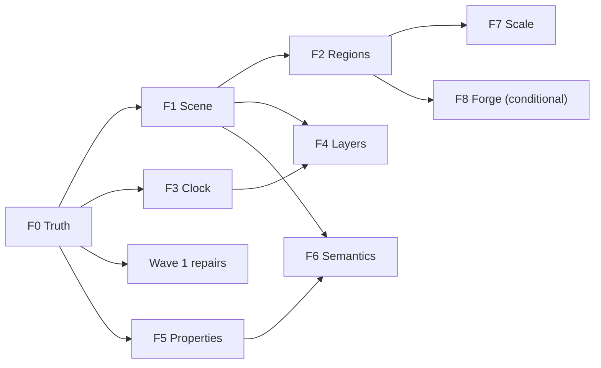

# DxUi frontier: retained scene, compositor motion and smart features, 11 November 2026

Status: SPEC READY — proposal and plan only. `FD1` was confirmed on 11 November 2026 and `FD2`, `FD3` and
`FD5`–`FD10` on 12 November 2026. `FD4` (composition by default) is not decided: the developer asked for impact
information and test evidence first (`F0.9`). No code has been implemented. Prepared at `DxUi` `0fe99c4a`.

- **Owning contracts**: [performance and resources](../../Core/Core_PerformanceAndResources.md),
  [architecture](../../Core/Core_Architecture.md), [embedded rendering](../../Rendering/Rendering_EmbeddedD3D11.md),
  [Win32 host](../../Rendering/Rendering_Win32Host.md), [controls and layout](../../UI/UI_ControlsAndLayout.md),
  [input and accessibility](../../UI/UI_InputAndAccessibility.md), [design system](../../UI/UI_DesignSystem.md),
  [validation](../../Testing/Testing_Validation.md) and [documentation](../../Core/Core_Documentation.md).
- **Coordinated plans**: [runtime efficiency](RuntimeEfficiency_2026-11-07.md) stays the evidence ledger (`E1`–`E84`)
  and item catalogue (`P`, `V`, `B`); this plan challenges it, re-orders it and names what replaces what
  ([triage](#7-triage-of-the-runtime-efficiency-plan)). [Remaining work](RemainingWork_2026-11-04.md) keeps D-P1 and
  D-Q1. [Explicit state machines](ExplicitStateMachines_2026-11-10.md) keeps `DXUI-SM-01`..`08`.

## 1. The short version

The runtime efficiency plan is a careful list of about 200 local repairs. Most of them treat symptoms of **one**
design fact that the plan never names:

> DxUi retains its control tree, but not what the tree draws. `Paint` is a procedure. Any change, anywhere,
> re-runs that procedure for every visible control, straight into Direct2D.

Three facts at `0fe99c4a` show it. `Control::Paint(ControlHost&)` is the only drawing path and every control calls
`ID2D1DeviceContext` directly (`include/DxUi/DxUi.h`, `Control`). `ControlHost::Invalidate` has one granularity, the
whole window. `Panel::Paint` paints every visible child with no culling. The measured result
([ComplexUi, 7 September](../../../Measurements/ComplexUi/2026-09-07/README.md)): a clean frame prepares in
`0.0003 ms`, a dirty frame in `1.67 ms` p95 with 54 allocations, for 83 controls, whatever changed.

This plan fixes the cause instead of the symptoms, in this order:

1. **Truth (`F0`)**: measure work, real-GPU cost and input latency, so a claim can be true or false.
2. **Scene (`F1`)**: retain each control's drawing as a Direct2D command list. A frame replays what did not change.
   No control's paint code changes.
3. **Regions (`F2`)**: with retained drawing, dirty regions, culling and partial present become small and safe.
4. **Clock (`F3`)**: one frame scheduler; zero wakes at idle; the UI thread never blocks in `Present`.
5. **Layers (`F4`)**: scrolling and transitions move pixels on the compositor instead of repainting them; real
   pointer, touch and pen input.
6. **Properties (`F5`)** and **Semantics (`F6`)**: the two mechanisms that make smart features cheap to add.
7. **Scale (`F7`)**: one virtualizer, borrowed background work, streaming documents.
8. **Forge (`F8`, conditional)**: a DxUi-owned GPU backend fed by the same command lists, only if `F0` proves
   Direct2D is the remaining ceiling.

Every move starts with a timeboxed spike and a written go/no-go number. A bold move without a kill criterion is a
rewrite; none is proposed here.

## 2. How this review was done, and its limits

- The whole [runtime efficiency plan](RuntimeEfficiency_2026-11-07.md) was read (1,425 lines).
- Three independent read-only sweeps of the source at `0fe99c4a`: the rendering/layout/scheduling architecture, a
  skeptical re-read of 16 ledger claims, and the extension surface (catalog, API style, input, diagnostics).
- Four external claims were checked against primary sources: Microsoft's DXGI flip-model documentation,
  `microsoft/terminal` at `5f7dc283`, `chromium/chromium` at `301a3f2f` and the `makepad/makepad` tree at `506ec051`.
- **Limits**: 16 claims drawn from the 84 ledger rows and 4 external claims were re-checked. Every other row and
  citation keeps the status the ledger gives it. Nothing in this plan was built or measured; all numbers marked *target* are
  proposals that `F0` must confirm or replace.

## 3. Challenge ledger

### 3.1 Against the runtime efficiency plan

| # | Challenge | Evidence | Consequence |
| --- | --- | --- | --- |
| C1 | It optimizes sites, not the cause. About 20 new per-site caches (popup effects, shadows, status text, graph bitmap, badge layouts, palette results, …), each with its own key, cap and invalidation rule. | `P1.2`, `P1.3`, `P1.9`, `P1.14`, `P4.1`, `P4.5`; root cause in §1 | `F1` replaces most of them with one mechanism |
| C2 | `E7` is backwards. The plan calls today's partial present "probably false" and designs an "asymmetric `Present1`" that repaints `dirty_N ∪ dirty_{N-1}`. Microsoft's flip-model page says the reverse: "The runtime copies only the differences between updated areas of the previous frame" onto the back buffer; the application must fully redraw only its own dirty rectangles. The existing comment in `ControlHost::Render` is consistent with that. | [DXGI flip model, dirty rectangles](https://learn.microsoft.com/en-us/windows/win32/direct3ddxgi/dxgi-1-2-presentation-improvements) | `P0.4` stays as a test; its expected result flips; `P3.3`'s history union is deleted (`F2.3`) |
| C3 | The two citations offered as proof of C2 do not say it. Terminal's `_present` clamps and passes the current dirty rectangle only; its `StartPaint` unions the *old ink extents of rows being replaced*, which is the ordinary "old bounds ∪ new bounds" rule, not buffer history. Chromium's cited file contains neither `Present1` nor `DXGI_PRESENT_PARAMETERS`. | `terminal` `AtlasEngine.r.cpp`, `AtlasEngine.cpp` at `5f7dc283`; `chromium` `skia_output_device_dcomp.cc` at `301a3f2f` | External citations are leads, not evidence (C5) |
| C4 | "Verified" in the ledger is not exact. Of 16 claims re-read, 10 hold (two with a correction) and 6 are overstated in mechanism, count or location; none is wholly false. | [Re-read results](#33-re-read-of-16-ledger-rows) | Counts in the ledger are hypotheses; several items lose their priority (§7) |
| C5 | Every Makepad Windows citation points under `platform/src/os/windows/…`. At the pinned commit `platform/src/os` contains `hal` and `web` and no `windows` directory. | GitHub tree at `506ec051` | Re-locate or drop; the waitable-credit rule stands on DXGI semantics alone |
| C6 | "Clean-room" is claimed for `BUI` (GPL) while the plan cites its files, line ranges and commits. A clean-room process separates the people who read the source from the people who design. | `B1`–`B6`, "BUI review" | `FD8`: remove BUI line-level citations; keep only ideas with an independent permissive or Microsoft source |
| C7 | Feature work is filed as efficiency: numeric scrubbing, pie menu, sweep selection, toolbar overflow, ImGui selection policies. | `B3`, `B5`, `B6`, `P5.4`, parts of `P1.7` | Moved to the feature catalogue (§6), built on behaviors (`F6.4`) |
| C8 | Counters are the only gate because timing "cannot say yes". The plan accepts that instead of fixing it. A/A controls fail because the lane is a shared hosted VM measuring a software rasterizer. | D-P1 in [remaining work](RemainingWork_2026-11-04.md); [performance guide](../../../docs/performance.md) | `F0.5`, `F0.6` |
| C9 | All performance evidence is WARP. WARP timing measures Microsoft's CPU rasterizer. No receipt exists for a real GPU, for input latency, or above 60 Hz. | `docs/performance.md` fixture description | `F0.5`, `F0.7`, budgets §4 |
| C10 | The plan is not reviewable as written: 167 KiB, single "items" that bundle 15–20 unrelated changes (`P1.12`), no ordering by payoff, no size estimate. | The plan itself | Waves of at most six items with exit criteria (§8) |
| C11 | Two proposed public breaks are unnecessary. `GetVisualOverhangDip()` (`D3.2`): a recorded command list reports its own ink bounds. `ControlLifetimeHandle` was already withdrawn. | `F1.1` | API 6 gets smaller (`FD7`) |
| C12 | Shadow work is over-engineered twice: a cache keyed by device size (`P1.2`) and a custom pixel-shader effect (`V4`). A rounded-rectangle shadow is nine-sliceable: one small blurred corner tile per `(radius, sigma, color, scale)` draws any size with zero effects. | `F1.4` | `P1.2` shadow cache and `V4` replaced |

### 3.2 Against the reference libraries

The 15 depots were mined for edge-case fixes. Their central lessons were mostly left behind.

| # | Library | What it really teaches | What the plan took | Verdict |
| --- | --- | --- | --- | --- |
| R1 | `gpui-fast` | Its own description: keep what did not change between frames. Retained *output*, not just a retained tree. | Hover freeze, chord capture, wheel clamp; "closure replay logs" rejected because DxUi "already retains its control tree" | The rejected item was the lesson. `F1` |
| R2 | `rune` | It owns renderer, text, layout and springs. Its `< 90 µs` frame floor is an own-renderer number. | The number, plus tooltips and timers | The number cannot be reached by removing Direct2D calls one site at a time. `F8` decides |
| R3 | `terminal` | AtlasEngine was written for speed: it keeps DirectWrite quality with a glyph atlas and instancing, and keeps a Direct2D backend only as a fallback. | Device flags, BiDi trivia, a misread `Present1` | Flags are right (`SINGLETHREADED`, no driver thread pool). Architecture lesson goes to `F8` |
| R4 | `makepad` | Shader-per-widget immediate layout; correctly rejected. | Waitable-credit rule, cache working sets | Rule is sound; citations do not resolve (C5) |
| R5 | `chromium` | Damage tracking, a layer tree and a compositor that animates without the main thread. | TSF lock queue, UIA details | TSF/UIA items are good. The compositor lesson is `F4` |
| R6 | `accesskit` | Build nothing until assistive technology attaches; then push *diffs*. | Property slab, lazy gate | Do the gate first; make snapshots diffable rather than special-casing "value" (`F6.1`) |
| R7 | `taffy`, `clay` | Constraint-keyed measure caches. | Monotonic cache rules | Keep, but only after counting repeat measures; much DxUi layout is explicit `SetBounds` |
| R8 | `imgui` | A stable-ID API makes UI code trivial to write. | Selection and drag details | DxUi's gap is ergonomics (`F5`), not ImGui's selection policy |
| R9 | `vscode`, `xi-editor`, `parley` | Piece-tree append buffer, cached line summaries, shaping split from breaking. | Exactly that | Agreed; kept (`F7.3`) |
| R10 | `BUI` | Nothing that a permissive source does not also show. | Six `B` items | C6 |
| R11 | *Never studied* | Flutter (repaint boundaries, raster cache), WebRender (picture caching), Qt Quick (scene graph batching), Windows composition (independent animation, DirectManipulation). These solved DxUi's exact problem: a retained tree with retained paint and a compositor. | — | Their shared shape is this plan's `F1`–`F4` |

### 3.3 Re-read of 16 ledger rows

Independent re-read at `0fe99c4a`. "Holds" means the mechanism and magnitude are as written.

| Ledger row | Result | What the code does |
| --- | --- | --- |
| `E14` device churn | Holds, one correction | An embedded-only application creates and destroys a D3D11 device, D2D factory/device and DComp device once per **root** menu session (`ReleaseSharedWindowHostAttachment`; popups attach their own HWND host). DirectWrite is the shared factory and is not recreated. |
| `E72` format cliff | Holds | Above 96 formats `TrimCaches` clears and forces full visual preparation on every painted frame. |
| `E12` ComboBox | Holds | `1 + 2V` layout passes, each measuring all `N` items with an uncached text layout. |
| `E13` popup paint | Holds for gradients and shadow passes | Blur, layer and geometry are created only for blurred non-solid materials. |
| `E64` typing never coalesces | Holds | A fresh buffer per insert; `AppendCoalesced` needs the same buffer. |
| `E69` chunks skipped | Holds | One whole-document layout whenever `lineHeightMultiplier > 0` outside Source mode. |
| `E5`, `E1`/`E2`, swap chain, DComp device | Hold | Full clear and repaint; 8 ms timer; caret `Tick` returns `true` every tick. |
| `E15` GDI capture | Holds | Synchronous, once per popup open and on DPI relayout (not per paint); skipped for solid material. |
| `E51` "4N `weak_ptr::lock`" | Overstated | No `lock`. One token copy (2 atomic updates) and about 4 `expired()` loads per child. |
| `E59` embedded UIA "every mutation, un-gated" | Overstated | `UpdateAccessibility` is called by the application, only after `AttachAccessibility`, and is deduplicated by preparation count and placement. The build itself has no client-interest gate; that part stands. |
| `E62` "15–25 document copies" | Overstated | About 6–10 per composition update; one cited range is the IMM32 commit path. |
| `E56`/`E74` `set_terminate` | Overstated | 2 sets and 1 get per **outermost** `Failure::Scope`; nested scopes do nothing. The "6N–9N per layout pass" figure does not exist. |
| `E6` invalidation | Partly | Controls invalidate the whole window, but the paint path already consumes a partial `rcPaint` and calls `Present1`. |
| `E35` control size | Partly | Callbacks are `shared_ptr<function>` (16 B each), not inline `std::function`; about 296 B, not 328 B. |

### 3.4 Against DxUi itself

| # | Challenge | Evidence at `0fe99c4a` | Move |
| --- | --- | --- | --- |
| X1 | Paint is a procedure, not data. | One `CreateCommandList` call site in the library, a transient shadow mask | `F1` |
| X2 | Invalidation has one bit. | `ControlHost::Invalidate` → `InvalidateRect(_hwnd, nullptr, FALSE)`; embedded `Prepare` clears the surface | `F2` |
| X3 | The clock polls. | 8 ms `SetTimer` whenever any subscriber exists; a focused text field keeps it alive | `F3` |
| X4 | Nothing moves without repainting. | One DComp visual per host; no DComp animation; page slides and scrolling repaint the tree each frame | `F4` |
| X5 | Input is mouse-era. | No `WM_POINTER`, no DirectManipulation; touch and pen arrive as promoted mouse messages | `F4.1` |
| X6 | "No worker" is treated as "no background work". | Decode, parse and shaping run as cooperative owner-thread slices | `F7.2` borrows a scheduler the way the host already borrows a device |
| X7 | No property, binding, command or behavior mechanism. | Imperative setters and `std::function` callbacks only; about 30 unguarded setters (`E50`) | `F5`, `F6` |
| X8 | Virtualization is bespoke per control. | `Tree`, `Grid` and the editor each implement their own | `F7.1` |
| X9 | The library cannot be observed in the field. | `EmbeddedStatistics` has seven fields; no ETW, no inspector | `F0.7`, `F6.5` |
| X10 | Evidence stops at small scale. | 83 controls, 1,000 rows | Fixtures in `F0.2` |
| X11 | The source shape slows every change. | `DxUi.Accessibility.cpp` 15,388 lines; `DxUi.Controls.cpp` 12,358; one 6,913-line public header for all 35 controls | `F5.5` |

## 4. What "best" means: budgets

"Best" is a set of numbers a rival can be measured against. *Today* is a receipt where one exists; *target* is a
proposal that `F0` confirms or replaces before any phase claims it.

| Budget | Today | Target | Proved by |
| --- | --- | --- | --- |
| B1 Idle wakes, focused text field, 10 s | about 640 (8 ms timer; ledger hypothesis) | ≤ 20 (deadlines); **0** with a compositor caret | Wake counter (`F3`) |
| B2 `Paint` executions per dirty frame (one hover change, ComplexUi) | 83, every visible control | ≤ 2, the controls that changed | Counter (`F1`) |
| B3 Dirty-frame allocations | 54 per frame | **0** in steady state | Existing allocation sink |
| B4 Dirty-frame preparation CPU, hardware | not measured (WARP: 1.67 ms p95) | work ∝ changed controls; receipt on four GPU vendors | `F0.5` |
| B5 Pixels repainted, caret blink | whole surface | caret ink bounds | Counter (`F2`) |
| B6 UI-thread frames during a page slide or fling (native composition) | every frame | **0** after the first | Counter (`F4`) |
| B7 Input to present | not measured | within one refresh interval at 60–240 Hz; UI thread never blocked in `Present` | ETW (`F0.7`, `F3`) |
| B8 UI Automation work with no client | embedded publication builds a full snapshot with no client gate | **0** | Counter (`F6.1`) |
| B9 Devices created per menu session, embedded application | 1 | **0** after the first | Counter (Wave 1) |
| B10 Plain control size, x64 Release | about 296 B plus header | ≤ 176 B | `static_assert` (`P8.1`) |
| B11 Scale | 1,000 rows, 83 controls | 1,000,000 rows; 10 MiB document; 10,000 controls, all at B2/B3 | New fixtures (`F0.2`) |
| B12 Retained memory | n/a | capped, reported, inside today's per-view caps | `EmbeddedStatistics` (`F1`) |

Every existing bound in [performance and resources](../../Core/Core_PerformanceAndResources.md) stays. Where a move
needs a contract amendment it is named in [decisions](#9-decisions).

## 5. Architecture: nine moves

### F0 — Truth

- [ ] **F0.1 Work counters.** `P0.1` as written, minus the lint: private thread-local counters behind counted creation
  helpers, a tooling test that forbids raw `->Create*` calls outside them, per-frame `churn`.
- [ ] **F0.2 Scenarios.** Start with eight: `S1` idle caret, `S3` ComboBox, `S5` Grid wheel, `S10` menu, `S12`
  ComplexUi, `S17` UIA clients, `S18` IME, `S19` rich typing. Add three scale fixtures: a 1,000,000-row `Grid`, a
  10 MiB Markdown document, a 10,000-control form. Other `S` scenarios are written when their item starts.
- [ ] **F0.3 Oracle.** `P0.3` unchanged: incremental against fresh, exact BGRA on WARP, bounds and UIA snapshot.
  It is the best idea in the runtime efficiency plan and every move below depends on it.
- [ ] **F0.4 Swap-chain truth.** `P0.4`, expected result reversed (C2): present full, then partial A, then partial B;
  read back; prove the runtime keeps non-dirty pixels current. Run on WARP **and** one hardware adapter, in both
  `HwndSwapChain` and `CompositionSwapChain` modes. Record the result in
  [Win32 host](../../Rendering/Rendering_Win32Host.md).
- [ ] **F0.5 Attribution on real GPUs.** A local, advisory run of the ComplexUi dirty loop for at least 10 s with ETW
  CPU sampling, split by module: DxUi, `d2d1`, `dwrite`, `d3d11` plus driver, other. Add D3D11 timestamp queries
  for GPU time. Receipt under `Measurements/Frontier_2026-11-11/attribution.json` with adapter and driver identity.
  **This single receipt orders `F1` against `F8`.**
- [ ] **F0.6 Timing that can say yes (input to D-P1; ownership stays there).** Two candidates, each judged by its
  own A/A spread: (a) `QueryThreadCycleTime` minimum-of-N on a quiet local machine; (b) instruction counts for the
  DxUi module under a dynamic instrumentation tool. Adopt one as a gate only if its A/A spread stays under 1% across
  five sessions. Until then counters gate and timing advises, as today.
- [ ] **F0.7 ETW provider.** One TraceLogging provider, dormant unless a session enables it: input received, frame
  requested (with reason), prepare begin/end, present, wake source. This is the only honest way to measure input
  to present, and it lets a consumer diagnose a field problem without a debugger.
- [ ] **F0.8 Evidence anchors.** A tooling test resolves every source anchor in WIP plans against `HEAD`. Anchors
  name a file and a symbol, not a line number. External citations carry `(repository, commit, path)` and a
  `verified` flag; unverified ones may motivate an item but may not be its only justification.
- [ ] **F0.9 Presentation-mode comparison (evidence for `FD4`).** Run one fixture (ComplexUi plus a text-heavy page)
  in `HwndSwapChain` and in `CompositionSwapChain`, on WARP and on one hardware adapter, and record what a consumer
  relying on the default would see change:
  - *Pixels.* Composition mode renders to a premultiplied-alpha target cleared to transparent; HWND mode renders to
    an opaque target cleared to the window background. Read both back: text antialiasing mode actually used,
    edge pixels of rounded shapes, and any area left transparent.
  - *Cost.* Dirty-frame CPU by module (`F0.5`), GPU time, input to present (`F0.7`), private bytes and video memory
    (`IDXGIAdapter3::QueryVideoMemoryInfo`), each paired on the same machine.
  - *Behavior.* Interactive resize (gaps, stretching, frames presented), occlusion and minimize, device loss, a
    monitor move across a DPI change, a remote session, and a host with a child `HWND`.
  - *Scope.* List every host a consumer creates without naming a mode; the default change reaches exactly those.

  Receipt under `Measurements/Frontier_2026-11-11/presentation-mode.json` with a short written summary of the
  differences. Counters and read-back decide; timing advises, under the D-P1 rules.

**Exit**: baseline receipts for the eight scenarios and three scale fixtures; `F0.4` result recorded; `F0.5` receipt
from at least one hardware adapter.

### F1 — Scene: retain what each control draws

**Idea.** Direct2D already has a retained drawing object: `ID2D1CommandList`. Record a control's `Paint` into one,
keep it, and replay it with `DrawImage` until the control's visual state changes. Controls keep painting exactly as
they do today; the host decides whether to call them.

**Why command lists.** One Windows-native object gives five things the plan otherwise builds by hand:

1. Retention: unchanged controls cost one replay call, no control code, no text layout, no geometry creation.
2. Ink bounds: `GetImageLocalBounds` reports what was actually drawn, including shadows and focus rings (C11).
3. A hashable stream: `ID2D1CommandList::Stream` replays into any `ID2D1CommandSink`. A hashing sink turns a
   control's drawing into a 64-bit value, so "did the drawing change" is answerable without pixels or a GPU.
4. A capture format: the same sink can serialize a frame for bug reports and the inspector (`F6.5`).
5. A backend seam: a sink can translate the stream into anything, including a DxUi-owned GPU renderer (`F8`).

- [ ] **F1.0 Spike (timebox: one week).** Private flag; retain `Label`, `Button` and `CardPanel` only; run ComplexUi.
  - **Go** if all hold: `Paint` executions per dirty frame equal changed controls; oracle shows 0 BGRA differences at
    96/144/192 DPI; on hardware, replaying a retained control costs at most half the CPU of painting it; text
    position is identical after whole-pixel translation.
  - **No-go** if replay is not cheaper or text snaps differently: fall back to `F1.3` bitmaps for expensive controls
    only, and bring `F8` forward.
- [ ] **F1.1 Retention mechanism.**
  - `Control` gains a private `uint32_t` paint revision, advanced by `InvalidateVisual()`.
  - The host keeps a side table (not in `Control`, so `P8.1` sizes hold): `{command list, ink bounds, paint revision,
    resource epoch}` per retained control. The resource epoch covers theme, DPI, device generation, font generation
    and text rendering parameters.
  - Recording happens in the **preparation** stage on a host-owned recording device context. The render stage only
    replays. This matches the existing "preparation and composition are separate contracts" rule.
  - `PaintRetention { Auto, None }`. Library controls default to `Auto`. **Consumer-derived controls default to
    `None`**, because their `Paint` may read state DxUi cannot see; they opt in. No source break.
  - Scrolling translates replay; whole-pixel translation never re-records.
- [ ] **F1.2 Parts for large self-painting controls.** `host.PaintPart(owner, key, revision, fn)` memoizes a slice of
  one control: `MenuPopup` chrome and each row, the `ComboBox` popup, `Grid` header and each visible row, `Tree`
  rows, `TabControl` headers, `StatusStrip` segments. Parts are bounded to visible rows plus one viewport of overscan
  and evicted by frame stamp.
- [ ] **F1.3 Raster promotion.** A retained control or part that contains effect operations (shadow, blur) and stays
  unchanged for three frames is rasterized once into an atlas tile. This is decision `D4` generalized, with its
  limits: 16 MiB inside the 64 MiB per-view cap, demotion on change, eviction under pressure.
- [ ] **F1.4 Nine-slice shadows.** One blurred corner tile per `(corner radius, sigma, color, scale)` in a small
  host atlas; any rectangle draws as nine bitmap pieces. Falls back to the effect only when the rectangle is smaller
  than twice the blur reach. Zero effects, command lists or intermediate surfaces per steady frame.
- [ ] **F1.5 Paranoid verifier (Debug and ASan Debug).** Every Nth frame, re-record retained controls and compare
  stream hashes. A mismatch means a control's `Paint` read state that nothing invalidated; it fails the test with
  the control kind and the differing operation. This is how missing invalidations are found before users see them.

**Replaces or shrinks**: `P1.2` (effect, gradient and shadow retention), `P1.3` paint churn, `P1.14` control
rendering, `P3.4`, static-text half of `P4.1`, `V4`, `V7` (a connected animation is two retained lists).

**Gates (`S12`, `S10`, `S3`)**: B2 and B3 met; creations of layouts, effects, geometries and brushes for untouched
controls **0**; oracle 0 differences; verifier 0 mismatches across the Controls and Embedded suites; retained
operations and tile bytes reported in `EmbeddedStatistics`.

**Contract**: a new bound in performance and resources for retained operations per view (`FD3`).

### F2 — Regions

Small, because `F1` supplies bounds and replay.

- [ ] **F2.1 Region invalidation.** `InvalidateVisual()` adds the control's previous ink bounds and, after
  re-recording, its new ink bounds to an 8-rectangle device-snapped region. It collapses to full above 50% coverage
  and on topology, theme, DPI, size or device change. `RequestInvalidate()` keeps meaning "everything".
- [ ] **F2.2 Embedded partial preparation.** The embedded surface is already retained between preparations. Clip to
  the region, clear to transparent premultiplied zero, replay the lists that intersect.
- [ ] **F2.3 Native partial present.** Pass the region to `InvalidateRect`; the existing partial path already clips
  and calls `Present1`. Add only: clamp to the back buffer, skip empty rectangles, fall back to a full `Present` on
  `E_INVALIDARG`. No history union (C2), unless `F0.4` proves otherwise on a tested adapter.
- [ ] **F2.4 Culling.** The replay loop skips lists whose ink bounds miss the clip. Children outside a `ScrollPanel`
  viewport are neither recorded nor replayed until first visible.

**Replaces**: `P3.1`–`P3.4`. **Gates**: B5; child replays per scrolled frame bounded by visible children plus one row;
oracle 0 differences after every partial frame; `F0.4` readback after every partial present.

### F3 — Clock

- [ ] **F3.1 One frame scheduler per host.** Three requests: `Continuous`, `Deadline(tick)`, `Once`. The 8 ms timer
  goes away. Deadlines arm one coalescable timer for the earliest due time. A deadline wake runs `Tick` and renders
  only if something invalidated. Hidden, minimized or detached hosts hold expired deadlines without firing.
  (`P2.1`, with central scrubbing on detach kept.)
- [ ] **F3.2 Clients.** Shared caret clock honoring `GetCaretBlinkTime`, caret timeout and reduced motion (`P2.2`);
  tooltip deadlines (`P2.3`, state machine owned by `DXUI-SM`); hover freeze (`P2.5`); unseen motion lands instantly
  (`P2.6`).
- [ ] **F3.3 Embedded request API.** `EmbeddedAnimationRequest { None | Continuous | Deadline, dueTickMs }` replaces
  `NeedsAnimation()`/`AdvanceAnimation()` (`P2.4`; API 6).
- [ ] **F3.4 Native pacing without an owned thread.** Waitable swap chain at frame latency 1. The wait is a
  **thread-pool wait** on the swap chain's handle that posts one frame message; DxUi starts no thread and polls
  nothing. Rules: render and present only after the handle signals, so the UI thread never blocks inside `Present`;
  never wait again while a signalled credit is unspent (a tick that skips `Present` keeps its credit); fall back to a
  one-shot timer at the refresh period when occluded or when wakes arrive under 1 ms apart.
- [ ] **F3.5 Input.** Pointer moves coalesce to one per frame. A frame requested by input presents at the next
  vertical blank. Animations sample at predicted presentation time with the jitter filter from `P2.7`.

**Replaces**: `P2.1`–`P2.7`, `D5` (thread-pool wait instead of a pacer thread). **Gates**: B1; **0** scheduler wakes
with nothing armed; ten consecutive ticks that skip `Present` complete without deadlock; B7 receipt from `F0.7`.

### F4 — Layers: move pixels instead of repainting them

Native composition mode first. Embedded hosts gain nothing here by default: with `F1`, a scrolled embedded frame is a
replay, and the application owns composition.

- [ ] **F4.1 Pointer input.** Handle `WM_POINTER` for touch and pen (mouse stays on mouse messages): contact
  identity, pen pressure and tilt, palm rejection flags. `EmbeddedHost::DispatchPointer` carries pointer identity
  and kind. Chord capture and stationary-move fixes from `P1.12` land here.
- [ ] **F4.2 Layer abstraction.** Private `Layer { content, offset, opacity, clip }`. Native: a DirectComposition
  visual with its own surface; scroll content uses a virtual surface updated sparsely and trimmed to the viewport
  plus overscan. Create the DComp device without a rendering device so the visual tree survives device removal
  (`P1.12`, `E73`).
- [ ] **F4.3 Independent scrolling.** DirectManipulation viewports for `ScrollPanel`, `Grid`, `Tree` and the editor
  drive the layer offset on the compositor: pan, inertia, rails and overscroll continue while the UI thread is busy.
  The UI thread receives viewport updates and records content ahead of the scroll. Keyboard, wheel and UIA scrolling
  go through the same viewport. Fallback everywhere else: UI-thread fling with the `V6` math.
- [ ] **F4.4 Compositor animations.** A spring (`V1`) is sampled once into cubic segments and handed to the
  compositor for layer offset and opacity: `PageHost` slide and fade, popup open and close, connected animation
  (source and target are retained lists from `F1`), indeterminate progress. The UI thread draws the first frame and
  the last; B6. Optional showcase: the caret as a one-pixel layer with a repeating opacity animation, B1 = 0.
- [ ] **F4.5 Materials.** `V5` as written: system transient backdrop for popup windows, shared blur pyramid for
  in-window overlays, solid fallback. Retire the GDI capture (`D7`).

**Replaces**: `V5`, `V6`, `V7`, DirectManipulation line of `P2.7`. **Gates**: B6; touch pan without mouse promotion;
UIA scroll pattern and keyboard parity; layer memory reported and capped. **Kill**: if layer memory for ComplexUi
exceeds 32 MiB, or DirectManipulation cannot reach UIA and keyboard parity, `F4.3` stays opt-in per scroller.

### F5 — Properties: one way to change a control

Today each setter decides by hand whether to compare, invalidate, re-measure or notify accessibility. About 30 forget
the comparison and one forgets the invalidation (`E50`).

- [ ] **F5.1 `Assign`.** One private helper:
  `bool Control::Assign(T& field, T&& value, Affects affects)` with
  `Affects { Paint, Layout, Hit, SemanticName, SemanticValue, SemanticState }`. It returns `false` when the value is
  equal; otherwise it stores and routes: `Paint` → `InvalidateVisual()` (`F2.1`), `Layout` → `InvalidateMeasure()`,
  `Semantic*` → the matching accessibility mutation (which is how `P1.6`'s value-only update becomes general).
  A tooling test requires every public `Set*` under `src/Controls` to go through `Assign` or sit on an allow list.
- [ ] **F5.2 Animated assignment.** `AssignAnimated(field, target, MotionToken)` runs a `MotionValue` spring (`V1`)
  with velocity-preserving retarget; colors interpolate in OKLab (`V2`); reduced motion lands instantly. Properties
  that map to layer offset or opacity are handed to the compositor (`F4.4`).
- [ ] **F5.3 `State<T>` and `Bind` (additive API).** A small observable value. `Bind(control, &Label::SetText,
  state)` subscribes with the control's lifetime token. Notifications coalesce to the start of the next frame: many
  model changes, one layout, one paint.
- [ ] **F5.4 Property metadata.** One declaration list per control kind (name, type, getter, setter, `Affects`). It
  feeds a single generic test (set every property of every catalog control to its current value: **0**
  invalidations), the inspector's live editing, gallery knobs and the property tables in `docs/controls.md`.
- [ ] **F5.5 Source shape.** Split `DxUi.h` into one header per control under `include/DxUi/Controls/` with `DxUi.h`
  as the umbrella include (source compatible). Split `DxUi.Controls.cpp` and `DxUi.Accessibility.cpp` along the
  same lines when a control is next touched. No behavior change; build-time and review-time efficiency.

**Replaces**: setter guards in `P1.14`, value mutation in `P1.6`, migration list in `P3.1`. **Gates**: no-op setter
invalidations **0** for every catalog control; spring continuity and settle tests; **0** frames after settle.

### F6 — Semantics: one tree, many readers

DxUi already computes a full semantic description of the UI for UI Automation: role, name, value, state, bounds,
actions. Today one reader uses it. Make it a platform.

- [ ] **F6.1 Lazy and diffable.** Build nothing until a provider is requested or a client listens (`P1.6` gate, B8).
  Give each node a generation so publication sends differences; "value changed" is then the smallest difference, not
  a special case. Slim the node record afterwards (`P7.3`).
- [ ] **F6.2 Read API (additive, opt-in).** `Semantics::Snapshot()` returns immutable nodes with stable identifiers.
  `Query(role, name)` and `Invoke(node, action)` run through the same paths UI Automation uses. Tests use it
  ("find the Save button, invoke it") instead of coordinates. The application decides whether anything outside the
  process may see it.
- [ ] **F6.3 Commands.** `CommandRegistry`: identifier, title, accelerator, enabled query, invoke. `MenuBar`,
  `Toolbar`, context menus and accelerators bind to commands instead of raw integers and display-only shortcut text.
- [ ] **F6.4 Behaviors.** `Control::AddBehavior(std::unique_ptr<Behavior>)`, stored in the cold sidecar from `P8.1`
  so a control without behaviors pays one bit test. A behavior sees pointer, key, tick and overlay-paint hooks.
  Scrubbing (`B3`), drag reorder, sweep selection (`B6`), typeahead and validation become behaviors, not edits to
  35 controls.
- [ ] **F6.5 Inspector and capture.** An opt-in overlay built from the semantic tree, property metadata (`F5.4`) and
  the scene (`F1`): tree and bounds, live property editing, dirty-region flashing, layer borders, retained memory,
  frame timeline. "Capture frame" writes the serialized command stream; the gallery replays a capture offline.

**Gates**: B8; every catalog control reachable and invokable through `Query`/`Invoke` in a generic test; inspector
adds **0** work when closed.

### F7 — Scale

- [ ] **F7.1 One virtualizer.** A private primitive used by `Grid`, `Tree`, menu and ComboBox popups and future
  lists: prefix-sum height tree, sparse custom extents, recycled parts (`F1.2`), overscan, scroll anchoring when
  content above the viewport changes. Wheel and flick deltas resolve to a position before any row is instantiated.
  Gate: the 1,000,000-row fixture meets B2/B3 with memory independent of row count.
- [ ] **F7.2 Borrowed scheduler.** `IWorkScheduler`, supplied by the application exactly as the device is. Default is
  today's cooperative owner-thread slicing. When supplied: image decode, Markdown parse, text preparation and spell
  checking run off the UI thread and publish at frame start. DxUi still owns no thread (`FD5`).
- [ ] **F7.3 Documents.** Kept from the runtime efficiency plan: append buffer and flatten removal (`P6.1`), chunk
  activation and translation (`P6.2`), content-keyed carry of math, diagrams and tables (`P6.1`), lazy math font
  data (`P6.5`). **Promoted**: incremental block reparse (`P6.3`) becomes required, because streaming needs it.
- [ ] **F7.4 Asynchronous models.** `IGridModel` and `ITreeModel` may answer "not yet" for a range; the control draws
  placeholders and re-requests on arrival.

### F8 — Forge (conditional): a DxUi-owned GPU backend

**Entry condition**: after `F1` and `F2`, the `F0.5` receipt on hardware still attributes at least half of dirty-frame
CPU to `d2d1` and `dwrite`. If not, `F8` is closed unbuilt.

**Design.** Controls keep authoring with Direct2D. The retained command lists are the intermediate form. A
translating `ID2D1CommandSink` turns the stream into instanced draws on D3D11: rectangles, rounded rectangles,
borders and shadows as signed-distance quads; text as instances from an atlas rasterized by DirectWrite, so glyph
quality and color fonts are unchanged; images as textured quads. Anything the translator does not recognize is
rasterized by Direct2D into an atlas tile and drawn as a quad. The whole UI becomes a handful of draw calls.

- [ ] **F8.0 Spike (timebox: two weeks)**: rectangles, rounded rectangles and DirectWrite-rasterized Latin text for
  ComplexUi. **Go** only with at least a 3× drop in hardware CPU per dirty frame and a gallery review that accepts
  the antialiasing differences. Exact BGRA parity with Direct2D is not expected and not claimed; this is a `V`-class
  visual change.
- **Contract**: drawing on a borrowed D3D11 context needs an explicit state set-and-restore rule in
  [embedded rendering](../../Rendering/Rendering_EmbeddedD3D11.md) (`FD9`).

## 6. Smart features, built on the mechanisms

Each feature names the mechanism it stands on. None edits control internals.

| # | Feature | What the user gets | Stands on |
| --- | --- | --- | --- |
| K1 | Command palette | One searchable list of everything the application can do, with shortcuts | `F6.3`, `F6.2` |
| K2 | Find in UI | Search all visible and collapsed text; reveal by expanding, switching tab and scrolling | `F6.2` |
| K3 | Automation interface | Structured tree plus actions for tests and, where the application allows, software agents; no screenshots or coordinates | `F6.2` |
| K4 | Inspector and frame capture | See why a frame was drawn; attach a capture to a bug | `F6.5`, `F1` |
| K5 | Streaming rich view | Append Markdown, math, code and diagrams at token rate; stays pinned to the bottom; code coloring stable mid-stream | `F7.3`, `F7.1`, `F1.2` |
| K6 | Inline suggestions | Ghost text and a completion list in `TextField` and the editor; the application supplies suggestions, DxUi handles drawing, keys, IME safety and announcements | `F6.4`, `F7.2` |
| K7 | Spelling and grammar | Squiggles through the existing annotation kinds, checked off the UI thread | `F7.2` |
| K8 | Layout transitions | When layout moves a control, it glides there; no per-frame relayout | `F5.2`, `F4.4` |
| K9 | Overflow intelligence | Tooltip appears only when text is actually elided; toolbars shed low-priority items with hysteresis (`P5.4`) | `F1` ink bounds, `F6.4` |
| K10 | Adaptive quality | Remote session, battery saver, low video memory or reduced motion select a quality tier: no blur, nine-slice shadows only, instant motion, dirty rectangles on | `F0.7` signals, `F1.4`, `F3` |
| K11 | Theme from a seed color | One color yields a full palette with contrast proved at build time | Existing OKLab ramps, `F5.2` |
| K12 | Gestures as behaviors | Numeric scrubbing, drag reorder, sweep selection, radial menu | `F6.4`, `F4.1` |

K5 is the positioning bet. DxUi already renders Markdown, native math and eight Mermaid diagram families
([capabilities](../../../capabilities.json)). That combination is rare in a native Windows toolkit. Making it stream
aims DxUi at being the fastest native surface for generated content.

## 7. Triage of the runtime efficiency plan

| Items | Disposition | Reason |
| --- | --- | --- |
| `P0.1`, `P0.3`, `P0.4` | **Keep** as `F0.1`, `F0.3`, `F0.4` | `P0.4` with reversed expectation (C2) |
| `P0.2` | **Shrink** to `F0.2` | Eight scenarios plus three scale fixtures first |
| `P1.1` ComboBox, `P1.4` multiline layout reuse | **Wave 1** | Algorithmic; not helped by retention |
| `P1.2` shared device lease and device flags | **Wave 1** | `E14` holds; B9 |
| `P1.2` effect, gradient, shadow retention | **Replaced** by `F1.2`, `F1.4` | C1, C12 |
| `P1.3` | **Split** | Secure-clear and composition copies: Wave 1. Paint churn: `F1` |
| `P1.5`, `P1.6`, `P7.1` | **Wave 1** as `F6.1` gate | B8. Rewrite the `E59` claim first (§3.3) |
| `P1.6` six UIA lifetime fixes | **Wave 1** | Correctness |
| `P1.7` selection epoch, navigation allocations, `Tree` copies | **Wave 1** | Algorithmic |
| `P1.7` ImGui selection policies, reorder slide | **Move** to K12 | C7 |
| `P1.8` `O(N²)` validations | **Wave 1** | Algorithmic |
| `P1.8` `Failure::Scope` hoist; `P1.12` `set_terminate` rewrite | **Drop** | Premise overstated (§3.3) |
| `P1.8` child lifetime traffic | **Lower** | 2 atomic updates per child, not 4 locks; re-measure after `F1` |
| `P1.9`, `P1.10`, `P1.11`, `P1.13` | **Keep**, after `F1` | Re-baseline first: retention removes the per-paint parts |
| `P1.12` device-loss retry, `Present1` clamp, chord capture, wheel clamp | **Wave 1** | Correctness |
| `P1.12` DComp device, modal resize, FIFO deferral | **With `F4.2`** | Same code |
| `P1.14` | **Replaced** by `F1`, `F5.1` | Local fixes only where a control opts out of retention (`ThroughputGraph`) |
| `P1.15` TSF and IME | **Wave 1** | Correctness and input cost; rewrite the `E62` count first |
| `P2.1`–`P2.7`, `D5` | **Restructured** as `F3` | Thread-pool wait instead of an owned thread |
| `P3.1`–`P3.4`, `D3.2` | **Replaced** by `F2` | No overhang virtual (C11) |
| `P4.1` shaped-run cache | **Defer** behind `F1` | Retained lists already hold glyph runs for static text; measure what is left |
| `P4.2`, `P4.3`, `P4.5`, `P4.6` | **Keep** | `P4.5` format cliff (`E72`) moves to Wave 1 |
| `P4.4` proved numeric table | **Drop** | A run cache keyed by the digits covers it without a per-font proof |
| `P5.1`–`P5.3` | **Keep, measure first** | As the plan itself says |
| `P5.4` | **Move** to K9 | C7 |
| `P6.1`, `P6.2`, `P6.5` | **Keep** as `F7.3` | |
| `P6.3` | **Promote** | Required by K5 |
| `P6.4`, `P7.2`, `P7.3`, `P7.5` | **Keep** | `P7.3` after `F6.1` |
| `P7.4` | **Replaced** by `F6.1` diffs | |
| `P8.1`–`P8.3` | **Keep** | `P8.1` cold sidecar also hosts behaviors |
| `V1`, `V2` | **Keep** as `F5.2` | |
| `V3`, `V8`, `B2` | **Keep** | |
| `V4` | **Replaced** by `F1.4`; analytic form only in `F8` | C12 |
| `V5`, `V6`, `V7` | **Restructured** as `F4` | |
| `B1` media clock and decode | **Keep**, sourced from Makepad and Microsoft documentation only | C6 |
| `B3`, `B5`, `B6` | **Move** to K12 | C7 |
| `B4` curve text | **Drop** | Superseded by `F8`; Makepad's own results argue against it |
| `D4` strip cache | **Generalized** as `F1.3` | |

## 8. Sequencing

Waves 2 to 5 overlap where they touch different files. Each wave closes on its exit line, not on a date.

| Wave | Content | Exit |
| --- | --- | --- |
| 0 Truth | `F0.1`–`F0.9` | Baseline receipts; `F0.4` recorded; hardware attribution receipt; `F0.9` receipt for `FD4` |
| 1 Repairs | Shared device lease and flags (B9); UIA client gate and lifetime fixes (B8); ComboBox layout; TSF/IME copies and compliance; device-loss retry and `Present1` clamp; format-cache cliff; selection and navigation allocations; `F5.1` `Assign` | Each item's counter gate; no API change |
| 2 Scene | `F1.0` spike → `F1.1`–`F1.5`, then `F2.1`–`F2.4` | B2, B3, B5; verifier clean |
| 3 Clock | `F3.1`–`F3.5`; API 6 lands here (`FD7`) | B1, B7 receipt |
| 4 Layers | `F4.1`–`F4.5`, `F5.2` | B6; touch and pen receipt |
| 5 Platform | `F6.1`–`F6.5`, `F5.3`–`F5.5`, `F7.1`–`F7.4`; features K1–K12 in the order `FD10` sets | B8, B11; per-feature gates |
| 6 Forge | `F8.0` spike, only if its entry condition holds | 3× hardware CPU drop or closed unbuilt |

## 9. Decisions

Confirmed on 11 November 2026:

- [x] **FD1. Relationship.** The two plans stay separate. This plan orders the work; the runtime efficiency plan
  remains the ledger and item catalogue, read through the triage in §7. Where the two disagree on order, priority
  or disposition, §7 decides; the ledger's `E` rows and item text are corrected there only when an item starts.

Confirmed on 12 November 2026, each as proposed:

- [x] **FD2. Retained scene.** Adopt Direct2D command lists as the retention mechanism, subject to the `F1.0` go
  criteria. Library controls opt in by default; consumer controls opt in explicitly. If the spike meets its
  criteria, migration starts without a further decision.
- [x] **FD3. Retention bound.** Add a per-view cap on retained operations and tile bytes to
  [performance and resources](../../Core/Core_PerformanceAndResources.md), inside today's 64 MiB surface cap.
- [x] **FD5. Borrowed scheduler.** Amend "owns no worker" to "owns no worker; may borrow an application-supplied
  scheduler" (`F7.2`). Default behavior unchanged.
- [x] **FD6. Pointer scope.** `WM_POINTER`, pen data and DirectManipulation in native hosts; pointer identity in the
  embedded dispatch API (`F4.1`, `F4.3`).
- [x] **FD7. API 6 content (revises `D3`).** In: embedded animation request; pointer identity in embedded dispatch;
  `PaintRetention`. Out: `GetVisualOverhangDip()`. Additive and revision-neutral: `State<T>`, `Bind`, `Semantics`,
  `CommandRegistry`, behaviors. The composition default is in only if `FD4` is later confirmed.
- [x] **FD8. BUI.** Remove BUI file, line and commit citations from the specifications; keep a `B` item only where a
  permissive or Microsoft source independently supports it.
- [x] **FD9. Forge.** Authorize the `F8.0` spike if and only if its entry condition is met, with the borrowed-context
  state rule drafted first. Otherwise `F8` is closed unbuilt.
- [x] **FD10. Feature order.** K4 inspector, K5 streaming view, K1 command palette, K3 automation, then the rest. K4
  first because it shortens every later item.

Not decided:

- [ ] **FD4. Composition by default.** Proposal: make `CompositionSwapChain` the default native presentation mode in
  API 6 so layers (`F4`) are available without configuration, with `HwndSwapChain` still selectable. On 12 November
  2026 the developer asked for impact information and test evidence before deciding. `F0.9` produces it. Until then
  the default stays `HwndSwapChain`, `F4` layers require the mode to be selected explicitly, and API 6 does not
  change the default.

## 10. Risks

| Risk | Mitigation |
| --- | --- |
| Command-list replay is not cheaper than painting, or text snaps differently | `F1.0` go/no-go before any migration; fallback to `F1.3` tiles and `F8` |
| A control's `Paint` reads state that nothing invalidates, so a retained drawing goes stale | `F1.5` verifier in Debug and ASan Debug; oracle; consumer controls opt in |
| Command lists reference bitmaps, not copies; an in-place bitmap update changes old recordings | Treat bitmap content revision as part of the resource epoch; verifier covers it |
| Retained memory grows without a number | Cap in operations and tile bytes (`FD3`), reported in `EmbeddedStatistics`, trimmed at preparation start only |
| Partial present shows stale pixels on some adapter | `F0.4` on WARP and hardware in both presentation modes; full-present fallback stays |
| DirectManipulation breaks keyboard, wheel or UIA scrolling parity | One viewport model for all inputs; parity gate; per-scroller opt-in on failure |
| A thread-pool wait races host teardown | Close the wait and drain callbacks before releasing the swap chain; detach fuzz under ASan |
| `Assign` routes an invalidation class wrongly | `F5.4` generic property test; oracle |
| The semantic read API exposes content the application considers private | Opt-in per host; in-process only unless the application bridges it |
| `F8` antialiasing differs from Direct2D | Visual-change review, not parity; Direct2D stays the fallback and the test reference |
| Two plans drift apart | §7 is the single mapping; `FD1` settles ownership; `F0.8` checks anchors |

## 11. Closeout

1. Every accepted item is ticked with its commit, counter receipt under `Measurements/Frontier_2026-11-11/` and tests.
2. Budgets B1–B12 each have a receipt or a recorded decision to change the target.
3. `validate.ps1`, `format.ps1 -Check` and `Tools/Test-Changelog.ps1` are green; `test.ps1` passes in x64 Debug,
   Release and ASan Debug; all three ARM64 configurations build. Focus-taking suites run only with the developer's
   agreement to the time.
4. Normative behavior moves into the owning contracts; `docs/`, the design system, the gallery and
   `capabilities.json` are updated; the plan moves to `Specs/Plans/Done/`. Consumer adoption of API 6 is never closed
   here.
