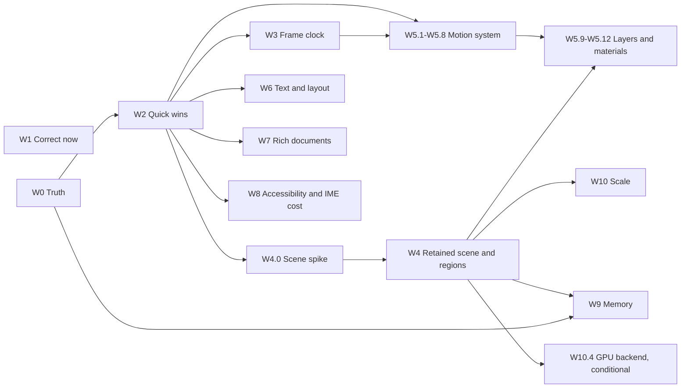

# Performance and motion plan: speed, frame rate, memory and animation, 13 November 2026

Status: SPEC READY — plan only; no code has been implemented. This is the single plan for making DxUi faster, raising
its frame rate, lowering its memory use and animating every interactive change. It replaces three documents, now
archived as records: the [runtime efficiency study](../Done/RuntimeEfficiency_2026-11-07.md), its
[challenge review](../Done/RuntimeEfficiencyReview_2026-11-12.md) and the
[frontier plan](../Done/Frontier_2026-11-11.md). It carries what survived them and nothing else: every item below is
work we intend to do, stated with the assumption it rests on. Prepared at `DxUi` `e9258f82`; `src` and `include` are
unchanged since `4acabe0e`, the commit the evidence was read at.

- **Owning contracts**: [performance and resources](../../Core/Core_PerformanceAndResources.md),
  [architecture](../../Core/Core_Architecture.md), [failure handling](../../Core/Core_FailureHandling.md),
  [controls and layout](../../UI/UI_ControlsAndLayout.md), [theme and typography](../../UI/UI_ThemeAndTypography.md),
  [input and accessibility](../../UI/UI_InputAndAccessibility.md), [design system](../../UI/UI_DesignSystem.md),
  [embedded rendering](../../Rendering/Rendering_EmbeddedD3D11.md), [Win32 host](../../Rendering/Rendering_Win32Host.md),
  [toolchain and consumption](../../Build/Build_ToolchainAndConsumption.md),
  [validation](../../Testing/Testing_Validation.md) and [documentation](../../Core/Core_Documentation.md).
- **Coordinated plans**: [remaining work](RemainingWork_2026-11-04.md) owns D-P1 (the timing policy) and D-Q1
  (platform and consumer acceptance); `W0.2` is input to D-P1, not a replacement.
  [Explicit state machines](ExplicitStateMachines_2026-11-10.md) owns `DXUI-SM-01`..`DXUI-SM-08`; `W3.1`, `W3.3` and
  `W2.5` coordinate with it and never redefine its machines. This plan never weakens an accepted bound in
  [performance and resources](../../Core/Core_PerformanceAndResources.md).
- **Reading order**: [§1](#1-goals-and-budgets) says what "better" means in numbers;
  [§2](#2-assumptions) lists what the plan takes as given; [§3](#3-where-the-time-and-memory-go-today) is the evidence;
  [§4](#4-order-of-work) is the order; the waves `W0`–`W10` are the work.

## 1. Goals and budgets

| Goal | What it means here | Budgets |
| --- | --- | --- |
| Better speed | Work proportional to what changed: a keystroke, a hover or a value change touches the controls and bytes involved, not the tree, the document or the window. | `G2`, `G3`, `G4`, `G11`, `G12` |
| Higher frame rate | Full frames fit a 120 Hz interval at 4K, scrolling and transitions do not miss frames, and nothing wakes when nothing changes. | `G1`, `G5`, `G6`, `G7`, `G8`, `G15` |
| Lower memory | Every large line has a number: surfaces and video memory, retained text and scenes, histories, snapshots, control objects. | `G13` |
| Better animation everywhere | One motion system; every interactive state change animates through it, at the display rate, identically at any refresh rate, and in native hosts independently of a busy UI thread. | `G7`, `G14` |

A budget is a target until a `W0` receipt confirms or replaces it (`A7`). "Today" is a receipt or a count read from
source; "not measured" means exactly that.

| ID | Budget | Today | Target | Proved by |
| --- | --- | --- | --- | --- |
| `G1` | Wakes in 10 s, focused text field | about 640 (8 ms timer; inferred) | ≤ 20; **0** with nothing armed | Wake counter on `FX1`, `FX13` (`W3`) |
| `G2` | `Paint` executions per dirty frame, one hover change | 83, every visible control | ≤ 2 | Counter on `FX5` (`W4`) |
| `G3` | Allocations per dirty frame | 54 | **0** | Allocation counter on `FX5` (`W2`, `W4`) |
| `G4` | UI-thread CPU for a micro-change frame (caret, hover, one value) at 4K, 192 DPI, hardware | not measured | ≤ 1 ms | Thread cycle time on `FX12` (`W0.2`, `W4`) |
| `G5` | Full repaint of a 2,000-control screen at 4K, hardware | not measured | ≤ 4 ms CPU, GPU time below CPU time | `W0.7` receipt on `FX12` |
| `G6` | Missed frames, 100,000-row `Grid` scrolled for 10 s at 120 Hz | not measured | **0** | Presented-frame trace on `FX9` (`W0.8`, `W4.9`, `W5`) |
| `G7` | UI-thread frames during a page slide or fling in composition mode | every frame | **0** after the first | Counter on `FX11` (`W5.11`) |
| `G8` | Input to present | not measured | within one refresh interval at 60–240 Hz | Trace provider (`W0.8`, `W3.7`) |
| `G9` | UI Automation work with no client | embedded builds on every application call | **0** | Build counter on `FX6` (`W8.1`) |
| `G10` | Devices created per menu session, embedded-only application | 1 | **0** after the first | Counter on `FX4` (`W2.4`) |
| `G11` | Text layouts created per steady repaint | one per `DrawCenteredText` call (61 call sites) | **0** | Counter on `FX5` (`W2.1`) |
| `G12` | Per-keystroke work in a 64 Ki-unit rich document | every image re-uploaded (up to 64 MiB); whole-document semantic rebuild | **0** uploads; work proportional to the edited block | Counters on `FX8` (`W2.3`, `W7`) |
| `G13` | Memory | idle window, per control, per cell, undo and video memory unbudgeted | idle native window ≤ 8 MB private above process entry at 1080p; ≤ 8 MiB video memory when minimized; ≤ 256 B per simple control all-in; ≤ 1 KB per visible single-line `Grid` cell; ≤ 4 MiB text history per editor | `W0.3` metrics (`W9`) |
| `G14` | Motion | six hand-rolled patterns; several state changes snap | every interactive state change runs through the shared motion system; identical within 1e-5 at 30/60/144/240 Hz; **0** ticks after settle; **0** ticks under reduced motion | Tests and captures on `FX11` (`W5`) |
| `G15` | Scale | 1,000 rows and 83 controls measured | 1,000,000 rows and 10,000 controls at `G2`/`G3`; memory independent of row count | `FX9`, `FX12` (`W10`) |

## 2. Assumptions

The plan takes these as given. Each says what follows from it and what would make us revisit it. "Set" means the
developer decided it; "assumed" means the plan chose it and the developer can change it.

| ID | Assumption | Status | What follows | Revisit if |
| --- | --- | --- | --- | --- |
| `A1` | The minimum system to run a product is Windows 11 version 25H2, build 10.0.26200. | Set, 13 November 2026; kept at 25H2 the same day when lowering it to the hosted build was considered | No Windows 10 code path or fallback. Facilities of that build are used unconditionally: the DWM transient backdrop, the compositor clock, `ID2D1DeviceContext7` color glyphs, `WM_POINTER`, DirectManipulation. Anything newer needs run-time detection and a tested fallback. Hosted x64 qualification runs on Windows Server 2025, build 10.0.26100: the same servicing branch, one build label lower. Every facility named here exists there, and an unconditional import must resolve there too, or the hosted suites cannot start. A hosted pass does not qualify client-only, GPU or interactive behaviour (`A6`). | A consumer must run on an older build, such as Windows 11 LTSC 2024 (build 10.0.26100). |
| `A2` | Controls keep drawing with Direct2D and DirectWrite on D3D11. | Assumed | No control's paint code is rewritten for a new renderer. A DxUi-owned GPU backend is built only under the entry condition of `W10.4`. | `W0.7` attributes most frame CPU to Direct2D after `W4`. |
| `A3` | The embedded-host contract is unchanged: it borrows the application's device and context and owns no swap chain, window, worker or periodic timer; composition does no heap work, layout, rasterization, I/O or blocking wait. | Set (repository guidance) | Threads, timers, swap chains and DirectComposition are native-host only. The embedded host gets a descriptive equivalent: it publishes what should move or when to wake, and the application acts on it. | Never without a contract change. |
| `A4` | Retained drawing uses `ID2D1CommandList`, adopted only if the `W4.0` spike meets its go criteria; library controls opt in by default, consumer-derived controls opt in explicitly. | Set, 12 November 2026 | `W4.1`–`W4.9` follow a go. A no-go runs `W4.10` instead. | The spike fails a go criterion. |
| `A5` | Compositor layers need `CompositionSwapChain` presentation. The default native mode stays `HwndSwapChain` until the `W0.9` comparison has been reviewed. | Open: the default is the developer's decision after `W0.9` | Until then `W5.9`–`W5.11` require selecting composition mode explicitly, and API revision 6 does not change the default. | `W0.9` is reviewed. |
| `A6` | A timing verdict needs a hardware GPU. Reference machines: the developer workstation that produced the existing receipts, and one integrated-GPU laptop if available. WARP is used for pixel determinism and counters only. | Assumed | Timing budgets (`G4`–`G8`) are judged on the reference machines; with one machine, claims are limited to its GPU class. `W0.7` needs a session allowed to run kernel tracing, which the workstation has refused so far (`docs/performance.md`), and `W0.10` needs a 120 Hz display. | Other reference hardware is named, or tracing stays unavailable. |
| `A7` | Budgets `G1`–`G15` are targets until a `W0` receipt confirms or replaces them. | Assumed | No item is accepted on a target alone; a budget that proves wrong is changed in §1 with the receipt that showed it. | A receipt contradicts a target. |
| `A8` | One compile-breaking API revision 6 carries the embedded animation request (`W3.5`), pointer identity in embedded dispatch (`W5.8`) and `PaintRetention` (`W4.1`). Its whole surface is declared in one change at `W3.5`; the other two items implement behind it. | Set, 12 November 2026 | Consumers migrate once. Everything else in this plan is additive or private. | Another source break proves unavoidable. |
| `A9` | The rich-document cap stays 65,536 UTF-16 units (`include/DxUi/RichDocument.h:127`). | Assumed | `W7` optimizes within the cap; raising it is separate qualification. | Larger documents become a requirement. |
| `A10` | DxUi owns no worker but may borrow an application-supplied scheduler. | Set, 12 November 2026 | `W10.2`; the default stays cooperative slicing on the owner thread. | — |
| `A11` | Motion and material changes are design-system changes. | Assumed | Each lands with tokens in `Specs/DesignSystem/tokens.json`, a guideline in the design system and harness gallery captures; reduced motion and High Contrast keep their semantics. | The developer wants a different visual direction for a control. |
| `A12` | Popups stop capturing the screen with GDI. | Assumed | Popup windows use the DWM transient backdrop; in-window and embedded overlays blur DxUi's own retained surface during preparation; High Contrast uses the solid themed fill (`W5.12`). | The backdrop is visually unacceptable in a consumer. |
| `A13` | Native hosts handle `WM_POINTER` for touch and pen and use DirectManipulation; mouse stays on mouse messages. | Set, 12 November 2026 | `W5.8`, `W5.10`. | — |
| `A14` | New controls and application features are out of scope, as are consumer adoption and a larger document cap. The one exception is the `Expander` control (`W5.15`). | Assumed; the exception set on 13 November 2026 | See [not in this plan](#not-in-this-plan). | Another control is wanted for the same reason. |
| `A15` | Every item is one focused change with a `Changes/` fragment, scoped tests under the testing contract, and a counter or timing receipt taken before and after on the same fixture. | Set (repository guidance) | A change that cannot show its receipt is not accepted. | — |
| `A16` | Retained drawing is capped per view at 16 MiB of effect tiles and atlas bytes and 4 MiB of retained command lists; composition-mode layers are capped at 32 MiB on ComplexUi. | Assumed; the figures are estimates | `W4.3` enforces the caps and `W9.8` reports them; the performance contract gains the bounds, beside the existing surface cap, only after `W0.3` numbers confirm or replace the figures and the developer approves them. | `W0.3` shows a different need. |

## 3. Where the time and memory go today

Library source is unchanged since `4acabe0e`, where every fact below was read. Nothing was timed on hardware: weight
is frequency × work, counts come from source or the retained WARP receipt, and `W0` supplies the measurements. Paths
without a directory are under `src/Controls/`.

| Area | What happens today | Evidence | Weight | Fixed by |
| --- | --- | --- | --- | --- |
| Frame loop and scheduling | Native ticks come from an 8 ms `SetTimer` that Windows raises to its 10 ms minimum, unaligned to the display; `FrameClock::SmoothDeltaUs` only clamps hitches above 50 ms; every tick walks the whole visible tree. | `src/Support/AnimationDispatcher.h:182, 348`, `src/Foundation/FrameRuntime.cpp:125-135`, `DxUi.Controls.cpp:1571-1585` | High (motion quality), per frame | `W3.1`, `W3.4`, `W3.6` |
| Frame loop and scheduling | Focused `TextField`, `ComboBox` and `RichTextEditor` carets and a pending tooltip tick every frame, ignoring the system blink time, caret timeout and reduced motion; the timer never stops meanwhile (about 640 wakes in 10 s, inferred). | `DxUi.TextInput.cpp:1787-1813`, `DxUi.ComboBox.cpp:1883-1910`, `DxUi.RichTextEditor.cpp:5505-5511`, `DxUi.Controls.cpp:12156-12158` | Medium (idle power), per frame | `W3.1`, `W3.2`, `W3.3` |
| Frame loop and scheduling | Every control invalidation is full-window (`InvalidateRect(_hwnd, nullptr, FALSE)`), so one caret or hover change repaints the whole native window; the partial-present path runs only on system-originated invalidation. | `DxUi.WindowHost.cpp:1912, 3447-3450` | High, per frame | `W4.6`, `W4.9` |
| Frame loop and scheduling | `EmbeddedHost::Prepare` clears and repaints the whole surface for any change. | `src/Rendering/Embedded.cpp:641` | High, per frame | `W4.7` |
| Frame loop and scheduling | A dirty frame re-runs `Paint` for every visible control: 83 in ComplexUi, where the retained WARP receipt counts 54 C++ allocations per dirty frame. `Panel` and `ScrollPanel` paint every visible child regardless of clip. | `DxUi.WindowHost.cpp:5137`, `DxUi.Controls.cpp:1535-1545, 11311, 11326`, `Measurements/EmbeddedInteractionLayout/Default-B1.json` | High, per frame | `W4.1`, `W4.2`, `W4.8` |
| Frame loop and scheduling | Each `WM_MOUSEMOVE` hit-tests the tree three times: cursor, hover and target. | `DxUi.WindowHost.cpp:3581, 5833, 5868` | Medium, per input event | `W2.9` |
| Text | `DrawCenteredText` draws through `DrawTextW`, which lays out the whole string on every call. Its 61 callers include every plain `Label` and `Button`, menu, `Tree`, `ComboBox` and text-input rows, and `Grid` headers and badges. | `DxUi.Controls.cpp:1072-1095` | High, per frame | `W2.1` |
| Text | A multiline `TextField` bypasses its cached layout on 10 hot paths and builds two uncached full-document layouts on every paint, caret blinks included; one `PageDown` builds five. | `DxUi.TextInput.cpp:766, 811` | High for large text, per frame | `W2.7` |
| Text | The host brush cache is keyed by exact color, so an animated color creates a brush per distinct value and the cache clears at 256; above 96 format keys `TrimCaches` forces full-tree re-preparation every frame. | `DxUi.WindowHost.cpp:2853-2893, 4674-4682` | Medium during color animation, High above 96 keys (unmeasured), per frame | `W2.8` |
| Text | `SameLayoutOptions` includes `widthDip`, so any width change re-shapes every rich-text paragraph and chunk: no shaping reuse on resize. | `DxUi.RichLayoutOptions.h:15`, `DxUi.RichDocumentLayout.cpp:306` | High, per frame during resize | `W6.1` |
| Popups and menus | The `ComboBox` popup runs `1 + 2V` `UpdatePopupLayout` calls per paint (8,500 layouts at 500 items, 8 visible), 2–3 per mouse-move pixel while open and 2–3 per typed character even while closed. | `DxUi.ComboBox.cpp:1127, 1845, 2114, 2577-2665` | High, per frame and per input event | `W2.2` |
| Popups and menus | When every row fits, the popup costs `(1 + 2M) × M` DirectWrite layouts per paint (20,100 at 100 items), and its three hit-tests per mouse message cost 1,500 layouts at 500 items. | `DxUi.ComboBox.cpp:2616-2622, 2689-2700` | High, per frame | `W2.2` |
| Popups and menus | Every popup paint re-creates the blur (with a backdrop capture), `CreateLayer`, rounded geometry, two gradient stop collections, brushes and both shadow passes, each a command list plus a shadow effect. | `DxUi.ComboBox.cpp:217-245, 341, 414-428`, `DxUi.Menu.cpp:590-619, 710, 778-793`, `DxUi.cpp:152-201` | Medium, per frame while open | `W2.4`, `W4.4` |
| Popups and menus | The popup backdrop is a synchronous GDI `BitBlt` with `CAPTUREBLT`, a heap vector, an extra full DIB copy and a scalar alpha loop: about 1.44 MB transient for a 300×400 popup. | `DxUi.cpp:136, 305-342`, `DxUi.ComboBox.cpp:200, 331` | Medium, per open | `W2.4`, `W5.12` |
| Popups and menus | Each popup, submenus included, creates about fifteen text formats, a device context, a shadow-padded composition swap chain and a screen capture; a thread with no other native host also re-creates all shared devices per menu session. | `DxUi.WindowHost.cpp:668-672, 716-722, 4162-4307`, `DxUi.Menu.cpp:4097, 4152` | Medium, per open | `W2.4` |
| Popups and menus | While a tooltip is pending, every mouse move over the control reports a change and repaints the whole window; `Tree` rows with tooltip text do the same on every move. | `DxUi.Controls.cpp:12044-12050`, `DxUi.WindowHost.cpp:1788-1792` | High, per input event | `W1.6`, `W3.3` |
| Lists (`Grid`, `Tree`) | `Grid::Paint` calls `GetColumn`, which returns two strings by value, once per visible header and cell: 320 calls and up to 640 heap allocations per frame at 40 rows × 8 columns. | `DxUi.Grid.cpp:4155, 4435` | Medium, per frame | `W2.5` |
| Lists (`Grid`, `Tree`) | A grouped `Grid` costs O(G²) per frame through `GetRowTopDip`, runs `CollectOrderedGroups` about ten times per frame, and once per cell in right-to-left layouts. | `DxUi.Grid.cpp:7077-7114, 7393, 7424, 7866-7868` | High for grouped data, per frame | `W2.5` |
| Lists (`Grid`, `Tree`) | `Grid` key navigation allocates and walks all rows per key; each click or key copies the whole previous selection (1.53 MiB after a 200,000-row select-all) to test equality, and `Shift+Click` materializes every visible row ID. | `DxUi.Grid.cpp:1080, 5937, 6728-6804, 7027` | Medium, per input event | `W2.5` |
| Lists (`Grid`, `Tree`) | `Tree`'s default `FindVisibleItemById` is O(N) with four string copies per item on every key; an expand or collapse copies about `3N + 3N'` item records (24,576 at 4,096 items). | `DxUi.Tree.cpp:279-295, 1085, 3599-3602` | Medium, per input event | `W2.6` |
| Rich documents | Geometry reuse requires `state_->document == document` and every edit creates a new `SemanticDocument`, so each keystroke re-uploads every raster image (up to 64 MiB) and re-rasterizes every SVG. | `DxUi.RichSemanticGeometry.cpp:289, 310, 2437, 2447`, `DxUi.RichSemanticDocument.cpp:2848-2855` | High, per edit | `W2.3` |
| Rich documents | Every revision rebuilds the semantic document and `SourceDisplayMap` from scratch: a duplicate source plus dense anchors, 1.00 MiB at the 64 Ki-unit cap (3.875 MiB whole map), about 1 MiB written per keystroke. | `DxUi.RichSemanticDocument.cpp:2596-2617`, `include/DxUi/RichSemantic.h:67-70`, `DxUi.RichSemantic.cpp:146-212` | High at the cap, per edit | `W7.1` |
| Rich documents | Host text-input sync flattens the whole document twice per character and per arrow key, about 640 KiB copied per keystroke at the cap; 14 editor sites also flatten the full text. | `DxUi.WindowHost.cpp:2335, 3908`, `DxUi.NativeTextInput.cpp:1063, 1076-1077`, `DxUi.RichTextEditor.cpp:5608-5623` | Medium, per edit | `W7.4` |
| Rich documents | Layout chunks bake their absolute vertical origin into the text, so Enter re-lays out everything below; with a non-default line height, preparation skips chunks and builds one whole-document layout. | `DxUi.RichTextLayout.cpp:308-340`, `DxUi.RichDocumentLayout.cpp:338-344, 445` | High at the cap, per edit | `W7.3` |
| Rich documents | With Subtle table presentation, `MeasureTableOne` creates one uncached layout per cell: about `R·C` per one-character prose edit and `2·R·C − C` per resize. | `DxUi.RichSemanticGeometry.cpp:1421-1426, 1561-1562, 1615-1624` | High with Subtle tables, per edit | `W7.5` |
| Rich documents | Code-fence line numbers allocate one `PreparedLayout` per numbered line (up to 4,096), each through a full `RichText::Document`, `Snapshot()` and `Project()`; every fence lays out its own language badge. | `DxUi.RichSemanticGeometry.cpp:2849-2865, 2924-2944` | High in code-heavy documents, per edit | `W7.6` |
| Rich documents | Prose edits re-parse unchanged math and revalidate YAML front matter; `MathFontData::Build` re-creates the font face, copies the MATH table and does about 22,500 lookups whenever `SemanticLayout` rebuilds. | `DxUi.RichSemanticDocument.cpp:920, 940, 1286`, `DxUi.PreparedMath.h:444-459, 604-648` | Medium, per edit | `W7.2`, `W7.7` |
| Layout | Any pending layout flag walks the whole tree, copying `weak_ptr`s and running two `dynamic_cast`s per control; each ancestor reruns its layout even when the re-measured size is unchanged. | `DxUi.Controls.cpp:2393-2529`, `DxUi.cpp:1133-1154` | Medium, per frame with layout pending | `W6.3` |
| Layout | `Label::OnBoundsChanged` invalidates its typography on any bounds change, so a position-only move rebuilds the retained layout, which the theme and typography contract forbids. | `DxUi.Controls.cpp:2822-2826, 2985` | Medium, per frame while moving | `W6.3` |
| Layout | Plain `Label`s are eagerly flagged for visual preparation, and `Label` and `Button::PrepareVisualContent` run an `IsControlInTree` search before their cheap guards. | `DxUi.Controls.cpp:2808-2811, 2970, 3180-3192` | Medium, per frame during resize | `W2.9` |
| Accessibility and IME | With a client attached, a `Splitter` preview drag rebuilds the whole-window snapshot on every pointer move, and each `Slider` or `ProgressBar` value change runs three tree walks plus an index. | `DxUi.EditorControls.cpp:747`, `DxUi.Controls.cpp:5186-5198, 6467-6474` | High with a client attached, per input event | `W8.2` |
| Accessibility and IME | `EmbeddedHost::UpdateAccessibility` runs a full four-pass rebuild on every application call after a changed preparation, placement or focus, client or not; natively, one `WM_GETOBJECT` latches full rebuilds for the window's lifetime. | `DxUi.Accessibility.cpp:6377, 14897-14932` | Medium, per frame | `W8.1` |
| Accessibility and IME | With a client attached, every snapshot build finds labels by an unindexed whole-tree search per unnamed control, runs about 45 `dynamic_cast`s per `Label`, and copies up to 128 KiB of editor text 2–3 times. | `DxUi.Accessibility.cpp:2309-2942, 4092-4121, 4184` | High with a client attached on large forms, per input event | `W8.3` |
| Accessibility and IME | With a client attached, text-range word lookups scan from offset 0 and `ResolveText` copies the full text, up to 128 KiB, on every COM call. | `DxUi.Accessibility.cpp:4604-4630, 8332-8349` | High with a client attached on long documents, per input event | `W8.4` |
| Accessibility and IME | TSF `TextStoreACP` copies the whole document string about 19–21 times per lock (15–25 per CJK syllable) and imports state twice on commit; clipped `GetTextExt` falls back to per-character bound probes. | `DxUi.TextStoreACP.cpp:114-164, 936-1002` | Medium for 64 Ki-unit documents, per input event | `W8.5` |
| Motion | No shared motion system exists: at least six hand-rolled transition patterns, durations hard-coded (several in the public header), no motion tokens, and `MotionPolicy` has no caller. | `DxUi.Controls.cpp:6605-6651`, `src/Foundation/FrameRuntime.cpp:152-159`, `Specs/DesignSystem/tokens.json:815` | Medium (motion quality), per input event | `W5.1`, `W5.4`, `W5.14` |
| Motion | Several state changes snap: the `Toggle` knob jumps, the `Checkbox` mark appears without motion, and no popup or menu open or close animation was found. | `DxUi.Controls.cpp:1274, 4821-4825` | Medium (motion quality), per input event | `W5.4` |
| Motion | Nothing moves without a UI-thread repaint: no control has a transform, opacity or clip property, and `WindowHost` has one DirectComposition visual holding the swap chain. | `DxUi.WindowHost.cpp:835, 4465-4490` | High (motion quality), per frame | `W5.3`, `W5.9`, `W5.11` |
| Motion | Touch and pen arrive only as promoted mouse messages: `src` has no `WM_POINTER`, `InteractionContext` or DirectManipulation code, so there is no inertia or independent scrolling. | no occurrence in `src` | Medium, per input event | `W5.7`, `W5.8`, `W5.10` |
| Memory | A `WindowHost` keeps two swap-chain buffers, 2 × 8.29 MB at 1080p and 63.3 MiB at 4K, and no path releases them while minimized. | `DxUi.WindowHost.cpp:854, 4439-4447` | High, per window | `W9.2` |
| Memory | No video-memory budget or trim exists: `SetMaximumTextureMemory`, `ClearResources`, `Trim` and `QueryVideoMemoryInfo` are absent from `src`; hiding a view frees a 3.69 MB surface yet private bytes fall only 0.64 MB. | `Measurements/MenuDescriptions/2026-09-21/qualification/retention/candidate-9-raw.txt:1` | Medium, per window | `W0.3`, `W9.2` |
| Memory | Text undo is capped by count, not bytes: 64 full-text snapshots each way, up to 16 MiB per 64 Ki-unit `TextField`. | `include/DxUi/DxUi.h:4025`, `DxUi.TextInput.cpp:3362-3366` | High, per editor | `W9.3` |
| Memory | The heap keeps 5–15 MB free but committed, driven by text-layout churn; first-frame caches hold about 2.8 MB. | `Measurements/GridTextOverflow/2026-09-21/heap-attribution/README.md:18-22` | High, per process | `W9.5` |
| Memory | A painting `Grid` retains one layout of about 20 KB per visible cell, 6–15 MB full-screen; a 200,000-row select-all holds 3.2 MB of row IDs. | `Specs/Core/Core_PerformanceAndResources.md:681, 692`, `include/DxUi/DxUi.h:1533-1534` | High, per visible screen | `W2.5`, `W9.4` |
| Memory | With a client attached, each control's snapshot record is about 936 B by hand count, about 1–2 MB per 1,000 controls. | `DxUi.Accessibility.cpp:692-798` | Medium with a client attached, per control | `W9.7` |

## 4. Order of work

| Wave | What it delivers | Starts | Exit |
| --- | --- | --- | --- |
| `W0` Truth | Counters, a timing method that can say yes, memory metrics, fixtures `FX1`–`FX14`, the pixel oracle, a hardware attribution receipt | Now | Baseline receipt for every fixture; `W0.6` recorded; `W0.7` receipt from a hardware adapter |
| `W1` Correct now | Defects with deterministic tests: recovery, input, conformance, text | Now, in parallel with `W0` | Each item's regression test |
| `W2` Quick wins | The largest verified costs removed without new architecture | `W0.1` and `W0.4` exist | `G3`, `G10`, `G11` met |
| `W3` Frame clock | Deadlines instead of polling, a caret clock, native pacing, API revision 6 | `W2.10` | `G1` met; revision 6 landed |
| `W4` Retained scene and regions | Unchanged controls are replayed, unchanged pixels are not repainted | `W2.1`, `W2.3`, then the `W4.0` spike | `G2`, `G4` met; verifier clean |
| `W5` Motion | One motion system, every control animated, compositor motion in native hosts | `W3.1` and `W2.10` for `W5.1`–`W5.8`; `W4` and the `W0.9` review for `W5.9`–`W5.12` | `G14`, `G7` met |
| `W6` Text and layout | Width changes and layout proportional to what changed | `W2.1` | Gates on `FX10`, `FX12` |
| `W7` Rich documents | Per-keystroke work proportional to the edit | `W2.3` | `G12` met |
| `W8` Accessibility and IME cost | No cost without a client, small cost with one | `W1.3`, `W1.4` | `G9` met |
| `W9` Memory | Measured, enforced budgets | `W0.3`; `W9.4` and `W9.8` after `W4` | `G13` met |
| `W10` Scale | The same budgets at a thousand times the data; a GPU backend only if measured need | `W4` | `G15` met; `W10.4` built or closed |

Rules of order:

- `W1` never waits: its items need a failing test, not a baseline.
- No item in `W2` or later starts without its "before" receipt (`A15`), so `W0.1` and `W0.4` come first.
- The `W4.0` spike is measured after `W2.1` and `W2.3`, so retention is not credited with what a layout cache and a
  reuse fix already deliver.
- `W0.7` and `W0.10` decide between designs before they are built: `W0.7` orders `W4` against `W10.4`, and `W0.10`
  sets the scope of `W4.9` and `W5.9`.
- API revision 6 is declared once, at `W3.5` (`A8`).
- Two items that edit the same source file do not run at the same time.

If only ten things get done, these are the ten, in this order: `W2.1` retained text layouts; `W2.3` reuse across
edits; `W2.2` `ComboBox` popup layout; `W1.6` tooltip repaint; `W3.1` with `W3.2` (deadlines and the caret clock);
`W4.7` embedded partial preparation; `W2.5` `Grid` data paths; `W7.1` block-incremental semantic projection; `W5.1`
with `W5.4` (the motion system in every control); `W9.2` video memory.

## W0 — Truth: measure before changing

Purpose: make every later claim provable with deterministic counters, timing that can confirm an improvement on
hardware, memory that is attributed, and two experiments that choose the architecture. Exit: a baseline receipt for
`FX1`–`FX14`; the `W0.6` result recorded in the Win32 host contract; a `W0.7` receipt from a hardware adapter.

- [ ] **W0.1 Work counters.**
  - **Why**: the only deterministic work measure is the C++ allocation sink of the ComplexUi benchmark
    ([Embedded.Tests.ComplexUiBenchmark.h](../../../Tests/Embedded/Embedded.Tests.ComplexUiBenchmark.h) `:157-197`);
    `Paint` executions, tree visits, wakes, layouts, formats and devices are not counted. A `->Create…(` source match
    misses `CreateTextFormat` (3 of 19 sites are written with `->`), `CreateDeviceContext` (3 sites) and
    `D3D11CreateDevice`, which has no direct call site (function pointer, `src/Support/NativeRendering.h:12`).
  - **Change**: a private `Detail::WorkCounters` thread-local record of plain increments, dormant until a test sink
    reads it. Creation goes through counted helpers in [DxUi.Internal.h](../../../src/Controls/DxUi.Internal.h)
    (text layouts and formats, implicit `DrawTextW` layouts, effects, command lists, layers, brushes, geometries,
    bitmaps, device contexts, D3D11 devices, GDI captures, UI Automation snapshot builds with node and byte counts).
    Enforcement: counting COM wrappers around factory, device and device context in test executables, plus a
    `Tools/tests` check that matches creation method names regardless of receiver. Per-frame `churn = min(creates,
    destroys)`. Also counted: tree visits in `Tick`/`Paint`/`HitTest`, `Paint` executions, timer and pacer wakes by
    source, prepare/render/present, pixels painted, Direct2D draw calls.
  - **Gate**: on `FX5` the dirty frame reports 54 allocations (today's sink value) and a `Paint` count equal to the
    visible-control count; clean frames report 0 allocations, 0 creates and 0 churn; the matcher fails on a seeded
    raw `CreateTextFormat` call. No percent-overhead gate.
  - **Needs**: nothing. **Size**: L.

- [ ] **W0.2 Timing that can say yes (input to D-P1).**
  - **Why**: today's runs are 5 rounds of 40 frames after 20 warm-up frames, "p95" is `frameMs[37]`, and every frame
    ends in a blocking one-pixel readback ([Embedded.Tests.ComplexUiBenchmark.h](../../../Tests/Embedded/Embedded.Tests.ComplexUiBenchmark.h)
    `:101-116`, `:151-200`); a clean round lasts about 15 ms, shorter than one scheduler quantum. A same-binary pair
    is "unstable" if any of 26 metrics moves beyond 5% or 2% ([BenchmarkGate.psm1](../../../Tools/BenchmarkGate.psm1)
    `:305-324`). Same-binary clean rate spans 9.90 to 2,626 frames per second (`Measurements/Performance/2026-10-10-aa`).
  - **Change**: at least 1,000 frames or 2 s per run; about six judged metrics; UI-thread `QueryThreadCycleTime` per
    frame with prepare and composite separate (already used by the form and grid benchmarks); D3D11 timestamp queries
    inside a disjoint query, read one frame late in test fixtures only; interleaved A/B/B/A runs; equivalence testing
    against a declared margin (3% CPU, 5% GPU) with the minimum detectable effect reported; a noise floor per metric
    from same-binary pairs; High Performance plan, pinned affinity, idle preflight with
    [Watch-BenchmarkHost.ps1](../../../Tools/Watch-BenchmarkHost.ps1). [Remaining work](RemainingWork_2026-11-04.md)
    owns D-P1; this item supplies the method and the calibration receipt and does not redefine that policy.
  - **Assumes**: `A6`.
  - **Gate**: on `FX5` dirty and `FX3`, five sessions of same-binary pairs on a hardware adapter; each judged metric's
    same-binary spread stays below the declared margin, or the metric is recorded as advisory with its noise floor.
  - **Needs**: nothing. **Size**: M.

- [ ] **W0.3 Memory metrics.**
  - **Why**: receipts record private bytes, working set, `surfaceBytes`, `replacementPeakBytes` and allocation counts
    only ([Embedded.Tests.ComplexUiBenchmark.h](../../../Tests/Embedded/Embedded.Tests.ComplexUiBenchmark.h) `:200-206`);
    same-binary private-bytes noise is about 315 KB, and on WARP video memory is folded into private bytes. No
    `QueryVideoMemoryInfo`, per-cache bytes, retained live bytes or hidden residency exists in the repository.
  - **Change**: live tracked C++ bytes after scene build and after warm-up via the existing counting `operator new`;
    per-cache resident bytes and entry counts (layouts, runs, brushes, formats, bitmaps) in `EmbeddedStatistics`
    (`include/DxUi/Embedded.h:103`); `IDXGIAdapter3::QueryVideoMemoryInfo` local and non-local usage on hardware;
    hidden and minimized residency deltas; `static_assert(sizeof(T) <= N)` probes for `Control`, `Label`, `Button`,
    `Toggle`, `Checkbox`, `RadioButton`; a Debug-only live-device-object report and tracked-delta check at teardown.
    Private bytes and working set stay advisory bands.
  - **Gate**: the `FX5` receipt carries every field above; size probes compile at today's sizes; Debug teardown of
    `FX5` reports 0 live tracked bytes and 0 DxUi-created live device objects.
  - **Needs**: nothing. **Size**: M.

- [ ] **W0.4 Fixtures and baseline receipt.**
  - **Why**: all retained performance evidence is one fixture: 83 controls at 1280×720, 96 DPI, WARP, offscreen,
    absolute layout, reduced motion (`Samples/ComplexUi/ComplexUiScene.h:69-116`); nothing scrolls a large list,
    resizes a window, runs at 4K, holds thousands of controls, takes text input or measures startup.
  - **Change**: add `Embedded.Tests.PerformanceFixtures.h` and `Controls.Tests.PerformanceFixtures.cpp` defining:
    - `FX1` idle caret: focused single-line `TextField`, editable and read-only, 10 s; plus a focused 64 Ki-unit
      multiline `TextField`. Proves `G1`; with `FX5`, `G4`.
    - `FX2` `ComboBox`: 500 items, open with 60 hover moves and closed with 20 typed characters; plus a 100-item popup
      in which every row fits. Proves `G3`, `G11`.
    - `FX3` `Grid`: 2,048 rows, 100 wheel notches, 60 fractional touchpad deltas, 30 column-resize steps, 200 arrow
      keys; plus a grouped variant with 10,000 groups and a 200,000-row select-all. Proves `G3`, `G8`, `G13` (cells).
    - `FX4` menus: 4,096-row `MenuPopup` with 100 keyboard steps and an open/close cycle; ten menu sessions in an
      embedded-only application. Proves `G10`, `G3`.
    - `FX5` ComplexUi: the existing 83-control fixture, clean and dirty frames. Proves `G2`, `G3`, `G11`; `G4` when
      also run at 3840×2160 and 192 DPI on hardware.
    - `FX6` accessibility: 100 mutations with 0 and with 1 UI Automation client; a word walk over a 64 Ki-unit
      document; a `Splitter` drag of 200 px; 100 `Slider` steps. Proves `G9` and the `W8` gates.
    - `FX7` IME: a 10-syllable composition and commit in a 64 Ki-unit `TextField` and `RichTextEditor`. Proves the
      `W8` gates.
    - `FX8` rich typing: a 64 Ki-unit document with 3 math blocks, 2 diagrams, 2 raster images, 1 SVG, a 200×5
      table and a numbered code fence of 2,000 lines; 100 one-character inserts, 10 Enter presses, 50 arrow keys, a
      30-step width resize. Proves `G12`.
    - `FX9` large-list scroll: 100,000-row and 1,000,000-row `Grid`, and a 10,000-row `Tree`, scrolled continuously
      for 10 s. Proves `G6`, `G15` and row-count-independent memory (`G13`).
    - `FX10` live resize: a `WindowHost` swept from 800×600 to 3840×2160 in 30 steps. Proves the `W6` gates.
    - `FX11` motion: `PageHost` slide, `Tree` expand and collapse, toggle/checkbox/slider state changes, popup open and
      close, all with motion enabled, sampled at 30/60/144/240 Hz. Proves `G14`, `G7`.
    - `FX12` dense screen: 2,000 controls at 3840×2160 and 192 DPI; a 10,000-control form; and a variant using 120
      distinct text-format keys. Proves `G5`, `G15`, `G13` (per control), `G2`.
    - `FX13` whole application: 60 s idle; cold start to first presented frame. Proves `G1` (nothing armed) and `G13`
      (idle and minimized); records cold start.
    - `FX14` tooltip path: the pointer moving inside one tooltip-bearing control during the hover delay and while
      shown. Proves `G1`, `G2`.
  - **Change (receipt)**: `Measurements/PerformanceAndMotion_2026-11-13/` holds every `W0.1` counter, `W0.3` memory
    field and, on hardware, `W0.2` timing per fixture, with source commit, dirty flag, build profile, compiler, OS build,
    adapter and driver (or WARP version), refresh rate, power plan and host-idle record, plus a README per scenario.
  - **Assumes**: `A6`, `A7`.
  - **Gate**: the receipt exists with these fields for `FX1`–`FX14`; two consecutive WARP runs give equal counters.
  - **Needs**: `W0.1`, `W0.3`; `W0.2` for timing fields. **Size**: L.

- [ ] **W0.5 Incremental-versus-fresh oracle.**
  - **Why**: retention, regions and culling (`W2`, `W4`) can leave stale pixels that no counter sees. A native partial
    frame read before present holds pixels two frames old outside the dirty rectangle
    ([DxUi.WindowHost.cpp](../../../src/Controls/DxUi.WindowHost.cpp) `:5189-5194`), caret and progress phases depend
    on time, and effect intermediates may depend on the clip.
  - **Change**: add `Controls.Tests.IncrementalParity.cpp` and `Embedded.Tests.IncrementalParity.h`. Seeded mutation
    scripts (text, bounds, visibility, hover/focus/press, capture, scroll, theme, DPI 96/144/192, LTR/RTL, popup
    open/close, detach during hover or timers, rich edits) render incrementally and fresh after a new
    `DebugDropRetainedStateForTest()` on both hosts. Compare exact premultiplied BGRA on WARP, all bounds and the UI
    Automation snapshot, reading the embedded texture or the `W0.6` presented image. Frozen injectable clock; effects
    pinned to one optimization mode or exempted by name. Every cache registers with the drop hook.
  - **Gate**: 0 BGRA differences on today's code across the scripts; a test-only injected stale cache yields a nonzero
    difference; after the drop hook every registered cache reports 0 entries.
  - **Needs**: nothing (`W0.6` for native presented reads). **Size**: M.

- [ ] **W0.6 Presented-frame truth test.**
  - **Why**: the comment at [DxUi.WindowHost.cpp](../../../src/Controls/DxUi.WindowHost.cpp) `:5071-5073` in
    `ControlHost::Render` credits `FLIP_SEQUENTIAL` with preserving content; the actual mechanism is the runtime copy
    of the previous frame's updated areas at `Present1`
    ([DXGI 1.2 presentation improvements](https://learn.microsoft.com/en-us/windows/win32/direct3ddxgi/dxgi-1-2-presentation-improvements)).
    DxUi clears and repaints the whole dirty rectangle (`:5105-5137`) and forces a full first present after create and
    resize (`:4514-4516`, `:4591-4592`). No test observes the presented image.
  - **Change**: a `WindowHost` test presents a full frame, then partial A, then partial B through
    `DebugRenderDirtyRectForTest` (`:3046`), and observes the presented image with a non-activating capture of the
    composed window added to the test harness, on WARP and one hardware adapter, in `HwndSwapChain` and
    `CompositionSwapChain`. Expected: pixels outside B are current. It also asserts that `CaptureCurrentBackBuffer`
    (`:4960`) sees pre-present content outside B, as a property of that API. Record in
    [Win32 host](../../Rendering/Rendering_Win32Host.md); correct the comment (coordinate with `W1.1`).
  - **Assumes**: `A6`.
  - **Gate**: 0 BGRA differences between the presented image after B and a full render of the same state, per adapter
    and mode.
  - **Needs**: nothing. **Size**: M.

- [ ] **W0.7 Hardware attribution receipt.**
  - **Why**: no profile of where frame time goes exists; there is no timestamp query or hardware-GPU receipt anywhere
    in `src/`, `Tests/` or `Tools/`, and the benchmark readback is not displayed FPS
    ([performance](../../../docs/performance.md) `:301-303`). The choice between `W4` and `W10.4` rests on it.
  - **Change**: a local run of at least 10 s per fixture on `FX5`, `FX3` and `FX12` at 1920×1080 and 3840×2160:
    sampled CPU by module (DxUi, `d2d1`, `dwrite`, `d3d11` plus driver, other), `EndDraw` CPU, GPU time from timestamp
    queries around `BeginDraw`/`EndDraw`, `Present` time, and the `W0.1` Direct2D call count. Receipt
    `attribution.json` with adapter and driver identity.
  - **Assumes**: `A6`; CPU sampling needs a session with kernel-trace rights, refused on the current workstation
    ([performance](../../../docs/performance.md) `:75`).
  - **Gate**: the receipt exists with these fields for all three fixtures on one hardware adapter. Decision rule: if a
    full frame of `FX12` costs ≤ 4 ms at 4K with GPU below CPU, `W4` proceeds and `W10.4` stays closed. If it exceeds
    8.33 ms and `d2d1`, `d3d11` and driver submission dominate, `W10.4`'s entry condition is evaluated. Between the
    two, `W4` proceeds and the receipt is repeated after `W4` before `W10.4` is judged.
  - **Needs**: `W0.1`, `W0.2`, `W0.4`. **Size**: M.

- [ ] **W0.8 Trace provider.**
  - **Why**: input to present (`G8`) cannot be observed today; the only ETW mention is a test comment
    (`Tests/Embedded/Embedded.Tests.ComplexUiBoundaries.h:318`), and a consumer cannot diagnose a field stall without
    a debugger.
  - **Change**: one TraceLogging provider, dormant unless a session enables it, emitting input received, frame
    requested with reason, prepare begin/end, present (composite in the embedded host), and wake source. Events are
    written on the thread doing the work; the embedded host adds no thread or timer.
  - **Gate**: with no session, `FX5` dirty frames show 0 added allocations; with a session on `FX3` in a
    `WindowHost`, every input yields exactly one input-received event and every present one present event, giving
    `G8` per input.
  - **Needs**: nothing. **Size**: M.

- [ ] **W0.9 Presentation-mode comparison.**
  - **Why**: composition mode renders to a premultiplied target cleared to transparent, HWND mode to an opaque target
    cleared to the window background; `DXGI_SCALING_STRETCH` at `:4446` is shared by both modes and is required only
    for composition. What a consumer relying on the default would see change is unrecorded.
  - **Change**: run `FX5` and a text-heavy page in `HwndSwapChain` and `CompositionSwapChain`, on WARP and one hardware
    adapter. Pixels: antialiasing mode used, rounded-edge pixels, transparent areas (presented image, `W0.6`). Cost:
    `W0.7` breakdown, `W0.8` input to present, private bytes, video memory (`W0.3`). Behavior: live resize, occlusion
    and minimize, device loss, a DPI-changing monitor move, a remote session, a child `HWND`. Scope: every host a
    consumer creates without naming a mode. Receipt `presentation-mode.json` with a written summary.
  - **Assumes**: `A5`, `A6`.
  - **Gate**: the receipt exists with all four parts on both adapters; counters and read-back decide, timing advises.
  - **Needs**: `W0.3`, `W0.6`, `W0.7`, `W0.8`. **Size**: M.

- [ ] **W0.10 Scroll prototype, three ways.**
  - **Why**: scrolling is the most common full-viewport motion, and region invalidation alone does not make it cheaper
    than a full repaint; `ScrollPanel` only clips (`DxUi.Controls.cpp:11311`), and `Present1`'s scroll rectangle is
    unused.
  - **Change**: unmerged prototypes on `FX9` at 120 Hz: (a) full repaint; (b) scroll-rectangle band repaint through
    `Present1` in `WindowHost`, a self-copy of DxUi's texture during preparation in `EmbeddedHost`; (c) a
    DirectComposition visual offset over a retained surface (`WindowHost` only). Record missed frames (`W0.8`),
    UI-thread CPU (`W0.2`) and resident and video bytes (`W0.3`). Only the receipt is kept.
  - **Assumes**: `A6`; a 120 Hz display on the reference machine.
  - **Gate**: the receipt exists for (a)–(c). Decision rule: if (b) gives 0 missed frames (`G6`), `W4.9` carries the
    scroll rectangle and `W5.9` serves transforms and opacity, not scrolling. If only (c) does, `W5.9` adds scroll
    layers under a surface budget the developer approves (`W9.8`) and `W4.9` does not add the scroll rectangle. If
    (a) already does, neither adds scroll-specific work.
  - **Needs**: `W0.2`, `W0.3`, `W0.4`, `W0.8`. **Size**: M.

- [ ] **W0.11 Evidence anchors.**
  - **Why**: plan claims cite `path:line` anchors that drift as source changes; nothing checks them against `HEAD`.
  - **Change**: a tooling test under `Tools/tests`, run by
    [Invoke-ToolingTests.ps1](../../../Tools/tests/Invoke-ToolingTests.ps1), resolves every source anchor in
    `Specs/Plans/WIP/*.md` at `HEAD`: the file exists, a line or range lies within it, and a backticked symbol written
    with the anchor occurs in that file. Anchors that lost their symbol are reported as drifted.
  - **Gate**: the test passes on this plan at `HEAD` and fails on seeded fixtures for a missing file, an
    out-of-range line and a missing symbol.
  - **Needs**: nothing. **Size**: S.

## W1 — Correct now (no dependency on W0)

Fix defects that have deterministic functional tests, independently of the measurement wave. Exit: every item's named
regression test passes in x64 Debug, Release and ASan Debug and asserts the behaviour stated in its gate.

- [ ] **W1.1 Host recovery and input.**
  - **Why**: a failed device or swap-chain recreation returns from `Render` without invalidating or scheduling a retry,
    so the window stays blank (`DxUi.WindowHost.cpp:5045-5050`; failure paths `:754-808`), and a loss → recreate → loss
    loop has no backoff (`:5240-5250`). `EmbeddedHost::DispatchPointer` releases capture on the first button-up of a
    chord (`src/Rendering/Embedded.cpp:987-990`); both hosts drop `MiddleUp` (`src/Rendering/Embedded.cpp:954`,
    `DxUi.WindowHost.cpp:3628-3632`). `ScrollPanel::OnMouseWheel` invalidates and reports handled at a clamped bound
    (`DxUi.Controls.cpp:11820-11825`), repainting the window and blocking scroll chaining. Each swap-chain resize clears
    the brush cache (`DxUi.WindowHost.cpp:4612`, `:4552`) though brushes are device-context resources. The `#else`
    `Render` body is dead (`:4708-4952`, `include/DxUi/Configuration.h:4`); the comment at `:5070-5073` gives the wrong
    reason why partial frames present correctly.
  - **Change**: `WindowHost` schedules a one-shot retry on its own HWND after a failed recreation and backs off on
    repeated failure or loss, resetting after a successful `Present`; the embedded host reports the failure and owns no
    timer (`A3`). Embedded capture follows a button mask and ends with the last button-up. Both hosts deliver `MiddleUp`.
    `ScrollPanel` returns unhandled and invalidates nothing when the offset is unchanged. Delete both brush clears
    (`DiscardDeviceResources` still clears on device change) and the dead body. The comment states that `Present1`
    keeps the presented frame correct and only pre-present readers see older content (`W0.6` records the observation).
  - **Assumes**: item-specific: the backoff starts at one frame and doubles to a 1 s cap, declared in the Win32 host
    contract.
  - **Gate**: new cases in `DxUi.Tests.WindowHost.cpp` and the embedded suite: with `_debugSizeResourceFailureStage`
    (`DxUi.WindowHost.cpp:4421`) failing one recreation, a full frame presents after the fault clears with no external
    invalidation; a persistent injected loss retries exactly on the declared schedule (test clock); Left down, Right
    down, Left up keeps capture and Right up releases it; a middle release reaches the control in both hosts; a wheel at
    the bound is unhandled with 0 invalidations and the outer `ScrollPanel` scrolls; 30 resize steps create 0 brushes.
  - **Needs**: nothing. **Size**: L.
- [ ] **W1.2 Control correctness.**
  - **Why**: `CardPanel::SetCornerRadius` stores the radius without invalidating (`DxUi.Controls.cpp:2736-2739`).
    `Grid` applies the wheel delta as a float (`DxUi.Grid.cpp:5891`), then `ClampScrollOffsets(normalizeVertical = true)`
    (`include/DxUi/DxUi.h:5525`) floors the offset to a row (`DxUi.Grid.cpp:7311`): a downward touchpad delta under a
    third of a notch is lost and an upward one jumps a whole row. `Grid` and `Tree` hard-code 3 rows per notch
    (`DxUi.Grid.cpp:5891`, `DxUi.Tree.cpp:2154-2173`); `TextField` honours `SPI_GETWHEELSCROLLLINES`
    (`DxUi.TextInput.cpp:303`). `Ctrl+Shift+Click` takes the Shift branch first and `SetRange` wipes disjoint
    selections (`DxUi.Grid.cpp:6749-6761`).
  - **Change**: `SetCornerRadius` invalidates on change. `Grid` keeps an unsnapped wheel target and draws the target
    rounded to the nearest row; any non-wheel scroll resets the target (`W5.7` replaces snapping with pixel scrolling).
    `Grid` and `Tree` read lines per notch through the helper `TextField` uses, refreshed on `WM_SETTINGCHANGE`;
    `WHEEL_PAGESCROLL` scrolls one page. `Ctrl+Shift+Click` adds the anchor-to-target range, skipping collapsed
    groups, to the existing selection and keeps the anchor.
  - **Assumes**: item-specific: DxUi follows the Windows list convention (`Ctrl+Shift+Click` adds the range to the
    existing selection).
  - **Gate**: new cases in `DxUi.Tests.Controls.cpp`, `DxUi.Tests.Grid.cpp` and `DxUi.Tests.Tree.cpp`: a radius change
    invalidates once and changes the WARP corner pixels; four 30-unit deltas move down 3 rows and four upward return
    to the start row (today: 0 rows down, 4 rows up); with the lines setting overridden to 5, one notch moves 5 rows in
    `Grid` and `Tree`; `Ctrl+Click` rows 2 and 10, then `Ctrl+Shift+Click` row 14, selects {2, 10–14}.
  - **Needs**: nothing. **Size**: M.
- [ ] **W1.3 UI Automation conformance.**
  - **Why**: Win64 `WM_GETOBJECT` compares the sign-extended `lParam` (`DxUi.Accessibility.cpp:13954`), so a
    zero-extended `UiaRootObjectId` falls through to the MSAA proxy and an empty window
    ([WM_GETOBJECT](https://learn.microsoft.com/en-us/windows/win32/winauto/wm-getobject)). A toggle `Button` exposes
    Invoke and Toggle (`:5270-5284`). Every composition change, commit included, raises `Composition` with an empty
    array (`:14733-14738`). `FindRegisteredAccessibilityTarget` uses only `GetPropW` (`:1330-1336`), so unregistration
    after a missed `WM_NCDESTROY` skips the release and `UiaDisconnectProvider` (`:13723-13756`).
    `MakeEmptyAccessibilitySnapshot` allocates inside `noexcept` paths with no `Failure::Scope` (`:1338-1358`, `:13713`,
    `:13891`). An unnamed `TextField` or `ComboBox` publishes its content as Name (`:4162-4166`, `:4174`, `:2337`).
    `:1561-1566` is unreachable.
  - **Change**: compare `static_cast<DWORD>(lParam)`; `SupportsInvokePattern` excludes a `Button` with a toggle state;
    raise `Composition` with the changed slice while composing and `CompositionFinalized` with the committed string;
    fall back to the registered set when `GetPropW` fails; allocate one immutable empty snapshot at registration; Name
    comes from the label or stays empty, the content staying in Value and Text; delete the dead branch. Record the
    naming rule in [input and accessibility](../../UI/UI_InputAndAccessibility.md).
  - **Gate**: new cases in `DxUi.Tests.Accessibility.cpp` with `Support.Tests.UiaTestClient.h`: a zero-extended
    `lParam` returns the root provider; a toggle `Button` reports Toggle and not Invoke, a plain `Button` Invoke; a
    commit raises one `CompositionFinalized` carrying the committed text and no empty `Composition`; an HWND destroyed
    before `Detach` disconnects its provider and leaks no target; unregistration allocates nothing; an unnamed field
    with text reports an empty Name and raises no Name change while typing.
  - **Needs**: nothing. **Size**: M.
- [ ] **W1.4 TSF conformance.**
  - **Why**: `GetACPFromPoint` ignores `dwFlags` (`DxUi.TextStoreACP.cpp:1728`), acts as nearest-and-round inside the
    view (`:558-567`) and returns `TS_E_INVALIDPOS` outside (`:553-556`), where the contract defines `TS_E_INVALIDPOINT`
    and `TS_E_NOLAYOUT`
    ([GetACPFromPoint](https://learn.microsoft.com/en-us/windows/win32/api/textstor/nf-textstor-itextstoreacp-getacpfrompoint)).
    `RequestSupportedAttrs` is a no-op and `RetrieveRequestedAttrs` always fetches 0 (`:1637-1641`, `:1682-1692`), so no
    input scope reaches a TIP. External changes notify `TS_TEXTCHANGE{0, oldSize, newSize}` (`:2012`), re-anchoring
    every TIP range though the O(N) compare at `:2005` already locates the change. The TSF path resets the conversion
    target and clauses (`DxUi.NativeTextInput.cpp:1316-1322`).
  - **Change**: honour `GXFPF_ROUND_NEAREST` and `GXFPF_NEAREST` and return the documented errors; serve
    `GUID_PROP_INPUTSCOPE` as the store's existing `ITfInputScope` (`DxUi.TextStoreACP.cpp:1388-1405`); compute the
    common prefix and suffix for `TS_TEXTCHANGE`; map `GUID_PROP_ATTRIBUTE` `TF_DISPLAYATTRIBUTE` spans to the target
    range and clause boundaries through a pure function. Masked fields keep TSF deactivated
    (`DxUi.NativeTextInput.cpp:1102-1104`).
  - **Gate**: new cases in `Controls.Tests.TextStoreComposition.h`: each flag and out-of-view point returns the
    documented result; a numeric and a URL field return their input scope; a middle edit of "abcdef" to "abXYef"
    notifies `{2, 4, 4}`; the attribute mapping turns a three-clause span set into three boundaries and one target
    range. One Japanese IME composition under `test.ps1 -Interactive`, with the developer's agreement, confirms it.
  - **Needs**: nothing. **Size**: M.
- [ ] **W1.5 Text correctness.**
  - **Why**: `PreparedLayout::TryCaret` always hit-tests with `isTrailingHit = FALSE` (`DxUi.RichTextLayout.cpp:620`) and
    `Caret(position)` has no affinity (`include/DxUi/RichTextLayout.h:259`), so a caret at a soft wrap cannot sit at the
    end of the upper line. Above `MaximumCodeTokens` = 4,096 (`include/DxUi/RichCodeTokenizer.h:25`) `TokenizeCode`
    clears all coloring (`DxUi.RichCodeInk.h:103-107`). `SelectSingleLineWordAt` classes astral letters as punctuation
    (`DxUi.SingleLineTextEditing.cpp:845-857`) although a `uint32_t` overload exists (`:150-155`). `StatusStrip`
    leading elision cuts inside grapheme clusters after a binary search of layouts (`DxUi.Controls.cpp:10398-10432`).
    Multiline `TextField` selection uses the snapped width (`DxUi.TextInput.cpp:810-812`), the text its unsnapped width
    (`:1670`), so the two wrap differently at fractional DPI.
  - **Change**: an additive `Caret(position, affinity)` overload with `Upstream`/`Downstream`, carried by the editor's
    caret; on overflow keep the first 4,096 tokens and leave the rest plain; decode code points before classing; one
    layout and its cluster metrics choose a cluster-safe cut; selection and caret use the text layout's own width.
  - **Gate**: new cases in `Controls.Tests.RichTextLayout.cpp`, `Controls.Tests.RichTextEditor.cpp`,
    `Controls.Tests.TextElements.cpp`, `DxUi.Tests.Controls.cpp` and `DxUi.Tests.MultilineText.cpp`: `End` on a wrapped
    line puts the caret at the upper line's end; a 5,000-token fence colors its first 4,096 tokens; double-click inside
    U+20000 U+20001 selects both; elision of combining-mark and ZWJ-emoji text never starts mid-cluster and creates 1
    layout; at 125% and 150% the selection rectangles equal the text layout's hit-test ranges. Harness gallery captures
    of the `StatusStrip` and multiline `TextField` tiles at 100%, 125% and 150%.
  - **Needs**: nothing. **Size**: L.
- [ ] **W1.6 Tooltip repaint.**
  - **Why**: while a tooltip is pending, `TooltipLayer::SetTooltipDelayed` reports a change whenever only the pending
    origin moved (`DxUi.Controls.cpp:12044-12050`) and the host requests animation and invalidates the window
    (`DxUi.WindowHost.cpp:1788-1792`), so every pointer move over a tooltip-bearing control during the hover delay is a
    full-window frame. `Tree::OnMouseMove` passes the pointer as the tooltip origin (`DxUi.Tree.cpp:1680`);
    `TooltipLayer::SetTooltip` then reports a change on every move (`DxUi.Controls.cpp:11891`) and `ControlHost`
    invalidates (`DxUi.WindowHost.cpp:1727-1730`).
  - **Change**: a moved pending origin is stored and reported unchanged; `Tree` passes an origin captured when the
    hovered row changes. Coordinate with the tooltip state machine in
    [explicit state machines](ExplicitStateMachines_2026-11-10.md); this item does not redefine it.
  - **Gate**: new cases in `DxUi.Tests.Tooltip.cpp` and `DxUi.Tests.Tree.cpp` on the `FX14` path: 50 moves inside one
    control during the delay cause 0 invalidations and the tooltip still shows at the last pointer origin; 50 moves
    within one `Tree` row cause 0 invalidations and crossing to the next row causes 1. Harness gallery capture of the
    `Tree` tooltip tile.
  - **Needs**: nothing. **Size**: S.

## W2 — Quick wins: large effect, small change

Remove the biggest verified costs with the caches and helpers DxUi already has, without new architecture. Exit: every
item's gate met on its fixture with a before-and-after receipt (`A15`), and `G3`, `G10` and `G11` met.

- [ ] **W2.1 Retained text layouts.**
  - **Why**: `DrawCenteredText` (`DxUi.Controls.cpp:1072-1095`, 61 callers) calls `DrawTextW`, which lays out the whole
    string on every call; plain `Label` returns early from preparation (`:2972-2976`) and paints the same way. `Label`
    measure creates a fresh layout and a heap line-metrics vector per call (`DxUi.Layout.cpp:99`, `:266`, `:291`), and
    paint shapes the string again. `G11` today: one layout per call.
  - **Change**: a host-owned table of `Grid`-style entries reached through `FindTextLayoutEntry` and released by
    `EndTextLayoutPaint` after each host paint (`DxUi.Internal.h:333-388`), keyed by text, format `com_ptr`, rect width
    and height at 1/64 DIP and draw options; `DrawTextLayout` at the rect origin with `kTextDrawOptions`. Bound as the
    `Grid` tables (32 to 16,384 entries, `DxUi.Grid.cpp:382-384`); a hidden or detached host keeps none. `Label` measures
    with one stack `DWRITE_LINE_METRICS` and paints with the measured layout when the arranged size matches. A miss in
    embedded paint runs in preparation (`src/Rendering/Embedded.cpp:641`), never in composition (`A3`). `W4.1` revisits
    eviction once unchanged controls stop repainting.
  - **Assumes**: `A2`, `A3`; item-specific: `DrawTextLayout` of a layout sized to the rect draws what `DrawTextW` draws.
  - **Gate**: on `FX5`, 0 layouts created per hover dirty frame (`G11`) and 0 DxUi-owned allocations per `Label`
    measure; exact WARP BGRA parity with today on `FX5` and every harness gallery tile at 100%, 150% and 200%; resident
    entries never exceed the strings drawn by the last two paints.
  - **Needs**: `W0.4`, `W2.9`. **Size**: M.
- [ ] **W2.2 `ComboBox` popup layout.**
  - **Why**: each `UpdatePopupLayout` measures every filtered item with a fresh DirectWrite layout
    (`DxUi.ComboBox.cpp:2577-2681`, `:2689-2700`; `DxUi.SingleLineTextEditing.cpp:374-381`), and paint calls it
    `1 + 2V` times (`:857`, `:3095`, `:3118`): 8,500 layouts per paint at 500 items. When every row fits, `V = M`
    (`:2616-2622`), giving `(1 + 2M) × M` (20,100 at 100 items). Three hit-tests per `WM_MOUSEMOVE` repeat it (1,500
    layouts per message at 500 items), and each typed character runs it while closed (`:2114-2115`).
  - **Change**: measure each item's width once per items and typography/DPI revision into a `float` per item; the popup
    width is the maximum over the filtered indices. `PopupLayout` is computed once per state change and
    `GetPopupItemRect`/`GetPopupItemTextRect` derive rows arithmetically and mutate nothing. The edited-text layout of
    `EnsureEditableCaretVisible` stays.
  - **Gate**: on `FX2`, width-measurement layouts (`testSingleLineMeasureLayoutCreations`, `DxUi.Internal.h:795`) are 0
    per open hover frame, 0 per typed character open or closed, and 0 per paint of the 100-item all-fit popup after the
    first measure; exact WARP parity of the open popup.
  - **Needs**: `W0.4`. **Size**: S.
- [ ] **W2.3 Reuse across edits.**
  - **Why**: image and native-object reuse requires `state_->document == document` (`DxUi.RichSemanticGeometry.cpp:2437`,
    `:2447`) and every edit builds a new semantic document (`DxUi.RichSemanticDocument.cpp:2848-2855`), so each
    keystroke re-uploads every raster image (up to `MaximumDecodedBytes`, 64 MiB, `DxUi.RichImageResources.h:26`),
    re-parses and re-rasterizes every SVG, and rebuilds every formula and diagram. Raster lookup is already keyed by
    pixels (`:289`), SVG by pixels and size (`:310`); math and diagrams look up by element index (`:364`, `:2671`).
  - **Change**: drop the `document ==` condition from raster and SVG reuse, keeping the target, epoch and option checks.
    Math carries by expression source, font size, display mode, DPI, reading direction, math font family and resource
    generation; diagrams by graph source, revision, palette, DPI and resource generation. The carry reads only the
    previous generation and anything the new one does not claim is released at publication, so it is bounded by what
    the previous document held.
  - **Gate**: on `FX8`, per one-character prose insert `testRichMathPreparations` 0, `testRichSvgRasterizations` 0,
    diagram preparations 0 and image upload bytes 0 (both counters added); geometry and WARP pixels equal a fresh
    preparation of the edited document; deleting a formula releases its prepared object at publication.
  - **Needs**: `W0.4`. **Size**: M.
- [ ] **W2.4 Popup paint and devices.**
  - **Why**: every popup paint re-blurs a static capture (`DxUi.ComboBox.cpp:348`, `DxUi.Menu.cpp:717`, `DxUi.cpp:179`),
    runs two shadow passes, each a `CreateCommandList` plus a shadow effect (`DxUi.Controls.cpp:258`, `:283`, `:804-805`),
    and recreates `CreateLayer`, rounded geometry, two stop collections and gradient brushes (`DxUi.ComboBox.cpp:341`,
    `:359`, `:414-428`; `DxUi.Menu.cpp:710`, `:728`, `:778-793`), which are visible pixels on `Solid` too
    (`DxUi.ComboBox.cpp:252-254`).
    `MenuPopup` renders before show (`DxUi.Menu.cpp:4224`) and again through `InvalidateRect` (`:4243`). Closing the last
    popup on a thread with no other native host destroys the shared device stack (`DxUi.WindowHost.cpp:716-722`):
    one device creation per menu session in embedded-only applications (`G10`).
  - **Change**: blur the capture once at open into a retained bitmap; pre-render both shadow passes once per popup size
    (`W4.4` generalizes); retain geometry, stop collections and brushes per popup and in `PaintTransientSurfaceBackdrop`
    (`DxUi.cpp:152-201`), gradients kept on `Solid`; `PushLayer(..., nullptr)`. Drop the redundant `InvalidateRect`;
    keep the pre-show render. A popup opened from an `EmbeddedHost` renders with that host's borrowed device
    (`src/Rendering/Embedded.cpp:253`); its DirectComposition device is owned by the embedded host and released at
    detach or `ReplaceDevice`. The capture remains until `W5.12` (`A12`).
  - **Assumes**: `A3`, `A12`.
  - **Gate**: on `FX2` and `FX4`, 0 effect, command-list, layer, geometry or stop-collection creations and 0 blur or
    shadow passes per steady popup frame; one render per menu open; 0 `D3D11CreateDevice` calls across ten
    embedded-only menu sessions after the first (`G10`); exact WARP parity for every material including `Solid` at 100%,
    150% and 200%, harness gallery captures of the `ComboBox` and `Menu` tiles unchanged.
  - **Needs**: `W0.1`, `W0.4`. **Size**: L.
- [ ] **W2.5 `Grid` data paths.**
  - **Why**: `CollectOrderedGroups` (`DxUi.Grid.cpp:497-574`) runs about ten times per frame (`:4091`, `:7187`, `:7453`,
    `:7492`, `:7598`, `:7612`, `:7717`, `:7728`, `:7753`, `:7764`) and once per cell in right-to-left layout
    (`:7866-7868`); `GetRowTopDip` is O(G) (`:7077-7114`) and runs twice per group (`:7393`, `:7424`): O(G²) per frame.
    `GetColumn` copies two strings `C + C·rows` times per frame (`:4155`, `:4435`). Each arrow key allocates all
    visible rows (`:5937`, `:579`) and scans them (`:6154`); a click copies the selection to compare it (`:6332`,
    `:6728`, 1.53 MiB after a 200,000-row `Ctrl+A`); `AssignInOrder` and `SetSelectedRowIds` build hash sets (`:1080`,
    `:7027`); `Shift+Click` materializes every visible id (`:6756`).
  - **Change**: fill `_cachedGroups` and a prefix array of group top offsets once per data change or group toggle (rows
    have a fixed height), so `GetRowTopDip` is a binary search and every getter reads the cache. Cache `GridColumnDesc`
    per column on data or column-layout change. Arrow keys and `Shift+Click` walk the offsets and skip collapsed groups
    in O(range); `SelectedIdFilter` replaces the sets; a selection epoch that moves only on a membership change
    replaces the copy. Column resize keeps re-creating only the resized column's visible cell layouts, never
    `SetMaxWidth` on shared layouts, within the last-paint retention contract
    ([performance and resources](../../Core/Core_PerformanceAndResources.md)). Coordinate column drag with the
    explicit-state-machines plan.
  - **Assumes**: item-specific: models signal group changes through `NotifyDataChanged` (not verified).
  - **Gate**: on `FX3`, 0 `CollectOrderedGroups` and 0 `GetColumn` calls per steady frame with 10,000 groups;
    0 DxUi-owned allocations per arrow key and per click after the 200,000-row select-all; cell layouts held never
    exceed the cells the last paint drew; exact WARP parity.
  - **Needs**: `W0.1`, `W0.4`. **Size**: L.
- [ ] **W2.6 `Tree` data paths.**
  - **Why**: the default `ITreeModel::FindVisibleItemById` is O(N) and copies four strings per item
    (`DxUi.Tree.cpp:279-295`); it runs on every key through `FindFocusedVisibleIndex` (`:3035`, `:2265`), on selection
    and toggle paths (`:1139`, `:2325`), and `SetFocusedItemId` looks up twice (`:892`, `:901`).
    `BeginTreeExpansionAnimation` copies about `3N + 3N'` four-string records (`:1085`, `:3599-3602`, `:3658-3660`):
    24,576 records at 4,096 items. The collapse animation draws removed rows from those records (`:1443-1479`).
  - **Change**: a `Tree`-owned id-to-visible-index map rebuilt on data or expansion change; one lookup in
    `SetFocusedItemId`. Full records only for removed rows that intersect the viewport, ids elsewhere, built in place by
    `emplace()` and `swap` without copy or move. Coordinate the reorder drag with the explicit-state-machines plan.
  - **Assumes**: item-specific: models signal visible-set changes through `NotifyDataChanged` (not verified).
  - **Gate**: on `FX9` (10,000 rows), 0 model item copies per arrow key beyond the focused row; on `FX11`, record copies
    per expand or collapse at most the viewport's rows; collapse frames sampled with a frozen clock are WARP-identical
    to today.
  - **Needs**: `W0.4`. **Size**: M.
- [ ] **W2.7 Text field paint.**
  - **Why**: multiline `TextField` has 15 uncached full-text layout sites (`DxUi.TextInput.cpp:353`, `:483`, `:585`,
    `:713`, `:729`, `:766`, `:811`, `:1521`, `:1627`, `:1958`, `:2027`, `:2088`, `:2180`, `:3215`, `:3679`): every focused paint
    builds two (`:766`, `:811`), `PageDown` five, a sub-notch wheel two before the zero-step check (`:2180-2203`). A
    single-line cache hit still clears and copies the text (`DxUi.SingleLineTextEditing.cpp:527-540`), every field is
    treated as secure (`DxUi.TextInput.cpp:3620`), and paint copies the composition state twice
    (`:1703-1704`, `DxUi.NativeTextInput.cpp:2094`) with no composition active.
  - **Change**: every multiline path uses `_cachedMultilineLayout` and its line metrics; the zero-step check runs
    first; the "Ag" fallback height is cached per font role and typography revision. A cache hit neither clears nor
    copies; secure clearing applies to masked fields only; paint reads the display text by view and copies composition
    state only while a composition is active.
  - **Gate**: on `FX1` and a 64 Ki-unit multiline field, 0 layouts per focused paint, sub-notch wheel and `PageDown`
    with unchanged text and width, and 0 DxUi-owned allocations per focused single-line paint; exact WARP parity.
  - **Needs**: `W1.5`, `W0.1`, `W0.4`. **Size**: M.
- [ ] **W2.8 Format and brush caches.**
  - **Why**: above 96 format keys `TrimCaches` clears the format map and forces every visible control to re-prepare,
    every frame while the working set stays above 96 (`DxUi.WindowHost.cpp:4678-4682`, `include/DxUi/DxUi.h:6365`); the
    flag exists because some retained keys hold a raw format pointer (`include/DxUi/DxUi.h:2926`) or no format at all
    (`DxUi.Controls.cpp:2985-2987`). Brushes are keyed by exact color (`DxUi.WindowHost.cpp:2853-2893`), so each
    animated color creates one and the map clears at 256 (`:4674-4677`).
  - **Change**: stamp format and brush entries with their last-use frame and evict only entries unused in the current
    and previous frame, as `FindTextLayoutEntry` does (`DxUi.Internal.h:356`), with a format bound of 256. Every
    retained key holds its format by `com_ptr` or a format revision (audit `include/DxUi/DxUi.h:718`, `:2926`, `:5117`,
    `:5128`); then delete `_forceAllVisualPreparation`. Colors from a running transition draw through reusable brushes
    set with `SetColor`, used before the next request, as `DrawRawCenteredText` does (`DxUi.Controls.cpp:883`).
  - **Assumes**: item-specific: a brush's color is captured per draw call, so `SetColor` between draws is safe.
  - **Gate**: on a 120-key typography variant of `FX12`, 0 forced full re-preparations per frame; on `FX11` color
    transitions, 0 brushes created per frame after the first; exact WARP parity.
  - **Needs**: `W0.1`, `W0.4`. **Size**: M.
- [ ] **W2.9 Pointer-move cost.**
  - **Why**: one `WM_MOUSEMOVE` hit-tests three times: cursor, hover and target (`DxUi.WindowHost.cpp:3581`, `:5833`,
    `:5868`); in an open `ComboBox` each repeats the popup layout (`W2.2`). `Label` and `Button` preparation run the
    `IsControlInTree` depth-first walk (`DxUi.WindowHost.cpp:1225-1243`) before their cheap guards
    (`DxUi.Controls.cpp:2970`, `:3191`), and `Label::Label` marks every plain label for preparation (`:2808-2811`),
    renewed on every bounds change (`:2822-2826`): `L × O(T)` visits per resize pass.
  - **Change**: `ControlHost` keeps one hit result per client point and hit revision, used by the cursor query, hover
    and dispatch; any tree, bounds or visibility change moves the revision. Delete the walk from both
    `PrepareVisualContent`s: the host traversal reaches the control from the root (`DxUi.Controls.cpp:2474-2477`); the
    O(1) revision checks stay. Plain labels are not prepared; an override or a mnemonic set later enables preparation.
  - **Gate**: on `FX14` and `FX2`, 1 hit-test per `WM_MOUSEMOVE`; on `FX10`, 0 `IsControlInTree` calls during
    preparation and 0 plain labels pending preparation after each step; exact WARP parity on `FX5`.
  - **Needs**: `W0.1`, `W0.4`. **Size**: M.
- [ ] **W2.10 One way to assign a property.**
  - **Why**: about 30 setters invalidate without an unchanged-value guard, 28 counted
    (`DxUi.Controls.cpp:2911`, `:3495`, `:5186`, `:5205`, `:5223`, `:5304`, `:6051-6103`, `:6476`, `:7334`, `:7360`,
    `:7958`, `:10537`, `StackPanel` `:10660-10701`; `NumericStepper` and `ColorPicker` in
    `DxUi.EditorControls.cpp:856-1017`);
    `ProgressBar::SetValue` also refreshes UI Automation on every call (`DxUi.Controls.cpp:5197`). `DxUi.cpp` setters are
    not yet enumerated.
  - **Change**: a private `bool Control::Assign(T& field, T&& value, Affects affects)` with
    `Affects { Paint, Layout, Hit, SemanticName, SemanticValue, SemanticState }` returns `false` on an equal value and
    otherwise stores and routes: `Paint` invalidates, `Layout` calls `InvalidateMeasure`, `Hit` moves the `W2.9` hit
    revision, `Semantic*` raises the matching accessibility mutation. A PowerShell tooling test in
    `Tools/tests/Invoke-ToolingTests.ps1` requires every public `Set*` under `src/Controls` to use `Assign` or sit on a
    reviewed allow list. Coordinate the `NumericStepper` setters with the explicit-state-machines plan.
  - **Gate**: a test sets every public setter twice to the same value on `FX5`: the second set causes 0 invalidations,
    0 measure invalidations and 0 accessibility mutations; the tooling test passes.
  - **Needs**: `W2.9`, `W0.4`. **Size**: L.

## W3 — Frame clock: nothing runs unless something changes

Purpose: replace the fixed 8 ms dispatcher timer with event-driven scheduling, so an idle or blinking UI wakes only when
something is due, and pace native animation frames to the display. Exit: `G1` met on `FX1`; API revision 6 landed with
`W3.5` (`A8`); the `W3.6` no-deadlock gate passes.

- [ ] **W3.1 One frame scheduler per host.**
  - **Why**: native ticks come from `SetTimer(8 ms)` (`src/Support/AnimationDispatcher.h:182, 348`), which Windows
    raises to the 10 ms `USER_TIMER_MINIMUM`; it runs while any `Tick` returns `true` (`:331-391`), so a focused caret
    keeps it running (about 640 wakes in 10 s, inferred). Each tick walks the whole tree (`Panel::Tick`,
    `DxUi.Controls.cpp:1571-1585`, from `DxUi.WindowHost.cpp:6146` and `src/Rendering/Embedded.cpp:433`); the first
    tick after idle adds a phantom 8 ms (`AnimationDispatcher.h:431-447`).
  - **Change**: `ControlHost` keeps one schedule of `Continuous`, `Deadline(tickMs)` and `Once` requests and ticks only
    the controls holding one, not the tree. Native: one `SetCoalescableTimer` on the dispatcher window for the earliest
    deadline; `Continuous` frames come from `W3.6`. A deadline wake runs `Tick` and renders only if something
    invalidated. Hidden, minimized or `SetNativePresentationVisible(false)` hosts hold expired deadlines and fire them
    once on show. `ControlHost::ForgetControl` scrubs deadlines, hover targets, region owners and captures on detach,
    hide and popup close. The first tick after idle takes real elapsed time only. Embedded: no timer; the schedule is
    published through `W3.5`. Coordinate with [explicit state machines](ExplicitStateMachines_2026-11-10.md)
    (`AnimationDispatcher` `RunState`/`TickClockEpoch`, `DXUI-SM-03`; `ControlHost` tick mode, catalog `1.2`).
  - **Assumes**: `A3`.
  - **Gate**: `FX1` editable: wakes in 10 s ≤ 20 (`G1`); 0 wakes with nothing armed and 0 while minimized; `FX5`:
    `Tick` calls per wake equal requesting controls; detach and popup-close fuzz under ASan with 0 stale pointers.
  - **Needs**: `W0.1`, `W0.4`. **Size**: L.

- [ ] **W3.2 Caret clock.**
  - **Why**: `TextField` blinks at a fixed 530 ms (`DxUi.TextInput.cpp:17`) and its `Tick` returns `true` while focused
    (`:1787-1813`); `ComboBox` the same while editable and focused (`DxUi.ComboBox.cpp:1883-1910`); `RichTextEditor` at
    500 ms (`DxUi.RichTextEditor.cpp:5505-5511`). `GetCaretBlinkTime` and `SPI_GETCARETTIMEOUT` appear nowhere in `src`,
    and `TextField`/`ComboBox` ignore reduced motion (`RichTextEditor` honors it, `:5492`).
  - **Change**: one `CaretClock` per host serving all three controls. Period from `GetCaretBlinkTime` (`INFINITE` means
    steady); blinking stops after `SPI_GETCARETTIMEOUT` with the caret left visible; steady under reduced motion; both
    re-read on `WM_SETTINGCHANGE`. Each phase flip is one `Deadline` on `W3.1`; input restarts the phase. A read-only
    field shows a steady (non-blinking) caret, because the [controls contract](../../UI/UI_ControlsAndLayout.md)
    requires the caret drawn "editable or read-only"; it schedules nothing.
  - **Gate**: `FX1` editable at the 530 ms default: ≤ 20 wakes in 10 s; read-only: 0 wakes and caret present in every
    frame; 0 wakes after the caret timeout; harness gallery capture of focused read-only and editable `TextField`.
  - **Needs**: `W3.1`. **Size**: M.

- [ ] **W3.3 Tooltip deadlines.**
  - **Why**: `TooltipLayer::Tick` returns `true` on every tick while a show is pending and while shown
    (`DxUi.Controls.cpp:12156-12158, 12183-12186`); the show delay is `SPI_GETMOUSEHOVERTIME` clamped to 100–2,500 ms
    (`DxUi.WindowHost.cpp:499-507`) and the hide 5,000 ms (`DxUi.Controls.cpp:12167`): about 345 ticks per tooltip at
    the 400 ms system default.
  - **Change**: show and hide become `Deadline` requests on `W3.1`, armed on entry to and cancelled on exit from the
    waiting modes of `TooltipLayer::Mode`; `Tick` returns `false` while only waiting. The machine itself (`Hidden`,
    `ShowScheduled`, `VisiblePassive`, `VisibleHideScheduled`, …) is owned by
    [explicit state machines](ExplicitStateMachines_2026-11-10.md) (catalog `1.13`); coordinate with it, do not redefine
    it. The hover time is read once and refreshed on `WM_SETTINGCHANGE`.
  - **Gate**: `FX14`: wakes from the tooltip ≤ 2 per show (one show, one hide); 0 `Tick` calls between deadlines.
  - **Needs**: `W3.1`, `W1.6`. **Size**: S.

- [ ] **W3.4 Unseen motion.**
  - **Why**: `Panel::Tick` tests only `IsVisible` (`DxUi.Controls.cpp:1571-1585`), so a control scrolled out of a
    viewport or on a page slid away keeps ticking; phase loops (`ProgressBar`, `DxUi.Controls.cpp:5418-5445`) request
    frames for as long as they exist.
  - **Change**: the host marks a control *seen* when it and its host are visible and its bounds meet a viewport clip. A
    transition that starts and ends while unseen lands at its target with one invalidation and no ticks. Loops suspend
    while unseen and resume in phase, because phase is computed from the clock, not accumulated. Unselected `TabControl`
    and `PageHost` pages and collapsed `Tree` branches schedule 0 ticks and get one catch-up update on re-show.
  - **Gate**: `FX11` with an indeterminate `ProgressBar` on the page slid out: 0 ticks from it after the slide settles;
    `FX9` `Tree` with collapsed branches: 0 ticks from collapsed rows; `W0.5` oracle 0 differences on re-show.
  - **Needs**: `W3.1`, `W0.5`. **Size**: M.

- [ ] **W3.5 Embedded animation request (API 6).**
  - **Why**: `EmbeddedHost::NeedsAnimation()`/`AdvanceAnimation()` (`include/DxUi/Embedded.h:144-148`) is a boolean, so
    an application must advance every frame while anything is armed, including a 530 ms caret, and each advance ticks the
    whole tree (`src/Rendering/Embedded.cpp:433`).
  - **Change**: replace both with `EmbeddedAnimationRequest GetAnimationRequest() const noexcept` and
    `EmbeddedAnimationRequest AdvanceAnimation(uint64_t nowTickMs) noexcept`, where the request is
    `{ None | Continuous | Deadline, dueTickMs }` from the `W3.1` schedule. The application decides when to call; DxUi
    owns no timer or worker. The clock rules of the [embedded contract](../../Rendering/Rendering_EmbeddedD3D11.md)
    (baseline after a pause, no going back, saturation) are unchanged. Update [hosting](../../../docs/hosting.md),
    [upgrade](../../../docs/upgrade.md), samples and `Tools/ConsumerApi`. Coordinate with the embedded `WakeSchedule`
    in [explicit state machines](ExplicitStateMachines_2026-11-10.md) (catalog `1.1`).
  - **Assumes**: `A3`, `A8`.
  - **Gate**: scheduler simulation in `Embedded.Tests` on embedded `FX1`: ≤ 2 application wakes per blink period, 0 when
    idle, 0 while hidden.
  - **Needs**: `W3.1`, `W3.2`. **Size**: M.

- [ ] **W3.6 Native pacing.**
  - **Why**: frames follow `WM_TIMER` (`src/Support/AnimationDispatcher.h:281-285, 429-447`), not the display;
    `FrameClock::SmoothDeltaUs` only clamps deltas above 50 ms (`src/Foundation/FrameRuntime.cpp:125-135`); the swap chain
    has no frame-latency waitable and `ResizeBuffers` passes flags 0 (`DxUi.WindowHost.cpp:4571`).
  - **Change**: create the chain with `DXGI_SWAP_CHAIN_FLAG_FRAME_LATENCY_WAITABLE_OBJECT` at latency 1 and pass the same
    flag to `ResizeBuffers`, which rejects a changed flag
    ([latency article](https://learn.microsoft.com/en-us/windows/uwp/gaming/reduce-latency-with-dxgi-1-3-swap-chains)).
    While a frame is wanted, a thread-pool wait (`SetThreadpoolWait`, re-armed per frame) on that handle posts one frame
    message; DxUi starts no thread and polls nothing. Credit: set on signal, cleared by `Present`/`Present1`,
    `ResizeBuffers` or recreation; never wait while held. A tick that skips `Present` keeps its credit and arms a
    one-shot timer at the refresh period. Every native render (frame message, `WM_PAINT`, resize, first frame) waits
    first, or defers to the frame message, so it never blocks in `Present`. Animation time is the predicted present
    time from the compositor clock (`DCompositionGetFrameId`, `DCompositionGetStatistics` →
    `COMPOSITION_FRAME_STATS::targetTime`, `framePeriod`), not an averaged delta; the hitch clamp stays. Teardown
    cancels the wait and drains its callbacks before releasing the chain. Device flags stay as they are
    (`D3D11_CREATE_DEVICE_PREVENT_INTERNAL_THREADING_OPTIMIZATIONS` is not for general use); composition chains keep
    the mandatory `DXGI_SCALING_STRETCH`. Embedded: the application's time and scheduling, unchanged.
  - **Assumes**: `A1`, `A6`; timing policy is D-P1's ([remaining work](RemainingWork_2026-11-04.md)).
  - **Gate**: 0 pacer wakes with nothing armed (`FX1` read-only); 10 consecutive ticks skipping `Present`: 0 deadlocks,
    ≤ 1 wake per refresh period; `FX10`: 0 `ResizeBuffers` failures, 0 renders presenting without credit; `FX11` at
    60/144 Hz on hardware: animation sample time equals the frame's `targetTime` in ≥ 99% of frames (`W0.8` trace).
  - **Needs**: `W3.1`, `W0.2`, `W0.8`. **Size**: L.

- [ ] **W3.7 Input latency.**
  - **Why**: every control invalidation is full-window (`InvalidateRect(_hwnd, nullptr, FALSE)`,
    `DxUi.WindowHost.cpp:1912`) and each `WM_MOUSEMOVE` is dispatched and hit-tested on arrival; input to present is
    not measured (`G8`).
  - **Change**: native pointer moves accumulate the latest position and are dispatched once at the start of the next
    frame, before `Tick`; a button, wheel or key event first flushes a pending move so ordering holds. A frame requested
    by input renders as soon as it holds a `W3.6` credit and presents at the next vertical blank, instead of waiting for
    the next animation tick. Keyboard input is not coalesced. Embedded: the application owns input pacing; nested input
    already coalesces to one wake ([embedded contract](../../Rendering/Rendering_EmbeddedD3D11.md)).
  - **Gate**: `FX3` and `FX2` on hardware with the `W0.8` trace: ≤ 1 pointer-move dispatch per frame; input to present
    within one refresh interval at p99, 60 and 144 Hz (`G8`); ordering tests: a button-down sees the latest position.
  - **Needs**: `W3.6`, `W0.8`. **Size**: M.

## W4 — Retained scene and regions: repaint only what changed

Purpose: stop running `Paint` for controls that did not change and stop repainting pixels that did not change, after a
one-week spike decides the mechanism. Exit: `G2` and `G4` met on `FX5`; `W4.5` verifier clean across the Controls and
Embedded suites; or, on a no-go, `W4.10` gates met.

- [ ] **W4.0 Spike and go/no-go.**
  - **Why**: every dirty frame paints every visible control: native clips, clears and paints the whole tree
    (`DxUi.WindowHost.cpp:5105-5137`), embedded clears and repaints the whole surface (`src/Rendering/Embedded.cpp:631,
    641`); one hover change on `FX5` costs 83 `Paint` executions and 54 allocations (`G2`, `G3`).
  - **Change**: behind a private flag, record `Label`, `Button` and `CardPanel` `Paint` into `ID2D1CommandList` during
    preparation and replay with `DrawImage`; run `FX5`. Timebox one week. **Go** if all hold: `Paint` executions per
    dirty frame equal changed controls; `W0.5` oracle 0 BGRA differences at 96, 144 and 192 DPI; on hardware, replaying
    a retained control costs at most half the CPU of painting it, against a baseline measured after `W2.1` and `W2.3`
    landed, so the spike is not credited with what retained layouts and reuse already deliver; text position identical
    after whole-pixel translation. **No-go** otherwise: `W4.1`–`W4.9` close unbuilt and `W4.10` runs; `W0.7` decides
    whether `W10.4` comes forward.
  - **Assumes**: `A2`, `A4`, `A6`.
  - **Gate**: the go criteria above, recorded in a receipt under `Measurements/PerformanceAndMotion_2026-11-13/`.
  - **Needs**: `W0.2`, `W0.5`, `W0.7`, `W2.1`, `W2.3`. **Size**: M.

- [ ] **W4.1 Retention mechanism.**
  - **Why**: `W4.0` go; nothing today retains a control's drawing between frames.
  - **Change**: `Control` gains a private `uint32_t` paint revision advanced by `InvalidateVisual()`. The host keeps a
    side table (not in `Control`, so `W9.6` sizes hold) of `{command list, ink bounds, paint revision, resource epoch}`;
    the epoch covers theme, DPI, device generation, font generation, text rendering parameters and the content revision
    of every referenced bitmap, because a command list references bitmaps rather than copying them. Ink bounds come
    from `ID2D1DeviceContext::GetImageLocalBounds`. Recording happens in preparation on a host-owned recording context;
    rendering and embedded composition only replay. Public `PaintRetention { Auto, None }`: library controls `Auto`,
    consumer-derived controls `None` until they opt in. Whole-pixel scroll translation replays without re-recording.
  - **Assumes**: `A4`, `A8`.
  - **Gate**: `FX5` one hover change: `Paint` executions ≤ 2 (`G2`), 0 allocations (`G3`), 0 layouts, effects,
    geometries or brushes created for untouched controls; `W0.5` 0 differences; retained operations and bytes reported
    in `EmbeddedStatistics`; micro-change frame CPU ≤ 1 ms at 4K (`G4`, hardware).
  - **Needs**: `W4.0` (go), `W0.3`. **Size**: L.

- [ ] **W4.2 Parts for self-painting controls.**
  - **Why**: large controls paint all their rows in one `Paint`, so one changed row re-runs the whole control.
  - **Change**: `host.PaintPart(owner, key, revision, fn)` retains one slice of a control as its own command list:
    `MenuPopup` chrome and each row, the `ComboBox` popup, `Grid` header and each visible row, `Tree` rows,
    `TabControl` headers, `StatusStrip` segments. Parts are bounded to visible rows plus one viewport of overscan and
    evicted by frame stamp.
  - **Gate**: `FX3` arrow key and `FX4` keyboard step: ≤ 2 rows re-recorded per step; `FX2` hover move: ≤ 2 popup rows;
    retained parts never exceed visible rows plus one viewport; `W0.5` 0 differences.
  - **Needs**: `W4.1`. **Size**: L.

- [ ] **W4.3 Raster promotion and retention cap.**
  - **Why**: shadow and blur effects cost an intermediate pass on every replay. The only surface bound today is the
    single embedded surface: at most 64 MiB, with a 128 MiB replacement peak per view
    ([performance and resources](../../Core/Core_PerformanceAndResources.md)); it is not a per-view retention budget, and
    `WindowHost` has no such cap. A 16 MiB budget holds 16,777,216 / (3,840 × 4) ≈ 1,092 rows at 4K, about half a
    viewport, so tiles serve effects, not viewport strips.
  - **Change**: a retained control or part containing effect operations (shadow, blur) that stays unchanged for three
    frames is rasterized once into a host atlas tile; any change demotes it; tiles are evicted under the cap, and
    trimming happens only at preparation start. Retained bytes and tile bytes are reported in `EmbeddedStatistics`.
    The cap becomes a new bound in the performance contract, approved by the developer (surface budgets allow no
    silent growth); enforcement is shared with `W9.8`.
  - **Assumes**: `A16` (per view, effect tiles ≤ 16 MiB and retained command lists ≤ 4 MiB resident, confirmed or
    replaced by `W0.3` numbers before the contract bound is written).
  - **Gate**: `FX5` and `FX4` steady frames: 0 effects and 0 intermediate surfaces created; tile bytes ≤ cap; `W0.5`
    0 differences with effects pinned to `QUALITY`.
  - **Needs**: `W4.1`, `W0.3`. **Size**: M.

- [ ] **W4.4 Nine-slice shadows.**
  - **Why**: `ComboBox` and `Menu` popups recreate both shadow passes (`CreateCommandList` plus a shadow effect each)
    on every paint (`DxUi.ComboBox.cpp:414-428`, `DxUi.Menu.cpp:778-793`).
  - **Change**: one blurred corner tile per `(corner radius, sigma, color, scale)` in a small host atlas; any rectangle
    draws its shadow as nine bitmap pieces. The effect path remains only for a rectangle smaller than twice the blur
    reach. Generalizes the per-popup-size shadows of `W2.4` to every elevated surface.
  - **Gate**: `FX2` and `FX4`: 0 effects, command lists or intermediate surfaces per steady frame; `W0.5` maximum
    channel difference within the declared effect tolerance; harness gallery capture of popup, card and dialog
    elevations at 96 and 192 DPI.
  - **Needs**: `W4.3`, `W2.4`. **Size**: M.

- [ ] **W4.5 Paranoid verifier.**
  - **Why**: a retained drawing goes stale if a control's `Paint` reads state that nothing invalidated; users would
    see it before tests do.
  - **Change**: in Debug and ASan Debug, every Nth frame re-record retained controls and parts and compare 64-bit
    hashes produced by streaming each command list (`ID2D1CommandList::Stream`) into a hashing `ID2D1CommandSink`. A
    mismatch fails the test with the control kind and the first differing operation. Compiled out of Release.
  - **Gate**: 0 mismatches across the Controls and Embedded suites; a seeded control that reads uninvalidated state is
    reported within N frames.
  - **Needs**: `W4.1`. **Size**: M.

- [ ] **W4.6 Region invalidation.**
  - **Why**: every control invalidation is full-window (`DxUi.WindowHost.cpp:1912`); `rcPaint` is the bounding box of
    the update region ([GetUpdateRect](https://learn.microsoft.com/en-us/windows/win32/api/winuser/nf-winuser-getupdaterect)),
    so a region passed through `WM_PAINT` collapses two far-apart rectangles into one.
  - **Change**: `ControlHost` holds an eight-rectangle region snapped outward to device pixels. `InvalidateVisual()`
    adds the control's previous ink bounds and, after re-recording, its new ink bounds, both from the recorded command
    list, so state-dependent overhang (focus ring, elevation, glow) is included and no public overhang API is needed.
    The host invalidates the window only to get a `WM_PAINT`; `rcPaint` adds OS damage only. The region collapses to
    full above 50% coverage and on topology, theme, DPI, size or device change; `RequestInvalidate()` stays full.
    Merge and collapse thresholds are provisional until `W0.7`.
  - **Gate**: `FX1` caret flip: region area ≤ caret ink bounds + 2 px; `FX5` hover: region ≤ the changed control's old
    and new ink bounds; `W0.5` 0 differences after every partial frame.
  - **Needs**: `W4.1`, `W0.7`. **Size**: M.

- [ ] **W4.7 Embedded partial preparation.**
  - **Why**: `EmbeddedHost::Prepare` clears and repaints the whole surface for any change
    (`src/Rendering/Embedded.cpp:631, 641`), although the texture persists while its size is unchanged (`:544-574`).
  - **Change**: per region rectangle, push an aliased axis-aligned clip, clear to premultiplied `(0, 0, 0, 0)` and
    replay only the retained lists that intersect it. One persistent texture means no buffer history. `Composite` is
    unchanged: it still draws the full texture and does no heap work.
  - **Assumes**: `A3`.
  - **Gate**: embedded `FX1`: pixels written per caret flip ≤ caret ink bounds + 2 px; embedded `FX5`: replays per
    hover frame ≤ 2; `W0.5` 0 differences reading the embedded texture.
  - **Needs**: `W4.6`, `W4.8`. **Size**: M.

- [ ] **W4.8 Culling.**
  - **Why**: `Panel::Paint` tests only `IsVisible` and `ScrollPanel::Paint` clips but paints every child
    (`DxUi.Controls.cpp:1535-1545, 11311, 11326`); without culling a per-rectangle loop repeats a full traversal per
    rectangle.
  - **Change**: the replay loop skips lists whose ink bounds miss the current clip. Children outside a `ScrollPanel`
    viewport are neither recorded nor replayed until first visible. Lands before `W4.7` and `W4.9`.
  - **Gate**: `FX12` 10,000-control form scrolled: child replays per frame ≤ visible children + one row; `FX9`: parts
    recorded per frame ≤ visible rows + overscan; `W0.5` 0 differences.
  - **Needs**: `W4.1`. **Size**: M.

- [ ] **W4.9 Native partial present and scrolling.**
  - **Why**: with dirty rectangles on a flip-model chain the runtime copies the previous frame's updated areas onto the
    current back buffer at present
    ([DXGI 1.2 presentation](https://learn.microsoft.com/en-us/windows/win32/direct3ddxgi/dxgi-1-2-presentation-improvements)),
    so today's clip, clear and repaint path (`DxUi.WindowHost.cpp:5105-5137`, `Present1` `:5217-5221`) is correct and
    needs no history union; it simply never runs, because invalidation is full (`:1912`). A non-loss `Present1` failure
    is only logged (`:5271-5277`).
  - **Change**: render and present the `W4.6` region: clamp each rectangle to the back buffer, skip empty ones, pass
    them as dirty rectangles, and fall back to a full `Present` on any non-loss failure. Code that reads the target
    before present (`CaptureCurrentBackBuffer`, `:5189-5194`; own-surface blur under `A12`) requests a full frame. If
    `W0.10` shows band repaint holds 120 Hz, scrolling an opaque viewport with no translucent overlay across its edge
    passes `DXGI_PRESENT_PARAMETERS::pScrollRect`/`pScrollOffset` and repaints only the exposed band and overlays;
    the embedded equivalent is a copy inside DxUi's own texture during preparation (a ping-pong texture if an
    overlapping self-copy is not allowed).
  - **Gate**: native `FX1`: dirty-rectangle area per caret flip ≤ caret ink + 2 px; `W0.6` presented-image readback
    after every partial present: 0 differences on WARP and one hardware adapter in both modes; with the scroll
    rectangle, `FX9` at 120 Hz: 0 missed frames (`G6`).
  - **Needs**: `W4.6`, `W4.8`, `W0.6`, `W0.10`. **Size**: L.

- [ ] **W4.10 Fallback if the spike says no.**
  - **Why**: `W4.0` no-go: replay is not cheaper than painting, or text snaps differently; the costs `G2` and `G4`
    measure remain.
  - **Change**: `ControlHost` tracks the current paint clip in DIPs; `Panel`, `ScrollPanel`, `FlexPanel` and
    `FormPanel` skip children whose bounds plus overhang miss it and skip an inner `PushAxisAlignedClip` already
    enclosed by the parent clip. Region invalidation as in `W4.6`, with overhang declared per state by each control
    (focus ring, elevation, glow, plus blur sampling reach) and unioned old and new. Raster tiles as in `W4.3` for
    effect-heavy controls only. `W4.7` and `W4.9` then run on this region.
  - **Assumes**: `A8`: the per-state overhang query is a defaulted virtual, declared with the revision-6 surface if
    `W4.0` fails before `W3.5` lands and added as a source-compatible member otherwise.
  - **Gate**: `FX5` hover: `Paint` executions ≤ 2 (`G2`); `FX12` scrolled: child paints ≤ visible children + one row;
    enclosed clips emit 0 inner `PushAxisAlignedClip`; `W0.5` 0 differences after every partial frame.
  - **Needs**: `W4.0` (no-go), `W0.5`. **Size**: L.

## W5 — Motion: better animation everywhere

Purpose: one motion system behind every interactive state change, with motion that keeps running while the UI thread is
busy in native composition mode and degrades to cooperative ticks everywhere else. Exit: `G14` met on `FX11` for every
row of the `W5.4` table; `G7` met on `FX11` and `FX9` in composition mode.

- [ ] **W5.1 Animation core.**
  - **Why**: at least six hand-rolled patterns (eased snapshot restarted on retarget, `Slider`
    [DxUi.Controls.cpp](../../../src/Controls/DxUi.Controls.cpp) `:6605-6651`; constant-rate linear `:4445-4454`,
    [DxUi.Scrollbar.cpp](../../../src/Controls/DxUi.Scrollbar.cpp) `:117-142`; clamped accumulation `:4468-4508`; `Tree`
    stamps `DxUi.Tree.cpp:3507-3571`; inline `1-(1-t)^3` `:6349-6350`, `DxUi.Menu.cpp:1695-1698`; phase loop
    `:5418-5445`). A `Slider` retarget restarts the full 100 ms and resets velocity (`:6619-6641`); linear patterns
    reverse velocity instantly. Durations are constants, several in the public header (`DxUi.h:2040`, `2301-2302`,
    `2709`, `2849-2850`, `5223-5224`); `tokens.json` has only `caretPhaseMs` (`:815`); `MotionPolicy` has no caller
    ([FrameRuntime.cpp](../../../src/Foundation/FrameRuntime.cpp) `:152-159`).
  - **Change**: private `MotionValue` (scalar; colors use four, `W5.2`), about 24 B, no `alignas`: `float target, x0,
    v0`; `uint64_t t0Us`; `uint16_t token`; `uint8_t mode, flags`; `static_assert(sizeof ≤ 24)`. Spring: displacement
    `x = value − target`, `ω` from the token's response, damping ratio `ζ`. Under-damped `ζ<1`, `ω_d = ω√(1−ζ²)`:
    `x(t) = e^{−ζωt}(A cos ω_d t + B sin ω_d t)`, `A = x0`, `B = (v0 + ζω x0)/ω_d`; critical `ζ=1`:
    `x(t) = (A + Bt)e^{−ωt}`, `B = v0 + ω x0`; over-damped `ζ>1`, `r_{1,2} = −ω(ζ ∓ √(ζ²−1))`:
    `x(t) = C1 e^{r1 t} + C2 e^{r2 t}`, `C1 = (v0 − r2 x0)/(r1 − r2)`, `C2 = x0 − C1`; `x'(t)` by differentiation.
    Retarget at `t`: `x0 = x(t) + oldTarget − newTarget`, `v0 = x'(t)`, `t0 = t`. Settle bound for tolerance `ε`:
    `t_s = ln((|A|+|B|)/ε)/(ζω)`; critical `t_s = 2 ln((|A| + 2|B|/(eω))/ε)/ω`; over-damped
    `t_s = ln((|C1|+|C2|)/ε)/|r1|`; at `t_s` the value lands on target and stops ticking. Timed mode: cubic-bezier
    (Newton with bisection fallback, replacing the 14-step solver `:376-401`), `steps(n, jump-start|end|none|both)`,
    repeat and reverse; a timed retarget builds a cubic Hermite segment from `(x, x')` to `(target, 0)` over the token
    duration, so every mode keeps C¹. Delay, a fixed-capacity sequence (four inline segments) and stagger
    (`index × token.staggerUs`). Time is microseconds from the host clock (`W3.6` predicted present time); tests inject
    it through `DebugSetAnimationClockForTest` (`DxUi.h:6428`) natively and `AdvanceAnimation` embedded. Every value
    consults `MotionPolicy`. Tokens: a `motion` group in [tokens.json](../../DesignSystem/tokens.json) (`spring.micro`,
    `spring.control`, `spring.spatial`, `curve.page`, `curve.fade`, `curve.loop`, `curve.blink`, `stagger`) and a motion
    section in the [design-system guideline](../../DesignSystem/README.md). Coordinate with the explicit-state-machines
    `AnimationDispatcher` and with D-P1.
  - **Assumes**: `A7`, `A11`.
  - **Gate**: unit tests with the injected clock: `|Δx'| = 0` at retarget; samples at 30/60/144/240 Hz identical within
    1e-5 at shared instants; settle ≤ `t_s` + one frame; 0 ticks after settle; 0 ticks under reduced motion; 0
    allocations (`W0.1`) over `FX11`.
  - **Needs**: `W0.1`, `W0.4`, `W3.1`, `W3.6`. **Size**: M.
- [ ] **W5.2 Animated assignment.**
  - **Why**: each control stores and advances its own transition state (`DxUi.h:2271-2310`, `2793-2850`, `5225-5253`);
    `BlendColor` lerps straight, gamma-encoded components including alpha
    ([DxUi.Theme.cpp](../../../src/Controls/DxUi.Theme.cpp) `:198-202`), and the strongly different checked-track pair
    (`DxUi.Theme.cpp:573`) does not animate at all.
  - **Change**: `Control::AssignAnimated(field, target, token)` on `W2.10`'s `Assign`: an equal target is a no-op that
    keeps velocity; otherwise it retargets the field's `MotionValue` and routes `Affects::Paint` each frame (geometry
    moves through `W5.3`'s transform, never `Layout`). Colors interpolate premultiplied (lerp `rgb·a` and `a`, divide
    back for the brush). Pairs whose OKLab difference at the midpoint exceeds the `motion.color.perceptualThreshold`
    token interpolate in OKLab; float math, no table. The 172 static `BlendColor` derivations are untouched. Reduced
    motion lands at once. Fields that map to layer offset or opacity go to the compositor in composition mode (`W5.11`).
  - **Gate**: a test enumerates every animated color pair of the `W5.4` table in Light, Dark and High Contrast,
    measures the ΔE_OK between the sRGB-lerp midpoint and the OKLab midpoint, and requires the perceptual path for every
    pair above the threshold; transparent→opaque shows no dark fringe (exact premultiplied values); no-op assignment: 0
    invalidations; 0 allocations on `FX11`.
  - **Needs**: `W5.1`, `W2.10`. **Size**: M.
- [ ] **W5.3 Per-control transform, opacity and clip.**
  - **Why**: no control has a transform, opacity or clip property (`DxUi.h`: none), so motion of geometry needs layout or
    bespoke paint code. A control paints overlapping primitives (`DrawRoundedRect` fills then strokes the same rect,
    `DxUi.Controls.cpp:652-655`), so group opacity cannot be folded into its brushes: fills would show through borders
    and backgrounds through text.
  - **Change**: additive `Control::SetRenderTransform(D2D1_MATRIX_3X2_F)`, `SetOpacity(float)`, `SetClip` (rectangle
    or rounded rectangle), each through `AssignAnimated`. Opacity 1 draws directly, 0 skips paint, otherwise
    `PushLayer(params, nullptr)` (as `DxUi.cpp:198` already does) or the control's retained tile (`W4.3`); folding is
    allowed only for a control that declares a single-primitive paint. Rectangular clips use `PushAxisAlignedClip`.
    Transformed ink bounds feed `W4.6` region invalidation; hit testing applies the inverse transform; UI Automation
    bounding rectangles report transformed bounds.
  - **Gate**: `W0.5` oracle: opacity 0.5 on a fill+border+text control equals an offscreen-group reference exactly on
    WARP; 0 `CreateLayer` and 0 allocations per frame on `FX5` with ten animated opacities; hit test and UIA bounds under
    rotation and scale; harness gallery capture of a transformed and faded tile.
  - **Needs**: `W5.2`, `W4.6`. **Size**: M.
- [ ] **W5.4 Motion in every control.**
  - **Why**: the state changes users notice most snap: the `Toggle` knob (`DxUi.Controls.cpp:1274`), the `Checkbox`
    mark (`:4821-4825`), the checked color (`DxUi.Theme.cpp:573`), popup open and close; the rest use one of the six
    patterns of `W5.1`.
  - **Change**: every row below moves to `AssignAnimated` or a `MotionValue` with the named token; the per-control
    duration constants and `Debug…AnimationProgress` probes become token reads and one shared motion probe. There is no
    `Expander` control in the catalog today; disclosure is the `Button` chevron and the `Tree` expander, and `W5.15`
    adds the control. One PR per
    control family; each lands with its tokens, its `components/<Control>/README.md` guideline and
    [gallery](../../../docs/gallery/README.md) captures.

    | Control | State change | Today | Motion |
    | --- | --- | --- | --- |
    | `Button` | hover, focus tint | animates: constant-rate linear 140 ms, velocity reverses on retarget (`:4397-4466`, `DxUi.h:2301`) | `spring.micro` |
    | `Button` | press | snaps: `Button::Tick` advances only hover, focus and disclosure (`:4199-4212`) | `spring.micro` |
    | `Button` | disclosure chevron | animates: 240 ms `PointToPoint`, accumulated time, 100 ms tick clamp (`:4468-4508`, `DxUi.h:2302`) | `spring.control` |
    | `Toggle` | knob position | snaps: `checked ? right : left` (`:1274`) | `spring.control` (transform, `W5.3`) |
    | `Toggle` | knob diameter rest/hover/press | snaps by state (`:4608`) | `spring.micro` |
    | `Toggle` | track fill and border | snaps (`DxUi.Theme.cpp:573`) | `spring.control`, perceptual color (`W5.2`) |
    | `Toggle`, `Checkbox`, `RadioButton` | hover, focus tint | animates as `Button` (`:4595-4596`, `:4792-4793`, `:4896-4897`) | `spring.micro` |
    | `Checkbox` | check mark | snaps: glyph drawn when checked (`:4821-4825`) | `spring.control` (clip reveal and scale, `W5.3`) |
    | `Checkbox` | indicator fill | snaps (`DxUi.Theme.cpp:573`) | `spring.control`, perceptual color |
    | `Checkbox` | indeterminate dash | snaps (`:4812-4820`) | `spring.control` |
    | `RadioButton` | selected dot | snaps: drawn when checked (`:4920-4925`) | `spring.control` (dot diameter) |
    | `Slider` | thumb hover, press, touch halo | animates: eased from snapshot, 100 ms, restarts on retarget (`:6605-6651`, `DxUi.h:2849`) | `spring.micro` |
    | `Slider` | keyboard and pointer value | animates: 167 ms, restarts on retarget (`:6619-6641`, `DxUi.h:2850`) | `spring.control` |
    | `Slider` | `SetValue` | snaps by contract ([controls guide](../../../docs/controls.md)) | unchanged |
    | Scrollbar (`Grid`, `Tree`) | track and thumb hot color | animates: constant-rate 140 ms (`DxUi.Scrollbar.cpp:14`, `:117-142`) | `spring.micro` |
    | `ScrollPanel`, `Grid`, `Tree` | scroll offset | snaps per wheel event (`DxUi.Grid.cpp:5891-5898`, `DxUi.Tree.cpp:2154-2173`) | `spring.spatial` (`W5.7`) |
    | `ProgressBar` | determinate value | snaps: no transition state (`DxUi.h:2525-2536`) | `spring.control` |
    | `ProgressBar` | indeterminate sweep | animates: phase loop (`:5418-5445`) | `curve.loop`; compositor in `W5.11` |
    | `ThroughputGraph` | values | animates: inline cubic ease-out 160 ms (`:6349-6350`, `DxUi.h:2709`) | `spring.control` |
    | `PageIndicator` | selected dot | snaps: painted from the selected index, no `Tick` (`:5564-5584`) | `spring.spatial` |
    | `TabControl` | selected tab chrome | snaps: no `Tick`; painted from `_selectedIndex` (`:9773-9778`) | `spring.spatial` (indicator transform) |
    | `TabControl` | page change | not verified | `curve.page` cross-fade (`W5.6`) |
    | `TabControl` | tab reorder drag | not verified | `spring.spatial` glide (`W5.5`) |
    | `PageHost` | page change | animates: 250 ms fade and 24 DIP slide, up to four layers per frame (`:1819-1843`, `:1803`, `:1936`, `DxUi.h:2040`) | `curve.page` (`W5.6`) |
    | `PageHost` | connected element | placeholder accent rectangle (`:1968-1980`) | `spring.spatial` (`W5.6`) |
    | `Tree` | expander chevron | animates: 240 ms, stamp-based reversal (`DxUi.Tree.cpp:3507-3571`, `DxUi.h:5223`) | `spring.control` |
    | `Tree` | row slide on expand/collapse | animates: 320 ms before/after snapshots of every visible item (`DxUi.Tree.cpp:3608-3663`, `DxUi.h:5224`) | `spring.spatial` (`W5.5`) |
    | `Tree` | hover and selection highlight; reorder drop | not verified | `spring.micro`; drop glide `spring.spatial` |
    | `Grid` | hover and selection highlight | not verified | `spring.micro` |
    | `Grid` | sort glyph | animates: linear 140 ms (`DxUi.Grid.cpp:695`, `:4787-4802`) | `spring.micro` |
    | `Grid` | rows after sort; column resize and reorder drop | not verified | `spring.spatial`, visible rows only (`W5.5`) |
    | `Grid` | spinner and marquee | animates: timed loops (`DxUi.Grid.cpp:31-32`) | `curve.loop` (`steps` for the spinner) |
    | `ComboBox` | popup open/close | snaps: "an open list has nothing that moves" (`DxUi.ComboBox.cpp:1887`) | `spring.spatial` offset + `curve.fade`; compositor in `W5.11` |
    | `ComboBox` | item highlight | not verified | `spring.micro` |
    | `MenuPopup` | open/close | no open animation found (not exhaustively verified) | `spring.spatial` + `curve.fade`; compositor in `W5.11` |
    | `MenuPopup` | row highlight | not verified | `spring.micro` |
    | `MenuPopup` | slider item | animates: inline cubic 160 ms (`DxUi.Menu.cpp:80`, `:1645-1705`) | `spring.control` |
    | `MenuBar` | item highlight | snaps: no `Tick` override (`DxUi.h:2875-2960`) | `spring.micro` |
    | `TooltipLayer` | show/hide | snaps at the deadline (`:12152-12196`) | `curve.fade`; coordinate with the tooltip state machine |
    | `TextField` | focus border and ring | snaps: style resolved from `HasFocus()` (`DxUi.TextInput.cpp:1642`) | `spring.micro` |
    | `TextField`, `ComboBox`, `RichTextEditor` | caret | on/off phase (`DxUi.TextInput.cpp:1804`, `DxUi.ComboBox.cpp:1901`, `tokens.json:815`) | `curve.blink`; clock owned by `W3.2` |
    | Focus ring (`PaintFocusRing`) | appear, disappear | animates in the `Button` family; snaps in `TextField` (`DxUi.TextInput.cpp:1642`); elsewhere not verified | `spring.micro` opacity |
    | Popups (`MenuPopup`, `ComboBox`) | elevation | not verified | cross-fade of two cached nine-slice shadows (`W4.4`) |
    | `Splitter`, `NumericStepper`, `ColorSwatch`, `TagPicker`, `ColorPicker` | hover, press, selection | not verified | `spring.micro` |

  - **Gate**: a catalog test drives each row's state change on `FX11` and requires one `MotionValue` start (shared motion
    probe); `G14` at 30/60/144/240 Hz; 0 ticks after settle and under reduced motion; a tooling test finds 0
    transition fields or `EvaluateEasing` calls outside the motion core; harness gallery captures at frozen progress 0,
    0.5 and 1 per row in Light, Dark and High Contrast.
  - **Needs**: `W5.1`, `W5.2`, `W5.3`. **Size**: L.
- [ ] **W5.5 Layout transitions.**
  - **Why**: only `Tree` animates layout change, by copying every visible `TreeItemData` (four `std::wstring` each,
    `DxUi.h:868-882`) twice per expand and sorting both (`DxUi.Tree.cpp:3578-3663`): O(n) allocation, not O(viewport).
    Panels, `TabControl` reorder and `Grid` rows jump.
  - **Change**: one private before/after recorder: at layout commit it keeps `{stable id, rect}` for visible items in a
    reused buffer; after layout it starts a `spring.spatial` `MotionValue` per moved item on `W5.3`'s transform
    (inserted: fade and scale in; removed: a short-lived ghost from `W5.6`'s snapshot), with optional stagger. No layout
    runs during the glide. Adopted by `StackPanel`, `FlexPanel`, `FormPanel`, `TabControl` tab reorder, `Tree` (replacing
    its copies) and `Grid` visible rows after sort or insert.
  - **Gate**: `FX11` `Tree` expand on the 10,000-row `Tree` of `FX9`: recorder bytes proportional to visible rows, 0
    string copies, 0 allocations per animated frame, 0 `Measure`/`Arrange` calls during the glide (`W0.1`); retarget
    mid-glide keeps C¹; harness gallery capture of a mid-glide panel at frozen progress 0.5.
  - **Needs**: `W5.1`, `W5.3`, `W5.6`. **Size**: M.
- [ ] **W5.6 Connected transitions.**
  - **Why**: `PageHost` connected animation draws an accent rectangle over `LerpRect(source, target)`, not content
    (`DxUi.Controls.cpp:1968-1980`, `1839-1840`), and `PaintPage`/`PaintOverlay` call `CreateLayer` up to four times per
    transition frame (`:1802-1815`, `:1935-1948`).
  - **Change**: at transition start take one snapshot of the source subtree (bitmap tile at device scale; a retained
    command list only where `W4.0` showed text stays crisp) and of the outgoing page. The outgoing snapshot fades through
    `DrawBitmap` opacity (no layer); the incoming page uses `PushLayer(params, nullptr)` or its retained tile; the
    connected snapshot is transformed from source to target rect and cross-faded with the target's live paint.
    `PageHost` owns the snapshots, releases them at settle and counts their bytes against the `W9.8` cap. A retarget
    (`SetPage` mid-flight) starts from the current visual state and velocity.
  - **Gate**: `FX11` `PageHost` slide: 0 `CreateLayer` and 0 allocations per animated frame after the first; retarget
    mid-flight: no position jump above 0.5 device px and `|Δx'| = 0`; source destroyed mid-flight: transition completes
    from the snapshot, clean under ASan; reduced motion "reduce" is a cross-fade only, "remove" lands at once; harness
    gallery capture at frozen progress 0.5.
  - **Needs**: `W5.1`, `W5.3`, `W4.3`. **Size**: M.
- [ ] **W5.7 Scrolling feel.**
  - **Why**: wheel scrolling is immediate with no inertia; `Grid` applies a fractional delta, then `ClampScrollOffsets`
    floors the offset to a row (`DxUi.Grid.cpp:7311`), so vertical scrolling is row-quantized; `Tree` keeps a pixel
    offset but steps whole `WHEEL_DELTA` notches (`DxUi.Tree.cpp:2154-2173`). Edge fades: none verified.
  - **Change**: wheel input retargets a `spring.spatial` scroll target, accumulating notches; precision-touchpad
    fractional deltas apply pixel-exact; `Grid` scrolls by pixel (the row floor leaves the wheel and touch paths;
    keyboard navigation still brings the focused row fully into view); offsets in `double` for content above 16M px; a
    UI-thread fling for touch and pen with release velocity from a least-squares fit of the last samples and exponential
    decay; rubber-band overscroll that is invertible so a reversal has no dead travel; 16 DIP edge fades as a token.
    Wheel lines come from `W1.2`. This path serves the embedded host and every scroller outside `W5.10`.
  - **Gate**: `FX3` 60 fractional deltas move the offset by their sum within 1e-3 DIP; `FX9` 0 frames at rest after
    settle and `W0.5` parity at rest; `G6` on `FX9` at 120 Hz on hardware (`A6`); harness gallery capture of edge fades.
  - **Needs**: `W5.1`, `W1.2`, `W5.8`. **Size**: M.
- [ ] **W5.8 Pointer input (API 6 for the embedded part).**
  - **Why**: `src` has zero `WM_POINTER`, `PT_TOUCH`, `IDirectManipulation`, `InteractionContext` or `WM_GESTURE`
    references, so native touch arrives as promoted mouse and pen pressure is lost; embedded dispatch
    carries only a device kind (`PointerEvent::device`).
  - **Change**: `WindowHost` handles `WM_POINTER*` for touch and pen (mouse stays on mouse messages, `A13`): contact
    identity, pen pressure and tilt, palm-rejection flags, capture per contact. `EmbeddedHost::DispatchPointer` carries
    pointer identity and kind (compile-breaking, revision 6, `A8`). Controls receive one pointer event shape in both
    hosts; `Slider`'s touch halo and the `W5.7` fling read it. Chord capture stays in `W1.1`.
  - **Gate**: a native touch drag on `FX9` handles 0 promoted mouse messages; two simultaneous contacts keep separate
    capture; pen pressure reaches the control unchanged; embedded dispatch round-trips identity and kind; UI Automation
    and keyboard behaviour unchanged (`FX6`).
  - **Needs**: `W3.5` (same API revision). **Size**: L.
- [ ] **W5.9 Compositor layers.**
  - **Why**: `WindowHost` owns a DirectComposition device with one visual whose content is the swap chain
    ([DxUi.WindowHost.cpp](../../../src/Controls/DxUi.WindowHost.cpp) `:835`, `:4465-4490`); every slide, fade or
    scroll repaints the window on the UI thread, so a busy UI thread stalls motion (`G7` today: every frame).
  - **Change**: private `Layer { content, offset, opacity, clip }`, native composition mode only (`A5`): a
    DirectComposition visual with its own surface; scroll content uses a virtual surface updated sparsely and trimmed
    to the viewport plus overscan. Promoted only while needed: `PageHost` pages and snapshots in transition, in-window
    popups and flyouts, drag ghosts, scrollers under `W5.10`. Memory per full-size layer: 1920×1080×4 = 8,294,400 B
    (7.9 MiB); 3840×2160×4 = 33,177,600 B (31.6 MiB). Layer bytes are reported in host statistics and capped (cap in
    `W9.8`; growth beyond the deterministic surface budget of
    [performance and resources](../../Core/Core_PerformanceAndResources.md) needs developer approval); at the cap the
    subtree stays in the main surface. Embedded hosts get no layers (`A3`); `W5.11` publishes descriptions instead.
  - **Assumes**: `A5`, `A3`.
  - **Gate**: `W0.5` oracle: layered output equals a full repaint on WARP; hit testing and UIA bounds match under layer
    offset; device loss rebuilds layers with 0 live objects leaked at teardown (`W0.3`); `FX5` layer memory reported.
    **Kill**: if layer memory for `FX5` exceeds 32 MiB, `W5.10` stays opt-in per scroller.
  - **Needs**: `W0.9`, `W0.10`, `W5.3`, `W9.8`. **Size**: L.
- [ ] **W5.10 Independent scrolling.**
  - **Why**: scrolling, fling and overscroll run on the UI thread (`W5.7`), so they hitch whenever it is busy.
  - **Change**: DirectManipulation viewports for `ScrollPanel`, `Grid`, `Tree` and `RichTextEditor` drive the scroll
    layer's offset on the compositor: pan, inertia, rails and overscroll continue while the UI thread is busy. The UI
    thread receives viewport updates and paints content ahead of the scroll into the virtual surface. Keyboard, wheel
    and UI Automation scrolling go through the same viewport. Composition mode only; elsewhere the `W5.7` fling.
  - **Assumes**: `A5`, `A13`.
  - **Gate**: `FX9` fling with the UI thread blocked for 500 ms: presented offset keeps advancing (`W0.8` trace); `G7`
    0 UI-thread frames after the first while panning; `G6` on hardware; touch pan without mouse promotion; UIA
    ScrollPattern and keyboard parity tests. **Kill**: without UIA and keyboard parity the scroller stays opt-in.
  - **Needs**: `W5.8`, `W5.9`, `W5.7`. **Size**: L.
- [ ] **W5.11 Compositor animations.**
  - **Why**: every animated frame today is a UI-thread tick and repaint (`AnimationDispatcher` `SetTimer`,
    `src/Support/AnimationDispatcher.h:182-184`); DirectComposition runs animations of visual properties in the
    composition engine from cubic segments ([animation](https://learn.microsoft.com/en-us/windows/win32/directcomp/animation)).
  - **Change**: for a property on a layer (offset, opacity), the `MotionValue` is sampled once into cubic segments that
    match position and velocity at each knot, refined until the error is below 0.25 device px (offset) or 1/255
    (opacity), and handed to `IDCompositionAnimation`: `PageHost` slide and fade, popup open and close, connected
    transitions (`W5.6` snapshots as layer content), indeterminate progress (repeat). The UI thread draws the first
    frame; a retarget resamples from the analytic value and velocity at the retarget time. The embedded host publishes
    layer-and-curve descriptions (texture region, property, segments, start time) that the application may animate;
    if it does not, the control falls back to the `W3.5` animation request.
  - **Gate**: `G7` on `FX11` in composition mode: 0 UI-thread frames between the first frame and settle; segment error
    within the bound against the closed form at 240 Hz sampling; retarget keeps `|Δx'| = 0`; reduced motion creates 0
    animation objects; embedded: descriptions published and the fallback ticks only while unconsumed.
  - **Needs**: `W5.1`, `W5.6`, `W5.9`, `W3.5`. **Size**: M.
- [ ] **W5.12 Materials.**
  - **Why**: popup backdrops come from a GDI `BitBlt(... CAPTUREBLT)` screen capture that is then blurred
    ([DxUi.cpp](../../../src/Controls/DxUi.cpp) `:278-345`), a privacy and cost problem; `SetSystemBackdrop` applies
    `DWMWA_SYSTEMBACKDROP_TYPE` to the host HWND only (`DxUi.WindowHost.cpp:1873-1885`); `MenuPopup` windows carry a
    custom shadow margin (`DxUi.Menu.cpp:4117-4120`).
  - **Change**: popup windows set `DWMWA_SYSTEMBACKDROP_TYPE = DWMSBT_TRANSIENTWINDOW` unconditionally (`A1`,
    [DWM_SYSTEMBACKDROP_TYPE](https://learn.microsoft.com/en-us/windows/win32/api/dwmapi/ne-dwmapi-dwm_systembackdrop_type))
    and shrink to their tight surface bounds, since the backdrop fills the whole window, so DWM supplies border and
    shadow. In-window and embedded overlays blur DxUi's own retained surface during preparation, never composition: one
    downsampled pyramid per frame shared by disjoint panes in a retained scratch bitmap; a pane that reads the target
    before present requests a full frame (`W4.9`). High Contrast uses the solid themed fill. The GDI capture is removed.
    Tokens for blur radius and tint, the material guideline and gallery captures land with it (`A11`, `A12`).
  - **Assumes**: transparency or extended-frame prerequisites for the transient backdrop are not verified; the item
    confirms them first.
  - **Gate**: 0 GDI captures (`W0.1`) on `FX2` and `FX4`; ≤ 1 pyramid build per frame across disjoint panes; 0
    rectangular backdrop halos around `MenuPopup` in the harness capture; GPU time of the pyramid recorded on WARP and
    hardware; harness gallery captures in Light, Dark and High Contrast.
  - **Needs**: `W2.4`, `W4.3`, `W4.4`. **Size**: M.
- [ ] **W5.13 Crisp geometry in motion.**
  - **Why**: `DrawRoundedRect` snaps edges to integer pixels and then strokes 1 DIP centred on that edge
    (`DxUi.Controls.cpp:554-562`, `648-656`), so a hairline spans two pixels at partial alpha at 100% (inferred), 125%,
    150% and 175%; translating text by fractional pixels each frame makes glyphs shimmer against their box.
  - **Change**: hairline width `max(1, round(1 DIP × scale))` device pixels, centred on pixel centres, in the shared
    stroke helpers; opaque fills inset by half the stroke under opaque borders. An animated translation of a
    text-bearing subtree snaps Y to whole device pixels and X within 1/64 px at rest, for the whole subtree (background
    and text together); scale and rotation are exempt. Stroke tokens and the guideline update (`A11`).
  - **Gate**: harness captures at 100, 125, 150 and 175%: every border is exactly one device pixel at full alpha on
    WARP; a slow `PageHost` slide on `FX11` keeps the text-to-box offset constant in every frame; harness gallery
    recapture of every affected tile.
  - **Needs**: `W5.3`. **Size**: M.
- [ ] **W5.14 Reduced-motion policy.**
  - **Why**: each control tests `theme.reducedMotion` (`DxUi.h:901`) itself, and `MotionPolicy` has no caller
    (`FrameRuntime.cpp:152-159`); the only behaviour is "remove", so a page change loses its spatial cue entirely.
  - **Change**: `MotionPolicy` becomes the single policy object read by `MotionValue`, with modes `Full`, `Reduce`
    (spatial motion becomes a `curve.fade` cross-fade; loops rest) and `Remove` (instant). `ThemePalette::reducedMotion`
    maps to `Remove`, keeping today's semantics; an application selects `Reduce` explicitly. The policy, its tokens and
    the guideline land together (`A11`).
  - **Gate**: `FX11` under `Remove`: 0 ticks; under `Reduce`: 0 non-zero transforms or offsets in any frame and ticks
    only for the fade duration; a tooling test finds 0 direct `reducedMotion` reads outside the policy; harness gallery
    capture of a `Reduce` page change at frozen progress 0.5.
  - **Needs**: `W5.1`, `W5.4`. **Size**: S.
- [ ] **W5.15 `Expander` control.**
  - **Why**: the catalog has no collapsible section. An application builds one from a `Button` with the `Disclosure`
    variant (`DxUi.h:241`, `SetDisclosureExpanded` `:2211-2214`), which animates only its chevron and exposes
    ExpandCollapse; "the application updates the state, content visibility and focus"
    ([controls guide](../../../docs/controls.md)). Every product therefore re-implements the header, the content toggle,
    the focus rule and the layout, and the content appears and disappears without motion.
  - **Change**: a new catalog control `Expander`: a header row (title, optional leading icon, optional trailing
    summary) and one content child, with `SetExpanded`/`IsExpanded`, a changed callback, and the caller-acknowledged
    mode of the disclosure contract in [controls and layout](../../UI/UI_ControlsAndLayout.md). It reuses
    `DrawDisclosureChevron`. On a toggle the layout commits once to the final state; the content is revealed or hidden
    through `W5.3` clip and opacity on `spring.spatial`, and the siblings below glide through `W5.5`, so no layout
    runs during the motion. Collapsed content leaves navigation, input, ticking, painting and the UI Automation tree
    (`W3.4`). The header exposes ExpandCollapse only, named from its title; Enter and Space toggle; focus moves to the
    header when focused content collapses. As a new control it lands with its catalog and factory entry, interaction
    tests, a populated gallery tile, a `docs/controls.md` entry and a design-system guideline and preview. A group that
    keeps only one section open is not part of this item.
  - **Assumes**: `A11`; the one exception to `A14`, at the developer's request.
  - **Gate**: interaction tests for pointer, keyboard and focus, and UI Automation ExpandCollapse state and events
    through the test client; an `Expander` above ten siblings added to `FX11`: one toggle starts one motion per moved
    item, 0 `Measure`/`Arrange` calls during the glide and 0 ticks after settle (`W0.1`); collapsed content shows 0
    ticks, 0 paints and no nodes in the snapshot; reduced motion lands at once; harness gallery captures at frozen
    progress 0, 0.5 and 1 in Light, Dark and High Contrast.
  - **Needs**: `W5.1`, `W5.3`, `W5.5`, `W3.4`. **Size**: M.

## W6 — Text and layout engine

Purpose: make shaping and layout cost proportional to what changed: a width change re-wraps instead of re-shaping, a
measure runs once per key, and a layout pass visits only dirty subtrees and stops where a size did not change. Exit: the
`W6.1`–`W6.4` gates met on `FX10` and `FX12`; `W6.5` entered on its profile or recorded as not entered.

- [ ] **W6.1 Width-change reuse.**
  - **Why**: `SameLayoutOptions` includes `widthDip` (`DxUi.RichLayoutOptions.h:15`), so v0 reuse fails on any width
    change (`DxUi.RichDocumentLayout.cpp:306-321`) and semantic geometry gets `previous == nullptr`
    (`DxUi.RichSemanticGeometry.cpp:2445-2446`): every resize step re-shapes the whole document, up to 65,536 units
    (`A9`). `Label`'s retained layout is keyed by its size and rebuilt on every width step (`DxUi.Controls.cpp:2985-2987`).
  - **Change**: split `SameShapingOptions` (every option except `widthDip`) from `SameLayoutOptions`. When only the
    width differs, keep the layout, call `IDWriteTextLayout::SetMaxWidth` and re-read its metrics. Eligible: unshared,
    fully shaped, untrimmed layouts only — `Label`'s retained layout, semantic paragraph boxes, and v0 chunks once `W7.3`
    removes their baked origin. `Grid` is excluded: its cell layouts are shared across cells by text and width
    (`DxUi.Grid.cpp:3773-3799`), often prefix-shaped (`:3855-3876`) and trimmed per width; the resized column keeps
    re-creating about R visible layouts per step, inside the retention contract.
  - **Assumes**: whether `SetMaxWidth` avoids re-shaping is not documented; the timing gate decides, and the item closes
    with its receipt if the in-place path is not faster.
  - **Gate**: `FX10` and `FX8`'s 30-step width resize, hardware (`A6`): eligible layouts created per step 0, and median
    preparation CPU per step below the re-create path by more than the `W0.2` noise floor; `W0.5` oracle equal to a
    fresh preparation at every step.
  - **Needs**: `W0.2`, `W0.5`, `W2.1`; the v0-chunk part also `W7.3`. **Size**: M.

- [ ] **W6.2 Measure cache in `Control::Measure`.**
  - **Why**: measure results are cached per parent in one slot: `FlexPanel::_records`, keyed by child revision,
    constraints, typography, DPI, flow and density (`DxUi.Layout.cpp:699-710`), and `FormField::_measureCache`
    (`DxUi.Forms.cpp:274-275`); other parents measure again. A `Label` measure creates an `IDWriteTextLayout` and a heap
    `std::vector<DWRITE_LINE_METRICS>` per call (`DxUi.Layout.cpp:99`, `:266`, `:291`).
  - **Change**: one cache inside `Control::Measure` (`DxUi.Layout.cpp:181-231`) keyed by (`_measureRevision`,
    constraints, typography revision, DPI, flow, density), shared by every parent; delete `FlexPanel::_records` and
    `FormField::_measureCache`. The slot count (start at two) follows `W0.1` counts of repeated versus unique probes; its
    footprint is checked by `W9.1` probes against `G13`. Monotonic reuse ("fits unwrapped at a smaller maximum") is
    allowed only for a type declaring `MeasureDependsOnMaximum() == false` (default true). `FormField` returns
    `max(kMinimumEditorWidth, widthDip, editorMinimum)` (`DxUi.Forms.cpp:427`) and `FlexPanel` grows lines to
    `max(line.extent, mainAllocationLimit)` (`DxUi.Layout.cpp:874`); both depend on the maximum and never opt in.
  - **Gate**: `FX10` and the `FX12` 10,000-control form: `MeasureOverride` executions for controls with an unchanged
    key 0 (`W0.1` counter); each opted-in type passes a width sweep equal to an uncached measure at every step; `W0.5`
    bounds oracle clean.
  - **Needs**: `W0.1`, `W0.5`. **Size**: M.

- [ ] **W6.3 Layout invalidation scopes.**
  - **Why**: any pending flag makes `PreparePendingPageLayout` visit every control (`DxUi.Controls.cpp:2375-2377`,
    `:2393-2529`), copying `weak_ptr`s and running two `dynamic_cast<PageHost*>` per visit (`:2428`, `:2515`).
    `InvalidateMeasure` bumps every ancestor's revision (`DxUi.cpp:1133-1154`), with no cutoff when a re-measured size is
    unchanged; `Label::SetText` always invalidates measure (`DxUi.Controls.cpp:2850`); `ApplyLayout` re-checks all
    children after each `SetBounds`, O(C²) per panel (`DxUi.Layout.cpp:1053-1059`). `Label::OnBoundsChanged` bumps
    `_typographyInputRevision` on any bounds change (`DxUi.Controls.cpp:2822-2826`), so a pure move rebuilds the layout,
    which [theme and typography](../../UI/UI_ThemeAndTypography.md) forbids ("position-only movement" does not rebuild).
  - **Change**: two bits per control, needs-layout and subtree-needs-layout; the walk prunes clean subtrees and uses a
    kind tag instead of the casts. Cutoff: a re-measured control whose desired size is unchanged under the same
    constraints is re-arranged alone and propagates nothing (`W6.2` supplies the previous size). Layout roots: a control
    with fixed width and height, or one declaring size containment, stops propagation. `ApplyLayout` re-checks once.
    `Label` bumps its typography input only when its size changed.
  - **Gate**: `FX12`: one `Label` text change with unchanged size visits ≤ its ancestor chain and runs 0 ancestor
    `ApplyLayout`; 1,000 position-only moves create 0 text layouts; `FX11` `Tree` expand creates text layouts only for
    newly shown rows; `W0.5` oracle clean.
  - **Needs**: `W0.1`, `W0.5`, `W6.2`. **Size**: M.

- [ ] **W6.4 Text rendering parameters.**
  - **Why**: the native host never calls `SetTextAntialiasMode`; the embedded host forces grayscale
    (`src/Rendering/Embedded.cpp:283`). Direct2D already gives ClearType on the `HwndSwapChain` (`DXGI_ALPHA_MODE_IGNORE`)
    and grayscale on the premultiplied composition chain (`DxUi.WindowHost.cpp:4448`, `:4541`)
    ([antialias mode](https://learn.microsoft.com/en-us/windows/win32/api/d2d1/ne-d2d1-d2d1_text_antialias_mode)).
    Forcing ClearType on a premultiplied target gives unpredictable pixels
    ([alpha modes](https://learn.microsoft.com/en-us/windows/win32/direct2d/supported-pixel-formats-and-alpha-modes)).
    Whether the default honors the user's font-smoothing setting is not verified, and no per-monitor parameters are bound.
  - **Change**: keep the antialias defaults. Read `SPI_GETFONTSMOOTHING` and `SPI_GETFONTSMOOTHINGTYPE` explicitly,
    refresh on `WM_SETTINGCHANGE`, and choose grayscale on opaque targets when the user turned ClearType off. `WindowHost`
    binds `CreateMonitorRenderingParams` for its monitor, refreshed on `WM_DPICHANGED` and monitor change. An embedded
    host owns no window: an additive `EmbeddedHost` input lets the application supply the monitor; without it the host
    keeps today's parameters. Bound parameters must match the antialias mode, since a mismatch puts the target in an
    error state ([`SetTextRenderingParams`](https://learn.microsoft.com/en-us/windows/win32/api/d2d1/nf-d2d1-id2d1rendertarget-settextrenderingparams)).
  - **Gate**: `FX5` in both presentation modes and embedded, smoothing toggled ClearType/Standard/off: text draw failures
    0; `SetTextRenderingParams` calls per steady frame 0; harness gallery captures of light-on-dark and dark-on-light text
    at 96/144/192 DPI in each mode.
  - **Needs**: `W0.1`. **Size**: S.

- [ ] **W6.5 Glyph-run tier (conditional).**
  - **Why**: after `W2.1` every retained string still pays `DrawTextLayout`'s run walk per paint; that cost is not
    measured and may be small, since `DrawTextLayout` itself ends in per-run glyph draws.
  - **Change**: not scheduled. Entry condition: a hardware profile (`W0.7` method) after `W2.1` and `W4` attributes at
    least 15% of UI-thread frame CPU on `FX12` or `FX5` to the layout run walk below `DrawTextLayout`. If entered:
    capture glyph runs from the retained layout through a private `IDWriteTextRenderer` with the same snapping as the
    draw, and replay them with `DrawGlyphRun` and a solid brush, for single-line, untrimmed text without underline,
    inline objects, mnemonics or color glyphs; everything else keeps `DrawTextLayout`, and the layout stays for
    hit-testing and carets. Two bounded generations, as `DxUi.Internal.h:328-388`.
  - **Assumes**: the 15% entry share is proposed here.
  - **Gate**: exact WARP BGRA equal to `DrawTextLayout` across Latin, RTL, CJK, combining marks and fallback fonts at
    96/144/192 DPI; `FX12` frame CPU lower by more than the `W0.2` noise floor; otherwise closed unbuilt with the receipt.
  - **Needs**: `W0.7`, `W2.1`, `W4.0`. **Size**: M.

## W7 — Rich documents

Purpose: make the work for one keystroke in a 64 Ki-unit document proportional to the edited block: no whole-document
copies, rebuilds, uploads or re-layout of what follows the edit. Exit: `G12` met on `FX8`; the rich-document bounds
in [performance and resources](../../Core/Core_PerformanceAndResources.md) updated for the new reuse rules.

- [ ] **W7.1 Block-incremental semantic projection.**
  - **Why**: the semantic document and `SourceDisplayMap` are rebuilt from scratch per revision
    (`DxUi.RichSemanticDocument.cpp:2596-2617`, `DxUi.RichSemantic.cpp:146-212`): about 1.4–1.9 MiB written per keystroke
    at the cap. The map holds a duplicate `source_` (`include/DxUi/RichSemantic.h:68`, copied at
    `DxUi.RichSemantic.cpp:147`) and dense `sourceLeading_`/`sourceTrailing_` of 1.00 MiB; 3.875 MiB in all.
    `CloseElement` copies display text 2–3× (`DxUi.RichSemanticDocument.cpp:920`, `:940`); parse and geometry build
    identity multimaps of all old nodes (`DxUi.MarkdownSyntax.cpp:368`, `:417`; `DxUi.RichSemanticGeometry.cpp:1101`,
    `:2500`); `SemanticDisplayInput` copies every paragraph (≤ 256 KiB) before the reuse check (`:1913-1916`, `:1969`).
  - **Change**: `SemanticBuilder` takes the previous document and the edit envelope; top-level blocks outside the dirty
    range reuse their elements, display text, spans and map segments, stored block-relative and shifted by the source
    and display delta. The map becomes sparse and span-based with no `source_` copy and no per-unit vectors. Element
    names refer to display ranges instead of copies. Old-to-new node pairing comes from the block range; no
    per-keystroke identity map of all nodes. Reuse is checked before any input copy. The piece tree is unchanged.
    Constructs with document-wide effect (link reference definitions, footnote numbering, front matter) rebuild fully,
    counted.
  - **Gate**: `FX8` 100 inserts: elements built and display units written per insert ≤ those of the edited block;
    multimap nodes 0; map bytes at the cap ≤ display text plus spans; seeded edit fuzz equal to a fresh build.
  - **Needs**: `W0.1`, `W0.5`. **Size**: L.

- [ ] **W7.2 Incremental parse reuse.**
  - **Why**: each parse builds a new `MarkdownSyntax` owning a full source copy (`DxUi.MarkdownSyntax.cpp:135`) with
    only lexical prefix/suffix reuse (`:392-408`) and revalidates front matter wherever the edit is (YAML `:446-449`,
    TOML `:436-439`). How much block and inline parsing is whole-document beyond that reuse is not verified.
  - **Change**: reparse from the enclosing block's cut to the next stable cut and reuse unchanged block subtrees with
    their identity, which `W7.1` pairs by block range; copy only the reparse window. Skip front-matter validation when
    the edit lies past the fence end and neither creates nor destroys the fence.
  - **Gate**: `FX8` 100 inserts: source units re-lexed per insert ≤ the enclosing block plus the next; YAML/TOML
    validations per prose insert 0; a seeded AST-equality oracle against a full parse passes, covering lazy
    continuations, link reference definitions, fences opened and closed, and front matter created and removed.
  - **Needs**: `W0.1`, `W7.1`. **Size**: M.

- [ ] **W7.3 Position-independent chunks and viewport-first preparation.**
  - **Why**: v0 chunks bake their absolute vertical origin into the text through a private `U+FFFC` prefix
    (`DxUi.RichTextLayout.cpp:308-340`), so Enter re-lays every later chunk (up to 64 × 1,024 units), and the contract
    allows it ("height-changing edits may rebuild the entire suffix"). Reuse relies on bit-exact float equality with a
    whole layout (`DxUi.RichDocumentLayout.cpp:21-27`, `:502-503`). With `lineHeightMultiplier > 0` outside Source,
    chunks are skipped and one whole-document layout is built per keystroke (`:338-344`). Phases publish once at the end
    (`:547-555`).
  - **Change**: chunks and semantic boxes are laid out at origin 0; a prefix-height tree places them, and drawing and
    hit-testing add the offset. Chunks also serve the multiplier configuration. Chunks and boxes meeting the viewport and
    its overscan are prepared and published first, the rest after, within the existing per-turn work units and the 127
    chunk plus one whole-layout bound. Oracle redefined: each chunk is bit-exact with a fresh layout of that chunk at
    origin 0, and the incremental result equals a fresh preparation with the same chunking in exact WARP BGRA; line tops
    may differ from a single whole layout by at most 1/64 DIP, recorded in the contract.
  - **Gate**: `FX8`: chunks re-laid per insert ≤ 2 and per Enter (10 presses) ≤ 2; viewport published before any
    off-screen chunk; the oracle passes for fractional fonts, RTL, transformed drawing and large origins.
  - **Needs**: `W0.5`. **Size**: L.

- [ ] **W7.4 Text-input sync and flatten sites.**
  - **Why**: text-input sync runs twice per character and per arrow key (`DxUi.WindowHost.cpp:2335`, `:3908`;
    `DxUi.RichTextEditor.cpp:3657` → `DxUi.TextInput.cpp:914`); each pass flattens the document and copies
    `previousState` (`DxUi.NativeTextInput.cpp:1063`, `:1076-1077`), and the overlay rebuild copies the cache again
    (`DxUi.RichTextEditor.cpp:3806-3807`): about 640 KiB copied and 5 allocations of 128 KiB per keystroke at the cap.
    Fourteen editor sites flatten too, among them Ctrl+arrow (`:5608-5609`, `:5621-5623`), Backspace twice (`:6895`, `:5665`),
    Ctrl+Backspace (`:5851-5852`), Enter (`:5920`), double-click (`:7336`), and `TryFindInSource`
    (`DxUi.RichSemantic.cpp:32`).
  - **Change**: export an immutable source snapshot plus a change range instead of a flattened string; sync once per
    input event; keep the previous state as the previous snapshot. Editor sites use bounded slice and visitor reads on
    the existing tree (word boundaries scan a window around the caret; the first line end comes from line summaries).
    Coordinate with `W1.4` (prefix and suffix `TS_TEXTCHANGE`) and `W8.5`, which owns the TSF-side copies.
  - **Gate**: `FX8` and `FX7`: bytes copied per one-character insert and per arrow key ≤ 1 KiB (`W0.1` copy counter);
    whole-document flattens on insert, arrow, Backspace, Ctrl+arrow, Ctrl+Backspace, Enter and double-click 0.
  - **Needs**: `W0.1`. **Size**: M.

- [ ] **W7.5 Tables.**
  - **Why**: table measurement runs only in the Subtle presentation (`DxUi.RichSemanticGeometry.cpp:1421`, `:1426`)
    with one layout per cell (`:1561-1562`), and is not carried across edits: about R·C = 1,000 layouts per prose edit
    for 200×5, and 2·R·C − C = 1,995 per resize step (`:2445-2446`). In every presentation, each cell's reuse check
    compares the full table source (`:1986-1993`): O(cells × table length), about 44 MiB compared per keystroke for a
    200×5 table of about 44 KiB (inference).
  - **Change**: compare a table's source once per preparation and record the result on the table, not per cell. Carry
    column intrinsic widths and probe layouts across edits keyed by the table's content, typography, DPI and
    presentation; on a width change keep the width-independent probes and re-lay only final cells (`W6.1` for unshared
    ones).
  - **Gate**: `FX8` table, Subtle: layouts created per insert outside the table 0; units compared for table reuse per
    insert ≤ the table length, in Subtle and Default; probe layouts per resize step 0.
  - **Needs**: `W0.1`, `W7.1`. **Size**: M.

- [ ] **W7.6 Code blocks.**
  - **Why**: `Phase::CodeNumbers` builds a `Document`, `Project()` and `PreparedLayout` per numbered line
    (`DxUi.RichSemanticGeometry.cpp:2924-2944`), up to 4,096 per geometry (`:2909`), on every edit, width or option change;
    each language badge gets its own layout (`:2849-2864`); every visible number and badge pushes a clip per paint
    (`:4073-4081`, `:4047-4049`). `PreparedLayout::TryVisibleRange` calls `HitTestTextPosition` per line from line 0
    (`DxUi.RichTextLayout.cpp:768-781`), up to 4 times per Source prepare (`DxUi.RichTextEditor.cpp:4031`, `:7557`,
    `:7579`, `:7584`); semantic visible-range queries scan all boxes (`DxUi.RichSemanticGeometry.cpp:3661`, `:3966`).
  - **Change**: one bounded two-generation cache of number layouts keyed by (number text, gutter format, reading
    direction, DPI), shared across fences and carried across edits; badge layouts keyed by language. Skip the clip when a
    layout fits its gutter. `TryVisibleRange` uses prefix sums of line heights from `PreparedLayoutAccess::LineMetrics`
    and a binary search; semantic queries use `paintBoxes`.
  - **Assumes**: `FX8` includes a numbered fenced code block of at least 2,000 lines.
  - **Gate**: `FX8`: number and badge layouts created per prose insert 0, per insert in a fence ≤ new distinct numbers;
    `HitTestTextPosition` calls per visible-range query 0.
  - **Needs**: `W0.1`, `W2.3`. **Size**: M.

- [ ] **W7.7 Math and diagrams.**
  - **Why**: math font data (`GetSystemFontCollection`, `FindFamilyName`, `CreateFontFace`, MATH table copy;
    `DxUi.PreparedMath.h:604-648`) is rebuilt per geometry generation (`:2797-2800`). Each atom run gets one text layout
    (`:2855`) and one `DrawTextLayout` per paint; colored math runs `std::pow` per op per paint (`:3026-3035`), as does
    flowchart edge contrast (`DxUi.PreparedFlowchart.cpp:899`). Edges are separate `DrawLine` segments (`:910-917`), so
    dashes restart at bends and thick edges lack joins (inference). Each SVG placement creates a device context
    (`DxUi.RichSemanticGeometry.cpp:475`), and each strip re-walks the whole DOM (`:508-526`).
  - **Change**: cache `MathFontData` per font face across generations, immutable once built, dropped on a font
    collection change; keep eager parsing and one layout per atom run. Resolve math and edge contrast at preparation per
    palette key. Prepare one `ID2D1PathGeometry` per edge and draw it with `DrawGeometry`. Keep SVG strips (bounded work
    per turn, `:2801-2803`), choose their count from an element and pixel estimate, and use one device context per
    preparation.
  - **Gate**: `FX8`: math font reads per prose insert 0; `pow` per steady paint 0; `DrawLine` per edge per paint 0;
    `CreateDeviceContext` per preparation ≤ 1; harness gallery capture of dashed and 3 px flowchart edges.
  - **Needs**: `W0.1`, `W2.3`. **Size**: M.

- [ ] **W7.8 Image decode.**
  - **Why**: `Decode` copies its encoded input into `owned` (`DxUi.RichImage.cpp:251-255`) although every WIC object is
    local and `CopyPixels` finishes before it returns (`:253-293`); `LoadFile` reads into its own buffer first
    (`:506-518`). With the 16 MiB encoded cap (`include/DxUi/RichImage.h:66`) the encoded peak is 32 MiB; a GIF canvas
    (`:151`) or EXIF orientation (`:192`) adds a decoded-size buffer (up to 16 MiB). Failed sources are already not
    retried while location and binding are unchanged (`DxUi.RichImageResources.h:250`, `:327`).
  - **Change**: initialize the `IWICStream` over the caller's span (`InitializeFromMemory`) instead of copying;
    `LoadFile` moves its buffer into the decode, keeping the `FileCalls` test seam and cancellation granularity.
    Compose the GIF canvas and apply orientation in place where the frame allows.
  - **Gate**: `FX8` images and one 16 MiB encoded image: duplicate encoded buffers 0; peak tracked bytes per decode ≤
    encoded + decoded size, plus one decoded-size buffer only for a GIF canvas or orientation that cannot be done in
    place.
  - **Needs**: `W0.3`. **Size**: S.

- [ ] **W7.9 Hover and hit index.**
  - **Why**: `RichTextEditor::HoveredTitle` hit-tests and then scans every semantic element for the smallest titled
    span (`DxUi.RichTextEditor.cpp:7391-7401`). Tooltip revalidation runs it twice per animation tick while a target is
    live (`DxUi.WindowHost.cpp:6022-6023`, called from `:6127` and `src/Rendering/Embedded.cpp:431`), each time after a
    recursive control-tree search (`DxUi.WindowHost.cpp:5948-5955`).
  - **Change**: at preparation, index link, footnote, image and abbreviation spans by display range in the semantic
    geometry generation; a hover does a binary search. The host keeps the last (point, modifiers, geometry generation)
    and its title and re-resolves only when one changes. Coordinate with `W3.3` and the explicit-state-machines tooltip
    machine.
  - **Gate**: `FX14` over an `FX8` link: element scans per pointer move 0; `HoveredTitle` calls per tick with an
    unchanged pointer 0; invalidations per move over plain text 0.
  - **Needs**: `W0.1`. **Size**: S.

## W8 — Accessibility and text-input cost

Purpose: UI Automation costs nothing without a client and work proportional to the change with one; IME input copies
the document at most once per lock. Exit: `G9` met; the `FX6` and `FX7` gates below met with 0 and with 1 client.

- [ ] **W8.1 Client gate.**
  - **Why**: native builds run on `providerRequested || UiaClientsAreListening()` (`DxUi.Accessibility.cpp:13785-13794`);
    one `WM_GETOBJECT` latches `providerRequested` for the window's lifetime (`:6377`) and the flag is system-wide, so
    a prober makes every mutation three tree walks plus an index. Embedded: no gate; each application
    `UpdateAccessibility` after a change builds (`:14897-14932`), every frame when animated.
  - **Change**: `IRawElementProviderAdviseEvents` listener counts on the root provider, not the latch or the global
    flag, decide mutation-time builds and raising. Provider entry keeps a freshness-checked build (native
    `:1586-1587, 6378-6384`; added for embedded root queries), and without listeners `UpdateAccessibility` only records
    the revision ([contract](../../UI/UI_InputAndAccessibility.md) updated). The posted `AccessibilityFlush` stays: its
    drain is the only place a `WindowHost` raises focus, property, structure, selection and text events (`:14786-14856`).
  - **Assumes**: item-specific — UI Automation reports every subscription, focus-changed included, via
    `AdviseEventAdded`, and query-only clients re-enter through `WM_GETOBJECT`; checked with Narrator and Inspect first.
  - **Gate**: `FX6`, 100 mutations: `g_accessibilitySnapshotBuildCount` (`:1441`) +0 with no client, also after a
    released probe and with `UpdateAccessibility` every frame (`G9`); with 1 client the event sequence equals today's.
  - **Needs**: `W1.3`. **Size**: M.

- [ ] **W8.2 Incremental publication.**
  - **Why**: each value step is a whole-window build (`ProgressBar::SetValue`, `Slider::PublishRangeState`,
    `DxUi.Controls.cpp:5186-5198, 6467-6474`); a `Splitter` preview builds once per `WM_MOUSEMOVE`
    (`DxUi.EditorControls.cpp:730-750`). Snapshots are `shared_ptr<const>` read by UI Automation worker threads
    (`DxUi.Accessibility.cpp:1187, 8664-8667`): a record cannot change in place, and copying the array costs a rebuild.
  - **Change**: `Control::Assign` (`W2.10`) `Semantic*` affects mark one node dirty; nodes carry generations; a new
    snapshot shares unchanged records (per-record `shared_ptr<const>` or a chunked persistent array), so a value, text
    or caret change clones one record plus the spine, and the event diff compares generations. A `Splitter` preview
    publishes nothing structural and at most one RangeValue property change per frame; one build runs on commit.
  - **Gate**: `FX6`, 1 client: 100 `Slider` steps add 0 structural builds and clone ≤ 1 record plus spine each, with
    events equal to a full rebuild's (`W0.5`); the 200 px `Splitter` drag adds 1 build and ≤ 1 property event per frame.
  - **Needs**: `W8.1`, `W2.10`. **Size**: L.

- [ ] **W8.3 Build cost.**
  - **Why**: for every unnamed control `FindAssociatedLabelText` walks from the root with a `dynamic_cast` per node
    (`DxUi.Accessibility.cpp:4092-4121`, fall-through `:4184`): 5×10^5 casts per build for 500 unnamed controls in
    1,000 nodes. Cast chains (`:5205-5323`) cost about 45 casts per `Label`. Each text control is copied twice per build
    (`DxUi.NativeTextInput.cpp:2094`, `DxUi.Accessibility.cpp:2408-2410`), up to 128 KiB each. The record is about
    936 B by hand count, 7 strings and 12 vectors (`:692-798`), and a scroll moves every descendant's bounds.
  - **Change**: a label index built in the existing count pass (`:1456`); a private `GetAccessibilityKind()` tag in
    place of the cast chains; records borrow the shared immutable text (`W8.5`); a hot core record plus typed grid,
    tree, text and range side tables; container-relative bounds with a scroll-scope table.
  - **Gate**: `FX12` 10,000-control form, 1 client: 0 label-lookup walks, 0 `dynamic_cast` and 0 full-text copies per
    build (counted); `FX3` 100 wheel notches, 1 client: 0 structural builds, records touched ≤ scroll scopes.
  - **Needs**: `W8.2`, `W8.5`, `W9.1`. **Size**: L.

- [ ] **W8.4 Text provider.**
  - **Why**: `AccessibilityTextRangeProvider::ResolveText` returns the text by value at 16 call sites
    (`DxUi.Accessibility.cpp:8332-8349`), 128 KiB per COM call at 64 Ki units. `GetEnclosingTextRangeWordSpan` steps from
    0 (`:4604-4630`): a word-by-word read is quadratic (≈ 3.3×10^8 unit visits for 10,000 words, inference).
    `RaiseWindowHostTextInputAutomationEvent` copies the whole text-input state per caret move to read `caretIndex`,
    before any client check, for every user (`:13616-13662`).
  - **Change**: `ResolveText` returns a `std::wstring_view` pinned by the captured `shared_ptr<const
    AccessibilitySnapshot>`, also carried by off-thread line requests (`:6781, 7339, 7501`); the word span uses
    `FindPreviousWordBoundary` and `FindNextWordBoundary`; the event checks interest first and reads `caretIndex` alone.
  - **Gate**: `FX6` word walk, 64 Ki units: 0 full-document copies per call, units visited ≤ 2 × document length;
    `FX7` with 0 clients: 0 document copies from automation events.
  - **Needs**: `W8.1`. **Size**: M.

- [ ] **W8.5 IME copies.**
  - **Why**: one TSF lock in a native `TextField` copies the whole document 21 times (2+2+2+2+3+1+1+1+2+2+1+2; through
    `DxUi.TextStoreACP.cpp:256-274, 457, 572, 655-707, 751, 1289, 1486, 1557, 1894`, `DxUi.NativeTextInput.cpp:1063,
    1077, 1306-1310, 2094`, `DxUi.TextInput.cpp:3161, 3170`), plus 1 per caret move and 3–5 deferred: about 2.4 MiB per
    syllable at 64 Ki units, for every IME user. An editable `ComboBox` runs `RebuildPopupItems` and
    `EnsurePopupSelectionVisible` on every preview import (`DxUi.ComboBox.cpp:2113-2115`).
  - **Change**: one immutable shared text buffer (`shared_ptr<const std::wstring>` or a rope) held by
    `NativeTextInputState`, `TextInputState`, `TextField` and `ComboBox`; reads, staging, `previousText`, `GetEndACP` and
    bounds checks share it, and only an edit allocates. `ComboBox` rebuilds popup items on committed text only. Commit
    keeps its double import and one undo step (`DxUi.TextStoreACP.cpp:936-1002`); `RichTextEditor` with `W7.4`.
  - **Gate**: `FX7` with the `W0.1` counting allocator hook: ≤ 1 document-sized allocation per lock in `TextField` and
    `RichTextEditor`; `FX2` typed through an IME: 0 popup rebuilds before commit.
  - **Needs**: `W0.1`, `W1.4`. **Size**: L.

- [ ] **W8.6 Grapheme stepping.**
  - **Why**: off the ASCII fast path `StepToNextTextElement` segments from 0 (`DxUi.SingleLineTextEditing.cpp:81-95`)
    and `SnapCaretIndexToTextElementBoundary` always does (`:117-144`), so each non-ASCII arrow key and each UI
    Automation character expansion (`DxUi.Accessibility.cpp:4598`) is O(caret offset).
  - **Change**: search backward to the nearest position where UAX #29 always breaks, then segment forward: O(cluster
    span), unbounded only for regional-indicator runs and ZWJ sequences. The ASCII fast path stays.
  - **Gate**: `FX7`'s 64 Ki-unit `TextField` filled with CJK and emoji, 200 arrow keys, and the `FX6` character walk:
    ≤ 64 code units visited per step at any caret offset (counter); boundaries identical on the grapheme corpus.
  - **Needs**: nothing. **Size**: S.

## W9 — Memory

Purpose: budgets that are measured and enforced, aimed at the largest lines first: swap chain and video memory (up to
63.28 MiB per 4K window), text history (up to 16 MiB per field), `Grid` cell layouts (6–15 MB), free-but-committed heap
(5–15 MB), accessibility snapshots (1–2 MB per 1,000 controls), control objects (≈ 21 KB in ComplexUi). Class sizes
are hand counts until the `W9.1` probes exist. Exit: `G13` met.

- [ ] **W9.1 Size probes and budgets.**
  - **Why**: no class size is recorded; hand counts: `Control` ≈ 296 B, `Label` ≈ 448 B, `Button` ≈ 816 B, `Toggle`
    ≈ 904 B, `Checkbox` ≈ 912 B, `RadioButton` ≈ 864 B, `ThroughputGraphSample` 408 B,
    `AccessibilityControlNavigationSnapshot` ≈ 936 B. ComplexUi records allocation counts but no live bytes, cache bytes
    or video memory, and same-binary private-bytes drift is 315,392 B, so changes below 0.3 MB are invisible.
  - **Change**: `static_assert(sizeof(T) <= N)` probes for those types at their measured values; live tracked C++ bytes
    after build and warm-up from the counting `operator new`; per-cache resident bytes and entries in
    `EmbeddedStatistics`; each `G13` line an asserted budget on its fixture, private bytes and working set advisory
    paired bands. Builds on `W0.3`.
  - **Gate**: `FX5` and `FX13` receipts report every `G13` line as a counter; probes compile in x64 and ARM64 Release.
  - **Needs**: `W0.3`. **Size**: M.

- [ ] **W9.2 Video memory.**
  - **Why**: a `WindowHost` swap chain is 2 × 8,294,400 B at 1080p, 63.28 MiB at 4K (`DxUi.WindowHost.cpp:4439-4447`),
    kept while minimized (`IsIconic`, `:854`, only skips paint). Nothing in `src` calls `SetMaximumTextureMemory`,
    `ClearResources`, `IDXGIDevice3::Trim` or `QueryVideoMemoryInfo`. Hiding a view frees a 3,686,400 B surface while
    private bytes fall 643,072 B
    ([receipt](../../../Measurements/MenuDescriptions/2026-09-21/qualification/retention/candidate-9-raw.txt)).
  - **Change**: native hosts own their device: cap DxUi's Direct2D texture memory; on minimize resize the swap chain to
    1×1 or release it and restore with a full frame; on idle and minimize call `ClearResources` and `Trim`; read
    `QueryVideoMemoryInfo` for receipts and budget changes. The embedded host must not trim the application's device:
    an additive `GraphicsDevice` hint clears DxUi's own Direct2D device resources when the application calls it.
  - **Gate**: hardware `FX13`: minimized native window ≤ 8 MiB local video memory; hiding returns ≥ 90% of
    `surfaceBytes` on an owned device; embedded tests see 0 `Trim`, `ClearState` or `Flush` on the application's device.
  - **Needs**: `W9.1`, `W3.1`. **Size**: M.

- [ ] **W9.3 Text history by bytes.**
  - **Why**: `TextField` and `ComboBox` cap history at 64 entries (`include/DxUi/DxUi.h:4025, 4224`), each a full-text
    `EditHistoryState` (`:3911-3917`; `DxUi.TextInput.cpp:3362-3366`, `DxUi.ComboBox.cpp:2163, 2197`): a 64 Ki-unit
    field holds up to 64 × 131,072 B = 8 MiB of undo plus 8 MiB of redo.
  - **Change**: a byte budget of ≤ 4 MiB per editor across undo and redo, mirroring the rich-document history contract
    in [performance and resources](../../Core/Core_PerformanceAndResources.md), evicting oldest first; entries store the
    replaced span and caret state, not the whole text. One undo step per IME commit is kept.
  - **Gate**: `FX7` `TextField` and an `FX2` editable `ComboBox` at 64 Ki units, 128 edits: tracked history ≤ 4 MiB;
    undo then redo restores identical text, caret and selection at every step.
  - **Needs**: `W9.1`. **Size**: M.

- [ ] **W9.4 `Grid` cell footprint.**
  - **Why**: a painting `Grid` keeps one `IDWriteTextLayout` per cell its last paint drew, about 20 KB each (accepted
    envelope in [performance and resources](../../Core/Core_PerformanceAndResources.md)): about 304 visible cells
    (6.1 MB) at 1080p, 770 (15.4 MB) at 4K. A single-line cell as a glyph run is about 280 B (20 glyphs × ~14 B).
  - **Change**: once rows are retained parts (`W4.2`), release each cell's layout after its row is recorded and keep a
    layout only where hit-testing needs it (editing, caret and selection hit-tests, overflow tooltips), rebuilt on
    demand. The last-paint retention contract still bounds what is kept; its envelope is restated.
  - **Assumes**: item-specific — the recorded command list holds its glyph runs independently of the released layout;
    confirmed by the `W9.1` counters before the release lands.
  - **Gate**: `FX9` 100,000-row `Grid` at 1080p and 4K: ≤ 1 KB resident per visible single-line cell; layouts kept
    ≤ cells needing hit-testing; bytes independent of row count; oracle 0 differences (`W0.5`).
  - **Needs**: `W4.2`, `W9.1`. **Size**: M.

- [ ] **W9.5 Heap retention.**
  - **Why**: the `Grid` heap walk records 10.85 MB live and 14.9 MB free-but-committed
    ([heap attribution](../../../Measurements/GridTextOverflow/2026-09-21/heap-attribution/README.md)); retention of
    5–15 MB is driven by text-layout churn on scroll. A hidden view returns a sixth of its surface bytes.
  - **Change**: remove churn at its source (`W2.1` retained layouts, `W2.8` bounded caches, `W9.4` released cell
    layouts); add the heap walk to the `W0.3` phases (build, warm-up, scroll, hide). DxUi leaves the process heap's
    policy to the application.
  - **Gate**: `FX9` 10 s and `FX3`: free-but-committed growth after warm-up ≤ 2 MB; hardware `FX13`: after hide, private
    bytes within 1 MB of pre-show; idle native window ≤ 8 MB private above process entry at 1080p (`G13`).
  - **Needs**: `W2.1`, `W9.2`, `W9.4`. **Size**: S.

- [ ] **W9.6 Control footprint.**
  - **Why**: `Control` is about 296 B (hand count); its allocation request adds a 24 B header plus 15 B alignment
    slack, a 336 B block, and calls `HeapSize` every time (`src/Foundation/ControlAllocation.cpp:17-22, 35-45`). The
    whole struct diet is ≈ 21 KB in ComplexUi and ≈ 0.23 MB in a 1,000-control form.
  - **Change**: `HeapAlloc` already returns 16-byte-aligned blocks, so the default-alignment path drops the back-pointer
    and slack, keeps a 16 B `{requested, accounted}` prefix and calls `HeapSize` only when the sink is set (`:48`);
    over-aligned `new` keeps today's header. Only if `W9.1` shows the saving is real, cold fields move to a
    null-means-default block (the `_accessibleFormProperties` pattern, `include/DxUi/DxUi.h:1847-1848`): a control that
    sets any cold field then costs about 80 B more. No public type changes; the toggles stay derived from `Button`.
  - **Gate**: `FX12` 10,000-control form: ≤ 256 B all-in per simple control by live tracked bytes (`G13`), or the
    receipt records the figure for developer advice.
  - **Needs**: `W9.1`. **Size**: M.

- [ ] **W9.7 Accessibility snapshot residency.**
  - **Why**: with a client, a snapshot is about 0.9 MiB per 1,000 controls (≈ 936 B records, hand count) plus strings,
    held two or three times (current, event baseline, previous): 1–2 MB per 1,000 controls; a 64 Ki-unit text control
    adds 128–256 KiB of retained copies (`DxUi.Accessibility.cpp:2410, 2423`).
  - **Change**: generations share unchanged records (`W8.2`); records split into a hot core and typed side tables and
    borrow the shared text (`W8.3`); when the last listener leaves, the baseline and previous generations are released
    and only the current snapshot stays for worker-thread reads.
  - **Gate**: `FX12` 10,000-control form, 1 client: ≤ 512 B per non-text control record; after one value change, all
    generations ≤ 1.1 × one generation; 0 retained text copies beyond the shared buffer.
  - **Needs**: `W8.2`, `W8.3`, `W9.1`. **Size**: M.

- [ ] **W9.8 Retained-scene and layer caps.**
  - **Why**: retention (`W4`), layers (`W5.9`) and in-window blur (`A12`) add lines with no bound: one 4K layer or blur
    scratch is 33,177,600 B. The 64 MiB embedded cap bounds one surface with a 128 MiB replacement peak; it is not a
    per-view budget, and `WindowHost` has no cap.
  - **Change**: add to [performance and resources](../../Core/Core_PerformanceAndResources.md), beside the surface cap,
    a per-view cap on retained operations and on tile and atlas bytes (16 MiB) and a composition-mode layer cap
    (32 MiB on ComplexUi), the figures of `A16`; blur scratch and popup backdrops count against them. Report each in `EmbeddedStatistics`;
    trim at preparation start only; tighten on a `W9.2` budget change.
  - **Gate**: `FX5`, `FX9`, `FX12` at 4K: tile bytes ≤ 16 MiB per view, `FX5` layer bytes ≤ 32 MiB, embedded
    replacement peak ≤ 128 MiB; 0 trims outside preparation start.
  - **Needs**: `W4.3`, `W5.9`, `W9.1`. **Size**: M.

## W10 — Scale, and the conditional GPU backend

Purpose: the same budgets at a thousand times the data, and a hardware-receipt decision on a DxUi-owned GPU backend.
Exit: `G15` met; `W10.4` either meets its go criterion or is closed unbuilt.

- [ ] **W10.1 One virtualizer.**
  - **Why**: `Grid`, `Tree`, menu and `ComboBox` popups each keep their own row arithmetic (`W2.2`, `W2.5`, `W2.6`);
    `G15` asks for 1,000,000 rows with memory independent of row count, measured today at 1,000 rows only.
  - **Change**: one private primitive for all four and future lists: a prefix-sum height tree with sparse custom
    extents, recycled row parts (`W4.2`), overscan, and scroll anchoring when content above the viewport changes.
    Wheel and flick deltas resolve to a position before any row is instantiated. Coordinate `Grid` column drag with
    the explicit-state-machines plan.
  - **Gate**: `FX9` 1,000,000-row `Grid`: `G2` and `G3` on a hover change; resident bytes within 1% of the 100,000-row
    run; `G6` 0 missed frames on hardware; `FX4` menu and `FX9` `Tree` run on the same primitive.
  - **Needs**: `W2.5`, `W2.6`, `W4.2`, `W4.8`. **Size**: L.

- [ ] **W10.2 Borrowed scheduler.**
  - **Why**: decode, Markdown parse and text preparation run on the owner thread in cooperative slices, and DxUi owns no
    worker (`A10`), so large documents spend UI-thread time on every edit (`G12`).
  - **Change**: additive `IWorkScheduler`, supplied by the application exactly as the device is, in both hosts; the
    default stays cooperative owner-thread slicing. When supplied, image decode, Markdown parse and text preparation run
    on it as CPU-only jobs with generation-token cancellation, and immutable results publish at the next preparation
    start; device work stays on the owner thread. The boundary in
    [performance and resources](../../Core/Core_PerformanceAndResources.md) becomes "owns no worker; may borrow an
    application-supplied scheduler".
  - **Gate**: `FX8` with a test scheduler: 0 decode and parse calls on the owner thread; oracle 0 differences against
    cooperative mode (`W0.5`); 0 threads created by DxUi.
  - **Needs**: `W0.5`, `W7.2`, `W7.8`. **Size**: L.

- [ ] **W10.3 Asynchronous models.**
  - **Why**: `IGridModel` and `ITreeModel` (`include/DxUi/DxUi.h:1396, 1440`) answer synchronously, so a model backed by
    I/O or a remote source stalls the owner thread inside paint.
  - **Change**: an additive optional interface lets a model answer "not yet" for a range; the control draws themed
    placeholders and re-requests when the model signals arrival on the owner thread. `IGridModel` and `ITreeModel` do
    not change. Placeholders are a design-system change (`A11`).
  - **Gate**: `FX9` with a model delaying every range: 0 owner-thread waits; ≤ 1 re-request per arrival; harness
    gallery capture of the placeholder state in light, dark and High Contrast.
  - **Needs**: `W10.1`. **Size**: M.

- [ ] **W10.4 DxUi-owned GPU backend (conditional).**
  - **Why**: `W4` removes repeated `Paint` work but not Direct2D's per-primitive CPU submission. Entry condition: after
    `W4`, the `W0.7` hardware receipt still attributes at least half of dirty-frame CPU to `d2d1` and `dwrite`;
    otherwise this item is closed unbuilt.
  - **Change**: controls keep authoring with Direct2D; a translating `ID2D1CommandSink` turns retained command lists
    into instanced D3D11 draws: signed-distance quads for rectangles, rounded rectangles, borders and shadows; text from
    a DirectWrite-rasterized atlas; images as textured quads; anything unrecognized rasterized by Direct2D into an atlas
    tile. Spike, two weeks: rectangles, rounded rectangles and Latin text on `FX5`. Prerequisite: an explicit state
    set-and-restore rule for drawing on a borrowed D3D11 context in
    [embedded rendering](../../Rendering/Rendering_EmbeddedD3D11.md), drafted before the spike.
  - **Assumes**: `A2`, `A4`.
  - **Gate**: go only with ≥ 3× lower hardware CPU per dirty frame on `FX5` and the antialiasing differences accepted in
    a harness gallery review of the `FX5` and `FX12` captures; exact BGRA parity is not claimed.
  - **Needs**: `W0.7`, `W4.1`, `W4.2`. **Size**: L.

## Decisions carried into this plan

Decisions taken in the archived documents that still bind, and where each now lives.

| Decision | Taken | Now |
| --- | --- | --- |
| Retained scene through Direct2D command lists, subject to a spike | 12 November 2026 | `A4`, `W4.0`–`W4.9` |
| A per-view cap on retained operations and tile bytes in the performance contract | 12 November 2026 | `W4.3`, `W9.8` |
| Composition presentation by default | Not decided; evidence requested | `A5`, `W0.9` |
| DxUi owns no worker but may borrow a scheduler | 12 November 2026 | `A10`, `W10.2` |
| `WM_POINTER`, pen and DirectManipulation in native hosts; pointer identity in embedded dispatch | 12 November 2026 | `A13`, `W5.8`, `W5.10` |
| API revision 6 content | 12 November 2026 | `A8`, `W3.5` |
| A DxUi-owned GPU backend only under an entry condition | 12 November 2026 | `W10.4` |
| A popup keeps publishing every row to UI Automation | 7 November 2026 | `W8.2` keeps it; publication becomes incremental |
| Minimum system Windows 11 version 25H2 | 13 November 2026 | `A1` |

## Not in this plan

New controls other than `Expander` (`W5.15`) and application features are outside the four goals (`A14`): a command
palette, find in UI, an
automation read interface, an inspector with frame capture, a streaming rich view, inline suggestions, spelling,
theme generation from a seed color and gesture behaviors, with the property-binding and command mechanisms they need.
The developer's order for them (inspector, streaming view, command palette, automation interface, then the rest) is
recorded in the archived [frontier plan](../Done/Frontier_2026-11-11.md); they need their own plan before any work
starts.

## Risks

| Risk | Mitigation |
| --- | --- |
| Replaying a retained command list is not cheaper than painting, or text snaps differently after translation | `W4.0` go criteria before any migration; `W4.10` otherwise |
| A control's `Paint` reads state that nothing invalidates, so a retained drawing goes stale | `W4.5` verifier in Debug and ASan Debug; the `W0.5` oracle; consumer controls opt in (`A4`) |
| A command list references a bitmap that is later updated in place | Bitmap content revision is part of the resource epoch (`W4.1`); the verifier covers it |
| Retained scenes and layers grow memory without a number | Caps reported in `EmbeddedStatistics` and trimmed at preparation start only (`W4.3`, `W9.8`); `G13` |
| A partial frame shows stale pixels on some adapter | `W0.6` on WARP and hardware in both presentation modes; the full-present fallback stays (`W4.9`) |
| Code reads the render target before present and sees an older frame outside the dirty rectangle | Such readers request a full frame (`W4.9`, `W5.12`) |
| A latency-1 waitable swap chain blocks or deadlocks | Flag passed to `ResizeBuffers`, wait before every native render, credit tracking and a timer for ticks without a present (`W3.6`); a ten-skip regression test |
| A stale control pointer in pending deadlines, hover state or dirty regions after detach | Central `ForgetControl` scrubbing (`W3.1`); ASan detach and popup-close fuzz steps in `W0.5` |
| DirectManipulation breaks keyboard, wheel or UI Automation scrolling parity | One viewport model for every input; parity gate; opt-in per scroller on failure (`W5.10`) |
| A thread-pool wait races host teardown | Close the wait and drain callbacks before releasing the swap chain; detach fuzz under ASan (`W3.6`) |
| A UI Automation client attaches late and sees an empty tree | Synchronous, freshness-checked build when the provider is first queried (`W8.1`) |
| A published accessibility snapshot is mutated while a UI Automation thread reads it | Structural sharing, never in-place mutation (`W8.2`) |
| Reuse across edits shows stale math, diagrams, images or tables | Exact content keys, never a hash alone; bounded caches; the `W0.5` oracle against a fresh preparation (`W2.3`, `W7.5`) |
| A motion change surprises a consumer | Tokens, guideline and harness gallery captures per item (`A11`); reduced motion and High Contrast unchanged |
| A timing verdict is taken on noise | `W0.2`: hardware only, same-binary noise floor per metric, equivalence testing against a declared margin |
| MSVC Debug iterator debugging allocates inside a `noexcept` move | Construct in place and swap; verify x64 Debug and ASan Debug (`W2.6`) |
| API revision 6 churn across consumers | One declared surface (`A8`); each consumer migrates in its own repository |

## Closeout

1. Every accepted item is ticked with its commit, its receipt under `Measurements/PerformanceAndMotion_2026-11-13/`
   and its tests.
2. Budgets `G1`–`G15` each have a receipt, or §1 records the decision that changed the target.
3. `validate.ps1`, `format.ps1 -Check` and `Tools/Test-Changelog.ps1` are green. `test.ps1` passes in x64 Debug,
   Release and ASan Debug, and all three ARM64 configurations build. Native ARM64 runtime is claimed only after native
   execution.
4. `Menu`, `NativeTextInput` and the menu resource fixtures run through `test.ps1 -Interactive` with the developer's
   agreement to the time.
5. Normative behavior moves into the owning contracts; `docs/performance.md`, `docs/hosting.md`, `docs/upgrade.md`,
   the design system, `docs/controls.md` and the gallery are updated. The plan then moves to `Specs/Plans/Done/`.
   Consumer adoption of API revision 6 is never closed here.

## Appendix: where the archived items went

| Archived item | Now |
| --- | --- |
| `P0.1` | `W0.1` Work counters |
| `P0.2` | `W0.4` Fixtures and baseline receipt |
| `P0.3` | `W0.5` Incremental-versus-fresh oracle |
| `P0.4` | `W0.6` Presented-frame truth test |
| `P1.1` | `W2.2` `ComboBox` popup layout |
| `P1.2` | `W2.4` Popup paint and devices |
| `P1.3` | `W2.7` Text field paint |
| `P1.4` | `W1.5` Text correctness; `W2.7` Text field paint |
| `P1.5` | `W8.2` Incremental publication |
| `P1.6` | `W1.3` UI Automation conformance; `W8.1` Client gate |
| `P1.7` | `W2.5` `Grid` data paths; `W2.6` `Tree` data paths |
| `P1.9` | `W7.6` Code blocks |
| `P1.11` | `W7.6` Code blocks |
| `P1.12` | `W1.1` Host recovery and input |
| `P1.13` | `W7.8` Image decode |
| `P1.14` | `W2.10` One way to assign a property |
| `P1.15` | `W1.4` TSF conformance; `W8.5` IME copies; `W8.6` Grapheme stepping |
| `P2.1` | `W3.1` One frame scheduler per host |
| `P2.2` | `W3.2` Caret clock |
| `P2.3` | `W3.3` Tooltip deadlines |
| `P2.4` | `W3.5` Embedded animation request |
| `P2.6` | `W3.4` Unseen motion |
| `P2.7` | `W3.6` Native pacing |
| `P3.1` | `W4.6` Region invalidation; `W4.10` Fallback if the spike says no |
| `P3.2` | `W4.7` Embedded partial preparation |
| `P3.3` | `W4.9` Native partial present and scrolling |
| `P3.4` | `W4.8` Culling; `W4.10` Fallback if the spike says no |
| `P4.1` | `W2.1` Retained text layouts; `W6.5` Glyph-run tier |
| `P4.2` | `W2.1` Retained text layouts |
| `P4.3` | `W6.1` Width-change reuse |
| `P4.5` | `W2.8` Format and brush caches; `W9.2` Video memory |
| `P4.6` | `W6.4` Text rendering parameters |
| `P5.1` | `W6.2` Measure cache in `Control::Measure` |
| `P5.2` | `W6.3` Layout invalidation scopes |
| `P5.3` | `W6.3` Layout invalidation scopes |
| `P6.1` | `W2.3` Reuse across edits; `W7.3` Position-independent chunks and viewport-first preparation; `W7.4` Text-input sync and flatten sites; `W7.5` Tables |
| `P6.2` | `W7.3` Position-independent chunks and viewport-first preparation |
| `P6.3` | `W7.2` Incremental parse reuse |
| `P6.4` | `W7.9` Hover and hit index |
| `P6.5` | `W7.7` Math and diagrams |
| `P7.1` | `W8.1` Client gate |
| `P7.2` | `W8.3` Build cost |
| `P7.3` | `W8.3` Build cost; `W8.4` Text provider |
| `P8.1` | `W9.1` Size probes and budgets; `W9.6` Control footprint |
| `P8.3` | `W2.5` `Grid` data paths |
| `V1` | `W5.1` Animation core; `W5.4` Motion in every control |
| `V2` | `W5.2` Animated assignment |
| `V3` | `W5.13` Crisp geometry in motion |
| `V5` | `W5.12` Materials |
| `V6` | `W5.7` Scrolling feel |
| `V7` | `W5.6` Connected transitions |
| `V8` | `W5.13` Crisp geometry in motion |
| `F0.1` | `W0.1` Work counters |
| `F0.2` | `W0.4` Fixtures and baseline receipt |
| `F0.3` | `W0.5` Incremental-versus-fresh oracle |
| `F0.4` | `W0.6` Presented-frame truth test |
| `F0.5` | `W0.7` Hardware attribution receipt |
| `F0.6` | `W0.2` Timing that can say yes |
| `F0.7` | `W0.8` Trace provider |
| `F0.8` | `W0.11` Evidence anchors |
| `F0.9` | `W0.9` Presentation-mode comparison |
| `F1.0` | `W4.0` Spike and go/no-go; `W4.10` Fallback if the spike says no |
| `F1.1` | `W4.1` Retention mechanism |
| `F1.2` | `W4.2` Parts for self-painting controls |
| `F1.3` | `W4.3` Raster promotion and retention cap; `W9.8` Retained-scene and layer caps |
| `F1.4` | `W2.4` Popup paint and devices; `W4.4` Nine-slice shadows |
| `F1.5` | `W4.5` Paranoid verifier |
| `F2.1` | `W4.6` Region invalidation |
| `F2.2` | `W4.7` Embedded partial preparation |
| `F2.3` | `W4.9` Native partial present and scrolling |
| `F2.4` | `W4.8` Culling |
| `F3.1` | `W3.1` One frame scheduler per host |
| `F3.3` | `W3.5` Embedded animation request |
| `F3.4` | `W3.6` Native pacing |
| `F3.5` | `W3.7` Input latency |
| `F4.1` | `W5.8` Pointer input |
| `F4.2` | `W5.9` Compositor layers; `W9.8` Retained-scene and layer caps |
| `F4.3` | `W5.10` Independent scrolling |
| `F4.4` | `W5.11` Compositor animations |
| `F4.5` | `W5.12` Materials |
| `F5` | `W5.5` Layout transitions |
| `F5.1` | `W2.10` One way to assign a property |
| `F5.2` | `W5.2` Animated assignment |
| `F7.1` | `W10.1` One virtualizer |
| `F7.2` | `W10.2` Borrowed scheduler |
| `F7.4` | `W10.3` Asynchronous models |
| `F8` | `W10.4` DxUi-owned GPU backend |

The archived documents under `Specs/Plans/Done/` hold the full original text of every item.
