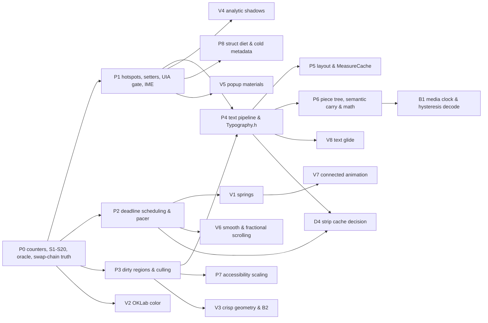

# Runtime efficiency and rendering quality, 7 November 2026 (revised 11 November 2026)

Status: SPEC READY — the 7 November draft (`rune` `0772373`, `gpui-fast` `61dccec`) was red-team reviewed on
8 November 2026 (`DxUi` `c0ead00a`, `rune` `a7f276c`, `gpui-fast` `fb8cf94`, `BUI` `e8126ca`) and then re-audited from
the ground up on 11 November 2026 across the full `DxUi` C++ tree (`4acabe0e`) and 15 external reference codebases:
[`longbridge/gpui-fast`](https://github.com/longbridge/gpui-fast/tree/af019de83a26f0d94c65ef408fdecebca1c25e9c) at
`af019de`, [`anomalyco/rune`](https://github.com/anomalyco/rune/tree/0ea75abef0a6caa014067a88f89518b9a04cce2b) at
`0ea75abe` (including `research/01..38`, `gpu-floor` and `engine-spike`),
[`makepad/makepad`](https://github.com/makepad/makepad/tree/506ec05105b9adb08d1d21f9879df181b5244ea7) at `506ec051`
(MIT; see [Makepad study](#makepad-study-makepadmakepad-at-506ec051)),
[`microsoft/terminal`](https://github.com/microsoft/terminal/tree/5f7dc283013152f89bfb76950515c33f45157ad7) at
`5f7dc283` (MIT), [`chromium/chromium`](https://chromium.googlesource.com/chromium/src/+/301a3f2f20827052d76f75d0d1669dea5e42578b)
at `301a3f2f` (BSD-3-Clause — Viz/DComp, VSync, TSF `ITextStoreACP` and Windows UIA),
[`AccessKit/accesskit`](https://github.com/AccessKit/accesskit/tree/dea4384134abe5d7b0734f56a0fdd8b80a16dfdd) at
`dea43841` (MIT / Apache-2.0),
[`microsoft/vscode`](https://github.com/microsoft/vscode/tree/75436fa46d2d234409ae10401414954ddc9e1efb) at `75436fa4`
(MIT — `pieceTreeTextBuffer`),
[`xi-editor/xi-editor`](https://github.com/xi-editor/xi-editor/tree/a2dea3059312795c77caadc639df49bf8a7008eb) at
`a2dea305` (Apache-2.0 — `rust/rope`),
[`linebender/parley`](https://github.com/linebender/parley/tree/36f82852f0516108586e9f5a7b0056e872c1f933) at `36f82852`
(Apache-2.0 / MIT),
[`rive-app/rive-runtime`](https://github.com/rive-app/rive-runtime/tree/66a4fbf3b18083eeacdcd6e9816d9106261090f9) at
`66a4fbf3` (MIT),
[`thorvg/thorvg`](https://github.com/thorvg/thorvg/tree/22c20d62c97137eb95c9b7eac795479fee5a50de) at `22c20d62` (MIT),
[`DioxusLabs/taffy`](https://github.com/DioxusLabs/taffy/tree/d0345bac609a10b25278ecc0850e862be9504e74) at `d0345bac`
(MIT), [`nicbarker/clay`](https://github.com/nicbarker/clay/tree/e6cc36941ab2af5d81107617039d6f527a1c660b) at `e6cc3694`
(zlib), [`ocornut/imgui`](https://github.com/ocornut/imgui/tree/abaca051e8799037e5b57d007fe35827422057ad) at `abaca051`
(MIT; see [Cross-ecosystem reference synthesis](#cross-ecosystem-reference-synthesis)), and clean-room
[`ppmpreetham/BUI`](https://github.com/ppmpreetham/BUI/tree/ae284781c2ae9b030aa795c7c0c1816678aafcf5) at `ae284781`
(see [BUI review](#bui-review-ppmpreethambui-at-ae284781)). Decisions D1, D2 and D4 stand; revised D3 and D5–D12 await
the developer's confirmation (see [Decisions](#decisions)). Plan only; no code has been implemented.

- **Owning contracts**: [performance and resources](../../Core/Core_PerformanceAndResources.md),
  [architecture](../../Core/Core_Architecture.md), [failure handling](../../Core/Core_FailureHandling.md),
  [controls and layout](../../UI/UI_ControlsAndLayout.md), [theme and typography](../../UI/UI_ThemeAndTypography.md),
  [input and accessibility](../../UI/UI_InputAndAccessibility.md), [design system](../../UI/UI_DesignSystem.md),
  [embedded rendering](../../Rendering/Rendering_EmbeddedD3D11.md), [Win32 host](../../Rendering/Rendering_Win32Host.md),
  [toolchain and consumption](../../Build/Build_ToolchainAndConsumption.md),
  [validation](../../Testing/Testing_Validation.md) and [documentation](../../Core/Core_Documentation.md).
- **Coordinated plans**: [remaining work](RemainingWork_2026-11-04.md) owns D-P1 (the timing policy), D-Q1
  (platform/consumer acceptance) and every closed item cited below; [explicit state machines](ExplicitStateMachines_2026-11-10.md)
  owns private non-breaking state-machine refactors and lifetime fixes (`DXUI-SM-01`..`DXUI-SM-08`) coordinated with
  `P2.1`/`P2.3`/`P1.15`; [frontier](Frontier_2026-11-11.md) orders this plan's items through its triage (kept
  separate by its `FD1`, confirmed 11 November 2026): it records a 16-claim re-read of this ledger, disputes `E7` and
  the "asymmetric `Present1`" design against Microsoft's flip-model documentation, and names which `P`/`V`/`B` items
  it keeps, replaces, moves or drops. Read an item's disposition there before starting it. The archived [production review](../Done/ProductionReview_2026-11-02.md) holds the original
  `CTRL-*`/`HOST-*` findings. This plan takes over only the open IDs it names. It never reopens a closed one or weakens
  an accepted bound in [performance and resources](../../Core/Core_PerformanceAndResources.md) (including `Grid`'s
  last-paint cell text-layout retention limit and application-supplied native occlusion visibility).

## Verdict on the 7 November draft and 11 November full reanalysis

The original draft studied the right projects and identified genuine hotspots, and the 8 November pass separated verified
claims from refuted ones. Full subsystem auditing on 11 November closed the remaining blind spots:

1. **About a fifth of the 7 November draft was already done.** `EDIT-01`/`RENDER-01`/`RENDER-14` were closed in
   [EditorCosmeticPreparation](../Done/EditorCosmeticPreparation_2026-11-06.md): source guides are viewport-scoped,
   capped at 4 layouts per turn and never withhold a frame (though retaining `PreparedLayout` entries outside the
   viewport remains open in `E26`/`P1.11`). `RENDER-02` for Source mode was closed in
   [SourceSpacingAndRadioNaming](../Done/SourceSpacingAndRadioNaming_2026-11-07.md). `RENDER-05` (color-glyph
   capability) was closed in [ScriptColorPreparation](../Done/ScriptColorPreparation_2026-11-06.md). `SEM-02` was
   closed in [SemanticAndDiagramResources](../Done/SemanticAndDiagramResources_2026-11-07.md), and `MD-05`..`07` in
   [MarkdownScanBounds](../Done/MarkdownScanBounds_2026-11-06.md).
2. **Several 7 November "facts" were wrong or overstated.** There is no `6.10 ms/step` measurement and no
   `Menu-Popup4096-Keyboard` fixture anywhere. The host brush and format caches are hash maps capped at 256 and 96, not
   64-entry linear scans. `GetMenuIconWicFactory` is already a cached static (though its CRT `atexit` lifetime after
   `CoUninitialize` is a teardown hazard; see `E14`). `TagPicker::ComputeLayout` and the `tag + L" \x00D7"`
   concatenation do not exist. `PreparedFlowchart::Draw` zeroes no stack arrays and creates no per-draw geometry (its
   actual waste is 4 of 5 zero-length `DrawLine` segments per orthogonal edge and a `>120 KiB` preparation buffer; see
   `E71`). `GetVisibleItemRect` is constant time. `Control` has 5 cold strings, not 4. The 8 ms `SetTimer` is not
   "125 Hz": `USER_TIMER_MINIMUM` raises it to 10 ms and the system tick quantizes it to about 64 Hz, with jitter. The
   API revision is already 5, so a breaking change makes it 6.
3. **The reference projects were partly misread.** `device_wake.rs` handles zero-poll D3D11 device removal, not widget
   deadline timers. `ChangedBounds` is draw-order batching, not dirty rects. `em_metrics.rs` is a font-fallback fix.
   gpui-fast's number set excludes space. rune's 4-band shadow split saves fragment overdraw in its own shader; with a
   `CLSID_D2D1Shadow` effect it would multiply effect passes by four, an anti-pattern.
4. **One rendering assumption looks wrong — and `Present1` dirty rects are asymmetric.** The partial-present path assumes
   `FLIP_SEQUENTIAL` with `BufferCount = 2` keeps the previous frame outside the dirty rect. DXGI documents that the
   reused back buffer holds the frame from `BufferCount` presents earlier; the source comment at `DxUi.WindowHost.cpp`
   around line 5071 assumes the opposite, and both Windows Terminal (`AtlasEngine.r.cpp:504-526`) and Chromium
   (`skia_output_device_dcomp.cc:138-170`) confirm that D2D drawing must clip to `dirty_N ∪ dirty_{N-1}` while
   `DXGI_PRESENT_PARAMETERS::pDirtyRects` receives **only** `dirty_N` clamped to `[0, widthPx] × [0, heightPx]`. `P0.4`
   proves the swap-chain behavior on WARP before `P3.3` builds on it.
5. **No usable timing acceptance signal.** D-P1 in [remaining work](RemainingWork_2026-11-04.md) records that paired
   timing is inconclusive: 71 of 72 controls are unstable and the base policy is unqualified. Every item here gates on
   **deterministic work counters** (layouts created, effects/layers/bitmaps created, tree visits, timer wakes, UIA
   passes, heap allocations and bytes). Wall/CPU timing stays advisory until D-P1 qualifies its policy.
6. **Beauty and motion belong beside CPU efficiency.** `V1`–`V8` cover closed-form springs, perceptual OKLab color
   transitions, crisp fractional-DPI hairlines, single-pass analytic Gaussian shadows, real popup materials, smooth and
   fractional scrolling, command-list connected animations and subpixel-stable text glide.
7. **Whole `DxUi` subsystems and cross-ecosystem mechanisms were missing (`E46`–`E84`).** The 11 November audit across
   `DxUi` and 15 external codebases uncovered major steady-state churn and subtle Win32/DXGI/TSF/UIA/editor bugs across
   `ThroughputGraph`, `StatusStrip`, `PageHost`, `ColorPicker`, `NumericStepper`, ~30 unguarded control setters, `Panel`
   `weak_ptr` atomic locking, `Grid` badge/resize/sort/`1.6 MiB` `previousSelection` paths, `Tree` expansion snapshots,
   `EmbeddedHost` `MenuPopup` full `D3D11CreateDevice` teardown/recreate storms and 16–32 driver-thread spawns,
   `WindowHost` device-loss retry spin, `TrimCaches` `_forceAllVisualPreparation = true` format-cliff storms,
   `DCompositionCreateDevice2(dxgiDevice)` TDR visual teardown, modal `WM_SIZING` `WM_PAINT` starvation, unclamped
   `Present1` rects, `FrameClock::SmoothDeltaUs` unfiltered vblank jitter, `DxUi.Typography.h` global mutex/leak/ALPC
   probes, `EmbeddedHost` un-gated 4-pass UIA rebuilds, `928 B` `AccessibilityControlNavigationSnapshot` records + UIA
   teardown/Narrator bugs, TSF `TextStoreACP` `15–25×` full-document copies + illegal async `TS_E_SYNCHRONOUS` + dead
   `GUID_PROP_INPUTSCOPE`, `RichDocument` non-coalescing 1-char buffers + split-CRLF hazard, `SameLayoutOptions` `0%`
   width-resize reuse, `SourceDisplayMap` `1.05–4.2 MiB` vectors, `libfyaml` frontmatter reparses, per-SVG
   `CreateDeviceContext` churn, `RichImageDecoder::Decode` synchronous `32 MiB` copies, and `MathFontData` `22,500`-call
   rebuilds + per-atom `IDWriteTextLayout`s.

## Evidence ledger

Static findings carry exact file references at `DxUi` `4acabe0e`. "Counter" means `P0.1` instrumentation must confirm
the baseline before the item closes; ledger numbers are hypotheses to measure, never receipts.

| # | Claim | Verdict | Evidence (`4acabe0e`) | Consequence |
| --- | --- | --- | --- | --- |
| E1 | Animation dispatcher polls at 8 ms whenever any subscriber exists | Verified (effective ~64 Hz) | `kFrameIntervalMs = 8u`, `SetTimer` in [AnimationDispatcher.h](../../../src/Support/AnimationDispatcher.h) | P2.1 |
| E2 | `TextField`/`ComboBox` caret (530 ms), `RichTextEditor` caret (500 ms) and `TooltipLayer` (500 ms show, 5,000 ms hide) return `true` every tick; `TextField` also ticks/draws caret when `_readOnly` | Verified | [DxUi.TextInput.cpp](../../../src/Controls/DxUi.TextInput.cpp) `:1707, 1789, 1804`, [DxUi.ComboBox.cpp](../../../src/Controls/DxUi.ComboBox.cpp) `:1901`, [DxUi.RichTextEditor.cpp](../../../src/Controls/DxUi.RichTextEditor.cpp) `:5505-5511`, [DxUi.Controls.cpp](../../../src/Controls/DxUi.Controls.cpp) `:12152` | P1.3, P2.2, P2.3 |
| E3 | `TextField`/`ComboBox` ignore `GetCaretBlinkTime`, reduced motion and `SPI_GETCARETTIMEOUT` | Verified (`RichTextEditor` honors reduced motion; `SPI_GETCARETTIMEOUT` appears nowhere) | same files | P2.2 |
| E4 | Every animation tick walks the whole tree | Verified | `Panel::Tick` visits every visible child; `EmbeddedHost::AdvanceAnimation` calls `_root->Tick` | P2.1 |
| E5 | `EmbeddedHost::Prepare` clears and repaints the whole surface for any change | Verified | `dc->Clear(...)` then `_root->Paint` in [Embedded.cpp](../../../src/Rendering/Embedded.cpp) | P3.2 |
| E6 | Control invalidation is always full-window | Verified | `ControlHost::Invalidate()` calls `InvalidateRect(_hwnd, nullptr, FALSE)` | P3.1 |
| E7 | Partial present keeps previous-frame content | **Unproven and probably false** | `BufferCount = 2`, `FLIP_SEQUENTIAL`, comment near [DxUi.WindowHost.cpp](../../../src/Controls/DxUi.WindowHost.cpp) `:5071` | P0.4 decides; P1.12/P3.3 fix |
| E8 | `Panel`/`ScrollPanel` paint every visible child regardless of clip | Verified | `DxUi.Controls.cpp:1533, 11311` | P3.4 |
| E9 | The host brush cache is cleared on every swap-chain resize | Verified, and cleared **twice** | `PrepareForSwapChainResize` and `RecreateBrushCache` in `DxUi.WindowHost.cpp` | P1.12 |
| E10 | Host brush/format caches use 64-entry linear scans | **Refuted** | `std::unordered_map`, limits 256/96 in [DxUi.h](../../../include/DxUi/DxUi.h); clear-on-overflow cliff is real | P4.5 |
| E11 | `DrawTextW` at "90+ call sites" | **Overstated** | 7 raw `DrawTextW` sites; `DrawCenteredText` has 63 callers; 28+ `CreateTextLayout` sites | P4.1 |
| E12 | `ComboBox` popup runs `1 + 2V` `UpdatePopupLayout` calls per paint (`8,500` layouts at `N = 500, V = 8`), plus `2–3×` (`2N–3N`) per `WM_MOUSEMOVE` pixel while open and `2–3×` per typed char even while closed | Verified | `DxUi.ComboBox.cpp:1127, 1845, 2114, 2213, 2311, 2322, 2577-2665` | P1.1 |
| E13 | Popup blur, layer, gradients (even on `OverlayMaterial::Solid`), both shadow passes and `PaintTransientSurfaceBackdrop` blur/geometry/layer are recreated every paint | Verified | `DxUi.ComboBox.cpp:217-245, 348/359, 414-428`, [DxUi.Menu.cpp](../../../src/Controls/DxUi.Menu.cpp) `:590-619, 717/728, 778-793`, `DxUi.Controls.cpp:258/283`, [DxUi.cpp](../../../src/Controls/DxUi.cpp) `:152-201` | P1.2, V4 |
| E14 | WIC factory created per icon (refuted), **but** static `IWICImagingFactory` releases post-`CoUninitialize`, `EmbeddedHost` apps hit `--attachedHostCount == 0` in `ReleaseSharedWindowHostAttachment` (destroying/recreating `ID3D11Device` + `ID2D1Device` + `IDWriteFactory` + `IDCompositionDesktopDevice` on every `MenuPopup` open/close!), `D3D11CreateDevice` omits `SINGLETHREADED \| PREVENT_INTERNAL_THREADING_OPTIMIZATIONS` (`16–32` driver threads), and `NativeMenuInterop` clones `HBITMAP`s | Refuted per-icon; **lifecycle & device churn verified** | `DxUi.Menu.cpp:814`, `DxUi.WindowHost.cpp:717-722, 741-753`, [NativeRendering.h](../../../src/Support/NativeRendering.h) `:13-20`, [NativeMenuInterop.cpp](../../../src/Controls/NativeMenuInterop.cpp) `:56-109, 746` | P1.2, P1.12 |
| E15 | Popup backdrop does synchronous GDI `BitBlt(..., SRCCOPY \| CAPTUREBLT)` plus heap `vector<uint8_t>` + scalar alpha loop because bitmap uses `PREMULTIPLIED` instead of `IGNORE` | Verified | `DxUi.cpp:139, 278-345` | V5 (and P1.2 until V5) |
| E16 | `TextField` cache hit runs `SecureClear` plus a string copy; masking applies to every field; composition state deep copy | Verified | [DxUi.SingleLineTextEditing.cpp](../../../src/Controls/DxUi.SingleLineTextEditing.cpp) `:527`, `DxUi.TextInput.cpp:3620`, [DxUi.NativeTextInput.cpp](../../../src/Controls/DxUi.NativeTextInput.cpp) `:2094` | P1.3 |
| E17 | Multiline `TextField` bypasses `_cachedMultilineLayout` across **10 hot paths**, including 2 layouts before `wheelStepCount == 0` and 5 per `PageDown` | Verified | `DxUi.TextInput.cpp:352, 482, 585, 713, 728, 765, 811, 1958, 2088, 2180-2203, 2955, 3063, 3215, 3679` | P1.4 |
| E18 | `TagPicker` per-paint string concatenation | **Refuted** | `LayoutParts()` runs on mutation only | dropped |
| E19 | `Splitter` preview rebuilds the whole-window UIA snapshot every pointer move | Verified | [DxUi.EditorControls.cpp](../../../src/Controls/DxUi.EditorControls.cpp) `:747` | P1.5 |
| E20 | `ProgressBar`/`Slider` value changes run full invalidation plus a `General` **4-pass** UIA rebuild (`IndexAccessibilitySnapshot` reserves `4×` maps) | Verified | `DxUi.Controls.cpp:5186, 6467`, [DxUi.Accessibility.cpp](../../../src/Controls/DxUi.Accessibility.cpp) `:1408-1483, 2199` | P1.6, P7.3 |
| E21 | `Label::Label` eagerly sets `NeedsVisualPreparation(true)` on plain labels, and both `Label` and `Button::PrepareVisualContent` run `IsControlInTree` DFS before cheap guards (`CTRL-02`) | Verified | `DxUi.Controls.cpp:2808-2811, 2970, 3180-3192` | P1.7 |
| E22 | `Grid` key navigation allocates and walks all rows per key (`CTRL-04`); `Tree::SetFocusedItemId` double lookup | Verified | [DxUi.Grid.cpp](../../../src/Controls/DxUi.Grid.cpp) `:5937`, [DxUi.Tree.cpp](../../../src/Controls/DxUi.Tree.cpp) `:892/901` | P1.7 |
| E23 | `O(N²)` child/field revalidations in `FlexPanel` (`BuildLayout`, `ApplyLayout`), `FormPanel` (`BuildLayout`, `ApplyLayout`, `AddField`) and `TabControl::UpdateVisiblePageBounds` | Verified | [DxUi.Layout.cpp](../../../src/Controls/DxUi.Layout.cpp) `:670-682, 726, 1030`, [DxUi.Forms.cpp](../../../src/Controls/DxUi.Forms.cpp) `:651-653, 747-759, 974-991`, `DxUi.Controls.cpp:9376-9447` | P1.8 |
| E24 | `Grid::Paint` calls `GetColumn` (by-value strings) `C + C·rows` times per frame | Verified | `DxUi.Grid.cpp:4155, 4435` | P8.3 |
| E25 | Semantic geometry reuse is gated on `state_->document == document` and every edit creates a new `SemanticDocument` | Verified (the real cross-edit loss of math, diagrams, tables and images) | [DxUi.RichSemanticGeometry.cpp](../../../src/Controls/DxUi.RichSemanticGeometry.cpp) `:2437/2447`, [DxUi.RichSemanticDocument.cpp](../../../src/Controls/DxUi.RichSemanticDocument.cpp) `:2848-2855` | P6.1 |
| E26 | Semantic code-fence line numbers & `RichSourceGuides` allocate per-line `PreparedLayout`s across all lines; `CodeLabels` recreates identical `"copy"`/language badge layouts per fence | Verified | `DxUi.RichSemanticGeometry.cpp:2849-2864, 2932/2943, 4073-4082`, [DxUi.RichSourceGuides.h](../../../src/Controls/DxUi.RichSourceGuides.h) `:148-155, 219-228` | P1.11 |
| E27 | `TokenizeCode` discards all coloring above 4,096 tokens | Verified | `output.clear(); return false;` in [DxUi.RichCodeInk.h](../../../src/Controls/DxUi.RichCodeInk.h) | P1.10 |
| E28 | `PreparedMath::DrawColored` zeroes a 32 KiB (`4096 × 8 B`) stack array and calls `pow` per paint; `ResolveDiagramLabelBackground` runs a 32-step `Contrast` binary search (`~192` `powf` calls) + `target->GetFactory` per draw | Verified | [RichMath.h](../../../include/DxUi/RichMath.h) `:11`, [DxUi.PreparedMath.h](../../../src/Controls/DxUi.PreparedMath.h) `:3015-3030`, [DxUi.PreparedFlowchart.cpp](../../../src/Controls/DxUi.PreparedFlowchart.cpp) `:21, 148-191, 812-814` | P1.9 |
| E29 | `pow`-based sRGB decode runs on paint/mutation paths in `Utilities.h` (`TextField`/`ComboBox`), math, flowchart and `ChooseContrastingTextColor` (`TagPicker::Paint`) | Verified | [Utilities.h](../../../src/Support/Utilities.h), `DxUi.Controls.cpp:7555` | P1.9 |
| E30 | `PreparedLayout::TryVisibleRange` is linear with a `HitTestTextPosition` per line; semantic `TryVisibleRange` and `TryVisibleSourceRange` scan all `boxes` and ignore `paintBoxes` | Verified | [DxUi.RichTextLayout.cpp](../../../src/Controls/DxUi.RichTextLayout.cpp) `:762-785`, `DxUi.RichSemanticGeometry.cpp:3651-3682, 3966` | P1.9 |
| E31 | `PaintIndex::Build` discards vector capacity on every rebuild | Verified | [DxUi.PaintIndex.h](../../../src/Controls/DxUi.PaintIndex.h) | P1.9 |
| E32 | `ComposeGifCanvas` has no fast path for alpha 0/255 | Verified | [DxUi.RichImage.cpp](../../../src/Controls/DxUi.RichImage.cpp) `:158` | P1.9 |
| E33 | `RichImage::LoadFile` duplicates the encoded buffer (`RENDER-09`) | Verified | `DxUi.RichImage.cpp:251, 506` | P1.13 |
| E34 | `MenuPopup` keyboard step costs 6.10 ms | **Not found** | no fixture or receipt | P0.2 measures; P7.4 conditional |
| E35 | Unrecorded `sizeof(Control)` (`~328 B` inline + `39 B` header) and bloated `Button`-derived toggles (`Checkbox` `~896 B`, `Toggle` `~928 B`, `RadioButton` `~880 B`) | Verified static layout; no test probe yet | `DxUi.h:1624-1870, 2979-3306`, [ControlAllocation.cpp](../../../src/Foundation/ControlAllocation.cpp) `:25-62` | P8.1 |
| E36 | Lifetime token is an eager `make_shared<int>` | Verified, 460 call sites | `DxUi.h:1853` | D3 revision: slab handle withdrawn |
| E37 | `HOST-14` dead `#else` `Render` body | Verified dead (`DXUI_ENABLE_DIAGNOSTICS == 1` in [Configuration.h](../../../include/DxUi/Configuration.h)) | `DxUi.WindowHost.cpp:4708-4952` | P1.12 |
| E38 | `HOST-03`, `HOST-09` | Verified open | `Embedded.cpp:1055, 664` | P1.12 |
| E39 | Native host never sets text antialias mode or rendering params | Verified; embedded forces grayscale | `Embedded.cpp:283` | P4.6 |
| E40 | Color transitions are sRGB-space lerps | Verified | `BlendColor` in [DxUi.Theme.cpp](../../../src/Controls/DxUi.Theme.cpp) | V2 |
| E41 | No springs; interrupted lerp transitions restart at the wrong speed | Verified | `Slider::BeginVisualTransition` re-anchors and restarts its clock | V1 |
| E42 | Connected animation draws a placeholder outline, not content | Verified | `PageHost::PaintOverlay` in `DxUi.Controls.cpp` | V7 |
| E43 | 1 DIP strokes at fractional DPI produce blurred 1.25/1.5 px borders | Verified | shared rounded-rect stroke helpers in `DxUi.Controls.cpp` | V3 |
| E44 | Wheel scrolling is quantized and immediate, with no inertia, fractional touchpad accumulation or edge fades | Verified | `DxUi.Grid.cpp:5891-5896`, `DxUi.Tree.cpp:2155` | P1.7, V6 |
| E45 | Windows 10 color-glyph path (`TranslateColorGlyphRun`) is absent; only `ID2D1DeviceContext7` is used | Verified; Windows 10 is in the embedded baseline ([toolchain](../../Build/Build_ToolchainAndConsumption.md)) | [DxUi.RichTextScriptRenderer.h](../../../src/Controls/DxUi.RichTextScriptRenderer.h) `:218` | P4.1 |
| E46 | `ThroughputGraph::Paint` creates per-frame `ID2D1PathGeometry`, unused `ID2D1SolidColorBrush`, `CreateLayer`, CPU-rasters `180×64` HSV pixels + `46 KB` `CreateBitmap`, zeroes `70.7 KB` stack arrays, draws `358` lines and `3` raw `DrawTextW`s; `ThroughputGraphSample` is `408 B` (`73.4 KB`/graph) and `ThroughputGraphHueWeight` pads `8 B` (`24 B` vs `16 B`) | Verified | `DxUi.Controls.cpp:5747-6319`, `DxUi.h:4714-4729` | P1.14, P8.1 |
| E47 | `StatusStrip::Paint` / `ElideLeadingForWidth` runs binary-search `CreateTextLayout` + `wstring` allocs (~12 layouts + ~11 strings/frame) and slices raw `wchar_t` offsets, splitting UTF-16 surrogate pairs and grapheme clusters | Verified | `DxUi.Controls.cpp:10386-10511` | P1.14 |
| E48 | `PageHost::PaintPage`/`PaintOverlay` calls `dc->CreateLayer` up to 4 times per transition frame instead of `PushLayer(..., nullptr)` | Verified | `DxUi.Controls.cpp:1802-1815, 1935-1948` | P1.14 |
| E49 | `ColorPicker` queries `dc->GetDevice` every paint, draws 6+ uncached texts, triggers **4 full 4-pass UIA rebuilds per HSV drag move**, loses saturation at `V = 0`, and allocates 7 SSO-exceeding default `Labels` strings; `NumericStepper::SetValue` lacks an unchanged-value guard, calls base-10 `std::pow(10.0, _decimals)` `3×` (with duplicate `ClampValue`), and formats a heap `wstring` in `SyncText` before checking equality | Verified | `DxUi.EditorControls.cpp:977-1017, 1046, 1124, 1201-1280, 1691-1904`, `DxUi.h:6082-6099` | P1.14, P8.1 |
| E50 | ~30 control setters lack unchanged-value guards; `StackPanel::SetOrientation`/`SetGap`/`SetPadding` unconditionally call `RequestInvalidate()`; `CardPanel::SetCornerRadius` mutates `_cornerRadius` without invalidating (`0` repaint bug) | Verified | `DxUi.cpp`, `DxUi.Controls.cpp:2736-2739, 10660-10701`, `DxUi.EditorControls.cpp` | P1.14 |
| E51 | `Panel::Paint`/`PaintOverlay`/`Tick` run `4N` atomic control-block operations per frame via `AcquireControlLifetime` (`weak_ptr::lock` before and after each child) | Verified | `DxUi.Controls.cpp:77-127, 1528-1595` | P1.8 |
| E52 | `MenuBar` formats unguarded `Debug::Info` strings in Release on hover/key/open and invalidates all item text widths on pure horizontal `MenuBar` resize; `MenuPopup` renders twice on open (`RenderPopup` + `WM_PAINT`) and allocates 2 `ParseMenuLabel` strings per row per paint | Verified | `DxUi.Controls.cpp:199-217, 8052-8270, 8287`, `DxUi.Menu.cpp:3224, 3244, 4224, 4243` | P1.2, P1.12 |
| E53 | `Grid` (within its last-paint cell layout retention contract) creates uncached `PaintBadgeCell` layouts per frame, destroys visible cell layouts on column drag-resize instead of `SetMaxWidth`, recomputes `ResolvedColumnLayout` & `CollectOrderedGroups` per frame, scans all groups linearly in `ComputeViewportMetrics`, materializes `O(R)` vectors/sets in `GridSelectionModel`, and copies `GridCellValue` strings during `InMemoryGridModel::RebuildView` sort | Verified | `DxUi.Grid.cpp:609-735, 1041-1095, 1395-1455, 4977, 5042-5080, 6756, 6955, 7393` | P1.7, P4.3, P8.3 |
| E54 | `Tree::BeginTreeExpansionAnimation` deep-copies up to `4,096` `TreeItemData` records (`4 × wstring` each) twice (`emplace(animation)` avoids `std::move` because MSVC `_ITERATOR_DEBUG_LEVEL == 2` allocates a vector proxy inside `noexcept`); `Tree::OnMouseMove` invalidates on within-row sub-zone moves with identical visuals | Verified | `DxUi.Tree.cpp:2077-2122, 3611-3665` | P1.7 |
| E55 | `ScrollPanel::OnMouseWheel` repaints and swallows wheel at clamped boundaries; `EmbeddedHost::DispatchPointer` drops `_capturedControl` on first button-up during multi-button chords and ignores `MiddleUp`; `WindowHost::OnMouseMove` switches modality to `Pointer` even when client pos equals `_lastMousePos` | Verified | `DxUi.Controls.cpp:11820-11825`, `Embedded.cpp:953-990`, `DxUi.WindowHost.cpp:3556-3568` | P1.12 |
| E56 | `WindowHost::HandleDeviceLost` resets `_deviceLossRetryCount = 0` inside `EnsureDeviceResources` before `Present` succeeds (unbounded retry spin on persistent `DEVICE_REMOVED`); swap chain uses `DXGI_SCALING_STRETCH`; `Failure::Scope` calls `3 × std::set_terminate` per Win32 message; `UpdateTooltipHover` copies `_tooltipText` 5×, calls `SPI_GETMOUSEHOVERTIME` 2× and runs `IsControlInTree` DFS 6–8× per move; `AnimationDispatcher` destroys/recreates `HWND_MESSAGE` across idle and double-counts frame-1 `dt` | Verified | `DxUi.WindowHost.cpp:4408, 4446, 4579, 5240, 5857-6008`, [Failure.cpp](../../../src/Foundation/Failure.cpp) `:103-114, 303-312`, `AnimationDispatcher.h:308-448` | P1.12, P2.1 |
| E57 | `DxUi.Typography.h` acquires a global `std::mutex`, allocates a heap `wstring` key + `vector<DWRITE_FONT_AXIS_VALUE>`, calls `GetSystemFontCollection(..., TRUE)` (FontCache ALPC check on miss), and stores raw `IDWriteTextFormat*` pointers in a never-evicted static map across `IDWriteFactory` lifetimes | Verified | [DxUi.Typography.h](../../../src/Controls/DxUi.Typography.h) `:194-433` | P4.5 |
| E58 | `MakeThemePalette` runs 4 redundant Oklab perceptual ramp derivations per theme build; `Control::operator new` adds `+39 B` header padding and a `HeapSize` Win32 call on allocation/deallocation | Verified | `DxUi.Theme.cpp:1068-1215`, `ControlAllocation.cpp:25-62` | P4.5, P8.1 |
| E59 | `EmbeddedHost::UpdateAccessibility` runs a full 4-pass UIA rebuild on every mutation with **no** `providerRequested` or `UiaClientsAreListening` gate; `AcquireCanonicalRootProvider` latches `providerRequested = true` forever, and `RefreshWindowHostAccessibilitySnapshot` synchronously flushes on `focusChanged` while still posting `AccessibilityFlush` (rebuilding twice when a same-turn layout/DPI mutation bumps `dirtyRevision`) | Verified | `DxUi.Accessibility.cpp:6377, 13824, 13839, 14897-14942` | P1.6, P7.1 |
| E60 | `FindAssociatedLabelText` runs an unindexed `O(K·N)` DFS; `AppendAccessibilitySnapshotNavigation` + `GetControlTypeId`/`Supports*Pattern` run ~29 `dynamic_cast`s per control; `AccessibilityControlNavigationSnapshot` (`928 B` x64 Release / `>1,080 B` + 19 Debug proxy allocs) copies full `128 KB` editor buffers into `controlAccessibleText` and materializes `10,000` `Tree` row nodes eagerly | Verified | `DxUi.Accessibility.cpp:692-798, 2309-2942, 4092-4121, 5187-5323` | P7.3 |
| E61 | `GetEnclosingTextRangeWordSpan` scans from index `0` (`O(offset)`), `AccessibilityTextRangeProvider::ResolveText` copies full `131 KiB` `wstring`s by value per COM call (and copies full `expectedText` into `AccessibilityUiActionRequest`), and `RaiseWindowHostTextInputAutomationEvent` runs un-gated per keystroke | Verified | `DxUi.Accessibility.cpp:4604-4630, 6781, 7339, 7501, 8332-8349, 13616-13651` | P7.1, P7.3 |
| E62 | TSF `TextStoreACP` copies the entire document `std::wstring` **15–25 times** per CJK/Korean IME syllable and imports state twice on commit; clipped `GetTextExt` (`TryResolveTextStoreRangeRect`) probes character bounds in `O(N)` loops; `TextField` and `ComboBox` push uncoalesced full-doc undo snapshots on every intermediate IME stroke | Verified | [DxUi.TextStoreACP.cpp](../../../src/Controls/DxUi.TextStoreACP.cpp) `:136-164, 908-941`, `DxUi.NativeTextInput.cpp:1924-1958`, `DxUi.TextInput.cpp:3166`, `DxUi.ComboBox.cpp:1829` | P1.15 |
| E63 | `StepToNextTextElement` / `SnapCaretIndexToTextElementBoundary` scan graphemes from `0` (`O(N)`, even on pure ASCII!); `SelectSingleLineWordAt` splits UTF-16 astral surrogate pairs; embedded `Ctrl+C` calls `ReadSnapshot` twice; `OnCopy` allocates `_text.substr`; `RegisterClipboardFormatW(L"HTML Format")` is uncached | Verified | `DxUi.SingleLineTextEditing.cpp:62-144, 836-865`, [TextInputServices.cpp](../../../src/Controls/TextInputServices.cpp) `:85-144`, `DxUi.NativeTextInput.cpp:893, 1083`, `DxUi.TextInput.cpp:2896`, [TextClipboard.cpp](../../../src/Controls/TextClipboard.cpp) `:133, 205` | P1.15 |
| E64 | `Document::TryReplaceImpl` calls `make_shared<const Buffer>(text)` per 1-char insert, defeating pointer-identity `Piece::AppendCoalesced` so consecutive typing never coalesces | Verified | [DxUi.RichDocument.cpp](../../../src/Controls/DxUi.RichDocument.cpp) `:283-291, 1003` | P6.1 |
| E65 | `RichTextEditor` flattens full-doc `source.Text()` / `projection.DisplayText()` across **11 hot paths** (including `128 KiB` concat on `Ctrl+Left/Right`, `Ctrl+Backspace/Delete`, double-click and `TryFindInSource`); `Ctrl+A` tessellates offscreen selection rects and offscreen highlight `HitTestTextRange` | Verified | `DxUi.RichTextEditor.cpp:1149, 2585, 2910, 3775-3871, 5608-5623, 5665, 5733, 5851-5852, 5920, 6017, 6312, 6746, 6895, 7336`, [DxUi.RichSemantic.cpp](../../../src/Controls/DxUi.RichSemantic.cpp) `:32` | P6.1 |
| E66 | `SourceDisplayMap` stores duplicate `wstring source_` (`128 KiB`) + dense `sourceLeading_`/`sourceTrailing_` (`1.05–4.2 MiB`), scans `spans_` linearly in `TryDisplayRanges`/`TrySourceRanges`, and collapses the whole doc to 1 dirty span in `TryApplySourceEdits`; v0 `Projection` + `JoinBlocks` waste `3.5 MiB` in `ViewMode::Source` | Verified | [RichSemantic.h](../../../include/DxUi/RichSemantic.h) `:67-70`, `DxUi.RichSemantic.cpp:146-212, 278-333, 387-399`, [DxUi.RichDocumentLayout.cpp](../../../src/Controls/DxUi.RichDocumentLayout.cpp) `:69-95` | P6.1 |
| E67 | `CloseElement` stores display text 2–3×; prose edits re-parse unchanged math/Mermaid ASTs and spin up `libfyaml` DOM + `std::multimap` (`ValidateYamlMetadata`); `MarkdownInlines` allocates per-run vectors/strings | Verified | `DxUi.RichSemanticDocument.cpp:940, 1286, 1756, 2182`, [DxUi.MarkdownSyntax.cpp](../../../src/Controls/DxUi.MarkdownSyntax.cpp) `:417, 436-458, 520-533, 1079` | P6.1 |
| E68 | `MeasureTableOne` creates `2·R·C` uncached `PreparedLayout`s (retaining only winning widths) on every 1-char prose edit and resize; horizontal resize calls `state_->Clear()`, dropping width-independent markers/line-numbers/images and reflowing top-to-bottom instead of viewport-first | Verified | `DxUi.RichSemanticGeometry.cpp:1531-1625, 2445` | P6.1 |
| E69 | `BeginPreparation` skips `Phase::Chunks` 100% (building one monolithic whole-doc `Phase::Reference` layout) whenever `lineHeightMultiplier > 0 && mode != Source`, while `translatedOrigin` fails reuse because `:445` checks `VerticalOrigin() == next.height`; multiline selection invalidates full viewport; `DrawSourceInkIfSupported` calls `layout.Draw` twice per chunk and uncached `QueryInterface` per run; `ScriptTextRenderer` queries `GetTransform`/`GetDpi` per run | Verified | `DxUi.RichDocumentLayout.cpp:338-344, 445`, `DxUi.RichTextLayout.cpp:308`, `DxUi.RichTextEditor.cpp:5397`, [DxUi.RichTextSourceInkRenderer.h](../../../src/Controls/DxUi.RichTextSourceInkRenderer.h) `:285-290, 411, 434`, `DxUi.RichTextScriptRenderer.h:348-374` | P6.2 |
| E70 | `MathFontData::Build` calls `3 × ~7,500` Cambria Math glyph methods and is discarded whenever `SemanticLayout` rebuilds; `BuildTextAtom` creates a full `IDWriteTextLayout` per single-character math variable/digit/operator (`~60–120`/formula) | Verified | `DxUi.PreparedMath.h:421-471, 950-1005, 3117` | P6.5 |
| E71 | `PreparedFlowchart::Draw` emits 5 `DrawLine`s per edge when 4/5 segments are zero-length and `Preparation` reserves `>120 KiB` fixed arrays; `RasterizeSvg` renders every SVG in multi-strip DOM re-walks; `PopulateRichTextEditorAccessibility` copies full doc and transforms every block/link/cell per cursor/scroll move | Verified | `DxUi.PreparedFlowchart.cpp:910-917`, `DxUi.RichSemanticGeometry.cpp:508-538`, `DxUi.Accessibility.cpp:2423, 2559` | P1.9, P7.2 |
| E72 | `ControlHost::TrimCaches` clears `_configuredTextFormats` **and** sets `_forceAllVisualPreparation = true` whenever `_configuredTextFormats.size() > 96`, forcing 100% full-tree visual re-preparation every frame on dense views (`>= 97` format combinations) | Verified | `DxUi.WindowHost.cpp:4678-4682` | P4.5 |
| E73 | `DCompositionCreateDevice2(dxgiDevice.get(), ...)` couples `_dcompDevice` to the D3D11 device so TDR tears down `_dcompTarget`/`_dcompVisual`, and `ControlHost::OnSize` only calls `Invalidate()` so rapid modal `WM_ENTERSIZEMOVE`..`WM_EXITSIZEMOVE` mouse traffic starves `WM_PAINT` | Verified | `DxUi.WindowHost.cpp:835, 4660-4662, 5291-5333` | P1.12 |
| E74 | `FrameClock::SmoothDeltaUs` clamps only `> hitchClampUs` with zero vblank jitter filtering (feeding raw `13 ms / 20 ms` DXGI/DWM variance into motion/scroll integrators), and `DxUi.Layout.cpp` constructs nested per-child `Failure::Scope`s (`6N–9N` `std::set_terminate` calls/pass) | Verified | [FrameRuntime.cpp](../../../src/Foundation/FrameRuntime.cpp) `:125-135`, `DxUi.Layout.cpp:183, 245, 535, 624, 973` | P1.8, P1.12, P2.7 |
| E75 | `RichImageDecoder::Decode` copies up to `32 MiB` of `encoded` into `std::vector<BYTE> owned` before `IWICStream::InitializeFromMemory` even though `CopyPixels` finishes synchronously before `Decode` returns, and broken image sources lack a failed-decode retry embargo | Verified | `DxUi.RichImage.cpp:250-256, 292-306` | P1.13, B1 |
| E76 | `WindowHost` `Present1` passes unclamped `*dirtyRectPx` (`E_INVALIDARG` risk without `Present(1, 0)` fallback), `MenuPopup` creates shadow-padded HWNDs incompatible with rectangular `DWMSBT_TRANSIENTWINDOW` borders, and `WM_ACTIVATE` lets `DefWindowProcW` attach a duplicate IMM32-TSF context | Verified | `DxUi.WindowHost.cpp:3525-3532, 4889-4893, 5217-5221`, `DxUi.Menu.cpp:4117-4120` | P1.12, P3.3, V5 |
| E77 | `TextStoreACP::RequestLock` returns illegal `TS_E_SYNCHRONOUS` for async reentrant requests on embedded/headless targets instead of draining `_pendingLockFlags` post-unlock; `NotifyExternalChangesIfNeeded` emits whole-doc `TS_TEXTCHANGE{0, oldSize, newSize}`; `RetrieveRequestedAttrs` always sets `*pcFetched = 0` (`ITfInputScope` / `IS_PASSWORD` dead under TSF); TSF `GUID_PROP_ATTRIBUTE` clauses are dropped; and `GetACPFromPoint` ignores `GXFPF_NEAREST` / returns `TS_E_INVALIDPOS` instead of `TS_E_INVALIDPOINT` | Verified | `DxUi.TextStoreACP.cpp:547-556, 1228-1250, 1298, 1682-1692, 1728, 2012`, `DxUi.NativeTextInput.cpp:1316-1324` | P1.15 |
| E78 | `DxUi.Accessibility.cpp` compliance & lifetime bugs: `FindRegisteredAccessibilityTarget` relies solely on `GetPropW` (leaking `target` / dangling `host` / skipping `UiaDisconnectProvider` if `DestroyWindow` precedes `Detach`); `MakeEmptyAccessibilitySnapshot` throws inside `noexcept` without `Failure::Scope`; Win64 `WM_GETOBJECT` rejects 32-bit zero-extended `UiaRootObjectId`; toggle `Button` exposes both `Invoke` and `Toggle`; IME commit fires both `TextChanged` and empty `TextEditChangeType_Composition` (Narrator double-speak); and `:1561-1566` has dead `if (! target.embedded)` code | Verified | `DxUi.Accessibility.cpp:1330-1358, 1558-1568, 5270-5284, 8226, 13722-13755, 13954, 14733-14738` | P1.6, P7.1, P7.3 |
| E79 | `SameLayoutOptions` requires `a.widthDip == b.widthDip`, forcing `0%` paragraph/chunk shaping reuse on width resize, and `SemanticDisplayInput` allocates throwaway `SemanticInput` strings/runs *before* checking `previousState` reuse | Verified | [DxUi.RichLayoutOptions.h](../../../src/Controls/DxUi.RichLayoutOptions.h) `:15`, `DxUi.RichDocumentLayout.cpp:262`, `DxUi.RichSemanticGeometry.cpp:801-813, 2445` | P4.3, P6.1, P6.2 |
| E80 | `PreparedLayout` creates uncached `IDWriteTextFormat`s per paragraph/chunk, scans `images->placements` in `O(P·I + I²)` during prep and `O(B·P)` per paint/caret/selection/table-cell (twice in `MeasureTableOne`!), runs unbounded `TryAdjacentSourceLine` scans, and lacks `Upstream`/`Downstream` soft-wrap caret `Affinity` | Verified | `DxUi.RichTextLayout.cpp:289-302, 620, 2007-2114, 3412-3465`, `DxUi.RichSemanticGeometry.cpp:715, 1584-1611, 3727, 4181`, `DxUi.RichTextEditor.cpp:5513-5648` | P1.9, P4.5, P6.1, P6.2 |
| E81 | `NativeImageGeometry::PrepareOne` creates and destroys a fresh `ID2D1DeviceContext` (`ID2D1DeviceContext5`) for **every** SVG placement; `Phase::CodeNumbers`/`CodeLabels` construct a full `RichText::Document` + piece-tree `Snapshot()` + `Project()` per code line number (`1..4096`); `PreparedFlowchart::Draw` mutates borrowed `stroke->SetOpacity` `2 × N_slices` times per `Pie` paint | Verified | `DxUi.RichSemanticGeometry.cpp:474-484, 545, 2849-2865, 2924-2944`, `DxUi.PreparedFlowchart.cpp:849-867` | P1.9, P1.11 |
| E82 | `FlexPanel::_records` and `FormField::_measureCache` thrash 1-slot exact-match caches across unbounded/bounded and multi-width passes; `FormPanel::BuildLayout` runs `MeasureParts` twice per field on settled passes; `FlexPanel::BuildLayout` zeroes all `_lines` unconditionally and scans all `_records` in `O(L·C²)` grow loops | Verified | `DxUi.Layout.cpp:662-663, 704-707, 844-871`, `DxUi.Forms.cpp:274-275, 845, 888` | P1.8, P5.1 |
| E83 | `Grid::SelectRow` / `OnSelectAll` copies the entire `previousSelection` (`1.6 MiB` after 200k-row `Ctrl+A`) on every click/key just to check equality, `AssignInOrder` allocates `std::unordered_set<uint64_t>` despite `SelectedIdFilter` existing right above, `Shift+Click` materializes all `R` visible row IDs to slice `[anchor..current]`, and `Ctrl+Shift` wipes disjoint selections | Verified | `DxUi.Grid.cpp:1080, 5346, 6332, 6728-6804` | P1.7 |
| E84 | `Slider::OnKeyDown` discards `modifiers`, ignoring `Shift` (`_largeStep`), and `WindowHost` lacks Win32 dual-Shift (`VK_LSHIFT`/`VK_RSHIFT`) release polling | Verified | `DxUi.Controls.cpp:7101-7153` | P1.12, P1.14 |

## What DxUi borrows, and what it does not

| Mechanism (source) | Transfer | DxUi item |
| --- | --- | --- |
| Lockstep incremental-versus-fresh verifier (`gpui-fast` `tests/oracle.rs`, `layers/verify.rs`) | As-is | P0.3 |
| Per-thread allocation counters, debug stall warnings & `wall_ms - cpu_ms` driver-stall split (`rune` `procwatch`, `tooling/perf_warn.rs`, `research/38`) | Adapted to test-only `operator new` hooks plus deterministic counters | P0.1 |
| Deadline wakes run without view, layout or GPU work unless visible state changed (`rune` `motion/timer_wake.rs`, `BUI` `kit_custom.c`); covered/minimized timer latch (`rune` `#324`) | Adapted | P2.1 |
| Multi-HWND `16 ms` `WM_PAINT` starvation guard (`rune` `#392`) and unified `Backoff` reset only on `Presented`/`Uncovered` (`rune` `627c2b3e`, `#492`) | Adapted | P1.12, P2.1, P2.7 |
| Hover held still for 100 ms after wheel under stationary pointer, immediate `release_unhovered` on leave, draw-only typing suppression (`gpui-fast` `#124`, `#105`, `hover_freeze.rs`) | As-is | P2.5 |
| 5-state tooltip machine (`Idle`, `Armed`, `Open`, `Grace`, `Suppressed`, `rune` `#383`) | Adapted | P2.3 |
| Unseen motion lands instantly (`rune` `87caf2a`, `motion/unseen_presence.rs`); loop phase kept across hiding (`rune` `motion/loop_clock.rs`) | As-is | P2.6 |
| Sample animations at predicted presentation time (`rune` `research/15` §1); guard `< 1 ms` `qpcRefreshPeriod` and immediate 1st-strike `< 1 ms` / `PBT_APMSUSPEND` sleep fallback (`gpui-fast` `vsync.rs:62-79`, `chromium` `vsync_thread_win.cc:131-150`); focused-only VRR `Steady` (`rune` `#497`) | Adapted to waitable swap chain plus `DwmGetCompositionTimingInfo` | P2.7 |
| Zero-poll TDR device-loss event (`gpui-fast` `device_wake.rs` `ID3D11Device4::RegisterDeviceRemovedEvent`) and borrow-safe FIFO deferral of reentrant Win32 display/power messages (`gpui-fast` `#125`) | Adapted | P1.12 |
| Boundary-clamped wheel no-op (`gpui-fast` `#104`), multi-button chord capture refcount & stationary `WM_MOUSEMOVE` filter (`gpui-fast` `#130`, `events.rs:369`), drag-out press disarm (`rune` `0ea75abe`) | As-is | P1.12 |
| Unchanged-value setter guards & old+new bounds dirty union (`BUI` `3ec5a5e`), premultiplied `(0,0,0,0)` dirty-rect clear (`BUI` `5cea7a6`), and central detach/close pointer scrubbing (`BUI` `9080f51`) | Clean-room architectural invariants | P1.14, P2.1, P3.1, P3.2 |
| Two-generation color-independent shaped-run cache (`gpui-fast` `text.rs` `RecentShapes`, 16 Ki glyphs/generation) + single `heavy` outlier slot (`gpui-fast` `path_cache.rs`) | Adapted: capture `DWRITE_GLYPH_RUN` via private `IDWriteTextRenderer`, replay via `DrawGlyphRun` | P4.1, P4.5 |
| Grapheme-safe shaped-width truncation (`gpui-fast` `#132` `truncation.rs`) | Adapted via DirectWrite cluster hit-testing | P1.14 |
| Width-independent shaping, re-breaking in place on resize (`rune` `research/28`: `16.1 → 4.6 ms`; `parley` `layout/mod.rs`) and `hold_landing_width` during collapse (`rune` `#248`) | Adapted: split `SameShapingOptions` from `widthDip` + `IDWriteTextLayout::SetMaxWidth` in place | P4.3, P5.3, P6.1, P6.2 |
| Context-free numeric shaping table (`gpui-fast` `number_shaping.rs`: `0123456789.,+-%$KMBT`, no `:`, no space) | Redesigned: tabular figures, all 15×15 pairs **proved once per font** | P4.4 |
| Binary-searched visible lines (`rune` `text/glyph_emit.rs`: 200 KB note `5.45 → 0.09 ms`) | As-is over cached line tops | P1.9 |
| Byte-cut fence coloring keeping complete prefix lines (`rune-kit` `syntax/scan.rs`) and `LRI..PDI` inline-code BiDi isolates (`rune` `#496`) + post-BiDi `U+200B` scrub (`terminal` `AtlasEngine.cpp:514-518`) | As-is | P1.10, P6.5 |
| Viewport-first resize reflow + `[0.25, 4.0]` sample height rescaling (`gpui-fast` `#129` `lists.rs`: `3.78 → 0.18 ms`) | Adapted for semantic blocks & variable-height lists | P6.1 |
| First-character undo boundary (`rune` `#385`) and fenced secret-clipboard auto-clear (`rune` `secret.rs` `CLIPBOARD_SEQUENCE` + `ZeroMemory`) | Adapted | P1.15, P6.1 |
| Cold rare-field sidecar with static empty instance (`rune` `cold.rs`) | As-is | P8.1 |
| Clickable-span hover filter (`gpui-fast` `interactive_text.rs`) | As-is | P6.4 |
| A11y container-local bounds + `ScrollScopeSnapshot` `O(1)` scroll transform & 1-sibling offscreen clip horizon (`accesskit` `node.rs:289-342`, `filters.rs:65-89`, `gpui-fast` `a11y.rs`) | Adapted inside immutable snapshot | P7.2 |
| Lazy tab-stop order (`gpui-fast` `tab_stop.rs`, `6b9c204`, `fb8cf94`) | Already lazy on `VK_TAB` in `WindowHost`; verify embedded/modal | P7.5 |
| Opaque fill inset by half stroke under opaque border (`rune` `paint/border.rs` `fill_under`), `PushAxisAlignedClip` when content clears rounded corners (`rune` `17abbcb`), and 3-tier opacity-group & enclosing-clip elision (`thorvg` `tvgScene.h:58-79`, `tvgShape.h:61-74`, `tvgPaint.cpp:44-127`) | Adapted | P1.14, P3.4, V3 |
| Closed-form spring with velocity-preserving retarget; effect channels never overshoot (`rune` `spring.rs`, `research/15` §7) | As-is | V1 |
| Separable 1D-`erf` × 4-step-Y analytic Gaussian rounded-rect shadow (`gpui-fast` `shaders.hlsl:465-512`) + $\pm 3\sigma$ smooth tail ease & `alpha != 0` dither guard (`rive-runtime` `gpu.cpp:2754-2771`, `common.glsl:297-321`) | Adapted as custom D2D effect | V4 |
| Scroll edge fades (`rune` `ScrollFade`), analytic fling (`rune` `research/15` §8`), `1/64` px reversal hold & `double` tall-scroll delta (`rune` `#401`, `b45bfd66`), DirectManipulation (`gpui-fast` `direct_manipulation.rs`) | Adapted | V6 |
| Text glide dead-zone: snap Y to whole px, snap X within `1/64` px of rest (`rune` `e1bd315`) | Adapted | V8 |
| Sub-rect `D3D11_BOX` `UpdateSubresource` uploads (`gpui-fast` `#131`, `rive-runtime` `render_context_d3d_impl.cpp:1270-1305`) & scroll-layer promotion/demotion (`gpui-fast` `layers/policy.rs`, `REPAINT_COST = 2`) | Sub-rect upload in `P1.14`; scroll strip cache **only if** D4 triggers | P1.14, D4 |
| Unspent waitable-credit deadlock guard (`_frameLatencyCreditHeld`), `32`-handle `DCompositionWaitForCompositorClock` limit & `0xC01E0006` occluded sleep (`makepad` `os/windows/win32/mod.rs:8-11, 194-195, 500-505`) | As-is: never re-wait on latency-1 waitable object when a woken tick skipped `Present` | P2.7 |
| `DCompositionCreateDevice2(nullptr)` TDR-surviving HWND target + diffed DComp `Commit()` + modal `WM_ENTERSIZEMOVE`..`WM_EXITSIZEMOVE` coalesced render (`makepad` `dcomp.rs:60-68`, `win32_window.rs:766-925`, `chromium` `dc_layer_tree.cc:938-943`) | As-is | P1.12 |
| `0.15` EMA vblank `dt` filter (`[0.5, 1.5] * dt_ema`) + `LagSmoothing` (`> 500 ms -> 33 ms`) (`makepad` `scroll_motion.rs:702-741`, `tween/src/ticker.rs:14-45`) | As-is | P2.7, V1, V6 |
| `NextFrameGate` 2-bit hidden-subtree settle + single re-show sync & `500 µs`/`200 µs` cooperative prep/retire slices (`makepad` `next_frame_gate.rs:1-88`, `async_labels.rs:252-318`, `draw_list.rs:942`) | Adapted | P2.1, P2.6 |
| Working-set frame-generation cache protection + `"Source Library wall"` producer epoch invalidation & DXGI 1.4 hysteretic VRAM trim (`makepad` `layouter.rs:392-401, 514-531`, `slug_atlas.rs:101-125`, `gpu_pressure.rs:14-181`) | Adapted | P4.1, P4.5, P6.1 |
| Beyond-viewport wheel backlog jump (`find_position` before row draw), Fenwick `HeightTree`, `DataGrid` sparse `AxisSizes` (`O(K)` memory, `O(log K)` hit) & ink-only `ReorderList` slide (`makepad` `portal_list.rs:360-726, 2508-2526`, `data_grid.rs:124-258`, `reorder_list.rs:164-307`) | Adapted | P1.7, P6.1 |
| 1-pass post-loop `StackPanel` shift, active-flex index list & `ConcedingRow` priority toolbar overflow with `6 DIP` hysteresis (`makepad` `turtle.rs:3683-3742, 4885-5086`, `conceding_row.rs:222-335`) | Adapted | P1.8, P5.4 |
| Per-line `CodeLexState` `(start_state, end_state)` lexical continuation & pixel-row deduplicated scrollbar marks (`makepad` `code_editor/src/tokenizer.rs:66-227`, `scroll_marks.rs:189-248`) | Adapted | P1.10, P6.2 |
| Optical cap-height `ink_centered` offset, `letter_spacing` `liga`/`calt` suppression, `< U+0590` fast LTR Bidi check & lazy per-glyph `MathFontTable` (`makepad` `draw_text.rs:314-327`, `shaper.rs:38-62, 220-236`, `latex_math/src/layout.rs:395-473`) | Adapted | P1.9, P4.1, P6.5 |
| `box_all` negative interior SDF, `smoothstep(-3*px, 0, d)` shadow reach, `+ 1e20` callout union, shared disjoint-pane blur pyramid + `r²` variance lerp & `MIN_PX = 0.7` / Manhattan AA ink-conserving hairlines (`makepad` `sdf.rs:436-616`, `surface.rs:101-261`, `backdrop.rs:123-131`, `gauss_chain.rs:518-526`, `ink.rs:17-46`, `rive-runtime` `draw_path_common.glsl:576-584`) | Adapted | P1.9, V3, V4, V5, B2 |
| `64 B` cache-line `Hot` tween record + `QuickTo` `Retime::ByDistance`, invertible rubber-band `stretch_displayed`/`stretch_raw` & `lsq2_release_velocity` (`makepad` `tween/src/{engine.rs:89-117, quick.rs:51-150}`, `scroll_motion.rs:233-338, 569-615`) | Adapted | V1, V6 |
| `15 s` failed-image retry embargo + alpha-weighted mip generation, `1×1` `ClipCursor` + `WM_INPUT` infinite scrubbing + `DragCurrentAccum` quantized remainder preservation, and `RadialMenu` per-sector AABB + resting-radius hit-test (`makepad` `image_tiles/src/store.rs:85-112`, `image_cache.rs:76-134`, `rawinput.rs:132-222`, `imgui` `imgui_widgets.cpp:2564-2661`, `makepad` `radial_menu.rs:464-704`) | Adapted | P1.13, B1, B3, B5 |
| Per-frame `churn = min(creates, destroys)` resource counter & gallery unlabeled-control UIA lint (`makepad` `ledger.rs:118-241`, `a11y/src/render.rs:255-330`) | Adapted | P0.1 |
| `D3D11_CREATE_DEVICE_SINGLETHREADED \| PREVENT_INTERNAL_THREADING_OPTIMIZATIONS`, asymmetric `Present1` (`dirty_N ∪ dirty_{N-1}` D2D clip vs clamped `dirty_N` `Present1`), shrink-resize outside-viewport clear & `IDWriteTextAnalyzer1::GetTextComplexity` (`terminal` `AtlasEngine.r.cpp:184-196, 504-526`, `AtlasEngine.cpp:918-936`, `chromium` `skia_output_device_dcomp.cc:138-170`, `crbug.com/457463689`) | As-is (stripping `PREVENT_INTERNAL_THREADING_OPTIMIZATIONS` on WARP fallback) | P1.2, P1.12, P3.3, P4.1 |
| Post-unlock `RequestLock` `_pendingLockFlags` drain loop, prefix/suffix `TS_TEXTCHANGE` diff, `GUID_PROP_INPUTSCOPE` (`IS_PASSWORD`), `GUID_PROP_ATTRIBUTE` clauses, `GXFPF_NEAREST`/`TS_E_INVALIDPOINT` & `WM_ACTIVATE` duplicate-IMM32 suppression (`chromium` `tsf_text_store.cc:658-702, 884-961, 1384-1419`, `terminal` `windowproc.cpp:284-296`) | As-is | P1.12, P1.15 |
| `64–80 B` `uint64_t presentMask` + `std::popcount` UIA property slab, `IRawElementProviderAdviseEvents` listener refcounts, `UiaLookupId` warm-up, Win64 `static_cast<LONG>(lp)` `WM_GETOBJECT` & Narrator IME commit dedup (`accesskit` `lib.rs:1108-1115`, `adapter.rs:544, 596-604`, `chromium` `ax_platform_node_win.cc:826-845, 7995-8046, 8619-8650`) | Adapted inside lock-free immutable snapshot | P1.6, P7.1, P7.3 |
| Split-CRLF inert `L'_'` slab pad, `<= 65535` CR/surrogate chunk holdback, cached `LineSummary` monoid + stack `PieceCursor`, `use_count() == 1` in-place COW, monotonic `SourceDisplayMapper` & `Upstream`/`Downstream` soft-wrap caret `Affinity` (`vscode` `pieceTreeBase.ts:1209-1224`, `xi-editor` `tree.rs:275-285, 637-659`, `multiset.rs:453-508`, `parley` `cursor.rs:10-61`) | Adapted | P6.1, P6.2 |
| Second-Chance + Unwrapped-Fit Monotonicity (`desired.width <= new_max_w <= cached_max_w`) + `size_is_valid_for` directional measure cache, `FrontBackVecBuilder` span-1 zero-sort & dry-run arena reset (`taffy` `cache.rs:17-359`, `track_sizing.rs:568-582`, `clay` `clay.h:2220-2263, 2411-2490`) | Adapted | P1.8, P4.1, P5.1, P7.3 |
| Closed-form `nextlog16` Wang's formula Bezier segment bound (`rive-runtime` `wangs_formula.hpp:58-80, 184-248`), `BatchSetItemSelected` + `SelectOnAuto` + `Ctrl+Shift` `RangeSelected` + scroll-relative XOR `BoxSelect` (`imgui` `imgui_widgets.cpp:7973-8919`), and Win32 dual-Shift `VK_LSHIFT`/`VK_RSHIFT` check (`imgui_impl_win32.cpp:292-298`) | Adapted | P1.7, P1.9, P1.12, B4, B6 |

### External repository synthesis (11 November 2026 heads)

- **`longbridge/gpui-fast` at `af019de`**: Recent PRs `#104`–`#133` hardened the exact edges a retained D3D11 UI hits
  after basic caching lands: `#129` cut 100k-item resize reflow `21×` (`3.78 ms → 0.18 ms`) by reflowing the visible
  viewport first and clamping height-estimate ratios to `[0.25, 4.0]`; `#131` switched D3D11 atlas uploads from staging
  buffers to `ID3D11DeviceContext::UpdateSubresource` on `D3D11_USAGE_DEFAULT` sub-rects and collapsed scroll-tile
  invalidation keys to a single `u64` version; `#132` added grapheme-safe shaped-width truncation; `#124`/`#105` split
  pointer-vs-wheel hover freeze (`release_unhovered` still clears exited hover immediately, while typing hides hover at
  draw time without invalidating hit-test state); `#130` fixed multi-button chord capture and stationary `WM_MOUSEMOVE`
  events; `#104` eliminated boundary-clamped scroll repaints; `#125` queued reentrant Win32 power/display callbacks in a
  FIFO instead of panicking or mutating borrowed host state; and `lists.rs:78, 3129` (`LIST_LAYERS = true`) confirmed
  that virtualized lists should replay compact row-draw operations rather than caching GPU scroll tiles.
- **`anomalyco/rune` at `0ea75abe` (`research/01..38`, `gpu-floor`, `engine-spike`)**:
  - *Empirical baselines and falsified ideas*: `gpu-floor` established a `< 90 µs/frame` native DirectX submission floor
    when per-frame resource creation is eliminated; `research/28` measured `3.5×` faster resize reflow (`16.1 → 4.6 ms`)
    from width-independent paragraph shaping; `research/31` proved that deferring retained-tree invalidation onto timer
    phases catastrophically regressed rapid edits `220×` (`0.23 → 50.9 ms`, never borrow); `research/32` proved per-word
    shaping caches yield only `1.46–1.57×` while breaking kerning and line breaks (never borrow); `research/37` showed
    heap allocation was `2–11%` of fresh-build busy time while `clear_old_nodes` was `< 1%` (justifying `P8` inline size
    reductions and cold sidecars without a custom node bump arena); and `research/38` separated `wall_ms - cpu_ms` to
    catch driver/Present stalls.
  - *State machines and rendering*: `#371`–`0ea75abe` replaced ad-hoc booleans with table-tested `#[derive(Machine)]`
    automata (`Tip` `#383`, `ScrollMode` `#401`, unified `Backoff` `627c2b3e`, first-char undo `#385`, fenced 45 s
    secret clipboard `be24e577`..`14e3c5d5`, drag-out disarm `0ea75abe`), rescued multi-window `WM_PAINT` starvation at
    `16 ms` (`#392`), latched expired timers while covered (`#324`), reset surface retries only after `Present` succeeds
    (`#492`), added `3×1` ClearType-to-A8 grayscale averaging (`#472`) and hue-preserving dual-source LCD blending
    (`#491`), switched to `Windfoil` analytical glyph outlines only during active scale motion (`#390`/`#425`/`#482`),
    isolated inline code in RTL paragraphs with `LRI..PDI` (`#496`), and documented Win32 `ISpellChecker` TLS COM
    teardown deadlocks (`#256`: never hold COM spellcheck objects in thread-local destructors).
- **`makepad/makepad` at `506ec051` (MIT; full audit in [Makepad study](#makepad-study-makepadmakepad-at-506ec051))**:
  - *Win32/DXGI/DComp & cache survival*: uncovered the **latency-1 waitable swap-chain unspent-credit deadlock** when a
    woken tick skips `Present` (`win32/mod.rs:8-11, 500-505`), decoupled `IDCompositionDesktopDevice` from `IDXGIDevice`
    (`DCompositionCreateDevice2(nullptr)`) so HWND visual trees survive D3D11 TDR (`dcomp.rs:60-68`), coalesced modal
    `WM_SIZING` paints (`win32_window.rs:766-925`), replaced `0.1–1.5 ms` byte hashing with pointer-epoch upload identity
    (`d3d11.rs:144-169`), and protected current/prev-frame cache entries from overflow cliffs (`layouter.rs:514-531`,
    exposing `DxUi`'s `E72` `_forceAllVisualPreparation = true` storm).
  - *Virtualization, shaders, math & empirical `Slug` limits*: contributed beyond-viewport wheel backlog jumps (`0`
    intermediate offscreen row instantiations on `8,000 px` flicks, `portal_list.rs:2508-2526`), `DataGrid` `O(K)`
    `AxisSizes` (`data_grid.rs:124-258`), `ConcedingRow` `6 DIP`-hysteresis toolbar overflow (`conceding_row.rs`),
    per-line `CodeLexState` continuation (`tokenizer.rs`), pixel-row deduplicated `ScrollMarks` (`scroll_marks.rs`), lazy
    per-glyph `MathFontTable` (`latex_math/src/layout.rs:395-473`), shared disjoint-pane backdrop blur pyramids + `r²`
    variance interpolation (`backdrop.rs`, `gauss_chain.rs`), `1×1` `ClipCursor` + `WM_INPUT` infinite scrubbing
    (`rawinput.rs`), tight per-sector `RadialMenu` AABBs (`radial_menu.rs`), and crucial production evidence that `Slug`
    GPU curve text hit shader-compiler banding bugs (`band_count = 0` in `slug_atlas.rs:334-336`) and `3.5 s` unroll
    compile stalls (`draw_text.rs:197-205`).
- **`terminal` (`5f7dc283`), `chromium` (`301a3f2f`), `accesskit` (`dea43841`), `vscode` (`75436fa4`), `xi-editor`
  (`a2dea305`), `parley` (`36f82852`), `rive-runtime` (`66a4fbf3`), `thorvg` (`22c20d62`), `taffy` (`d0345bac`), `clay`
  (`e6cc3694`) and `imgui` (`abaca051`)** (all permissive MIT / Apache-2.0 / BSD-3-Clause / zlib; full audit in
  [Cross-ecosystem reference synthesis](#cross-ecosystem-reference-synthesis)): exposed `E76`–`E84` and hardened every
  domain with production-tested invariants — D3D11 driver-thread suppression, asymmetric `Present1` dirty rects,
  post-unlock TSF `RequestLock` draining + `GUID_PROP_INPUTSCOPE`, `64–80 B` `popcount` UIA snapshots +
  `IRawElementProviderAdviseEvents`, VS Code's split-CRLF `L'_'` append-slab pad + `xi` `LineSummary` monoids + `parley`
  soft-wrap caret `Affinity`, Taffy's unwrapped-fit resize monotonicity law (`100%` resize cache hits without DirectWrite),
  Rive's `nextlog16` Bezier segment formula + $\pm 3\sigma$ shadow tail ease, ThorVG's 3-tier opacity-group elision, and
  ImGui's `DragCurrentAccum` remainder preservation + `BatchSetItemSelected` / `BoxSelect`.

**Not borrowed**, with reasons:

- **Closure replay logs** (`gpui-fast` `retained.rs`/`splice.rs`): `DxUi` already retains its control tree.
- **GPU tiles for virtual lists**: `gpui-fast` `docs/scroll-layers.md` and `lists.rs:78` reject them in favor of
  tile-less row replay.
- **Time-phased retainer** (`rune` `research/31`): regressed rapid edits `0.23 → 50.9 ms` (`220×`).
- **4-band shadow clip split** (`rune` `paint/bands.rs`): with D2D effects it multiplies effect passes by four.
- **Background `SetWinEventHook` + `EnumWindows` GDI occlusion thread** (`rune` `#570`, `platform/win32/occlusion.rs`):
  [performance and resources](../../Core/Core_PerformanceAndResources.md) explicitly forbids inferring arbitrary window
  coverage via polling or global WinEvent hooks; `SetNativePresentationVisible` stays application-supplied.
- **Expanding `Grid` text-layout retention beyond the last-painted cells**: `EndTextLayoutPaint` in
  [DxUi.Internal.h](../../../src/Controls/DxUi.Internal.h) `:371-382` enforces the accepted memory bound in
  [performance and resources](../../Core/Core_PerformanceAndResources.md) (`Grid` retains at most one text layout per
  cell drawn by the last paint).
- **rune's `KeyHasher` constants**: any good 64-bit hash works, and a cache must compare the full key exactly.
- **Per-word or space-split shaping caches** (`rune` `research/32`, `clay` `clay.h:1731-1758`): `rune` rejected per-word
  shaping at `1.46–1.57×` and summing space-split words breaks OpenType cross-word kerning, Arabic contextual joining,
  Thai/CJK breaking and BiDi reordering.
- **Bump arena for retained nodes**: `rune` `research/37` showed node teardown under `1%`; `P8.1` cold sidecars and
  inline struct shrinking capture the `2–11%` allocator share safely under WIL/RAII.
- **`em_metrics.rs`**: DirectWrite font fallback already covers it.
- **`ChangedBounds`/`BoundsTree`**: a draw-order structure `DxUi` does not have.
- **`CompositeBatch`/`draw_state.rs`**: embedded composite is already `0.0104 ms` p95
  ([Default-B1](../../../Measurements/EmbeddedInteractionLayout/Default-B1.json)); revisit only if a multi-view
  consumer measures otherwise.
- **HDR/advanced color**, **continuous `opsz` axis values**, **replacing the WinUI double focus ring**, and **retired
  Fluent reveal/noise textures**: outside product design or already handled by DWM/Segoe UI Variable instances.
- **Runtime `D3DCompile`, Immediate-mode `Turtle` re-walks, `Vec<String>` monospace code buffers, unbanded `Slug`
  (`band_count = 0`) on 1:1 UI chrome, and in-process hang-polling threads** (`makepad`): rejected for the reasons
  recorded in [Makepad study](#makepad-study-makepadmakepad-at-506ec051).
- **`RwLock<Tree>` blocking UIA readers/writers** (`accesskit`), **synchronous STA `UiaRaise*` for embedded hosts**
  (`chromium` `crbug.com/503419515`), **live text-range offset shifting** (`chromium` `ax_platform_node_textrangeprovider_win.cc`),
  **ROV / 4-UAV pixel-local-storage path rasterization & `ClearState()`** (`rive-runtime`), **`ID2D1BitmapBrush` on
  `DrawGlyphRun`** (`terminal` `BackendD2D.cpp:215`: `>10×` D2D cliff), and **15-`Get*` `BACKUP_DX11_STATE` readbacks**
  (`imgui` `imgui_impl_dx11.cpp:237-352`): rejected for the reasons recorded in
  [Cross-ecosystem reference synthesis](#cross-ecosystem-reference-synthesis).

## Definition of done for every item

1. **Fail-before counter.** The item names its `P0.2` scenario and counter. The baseline value is recorded before
   the code change. The candidate meets the stated bound on the same fixture and build profile. Counter bounds
   are exact or upper bounds and live in the test, so a regression fails the build. Timing (`cpu_ms` and `wall_ms`) is
   reported as advisory evidence until D-P1 qualifies its policy.
2. **Parity.** Any item that adds retention, culling or partial painting passes the `P0.3` incremental-versus-fresh
   oracle with **0** BGRA differences on WARP (including premultiplied alpha channels). It also keeps bit-identical
   bounds and an identical UIA snapshot for its scripts.
3. **Visual changes are separate.** A change meant to alter pixels (`V`-items, `P4.1` replay snapping, `P4.6`, `B2`) is
   reviewed through `gallery.ps1 -PublishDocs` harness captures, with scenario/build/DPI provenance and a
   before/after carousel. A design-system update is required. `P0.3` parity never stands in for this review.
4. **Resource and failure-policy rules.** Steady state allocates nothing, composition does no heap/layout/raster/blocking
   work, idle blocks on events, caches trim only at frame or preparation start, and every `noexcept` boundary preserves
   [failure handling](../../Core/Core_FailureHandling.md) (including MSVC Debug `_ITERATOR_DEBUG_LEVEL == 2` container
   proxy allocations). New caches report their size in `EmbeddedStatistics` or the diagnostics sink.
5. **Repository workflow.** One focused branch per item group, a `Changes/` fragment, `Test-Changes.ps1 -Explain`
   plus affected suites while editing, and `-Mode PrePush` before push. Normative text moves into the owning
   contract when the item closes. Behavior or API changes update `docs/` and `capabilities.json`. Focus-taking
   suites run only with the developer's agreement to the time.
6. **Platform.** No unconditional import beyond the Windows 10 embedded baseline. Windows 11-only facilities are
   detected at run time with a tested fallback.

## Decisions

Confirmed on 7 November 2026 and retained:

- [x] **D1.** This plan stays separate from [remaining work](RemainingWork_2026-11-04.md) and is sequenced after
  D9's history rewrite on shared files.
- [x] **D2.** A popup keeps publishing every row to UI Automation. The draft's "6.10 ms/step" was unsubstantiated,
  so `P7.4` runs only if `P0.2` (`S10`) measures a real cost.
- [x] **D4.** A non-virtual `ScrollPanel` bitmap strip cache waits for measurement after `P3`/`P4`/`P2.5`. If it is
  built, it uses gpui-fast's promotion/demotion policy and `REPAINT_COST` work accounting, a 16 MiB cap inside the
  64 MiB per-view cap, and only row-band `UpdateSubresource` uploads.

Proposed (revised 11 November 2026); each needs the developer's confirmation before its phase starts:

- [ ] **D3 (revised). API revision 6, not 5; one bundled break.** Revision 5 already exists. Bundle every public
  break into a single revision 6 so consumers migrate once:
  1. The embedded animation request replaces `NeedsAnimation()`/`AdvanceAnimation()` (`P2.4`). This is a
     deliberate compile break: a silent change in meaning would stop carets blinking in unported consumers.
  2. `Control::GetVisualOverhangDip()` and region invalidation (`P3.1`).
  3. Zero-copy `IGridModel::GetColumn` only if the `P8.3` hoist leaves allocations.
  4. **Withdrawn:** the 64-slot slab `ControlLifetimeHandle`. It would touch 460 call sites and every consumer to
     save one small allocation per control; `P8.2` keeps `std::weak_ptr<int>` while `P1.8` eliminates its per-paint
     atomic lock traffic.
  The `Control` and `ToggleableControlBase` layout changes in `P8.1` need no revision bump beyond rebuilding pinned
  consumers, provided source compatibility of `Checkbox`/`Toggle`/`RadioButton` public methods is preserved (or bundle
  into revision 6 if any consumer downcasts them to `Button*`).
- [ ] **D5. Native frame pacer.** `WindowHost` continuous animation is paced by a DXGI frame-latency waitable
  object (`MaximumFrameLatency = 1`), guarded by `_frameLatencyCreditHeld` so a woken tick that skips `Present` never
  re-waits on an unspent semaphore credit (`makepad` `win32/mod.rs:8-11, 500-505`). One pacer thread per UI thread
  blocks on `{waitable, arm/stop event}` and posts one frame message only while a continuous animation is armed. When
  disarmed it blocks indefinitely, so this is event-driven with no polling. Fallback where unavailable, occluded
  (`0xC01E0006`) or when `< 500 µs`–`1 ms` wakes indicate monitor sleep is a one-shot timer at the display refresh
  period. Embedded hosts are unchanged and stay owner-scheduled.
- [ ] **D6. Visual direction.** Adopt springs (`V1`), OKLab color transitions (`V2`), device-pixel hairlines (`V3`),
  analytic elevation shadows (`V4`) and smooth fractional scrolling (`V6`) as design-system changes, with gallery
  review per item. Reduced motion and High Contrast keep their current semantics.
- [ ] **D7. Popup materials.** Retire the GDI `CAPTUREBLT` screen capture. HWND popups use the DWM transient
  system backdrop where available. In-window and embedded overlays blur `DxUi`'s own retained surface. Everything
  else falls back to the solid themed fill. This also stops reading other applications' pixels.
- [ ] **D8. Text rendering params.** Pick antialias mode by presentation mode: grayscale on premultiplied or
  composition targets, the system setting on opaque HWNDs. Use per-monitor rendering params. Any change to dark-theme
  grayscale contrast requires harness A/B captures.
- [ ] **D9. Order.** `P0`, then `P1`, are mandatory first. `P2` through `P8` and `V1` through `V8` follow the
  [dependency graph](#sequencing). `V`-items may run in parallel with `P`-items when they touch different files.
- [ ] **D10. Clean-room BUI additions.** Adopt visibility-latched animated image clocks, two-buffer ping-pong and
  hysteresis-bounded target-size WIC decode scaling (`B1`), per-corner radius masks and 1-DIP analytical bevel/emboss
  rims for joined controls (`B2`), and evaluate optional Blender-style numeric scrubbing and menu typeahead (`B3`),
  zoomed curve text (`B4`), 8-slot radial `PieMenu` (`B5`), and `2 DIP` segment-swept multi-control boolean drag-toggle
  (`B6`). Zero GPL-2.0/3.0 code, shader source, comments or tables may be copied from `BUI`.
- [ ] **D11. MIT-licensed Makepad additions.** Fold Makepad's verified Win32/DXGI/cache/virtualization/text/math fixes
  directly into `P0`–`P8` (`_frameLatencyCreditHeld` deadlock guard, `DCompositionCreateDevice2(nullptr)` TDR survival,
  modal `WM_SIZING` synchronous coalesce, `FrameClock::SmoothDeltaUs` EMA jitter filter, working-set-protected
  `TrimCaches` without `_forceAllVisualPreparation = true`, zero-copy `RichImageDecoder::Decode` span stream + `15 s`
  failure embargo, `AxisSizes` / `HeightTree` / beyond-viewport wheel jump, per-line `CodeLexState` continuation,
  pixel-row `ScrollMarks`, lazy `MathFontTable`, and hysteretic DXGI 1.4 VRAM trim), and evaluate opt-in optical
  cap-height label centering (`P4.1`), priority-ranked `ConcedingRow` toolbar overflow (`P5.4`), `1×1` `ClipCursor` +
  `WM_INPUT` infinite scrubbing + direction-splitting select/scrub (`B3`), driver-banded HLSL curve-text qualification
  (`B4`), and tight per-sector `PieMenu` AABBs + resting-radius hit-testing (`B5`).
- [ ] **D12. Permissive cross-ecosystem additions (`terminal`, `chromium`, `accesskit`, `vscode`, `xi-editor`, `parley`,
  `rive-runtime`, `thorvg`, `taffy`, `clay`, `imgui`).** Fold the verified Win32/DXGI/TSF/UIA/editor/layout/vector fixes
  and bug repairs (`E76`–`E84`) into `P1`–`P8`, `V3`–`V5`, `B3`, `B4` and `B6`: retain `SharedWindowHostGraphicsResources`
  across `EmbeddedHost` popup cycles with `D3D11_CREATE_DEVICE_SINGLETHREADED |
  D3D11_CREATE_DEVICE_PREVENT_INTERNAL_THREADING_OPTIMIZATIONS`, asymmetric clamped `Present1` dirty rects + shrink-resize
  clear, post-unlock TSF `RequestLock` draining + prefix/suffix `TS_TEXTCHANGE` + `GUID_PROP_INPUTSCOPE` (`IS_PASSWORD`) +
  `GUID_PROP_ATTRIBUTE`, `64–80 B` `popcount` UIA snapshots + `IRawElementProviderAdviseEvents` + Narrator IME commit
  dedup + teardown/Win64 `WM_GETOBJECT` fixes, VS Code's split-CRLF `L'_'` append-slab pad + `xi` `LineSummary` monoid +
  `parley` soft-wrap caret `Affinity` + `SameShapingOptions`, Taffy's Second-Chance + unwrapped-fit resize monotonicity
  measure cache, Rive's `nextlog16` Bezier segment formula + $\pm 3\sigma$ shadow tail ease + `alpha != 0` dither guard,
  ThorVG's 3-tier opacity-group elision, and ImGui's `DragCurrentAccum` remainder preservation + `BatchSetItemSelected` /
  `SelectOnAuto` / `Ctrl+Shift` `RangeSelected` / scroll-relative XOR `BoxSelect`.

## P0 — Measurement foundation (blocks every other phase)

- [ ] **P0.1 Deterministic work counters.**
  - **Change**: Add a private `Detail::WorkCounters` thread-local record of plain increments, dormant until a test sink
    reads it. Route creation through counted helpers in [DxUi.Internal.h](../../../src/Controls/DxUi.Internal.h):
    `CreateTextLayout`, implicit `DrawTextW` layouts, `CreateEffect`, `CreateCommandList`, `CreateLayer`, gradient and
    solid brushes, path/rounded-rect geometries, `CreateBitmap*`, GDI captures, `set_terminate` calls, `Typography`
    format misses, and UIA snapshot builds (with pass counts, node counts and copied text bytes). Track per-frame
    resource `churn = min(creates, destroys)` (`makepad` `ledger.rs:118-241`) so same-frame create+destroy pairs fail
    steady-state gates even when net resident count is `0`, and add a deterministic gallery/test UIA lint asserting every
    interactive control exposes a non-empty accessible name (`makepad` `libs/a11y/src/render.rs:255-330`). Also count tree
    visits in `Tick`/`Paint`/`HitTest`, timer and pacer wakes, `Prepare`/`Render`/`Present`, pixels painted, and record
    advisory `cpu_ms` versus `wall_ms` (`wall_ms - cpu_ms` driver/Present stall metric from `rune` `research/38`).
  - **Allocation counting**: test executables replace `operator new`/`delete` to count per-thread allocations and bytes
    inside a `ScopedAllocationCounter`. The shipped library stays unhooked.
  - **Enforcement**: a tooling test (`Tools/tests`) fails if `->CreateTextLayout(`, `->CreateEffect(`,
    `->DrawTextW(`, `->CreatePathGeometry(`, `->CreateRoundedRectangleGeometry(`, `->CreateLayer(`, `->CreateBitmap(`
    or `->CreateLinearGradientBrush(` appears outside the counted helpers.
  - **Gate**: overhead under 1% on ComplexUi clean frames. Clean frames stay at **0** allocations.
- [ ] **P0.2 Scenario fixtures and baseline receipt.** Add `Embedded.Tests.WorkCounterScenarios.h` and
  `Controls.Tests.WorkCounterScenarios.cpp`. Record every counter for `S1`–`S20` in
  `Measurements/RuntimeEfficiency_2026-11-11/baseline-counters.json` with source commit and build profile:
  - `S1`: focused idle single-line `TextField` (editable and `_readOnly`) for 10 s.
  - `S2`: tooltip shown, hovered and dismissed across 6 s.
  - `S3`: 500-item `ComboBox` open (60 hover moves) and closed (20 typed characters).
  - `S4`: popup shadow/blur/backdrop steady frame for `ComboBox`, `MenuPopup` (`Acrylic` and `Solid`) and transient flyouts.
  - `S5`: 2,048-row `Grid`, 100 wheel notches, 60 fractional touchpad deltas, and 30 column-resize drag steps.
  - `S6`: 10,000-row `Tree` (including expand/collapse animation) and grouped `Grid`, 200 arrow/page keys.
  - `S7`: `Slider`/`ProgressBar`/`NumericStepper`, 100 value steps with 1 UIA client listening.
  - `S8`: `Splitter` dragged 200 px.
  - `S9`: semantic document with 3 math blocks, 2 Mermaid diagrams, 2 images and 1 off-viewport animated GIF; 50 prose keystrokes.
  - `S10`: 4,096-row `MenuPopup`, 100 keyboard steps and open/close cycle.
  - `S11`: 2,000-line fenced code block in semantic view and 20,000-line Source view with `RichSourceGuides`, scrolled.
  - `S12`: the existing ComplexUi and the 64 Ki-unit Source/Rich typing benchmark.
  - `S13`: swap-chain and semantic horizontal resize sweep, 30 sizes.
  - `S14`: wrapped-label resize, 30 widths.
  - `S15`: `ThroughputGraph` (180 hue-weighted samples) + 4-segment elided `StatusStrip` + `PageHost` slide, 60 frames.
  - `S16`: `ColorPicker` HSV drag (100 pointer moves) + `NumericStepper` unchanged/changed setter sweep.
  - `S17`: `EmbeddedHost` 100 mutations with **0** UIA clients vs **1** UIA client (`ITextRangeProvider` word walk on 64 Ki doc).
  - `S18`: TSF IME 10-syllable CJK composition + commit + non-ASCII grapheme arrow walk + rich `Ctrl+C` on 64 Ki `TextField` and `RichTextEditor`.
  - `S19`: 64 Ki Rich-mode typing (100 1-char inserts) + arrow/click/Backspace + YAML frontmatter + `200×5` semantic table + prose edit outside table.
  - `S20`: semantic document with 8 multi-atom `PreparedMath` formulas, 4 `PreparedFlowchart` diagrams and 2 inline SVGs across prose edits.
- [ ] **P0.3 Incremental-versus-fresh oracle.**
  - **Change**: Add `Controls.Tests.IncrementalParity.cpp` and `Embedded.Tests.IncrementalParity.h`. Seeded mutation
    scripts cover text, bounds, visibility, hover/focus/press, chord capture, scroll, theme, DPI 96/144/192, LTR/RTL,
    caret ticks, popup open/close, control detach during active hover/timers, and rich edits. Each step renders the
    incremental host and a reference rendered after `ControlHost::DebugDropRetainedStateForTest()` clears every cache
    and invalidates fully.
  - **Comparison**: exact 32-bit premultiplied BGRA output on WARP, all bounds and UIA snapshot records. Failures
    retain seed and step.
- [ ] **P0.4 Swap-chain content truth test.**
  - **Change**: Add a WARP test in [DxUi.Tests.WindowHost.cpp](../../../Tests/Controls/DxUi.Tests.WindowHost.cpp)
    presenting a full frame, then partial A, then partial B, reading back buffer 0 before the next draw to prove
    whether non-dirty pixels come from N−1 or N−2.
  - **Outcome**: Record the result in [Win32 host](../../Rendering/Rendering_Win32Host.md). If it is N−2, today's
    `WM_PAINT` partial path is a latent stale-pixel bug and `P3.3`'s history-union design is mandatory; fix `WM_PAINT`
    immediately in `P1.12`.

## P1 — Verified hotspots and open review IDs (independent, low risk, one PR per bullet group)

- [ ] **P1.1 `ComboBox` popup layout (`E12`).**
  - **Change**:
    - Cache widest item width keyed by `{itemsRevision, filterText, typography/DPI/themeRevision, fontGeneration}`.
    - Dirty-flag `PopupLayout` instead of recomputing on `WM_MOUSEMOVE` hover changes or on keystrokes while `_open == false`.
    - Compute `PopupLayout` at most once per open paint and derive row text rects arithmetically from the row rect.
  - **Files**: [DxUi.ComboBox.cpp](../../../src/Controls/DxUi.ComboBox.cpp).
  - **Gate (`S3`)**: width-measurement layouts per open hover frame drop from `8,500+` to **0**; layouts per typed
    character while closed are **0**; total open paint layouts stay at most `V` until `P4.1` makes them **0**.
- [ ] **P1.2 Retained popup, backdrop and shadow resources (`E13`, `E14`, `E15`, `E52`; Phase A of `V4`).**
  - **Change**:
    - Retain per popup and per `PaintTransientSurfaceBackdrop` (`DxUi.cpp:152-201`) the blur effect, clip geometry and
      unit-space gradient brushes; pass `nullptr` to `PushLayer` for D2D-pooled layers; skip gradient creation entirely
      when `OverlayMaterial::Solid`.
    - Until `V5` retires `CaptureBackdropScreenRegion`, upload the temporary GDI capture with `D2D1_ALPHA_MODE_IGNORE`
      to delete the heap `std::vector<uint8_t>` and scalar alpha loop (`DxUi.cpp:139, 278-345`).
    - Replace per-call `DrawShadowEffectPass` objects with an 8-entry host `ShadowCache` keyed by
      `{radius, blur, color, quantizedDeviceSize}` holding a retained command list + `D2D1_PROPERTY_CACHED` shadow (with
      skyline wasted-area / discarded-surface compaction metrics from `rive-runtime` `sk_rectanizer_skyline.cpp` &
      `imgui` `imgui_draw.cpp:5916-5988` if packed into an atlas).
    - Tie `IWICImagingFactory` to COM-initialized host state (never a CRT `atexit` static), **keep a thread-scoped
      `SharedWindowHostGraphicsResources` lease across `EmbeddedHost` lifetimes so `ReleaseSharedWindowHostAttachment`
      (`DxUi.WindowHost.cpp:717-722`) never tears down and recreates `ID3D11Device` + `ID2D1Device` + `IDWriteFactory` +
      `IDCompositionDesktopDevice` on every `MenuPopup` open/close**, pass `D3D11_CREATE_DEVICE_SINGLETHREADED |
      D3D11_CREATE_DEVICE_PREVENT_INTERNAL_THREADING_OPTIMIZATIONS` in `DxUi.WindowHost.cpp:741-753` (stripping
      `PREVENT_INTERNAL_THREADING_OPTIMIZATIONS` on WARP fallback in `NativeRendering.h:13-20`, matching `terminal`
      `AtlasEngine.r.cpp:184-196` to avoid spawning `16–32` driver worker threads), avoid redundant `NativeMenuInterop`
      `HBITMAP` cloning on unchanged icons, remove `MenuPopup`'s duplicate initial `RenderPopup()` before `ShowWindow`
      (`4224, 4243`), and pre-parse `MenuItem` accelerator labels on mutation (`3224, 3244`).
  - **Files**: `DxUi.cpp`, `DxUi.Controls.cpp`, `DxUi.ComboBox.cpp`, `DxUi.Menu.cpp`, `DxUi.WindowHost.cpp`,
    `NativeRendering.h`, `NativeMenuInterop.cpp`.
  - **Gate (`S4`, `S10`)**: `D3D11CreateDevice` calls on repeated `MenuPopup` open/close inside an `EmbeddedHost` **0**
    after first open; effect, command-list, layer, geometry and gradient creations per steady popup frame **0**;
    `ParseMenuLabel` allocations per paint **0**; popup open renders **1** frame, not 2; exact WARP pixel parity.
- [ ] **P1.3 `TextField`/`ComboBox` paint churn (`CTRL-13`, `E2`, `E16`).**
  - **Change**:
    - Copy or `SecureClear` cached display text only on a cache miss and only when masked (or clearing prior mask).
    - Add `GetDisplayTextView()` for unmasked fields and `HasNativeTextComposition(const Control*)` to skip composition
      state copies when idle.
    - Suppress caret blink registration and caret painting when `TextField::_readOnly == true` (`DxUi.TextInput.cpp:1707, 1789`).
    - Probe a stack array of 8 hit-test metrics before any heap fallback.
  - **Gate (`S1`)**: **0** heap allocations per focused paint frame; **0** caret wakes on `_readOnly` fields.
- [ ] **P1.4 Multiline `TextField` layout reuse (`E17`).** Route all 10 caret, selection, hit-test, scroll and wheel
  paths (`DxUi.TextInput.cpp:352..3679`) through `_cachedMultilineLayout` (with cached line metrics), and check
  `wheelStepCount == 0` before touching layout (`2180-2203`). **Gate**: focused multiline paint, sub-notch wheel and
  `PageDown` create **0** `IDWriteTextLayout`s when text/width are unchanged.
- [ ] **P1.5 `Splitter` preview accessibility (`E19`).** Publish only a bounds update once per frame during drag; run
  the structural refresh on commit. **Gate (`S8`)**: at most **1** UIA bounds update/frame and **1** structural build/drag.
- [ ] **P1.6 Value-only accessibility mutation, `IRawElementProviderAdviseEvents` gating and lifecycle fixes (`E20`, `E59`, `E78`).**
  - **Change**:
    - Pre-warm UIA's property table once per process (`UiaLookupId` for `ControlType_Property_GUID`, `accesskit`
      `adapter.rs:596-604`), track live `externalProviderRefs` + `IRawElementProviderAdviseEvents` per-`EVENTID` /
      per-`PROPERTYID` listener refcounts on the canonical root `AccessibilityProvider` (`chromium`
      `ax_platform_node_win.cc:7995-8046, 8619-8650`), gate `EmbeddedHost::UpdateAccessibility` (`14897`) and
      `RefreshWindowHostAccessibilitySnapshot` (`13785`) on `externalProviderRefs > 0 || adviseTotalCount > 0 ||
      UiaClientsAreListening()` so transient `WM_GETOBJECT` probers decay back to `++dirtyRevision`-only zero-build
      dormancy once released, and skip posting `AccessibilityFlush` (`13839`) when synchronous `focusChanged` flush
      (`13824`) already published `dirtyRevision`.
    - Add `AccessibilityMutationKind::Value` updating one node's range/text value in place and raising the property
      event only when advised/listening for `ProgressBar`, `Slider` and `NumericStepper`.
    - Fix the six `E78` compliance/lifetime bugs in `DxUi.Accessibility.cpp`: fall back to `GetRegisteredAccessibilityTargets()`
      when `GetPropW` returns `nullptr` on a destroyed HWND before `Detach` (`1330-1336, 13722-13755`); pre-allocate one
      immutable dead `AccessibilitySnapshot` at registration instead of throwing `MakeEmptyAccessibilitySnapshot` inside
      `noexcept` (`1338-1358, 8226, 13737`); compare `static_cast<LONG>(lp) == static_cast<LONG>(UiaRootObjectId)` on
      Win64 `WM_GETOBJECT` (`13954`, `accesskit` `adapter.rs:544`); exclude toggle/disclosure `Button`s from
      `SupportsInvokePattern` (`5270-5284`, `chromium` `ax_platform_node_win.cc:9128-9173`); pass the active composition
      `VT_BSTR` slice and suppress `TextEditChangeType_Composition` on IME commit when `textChanged` fires (`14733-14738`,
      `crbug.com/493951242`); and delete the dead `if (! target.embedded)` block at `1561-1566`.
  - **Gate (`S7`, `S17`)**: **0** UIA passes in `EmbeddedHost` or after released `WM_GETOBJECT` probe when
    `UiaClientsAreListening() == FALSE`; **0** structural snapshot builds per value step with 1 listening UIA client;
    destroyed-HWND-before-`Detach` test leaks **0** targets and disconnects cleanly.
- [ ] **P1.7 Label/Button preparation, `Grid` within-contract hot paths, and `Tree` (`E21`, `E22`, `E44`, `E53`, `E54`, `E83`).**
  - **Change**:
    - Do not set `NeedsVisualPreparation(true)` in `Label::Label` unless typography override or mnemonics are enabled;
      check cheap flags before `IsControlInTree` in both `Label` and `Button::PrepareVisualContent`.
    - `Grid` (preserving `EndTextLayoutPaint`'s last-paint cell layout cap): route `PaintBadgeCell` (`4977`) through
      `P4.1`, call `SetMaxWidth` in place on retained visible cell layouts during column drag-resize (`5042-5080`),
      cache `GridVisibleRowMap`, `ResolvedColumnLayout` and `CollectOrderedGroups` + sparse `O(K)` custom-extent
      `AxisSizes` (`O(log K)` group/custom-row offset & hit-test instead of `O(R)` dense prefix arrays, `makepad`
      `data_grid.rs:124-258`) per `(modelRevision, groupStateRevision, width)`, resolve beyond-viewport wheel deltas via
      prefix lookup *before* row instantiation (`makepad` `portal_list.rs:2508-2526`), accumulate fractional touchpad
      wheel remainders (`5891-5896`), **replace `SelectRow`/`OnSelectAll`'s `1.6 MiB` `previousSelection` copy
      (`5346, 6332, 6728`) with a `uint64_t _selectionEpoch`, replace `AssignInOrder`'s `std::unordered_set` (`1080`) with
      `SelectedIdFilter`, slice `Shift+Click` `[anchor..current]` directly via `GetStableRowId` without
      `CollectVisibleOrderedRowIds` (`6756`), and adopt `imgui`'s `BatchSetItemSelected` single-sort range amend,
      `SelectOnAuto` release-collapsed multi-drag press policy, and `Ctrl+Shift` `RangeSelected` range-deselect
      (`imgui_widgets.cpp:8475-8919`)**.
    - `Tree` & reorderable lists: single lookup in `SetFocusedItemId` (`892/901`), suppress within-row sub-zone
      `OnMouseMove` invalidation (`2077-2122`), slide displaced drag-reorder neighbors via ink-only Y offsets without
      relayout until drop (`makepad` `reorder_list.rs:164-307`), and replace `BeginTreeExpansionAnimation`'s `4,096`-row
      `TreeItemData` (`4×wstring`) double copy (`3611-3665`) with a pre-allocated slice of lightweight
      `{itemId, startY, targetY, depth}` records swapped in outside any MSVC `_ITERATOR_DEBUG_LEVEL == 2` `noexcept`
      vector-proxy hazard.
  - **Gate (`S5`, `S6`)**: **0** allocations in `SelectRow` after 200k-row `Ctrl+A`; **0** allocations per navigation key
    or steady `Grid` wheel frame; **0** cell layout recreations on `Grid` column resize for unchanged text; **0**
    `wstring` copies on `Tree` expand/collapse.
- [ ] **P1.8 `O(N)` panel/form/tab validation, scope hoisting and lock-free child traversal (`E23`, `E51`, `E74`, `E82`).**
  - **Change**:
    - Check O(1) topology/interaction revisions inside loops and run one `O(N)` validation pass across
      `FlexPanel::BuildLayout`/`ApplyLayout`, `FormPanel::BuildLayout`/`ApplyLayout`/`AddField`, and
      `TabControl::UpdateVisiblePageBounds`; fuse `FormPanel`'s settled `MeasureForLayout` + `StageLayout` so
      `FormField::MeasureParts` runs once instead of twice (`DxUi.Forms.cpp:845, 888`), and partition span-1 vs
      multi-span tracks without sorting when all cells are 1-column (`taffy` `FrontBackVecBuilder`, `track_sizing.rs:568-582`).
    - Hoist `Failure::Scope` to outer host entry points instead of constructing nested per-child scopes inside
      `Control::Measure`, `Label::MeasureOverride`, `WrapPanel`, `StackPanel` and `FlexPanel` (`DxUi.Layout.cpp:183, 245,
      535, 624, 973`), store `{firstIndex, count}` per `FlexPanel` line with lazy `_lines[lineCount]` init (`662-663,
      844-871`) + water-filling/active-flex freeze steps (`clay` `clay.h:2411-2490`, `makepad` `turtle.rs:3683-3742`),
      and shift `StackPanel` `Center`/`End` children in one post-loop rect pass (`turtle.rs:4885-5086`).
    - In `Panel::Paint`/`PaintOverlay`/`Tick`, pin the panel itself once and check host topology revision between
      children instead of `4N` atomic `weak_ptr::lock` calls when topology is untouched (`77-127`).
  - **Gate**: child validations per layout pass **≤ 2N**; `FlexPanel` grow visits **≤ 2 × line.count**; settled
    `FormField::MeasureParts` calls **1×**/field; per-child `Failure::Scope` entries **0**; atomic refcount ops in clean
    `Panel::Paint` **≤ 2** per panel.
- [ ] **P1.9 Rich-document, math, flowchart and SVG quick fixes (`E28`–`E32`, `E71`, `E80`, `E81`).**
  - **Change**:
    - Cache line tops in `PreparedLayout` for `O(log L)` `TryVisibleRange` with **0** `HitTestTextPosition` calls;
      route semantic `TryVisibleRange` and `TryVisibleSourceRange` (`3651, 3966`) through `paintBoxes`; index
      `{firstPlacement, placementCount}` per `SemanticBox` and partition sorted `images->placements` in `O(P + I)`
      instead of `O(B·P)` / `O(P·I + I²)` full-document scans (`DxUi.RichSemanticGeometry.cpp:715, 1584-1611, 3727,
      4181`, `DxUi.RichTextLayout.cpp:2007-2114`); bound `TryAdjacentSourceLine` scans (`3412-3465`); reuse
      `PaintIndex` capacity; add alpha 0/255 fast paths in `ComposeGifCanvas`; add fast `< U+0590` ASCII/Latin/CJK LTR
      range checks before `std::lower_bound` in `FirstStrongDirection` ([DxUi.RichBidi.h](../../../src/Controls/DxUi.RichBidi.h)
      `:21-45`, `makepad` `shaper.rs:220-236`).
    - Cache `PreparedMath` node-sized resolved colors and `PreparedFlowchart` `ResolveDiagramLabelBackground` contrast
      results + D2D factory pointer per palette key; replace paint-path sRGB `pow` decode with one shared 256-entry LUT
      in `Utilities.h` and `ChooseContrastingTextColor`.
    - Skip zero-length segment `DrawLine` calls in `PreparedFlowchart::Draw` (`910-917`), stop mutating borrowed
      `stroke->SetOpacity` per `Pie` slice by using 4 cached tint brushes (`849-867`), pre-size curved connector
      flattening in `O(1)` via Rive's zero-`sqrt` IEEE-754 `nextlog16` Wang's formula (`rive-runtime`
      `wangs_formula.hpp:58-80, 184-248`), conserve visual ink on zoomed-out diagram edges (`widthPx = max(rawPx, 0.7f)`,
      `alpha *= rawPx / 0.7f`, `makepad` `ink.rs:17-46`, `rive-runtime` `draw_path_common.glsl:576-584`), size
      `Flowchart::Preparation` dynamically to graph size instead of fixed `>120 KiB` arrays, and **retain one reusable
      staging `ID2D1DeviceContext5` across SVG placements while rendering each `ID2D1SvgDocument` in a single pass
      (`DxUi.RichSemanticGeometry.cpp:474-548`, `thorvg` `tvgScene.h:58-79`)**.
  - **Gates (`S9`, `S20`)**: line hit-tests per visible-range query **0**; `TryDraw` placement checks equal `P_visible`;
    `pow` calls, `SetOpacity` calls and palette resolutions per steady paint **0**; `CreateDeviceContext` per 20-SVG doc
    **1** and `DrawSvgDocument` passes per SVG **1**.
- [ ] **P1.10 Fence coloring prefix retention and per-line lexical state cache (`E27`).** Above `MaximumCodeTokens`,
  keep tokens up to the last complete line inside the budget and leave the remainder plain (`rune-kit` `scan.rs`), and
  cache per-line `(start_state, end_state)` lexical continuation tags in [DxUi.RichCodeInk.h](../../../src/Controls/DxUi.RichCodeInk.h)
  (`makepad` `code_editor/src/tokenizer.rs:66-227`) so mid-fence edits re-lex only until `new_end_state == old_end_state`.
  **Gate**: a 4,097-token fence keeps every line before the cut colored; single-line edit in a 2,000-line fence re-lexes
  **≤ 2** lines when delimiter state is unchanged; usage docs updated.
- [ ] **P1.11 Viewport-scoped semantic code line numbers, source guides and fence badges (`E26`, `E81`).**
  - **Change**: Draw only visible semantic fence line numbers with per-line clip and format digits into a stack
    `wchar_t[16]` instead of constructing a full `RichText::Document` + piece-tree `Snapshot()` + `Project()` per line
    number (`DxUi.RichSemanticGeometry.cpp:2924-2944`); ring-buffer `RichSourceGuides` `PreparedLayout` entries to the
    visible window (`DxUi.RichSourceGuides.h:148-228`) instead of retaining 20,000 layouts; cache shared
    `"copy"`/language `CodeLabels` layouts (`2849-2864`). (`P4.4` later reduces line-number layouts to **0**.)
  - **Gate (`S11`)**: `RichText::Document` constructions during `Phase::CodeNumbers` **0**; retained guide/number layouts
    bounded by `visibleLines + margin`; badge layouts per language **1**.
- [ ] **P1.12 Host, DirectComposition TDR survival, failure-scope and pointer/wheel hygiene (`E9`, `E37`, `E38`, `E52`, `E55`, `E56`, `E73`, `E74`, `E76`, `E84`).**
  - **Change**:
    - `HOST-14` (delete dead `#if !DXUI_ENABLE_DIAGNOSTICS` code), `HOST-03` (scope `Ctrl` rich-title resolve),
      `HOST-09` (skip text-input activation on non-text focus), `HOST-13` (eliminate 5× tooltip copies, cache
      `SPI_GETMOUSEHOVERTIME` on `WM_SETTINGCHANGE`, check bounds containment before `IsControlInTree` in
      `UpdateTooltipHover`), retain solid brushes across `ResizeBuffers`, and guard `MenuBar` `Debug::Info` formatting
      behind an active sink while keeping `MenuBar` text widths on horizontal resize (`8287`).
    - Create `_dcompDevice` via `DCompositionCreateDevice2(nullptr, ...)` (`DxUi.WindowHost.cpp:835`, `makepad`
      `dcomp.rs:60-68`) so `_dcompTarget` and root `_dcompVisual` survive D3D11 TDR without tearing down the HWND visual
      tree (`4660-4662`), diff DComp visual properties so `IDCompositionDesktopDevice::Commit()` runs only when visual
      state actually changed (`chromium` `dc_layer_tree.cc:938-943`), verify `CheckDeviceState` on `WM_PAINT`
      (`dcomp.rs:224-228`), coalesce and render synchronously during modal `WM_ENTERSIZEMOVE`..`WM_EXITSIZEMOVE`
      (`5291-5333`, `win32_window.rs:766-925`), clear newly exposed outside-viewport back-buffer strips when oversized
      swap chains shrink (`chromium` `crbug.com/457463689`), clamp `Present1` `dirtyRect` to `[0, widthPx] ×
      [0, heightPx]` with `Present(1, 0)` fallback on `E_INVALIDARG` (`4889, 5217`), and support opt-in first-`Present`
      window reveal.
    - Reset `_deviceLossRetryCount = 0` only **after** `Present` succeeds (`DxUi.WindowHost.cpp:4408, 5240`, `rune`
      `#492`), register `ID3D11Device4::RegisterDeviceRemovedEvent` where available (`gpui-fast` `device_wake.rs`),
      evaluate `DXGI_SCALING_NONE` (`4446`), and defer reentrant Win32 display/power/DPI notifications via a host FIFO
      (`gpui-fast` `#125`).
    - Replace `Failure::Scope`'s `3 × std::set_terminate` per message (`Failure.cpp:103, 303`) with a once-installed
      terminate handler reading a `thread_local` scope stack, preserving every [failure handling](../../Core/Core_FailureHandling.md)
      diagnostic and dump guarantee.
    - Fix `ScrollPanel::OnMouseWheel` boundary no-op (`11820-11825`, `gpui-fast` `#104`), `EmbeddedHost::DispatchPointer`
      button-mask chord capture + `MiddleUp` release (`Embedded.cpp:953-990`, `gpui-fast` `#130`), stationary
      `WM_MOUSEMOVE` modality clobber (`3556-3568`), **Win32 dual-Shift (`VK_LSHIFT`/`VK_RSHIFT`) release polling +
      `MouseTrackedArea` `TrackMouseEvent` / `SetCursor` deduplication (`imgui_impl_win32.cpp:292-298, 603-725`),
      suppress `DefWindowProcW(WM_ACTIVATE)` duplicate IMM32-TSF context attachment when TSF owns focus (`3525-3532`,
      `terminal` `windowproc.cpp:284-296`)**, and fix `WM_PAINT` partial history if `P0.4` proves N−2 content.
  - **Gates (`S13`)**: brush creations on resize **0**; `set_terminate` calls per message **0**; boundary wheel
    invalidations **0**; `TrackMouseEvent` syscalls during interior moves **0**; `_dcompTarget` recreations across
    simulated D3D11 TDR **0**; persistent simulated `DEVICE_REMOVED` backs off deterministically instead of spinning.
- [ ] **P1.13 `RENDER-09` and zero-copy synchronous `IWICStream` decode (`E33`, `E75`).** `RichImage::LoadFile` moves or
  file-streams its encoded input into `Decode`, and synchronous `RichImageDecoder::Decode` (`DxUi.RichImage.cpp:250-256`)
  initializes `IWICStream` directly over the `encoded` span instead of copying up to `32 MiB` into `std::vector<BYTE>
  owned` (since `CopyPixels` at `:292` finishes before `Decode` returns at `:306`). **Gate**: **0** duplicate encoded
  buffers; peak synchronous memory at most `encodedSize + decodedSize`.
- [ ] **P1.14 Control rendering and setter guards (`E46`–`E50`, `E84`).**
  - **Change**:
    - `ThroughputGraph::Paint`: retain grid geometry/brushes, pass `nullptr` to `PushLayer`, update the `180×64`
      spectrum bitmap incrementally (`CopyFromMemory` / `D3D11_BOX` `UpdateSubresource` 1-column strip per new sample
      instead of `11,520`-pixel CPU HSV raster + `CreateBitmap` + `70.7 KB` stack zeroing per frame), and route labels
      to `P4.1`.
    - `StatusStrip`: cache elided text per `(rawText, quantizedWidthDip, formatRevision)` and snap leading truncation to
      grapheme cluster boundaries via DirectWrite cluster metrics (`gpui-fast` `#132`), fixing the UTF-16 surrogate split.
    - `PageHost` & faded containers: replace `CreateLayer` (`1802, 1935`) with `PushLayer(..., nullptr)` and elide
      offscreen opacity groups when `opacity == 1.0f` or a faded leaf draws only fill or only stroke (`thorvg`
      `tvgScene.h:58-79`, `tvgShape.h:61-74`).
    - `ColorPicker`, `NumericStepper` & `Slider`: cache device/spectrum bitmap across paints, coalesce HSV drag child
      R/G/B/Hex updates into 1 `Value` UIA event (`P1.6`) while preserving hue/saturation across `V = 0`, guard
      `NumericStepper::SetValue`, **replace `3×` `std::pow(10.0, _decimals)` + duplicate `ClampValue` (`979, 1008, 1046,
      1124`) with a 7-entry `constexpr double kPow10[7]` LUT, format `NumericStepper::SyncText` (`1201`) into stack
      buffers via `std::to_chars` before string allocation, honor `Shift` (`_largeStep`) in `Slider::OnKeyDown`
      (`DxUi.Controls.cpp:7101-7153`)**, and store default `ColorPicker::Labels` as static views or SSO strings.
    - Add unchanged-value guards across all ~30 unguarded setters (`DxUi.cpp`, `DxUi.Controls.cpp`,
      `DxUi.EditorControls.cpp`), fix `StackPanel` unconditional invalidation (`10660-10701`), and add missing
      invalidation to `CardPanel::SetCornerRadius` (`2736-2739`).
  - **Gate (`S15`, `S16`)**: `CreateBitmap`, `CreateLayer`, `CreatePathGeometry` and `CreateTextLayout` per steady
    `ThroughputGraph`/`StatusStrip`/`PageHost` frame **0**; `std::pow` calls in `NumericStepper` **0**; structural UIA
    builds during `ColorPicker` drag **0**; no-op setter invalidations **0**.
- [ ] **P1.15 TSF IME, grapheme navigation and clipboard hot paths (`E62`, `E63`, `E77`).**
  - **Change**:
    - `TextStoreACP` & `NativeTextInput`: serve `GetText` from `wstring_view` spans without whole-document copies,
      **drain reentrant async `_pendingLockFlags` in a post-unlock `while (_pendingLockFlags != 0)` loop inside
      `RequestLock` (`DxUi.TextStoreACP.cpp:1228-1299`, `chromium` `tsf_text_store.cc:658-702` — eliminating illegal
      `TS_E_SYNCHRONOUS` returns on embedded/headless targets), emit minimal prefix/suffix `TS_TEXTCHANGE` diffs in
      `NotifyExternalChangesIfNeeded` (`2012`, `tsf_text_store.cc:1384-1419`) instead of `{0, oldSize, newSize}`,
      return `GUID_PROP_INPUTSCOPE` (`VT_UNKNOWN`, `IS_PASSWORD` / `IS_DEFAULT`) from `RetrieveRequestedAttrs`
      (`1682-1692`, `tsf_text_store.cc:884-961`), read TSF `GUID_PROP_ATTRIBUTE` `TF_DISPLAYATTRIBUTE` spans for
      `targetRange`/`clauseBoundaries` (`DxUi.NativeTextInput.cpp:1316-1324`), honor `GXFPF_NEAREST` and return
      `TS_E_INVALIDPOINT` / `TS_E_NOLAYOUT` in `GetACPFromPoint` & `GetTextExt` (`136-164, 547-556, 1728`)**, import
      committed text once, and coalesce intermediate IME updates into a single undo entry in `TextField`/`ComboBox`.
    - Synchronize `StepToNextTextElement` / `SnapCaretIndexToTextElementBoundary` (`DxUi.SingleLineTextEditing.cpp:62-144`,
      `TextInputServices.cpp:85-144`) backward to the nearest unconditional UAX #29 grapheme anchor (`O(1)` instead of
      `O(N)` from `0`), and decode full UTF-32 code points in `SelectSingleLineWordAt` (`836-865`) so astral emoji/CJK
      surrogate pairs never split.
    - Read snapshot once on embedded `Ctrl+C` (`893, 1083`), copy selection spans directly into `GlobalLock` without
      `_text.substr`, cache `RegisterClipboardFormatW(L"HTML Format")` once (`133, 205`), and support fenced 45 s
      `ZeroMemory` clipboard clearing (`GetClipboardSequenceNumber`) when copying from a secret/masked field (`rune`
      `secret.rs`).
  - **Gate (`S18`)**: full-document `wstring` copies per IME syllable drop from `15–25` to **≤ 1**; reentrant async
    `RequestLock` on `EmbeddedHost` returns `TS_S_ASYNC` and drains **100%** (`0` `TS_E_SYNCHRONOUS`); password field
    exposes `IS_PASSWORD` via `RetrieveRequestedAttrs`; non-ASCII/ASCII arrow grapheme step visits **O(1)** code units.

## P2 — Scheduling and frame pacing

- [ ] **P2.1 Deadline-aware dispatcher and lifecycle scrubbing (`E1`, `E4`, `E56`).**
  - **Change**:
    - `Tick` keeps its meaning (`true` requests continuous next frame); add `ControlHost::RequestWakeAt(uint64_t tickMs)`
      arming one `SetCoalescableTimer` for `min(deadline) - now` with 10% tolerance when only deadlines exist.
    - Keep `AnimationDispatcher`'s `HWND_MESSAGE` alive across idle transitions (`AnimationDispatcher.h:308-448`), fix
      frame-1 double-`dt` after idle, latch expired timers without firing ticks while the host is hidden/minimized/unvisible
      (`rune` `#324`), and rescue starved `WM_PAINT` messages after `16 ms` during multi-HWND animation (`rune` `#392`).
    - A deadline wake runs `Tick` once and renders only if something invalidated (`rune` `timer_wake.rs`); collapsed
      `TabControl`/`PageHost`/`Expander` subtrees use a 2-bit `NextFrameGate` (`(scheduled, pendingWhileHidden)`,
      `makepad` `next_frame_gate.rs:1-88`) so hidden subtrees schedule **0** ticks and run **1** catch-up sync on re-show.
    - Enforce central `ControlHost::ForgetControl` scrubbing of pending deadlines, hover/freeze targets, dirty-region
      owners and pointer captures on detach, hide and popup close (`BUI` `9080f51`), reclaiming large retired resource
      batches within a bounded `200 µs` per-frame budget (`makepad` `draw_list.rs:942`).
  - **Gate (`S1`)**: wakes in 10 s drop from ~640 to **≤ 20**; wakes while minimized/hidden **0**; detach fuzz passes
    ASan with **0** stale pointers.
- [ ] **P2.2 Shared caret policy (`E2`, `E3`).** One `CaretBlinkClock` across `TextField`, `ComboBox` and
  `RichTextEditor` honoring `GetCaretBlinkTime()` (`INFINITE` = steady), `SPI_GETCARETTIMEOUT`, reduced motion,
  `_readOnly` suppression, and `WM_SETTINGCHANGE`. **Gate**: **0** wakes after timeout; input restarts blink.
- [ ] **P2.3 Tooltip deadlines (`E2`).** Explicit 5-state `Tip` machine (`Idle`, `Armed`, `Open`, `Grace`, `Suppressed`,
  `rune` `#383`) driven by show/hide deadlines. **Gate (`S2`)**: wakes while shown drop from ~320 to **≤ 2**.
- [ ] **P2.4 Embedded animation request (`D3.1`).**
  - **Change**: Replace `NeedsAnimation()`/`AdvanceAnimation()` with
    `EmbeddedAnimationRequest GetAnimationRequest() const noexcept` (`{None | Continuous | Deadline, dueTickMs}`) and
    `EmbeddedAnimationRequest AdvanceAnimation(uint64_t nowTickMs) noexcept`. Update [hosting](../../../docs/hosting.md),
    [upgrade](../../../docs/upgrade.md), samples and `Tools/ConsumerApi`.
  - **Gate**: scheduler simulation in `Embedded.Tests` sees **≤ 2** host wakes per blink period and **0** when idle.
- [ ] **P2.5 Hover freeze and post-scroll hover.** Hold hover for 100 ms after wheel under an unmoved pointer, re-resolve
  once on a deadline, release exited hover immediately (`release_unhovered`), and suppress hover visuals at draw time
  while typing without invalidating hit-test state (`gpui-fast` `#124`, `#105`). **Gate (`S5`)**: hover re-hit-tests
  during notch burst **0**, **1** after settle, exited hover clears in **0 ms**.
- [ ] **P2.6 Unseen motion, loop gating and cooperative prep slice.** Transitions on controls invisible before and after
  land immediately; periodic loops (`ProgressBar`, `ThroughputGraph`, animated images in `B1`) suspend while unseen and
  resume in phase; background-prepared rich/label batches commit on the UI thread within a `500 µs` cooperative slice
  (`makepad` `async_labels.rs:252-318`). **Gate (`S12`)**: scrolled-away indeterminate progress bar adds **0** wakes.
- [ ] **P2.7 Native frame pacer, waitable-credit safety and EMA `dt` filter (`D5`, `E74`).**
  - **Change**: `DXGI_SWAP_CHAIN_FLAG_FRAME_LATENCY_WAITABLE_OBJECT` (`MaximumFrameLatency = 1`), event-blocked pacer
    thread active only while continuous animation is armed, **strictly tracking `_frameLatencyCreditHeld`** (`makepad`
    `os/windows/win32/mod.rs:8-11, 194-195, 500-505`: latched `true` on waitable wake, cleared `false` **only** when
    `Present`/`Present1` executes or `ResizeBuffers`/swap-chain recreate runs, **never** waiting on the waitable handle
    while `_frameLatencyCreditHeld == true` so clean/occluded/zero-size ticks that skip `Present` cannot deadlock);
    cap `DCompositionWaitForCompositorClock` handle arrays at `32`; `DwmGetCompositionTimingInfo` presentation-time
    sampling with `< 1 ms` `qpcRefreshPeriod` DWM bug guard, `STATUS_GRAPHICS_PRESENT_OCCLUDED` (`0xC01E0006`) sleep,
    **immediate 1st-wake `< 1 ms`** monitor-sleep timer fallback plus `PBT_APMSUSPEND` / `PBT_APMRESUMEAUTOMATIC`
    power-notification pause/resume (`chromium` `vsync_thread_win.cc:131-150`, tightening `gpui-fast` `vsync.rs:62-79`
    3-wake threshold so modern standby never spins 3 unthrottled ticks); filter `FrameClock::SmoothDeltaUs`
    ([FrameRuntime.cpp](../../../src/Foundation/FrameRuntime.cpp) `:125-135`) with a `0.15` EMA clamped to
    `[0.5, 1.5] * dt_ema` plus `LagSmoothing` (`> 500 ms -> 33 ms`, `makepad` `scroll_motion.rs:702-741`,
    `tween/src/ticker.rs:14-45`); unified `Backoff` reset only on `Presented`/visible (`rune` `627c2b3e`); and
    focused-only VRR `Steady` policy (`rune` `#497`).
  - **Gates**: **0** pacer wakes without continuous animation; 10 consecutive woken ticks skipping `Present` complete
    with **0** deadlocks; 1st `< 1 ms` VSync wake switches immediately to timer fallback; steady 60 Hz `SmoothDeltaUs`
    variance stays within `[0.5, 1.5] * dt_ema`; local hardware frame-interval receipt recorded.

## P3 — Dirty regions and culling

- [ ] **P3.1 Region invalidation API (`D3.2`).** `Control::InvalidateVisual()` unions **both previous and current**
  bounds plus `GetVisualOverhangDip()` (`BUI` `3ec5a5e`) into an 8-rect device-snapped `DirtyRegion` (merging under 25%
  area overhead, falling back to full above 50% coverage or on topology/theme/DPI/size/device/smoke-overlay change).
  `RequestInvalidate()` stays full. Migrate caret, hover/press/focus, scalar values, scroll thumb and tooltip first.
- [ ] **P3.2 Embedded partial preparation (`E5`).** Push aliased axis-aligned clip per dirty rect, explicitly clear the
  clipped premultiplied rect to `D2D1::ColorF(0, 0, 0, 0)` (`BUI` `5cea7a6`) so translucent pixels never accumulate,
  paint with `P3.4` culling, and pop. **Gates**: `P0.3` parity (**0** BGRA diffs); caret blink paints at most caret rect + 2 px.
- [ ] **P3.3 Native partial present (`E7`).** Enforce the **asymmetric `Present1` invariant** (`terminal`
  `AtlasEngine.r.cpp:504-526`, `chromium` `skia_output_device_dcomp.cc:138-170`): clip D2D drawing and `(0, 0, 0, 0)`
  composition clears to `dirty_N ∪ dirty_{N-1}` (`BufferCount − 1` history union, if `P0.4` proves N−2 back-buffer
  content), **but pass ONLY `dirty_N` (strictly clamped to `[0, widthPx] × [0, heightPx]` and non-empty) to
  `DXGI_PRESENT_PARAMETERS::pDirtyRects`** so DWM never recomposites `dirty_{N-1}` twice; fall back cleanly to full
  `Present(1, 0)` on `E_INVALIDARG`, failed/occluded/skipped present, resize or reset. **Gate**: `P0.3` parity with
  `P0.4` readback after every present; out-of-bounds dirty rects clamped with **0** `E_INVALIDARG` failures.
- [ ] **P3.4 Clip culling and enclosing-clip elision (`E8`).** Track current paint clip in DIPs on `ControlHost`;
  `Panel`, `ScrollPanel`, `FlexPanel` and `FormPanel` skip children whose bounds + overhang miss the clip, elide
  redundant child `PushAxisAlignedClip` calls when `bounds + overhang` already lie strictly inside the active parent clip
  (`thorvg` `tvgPaint.cpp:44-127`), and cull off-clip wrapped lines by Y range before `DrawGlyphRun` (`clay`
  `clay.h:3003-3007`). **Gate (`S12` scrolled)**: child paints per frame bounded by visible children + 1 row margin;
  nested fully enclosed clips emit **0** inner `PushAxisAlignedClip` calls.

## P4 — Text pipeline and typography

- [ ] **P4.1 Shaped-run cache (`E11`, `E45`; `gpui-fast` `RecentShapes`, `terminal` & `clay` adapted).**
  - **Key**: exact text (stored and compared), `IDWriteTextFormat` identity + revision, reading direction, locale,
    font-collection generation and measuring mode (plus pixels-per-DIP for non-natural modes).
  - **Value**: glyph runs captured via private `IDWriteTextRenderer` (pixel snapping disabled; using
    `IDWriteTextAnalyzer1::GetTextComplexity` fast single-run path when complex shaping is unnecessary, `terminal`
    `AtlasEngine.cpp:918-936`), advance width, height, baseline and overhang. Excludes wrapped, trimmed, inline-object,
    underline/strikethrough and mnemonic text.
  - **Storage & replay**: two pre-sized bump-arena generations (`O(1)` epoch reset without per-run destructors, `clay`
    `clay.h:2220-2263, 4027-4046`; 16 Ki glyphs or 1 MiB cap per generation) plus one `heavy` outlier slot (`gpui-fast`
    `path_cache.rs`), reported in `EmbeddedStatistics`, enforcing the `"Source Library wall"` epoch invalidation
    invariant (`makepad` `slug_atlas.rs:101-125`: any glyph/GPU cache eviction increments a cache epoch so upstream
    control caches never reference evicted runs). Suppress `liga`/`calt` OpenType features when `letterSpacing != 0`
    (`makepad` `shaper.rs:38-62`), and support an opt-in optical cap-height `ink_centered` vertical offset
    `0.5f * ((ascent - descent) - capHeight)` (`makepad` `draw_text.rs:314-327`) for single-line
    `Button`/`TabControl`/`ComboBox` chrome without mutating layout bounds. Replay via axis-aligned baseline-snapped
    `DrawGlyphRun` (**always** passing `ID2D1SolidColorBrush`, **never** `ID2D1BitmapBrush`, which triggers a `> 10×`
    Direct2D performance cliff per `terminal` `BackendD2D.cpp:215-221`), sharing one color-glyph helper across
    `ID2D1DeviceContext7` and Windows 10 `IDWriteFactory4::TranslateColorGlyphRun` + `ID2D1DeviceContext4`.
  - **Callers**: `DrawCenteredText` (63 callers), `DrawRawCenteredText`, `DrawTreeRow`, `ThroughputGraph` labels, `Grid`
    headers/badges/single-line cells, `ColorPicker` labels, `Menu`/`ComboBox` rows, and `MeasureSingleLineTextWidthDip`.
  - **Gates**: **0** layouts and **0** allocations per steady ComplexUi dirty frame; pixel-identical WARP replay across
    Latin, Arabic/Hebrew RTL, CJK, color emoji, combining marks and fallback fonts at DPI 96/144/192.
- [ ] **P4.2 `MeasureText` without heap.** Pass a single stack `DWRITE_LINE_METRICS` to extract line-0 `baseline`
  (`DxUi.Layout.cpp:93-107, 285-296`; `GetMetrics` already supplies `lineCount`), with single-line width/height served
  from `P4.1`. **Gate (`S12`)**: measure heap allocations **0**.
- [ ] **P4.3 Decouple shaping from line-breaking (`E79`; `parley` `layout/mod.rs`, `rune` `research/28`).** Split
  `SameShapingOptions` (excluding `widthDip`) from `SameLayoutOptions` in `DxUi.RichLayoutOptions.h:15` (`E79`) so
  `RichDocumentLayout` (`DxUi.RichDocumentLayout.cpp:262`) and `RichSemanticGeometry` (`DxUi.RichSemanticGeometry.cpp:2445`)
  retain shaped text layouts across horizontal resize and call `SetMaxWidth`/`SetMaxHeight` in place alongside
  `Label::_typographyLayout`, `PreparedLayout` and visible `Grid` cell layouts when only width/height changes.
  **Gate (`S5`, `S14`, `S19`)**: layouts created during horizontal resize **0**, with `P0.3` parity.
- [ ] **P4.4 Proved tabular numeric table.** Per `(font face, em size)`, shape `0`–`9 . , + - %` with `tnum` singly and
  across all 15×15 pairs once; enable direct glyph lookup only when every pair advance equals the sum of singles and
  maps 1:1 (excluding `:`, `/` and space). **Gate (`S11`)**: **0** layouts for line numbers and source gutters.
- [ ] **P4.5 Cache cliffs, `DxUi.Typography.h` overhaul, working-set protection and VRAM pressure (`E10`, `E57`, `E58`, `E72`, `E80`).**
  - **Change**:
    - Convert host brush and format caches into frame-stamped two-generation maps (`makepad` `layouter.rs:392-401,
      514-531`): **never** evict entries touched in `currentFrame` or `currentFrame - 1`, and delete
      `ControlHost::TrimCaches`'s `_forceAllVisualPreparation = true` cliff (`DxUi.WindowHost.cpp:4678-4682`) so dense
      views using `>= 97` text formats never re-prepare the entire control tree every frame.
    - Replace `DxUi.Typography.h`'s global mutex, per-call heap `wstring` + `vector<DWRITE_FONT_AXIS_VALUE>`,
      `GetSystemFontCollection(..., TRUE)` ALPC probe and leaked static raw-pointer map (`194-433`) — and route
      `PreparedLayout`'s uncached per-span `CreateTextFormat` (`DxUi.RichTextLayout.cpp:289-302`, `E80`) through the same
      helper — using a factory-scoped `wil::com_ptr_nothrow<IDWriteTextFormat>` two-generation cache keyed by a fixed POD
      key (inline 2-axis array, font generation refreshed only on `WM_FONTCHANGE`/font-set event).
    - Add optional DXGI 1.4 `IDXGIAdapter3::QueryVideoMemoryInfo` hysteretic soft-cache trimming (`Normal < 80%`,
      `Elevated >= 80% / < 70%`, `Critical >= 92% / < 85%`, `makepad` `gpu_pressure.rs:14-181`) shrinking non-working-set
      glyph/shadow/image caches to 50%/0% only on state transitions, and deduplicate `MakeThemePalette`'s 4 Oklab scale
      passes (`DxUi.Theme.cpp:1068-1215`).
  - **Gate**: **0** heap allocations and **0** mutex/ALPC calls on format cache hit (including `PreparedLayout` spans);
    **0** `_forceAllVisualPreparation` storms on 120-format screens; **0** leaked COM formats at exit.
- [ ] **P4.6 Text antialias mode and rendering params (`D8`, `E39`).** Enforce `D2D1_TEXT_ANTIALIAS_MODE_GRAYSCALE` on
  `CompositionSwapChain` (`DXGI_ALPHA_MODE_PREMULTIPLIED`) and premultiplied `EmbeddedHost` targets (**never** setting
  `CLEARTYPE` on premultiplied targets, which fails `EndDraw` with `D2DERR_INVALID_CALL` / `0x88990008`), with dark-theme
  contrast A/B captures informed by `rune` `#472`; honor the system ClearType/grayscale setting on opaque HWNDs (`rune`
  `#491`); bind per-monitor `CreateMonitorRenderingParams` refreshed on monitor change on **both** `WindowHost` and
  `EmbeddedHost` (`Embedded.cpp:283`); and bind linear `CreateCustomRenderingParams(1.0f, 0.0f, 0.0f, ...)` whenever
  rasterizing white-on-transparent offscreen glyph masks (`terminal` `dwrite_helpers.cpp:37`). **Gate**: **0** per-frame
  cost; **0** `D2DERR_INVALID_CALL` failures across composition and opaque hosts; gallery review.

## P5 — Layout (measure first)

- [ ] **P5.1 Monotonicity-aware `MeasureCache` (`E82`; `taffy` `src/tree/cache.rs:17-359`, `gpui-fast` `MeasureLog`).**
  Count repeated vs unique measure probes in `S12`, live horizontal resize (`S14`) and form/localized fixtures; where
  repeats or resize probes fire, use Taffy's 4-slot inline Second-Chance (`uint16_t` clock) `MeasureCache` with IEEE-754
  sign-bit packed `CacheKey` (`-0.0f` = unbounded), directional axis superset matching (`size_is_valid_for`) and the
  **Unwrapped-Fit Monotonicity Law**:
  - **Rule M1 (Unwrapped fit)**: if a cached entry recorded `!desired.overflow && desired.sizeDip.width <= newMaxW && newMaxW <= cachedMaxW`
    (with compatible height constraint), return the cached `desired` immediately (`100%` hit rate during continuous window
    resize without touching DirectWrite, vs `0%` on exact-float `MeasureLog`).
  - **Rule M2 (Min-content floor)** + single-axis inline width shortcut (`FormPanel::MeasureSharedLabel`): if wrapped
    content already hit its `minWidth` floor (`newMaxW <= cachedMaxW && desired.sizeDip.width >= cachedMaxW`) or only intrinsic
    inline width was requested, reuse without re-measuring.
  - **Gate (`S12`, `S14`)**: `100` continuous 1 px horizontal resize steps on unwrapped controls invoke **0** `MeasureCore`
    re-executions; **0** `P0.3` bounds diffs against uncached layout.
- [ ] **P5.2 Live label cutoff.** Skip `InvalidateMeasure()` in `Label::SetText` when single-line desired size (`P4.1`)
  is unchanged; invalidate visually (`P3.1`). **Gate**: ticking label causes **0** layout passes.
- [ ] **P5.3 Width settle and collapse landing hold.** Build width settle only if `P0.3` finds a wrapped leaf drawn at
  non-arranged width; adopt `rune` `#248` `hold_landing_width` when animating panel collapse so wrapped descendants do
  not reflow every collapse frame.
- [ ] **P5.4 Priority-ranked `ConcedingRow` bar overflow (`D11`).** Add an optional priority-ranked concession policy for
  `Toolbar` / command bars (`makepad` `conceding_row.rs:222-335`) that sheds lowest-priority slots into an overflow
  flyout in `O(N)` (`N <= 16`) and requires a `6 DIP` upward hysteresis margin before restoring conceded items during
  live window resize. **Gate**: continuous 1 px boundary oscillation triggers **0** overflow-flap cycles.

## P6 — Rich documents, piece tree, math and diagrams

- [ ] **P6.1 Piece-tree append slab + split-CRLF guard, `LineSummary` monoid, zero-copy slices and semantic carry (`E25`, `E64`–`E68`, `E79`, `E81`).**
  - **Change**:
    - *Piece tree & editor (`vscode` `pieceTreeBase.ts:288-336, 1209-1224`, `xi-editor` `tree.rs:275-285, 637-659`, `multiset.rs:453-508`)*:
      replace per-keystroke 1-char `Buffer` creation (`DxUi.RichDocument.cpp:283, 1000`) with an append-only immutable
      `AddBuffer` slab chunked at `<= 65535` UTF-16 code units (with trailing `\r` / high-surrogate holdback so
      `uint16_t lineStarts` at `:156` never overflows) and **insert an inert `L'_'` pad character** whenever the slab ends
      in `\r` and a non-coalesced insert starts with `\n` (`E81`: preventing `Buffer::Describe` `:171` from retroactively
      merging a cross-piece `\r\n` and corrupting line counts); cache a 12-byte `{length, lineBreaks, crlfSplitMask}`
      `LineSummary` monoid on every `Piece` and internal `Child`, mutate B-tree nodes in place when
      `shared_ptr::use_count() == 1` (`0` snapshot allocations while undone history is unshared), and traverse via a
      4-frame stack `PieceCursor` (`O(log_32 P)` `OffsetAt`/`LineSlice`, `0` `lower_bound` binary searches on untouched
      siblings); eliminate all 11 editor `source.Text()`/`DisplayText()` flatten sites (`E65`,
      `DxUi.RichTextEditor.cpp:3657..5920`, `DxUi.RichTextCommands.cpp:4238`) and v0 `ViewMode::Source` `3.5 MiB`
      `JoinBlocks` double-flatten (`E66`, `DxUi.RichTextEditor.cpp:3374-3395`); shrink `SourceDisplayMap`
      (`DxUi.RichSemantic.cpp:146-212`, `-1.13 MiB` on 64 Ki) via `uint32_t sourceIndex_`, binary-searched
      `TryDisplayRanges`/`TrySourceRanges`, `< 512`-op piece-preserving `TryApplySourceEdits` and a stateful monotonic
      `SourceDisplayMapper`; clip `Ctrl+A` `GetSelectionRectangles` (`2910`) and highlight `HitTestTextRange` (`3775`) to
      visible chunks.
    - *Semantic carry & tables*: check `previousState` carry **before** allocating `SemanticInput` in
      `SemanticDisplayInput` (`DxUi.RichSemanticGeometry.cpp:801-813`, `E79`); replace the `state_->document == document`
      gate (`2437`) with content-keyed carry for images (`{imageIdentity, frameEpoch, rasterTarget}`),
      math/flowcharts/SVGs (`{kind, exactSourceText + hash, widthBucket, typography, zoom, themeRevision}`), and
      `SemanticTable` column intrinsic widths + all `R × C` cell probe layouts (`MeasureTableOne` `1531-1625`, `E68`);
      deduplicate `CloseElement`'s 2–3× text copies (`940`); skip `libfyaml` `ValidateYamlMetadata` (`417`) when edits
      occur past the frontmatter fence; keep width-independent markers, line-numbers and images on horizontal resize
      (`2445`) while reflowing viewport-first (`gpui-fast` `#129`) backed by a Fenwick `HeightTree` (`0.001 px` jitter
      gate, `0.5 px` default-height hysteresis, `N/8` in-place `O(N)` rebuild, `makepad` `portal_list.rs:360-726`).
  - **Gates (`S9`, `S19`, `S20`)**: 100 consecutive 1-char inserts add **≤ 2** piece-tree leaves; split `\r` + `\n`
    non-adjacent slab fuzz passes `P0.3` line-count oracle with **0** drift; full-doc `GetText()` allocations on
    arrow/click/Backspace/Source-v0 **0**; `SourceDisplayMap` bytes on 64 Ki doc **< 16 KiB**; prose keystroke outside
    math/diagrams/tables/frontmatter causes **0** math/diagram/table/YAML rebuilds and **0** image uploads.
- [ ] **P6.2 Source and Rich chunk translation, `Phase::Chunks` activation, soft-wrap `Affinity` and scrollbar marks (`E69`, `E80`).**
  Fix `BeginPreparation` (`DxUi.RichDocumentLayout.cpp:338-344`, `E69`) skipping `Phase::Chunks` whenever
  `lineHeightMultiplier > 0 && mode != Source` and fix `:445`'s `VerticalOrigin() == next.height` check defeating
  `translatedOrigin`; add `float translatedOrigin` to `Chunk` (`0`-ULP delta rebase for chunks after an edit), pre-scan
  chunk runs to skip throwaway `Phase::Reference` layouts when font/size are uniform (`338`), narrow multiline selection
  invalidation to `union(oldSel, newSel)` (`5397`), merge `DrawSourceInkIfSupported` into **1** `layout.Draw` pass per
  chunk (`411, 434`) while caching `IDWriteFontFace*` `QueryInterface` in `SourceInkRenderer::Eligible` (`285-290`) and
  hoisting `GetTransform`/`GetDpi` once per draw in `ScriptTextRenderer` (`348-374`), add **`Upstream`/`Downstream`
  soft-wrap caret `Affinity`** (`parley` `cursor.rs:10-61`, `E80`: passing `isTrailingHit = (affinity == Upstream)` at
  wrap boundaries so `End`/line-end clicks stay at `(line.right, line.top)` instead of jumping to column 0 of the next
  visual line), and quantize/deduplicate scrollbar search/diagnostic/diff marks to integer track pixel rows via a
  reusable bitset (`makepad` `scroll_marks.rs:189-248`). **Gate (`S12`, `S19`)**: chunks reshaped per mid-doc keystroke in
  64 Ki (both `Source` and `Rich` with `lineHeightMultiplier > 0`) **≤ 2**; `Phase::Reference` layouts on uniform
  paragraphs **0**; soft-wrap `End`/`Home`/arrow affinity deterministic tests pass; `10,000` search hits emit at most
  `trackHeightPx` scrollbar tick quads.
- [ ] **P6.3 Incremental Markdown block reparse.** Measure full Markdown reparse in `Embedded.Tests.RichPreparationBenchmark`;
  if above 1 ms, reparse from enclosing block cut to next stable cut (`rune-kit` `markdown/cache.rs`) gated by a seeded
  AST-equality oracle (including lazy continuations and link reference definitions).
- [ ] **P6.4 Clickable-span hover (`HOST-08`).** Index link, footnote and image spans at preparation so pointer moves
  over plain text cause **0** invalidations and **0** title scans.
- [ ] **P6.5 Lazy `MathFontData` memoization, glyph-run atoms and BiDi inline-code isolates (`E70`, `rune` `#496`).**
  - **Change**: Retain `MathFontData` per `(IDWriteFontFace*, fontGeneration)` across semantic rebuilds and query
    OpenType `MATH` per-glyph metrics (`italicsCorrection`, `topAccentAttachment`, `GlyphVariants`, `GlyphAssembly`)
    lazily on first encounter per `glyphId` (`makepad` `latex_math/src/layout.rs:395-473`) instead of sweeping all `7,500`
    Cambria Math glyphs upfront (`DxUi.PreparedMath.h:421-471`); replace single-character `BuildTextAtom`
    `IDWriteTextLayout`s (`950-1005, 3117`) with direct `GetGlyphIndices` + design metrics + `DrawGlyphRun`; wrap
    Markdown inline-code runs in `LRI` (`U+2066`)..`PDI` (`U+2069`) isolates during RTL shaping, overwriting
    `U+2066..U+2069` glyph slots with `U+200B` post-BiDi in direct glyph-run paths so fonts without BiDi control cmap
    entries never draw `.notdef` tofu boxes (`terminal` `AtlasEngine.cpp:514-518`).
  - **Gate (`S20`)**: upfront 7,500-glyph sweeps **0**; each distinct math `glyphId` queried **≤ 1** time per font face;
    single-glyph math atoms create **0** `IDWriteTextLayout`s with WARP visual review; RTL inline-code punctuation order
    matches reference expectations with **0** `.notdef` glyphs.

## P7 — Accessibility

- [ ] **P7.1 Client gating and value-only updates (`E6`, `E78`).** Delivered by `P1.5` and `P1.6`, plus gating
  `RaiseWindowHostTextInputAutomationEvent` (`DxUi.Accessibility.cpp:13616`) so typing with **0** UIA clients copies
  **0** document strings.
- [ ] **P7.2 Container-relative scroll scopes and 1-sibling offscreen horizon (`E71`; `accesskit` `node.rs:289-342`, `filters.rs:65-89`).**
  Store container-local `D2D1_RECT_F` + `uint16_t scrollScopeIndex` into a compact `ScrollScopeSnapshot` table so scroll
  deltas update `O(scopes)` offsets instead of rebuilding or rewriting `O(N)` control records, compute `RichTextEditor`
  semantic block/link/cell screen bounds lazily on UIA query (`2559`), and expose offscreen virtualized items up to a
  1-sibling clip horizon (`IsOffscreen = TRUE`) so Narrator `NavigateDirection_NextSibling` triggers `ScrollIntoView`
  cleanly. **Gate (`S5`)**: structural builds per scroll notch **0**; scroll update touches `O(scopes)` records.
- [ ] **P7.3 Bitmask property-slab slimming (`928 B -> 64–80 B`), `O(1)` label lookup and zero-copy `ITextRangeProvider` (`E20`, `E60`, `E61`).**
  - **Change**:
    - Replace `AccessibilityControlNavigationSnapshot` (`928 B` inline, `E60`, `DxUi.Accessibility.cpp:2092-2156`) with a
      **`64–80 B` inline** core record (`uint32_t stateFlags` + `uint64_t presentMask` + `std::popcount` index into a
      snapshot-wide `PropertyValue` slab whose `vector` capacity is cleared and reused whenever
      `shared_ptr::use_count() == 1`, `accesskit` `lib.rs:1108-1115`), replace ~29 `dynamic_cast` probes (`2349-2908,
      5187-5325`) with a POD `Control::GetAccessibilityKind()` tag + `PopulateAccessibility`, size snapshot hash maps to
      `1.3×` instead of `4×` (`2199`), and resolve `FindAssociatedLabelText` (`4092`) in `O(1)` via
      `controlOrdinalByIdentity` instead of `O(K·N)` recursive tree walks.
    - Replace `AccessibilityTextRangeProvider::ResolveText`'s per-call `131 KiB` `std::wstring` copies (`8332-8349`,
      `E61`) and cross-thread `expectedText` `wstring` copies (`6781, 7339, 7501`) with zero-copy `std::wstring_view` /
      shared `PieceTree` readers plus snapshot-stored visual-line start offsets (`O(log L)` `TextUnit_Line` navigation
      with **0** UI-thread round-trips), bound `GetEnclosingTextRangeWordSpan` (`4604-4630`) to `O(word_len)` via paired
      `FindNextWordBoundary` + `FindPreviousWordBoundary` (eliminating `O(N²)` word scans), support Narrator
      `TextUnit_Document` stale-range clamping/recovery (`accesskit` `text.rs:366-376`), and materialize off-viewport
      `Tree` rows lazily when queried by UIA.
  - **Gate (`S17`)**: `ITextRangeProvider` 1,000-word walk and 500-line `TextUnit_Line` walk on 64 Ki doc copy **0**
    full-document strings and run in `O(words)` / `O(lines · log L)` steps;
    `sizeof(AccessibilityControlNavigationSnapshot)` **≤ 80 B** enforced by `static_assert`.
- [ ] **P7.4 `MenuPopup` keyboard step (`D2`).** Conditional on `S10`: update only old/new focused row records in place.
- [ ] **P7.5 Lazy tab order.** `WindowHost::FindAdjacentFocusable` (`DxUi.WindowHost.cpp:987-1035`) is already lazy on
  `VK_TAB`; verify `EmbeddedHost` and modal scopes do **0** eager tab-order work outside `VK_TAB`.

## P8 — Memory

- [ ] **P8.1 Cold control metadata and struct diet (`E35`, `E46`, `E49`, `E58`).**
  - **Verified `4acabe0e` x64 Release inline baseline vs target**:

    | Type | Current inline (`4acabe0e`) | Main bloat source | Target |
    | --- | --- | --- | --- |
    | `Control` | `~328 B` (`+ 39 B` alloc header) | 5 `wstring`s (`160 B`), 2 `function`s (`128 B`), 4 `optional`s | **≤ 176 B** (`+ 16 B` header) |
    | `Checkbox` / `Toggle` / `RadioButton` | `~896 B` / `~928 B` / `~880 B` | Inherit all `~832 B` of `Button` (icons, badge, menu, repeat) | **≤ 320 B** via shared `ToggleableControlBase` |
    | `ThroughputGraphHueWeight` | `24 B` | `{bool, pad[3], float, double}` alignment holes | **16 B** (`{float, float, bool}`) |
    | `ThroughputGraphSample` | `408 B` (`73.4 KB` × 180 ring) | `16 × 24 B` padded hue array | **≤ 160 B** (`< 29 KB`/graph) |
    | `ColorPicker::Labels` | `224 B` + 7 heap strings | 7 default strings exceed 7-`wchar_t` UTF-16 SSO | **0** default heap allocs |

  - **Change**: Move `Control`'s 5 cold strings, 2 callbacks and 4 optionals into an on-demand
    `std::unique_ptr<ControlCold>` backed by a static empty instance (`rune` `cold.rs`); extract `ToggleableControlBase`
    so `Checkbox`/`Toggle`/`RadioButton` stop carrying `Button`'s icon/badge/split-menu fields; pack
    `ThroughputGraphHueWeight`/`ThroughputGraphSample`; use sized C++17 `operator delete(void*, std::size_t)` in
    `ControlAllocation.cpp` to shrink the `+39 B` header to `16 B` and drop the `HeapSize` call on sized deletes; add a
    recorded `sizeof` test in `Foundation.Tests`.
  - **Gate**: all table bounds enforced by `static_assert` in x64 Release; measured ComplexUi private-bytes drop.
- [ ] **P8.2 Lifetime token (`E36`).** Keep `std::weak_ptr<int>` (`P1.8` removes per-paint lock traffic). Allow pooled
  `allocate_shared` only if profiling still attributes ≥ 2% of construction time to control blocks.
- [ ] **P8.3 `Grid` column and sort strings (`E24`, `E53`).** Hoist `GetColumn` out of the row paint loop into a
  reused member scratch vector, and sort row indices in `InMemoryGridModel::RebuildView` (`1395-1455`) using `GetCell`
  views/projections instead of copying `GridCellValue` strings `O(R log R)` times. Change `IGridModel` (`D3.3`) only if
  paint allocations remain. **Gate (`S5`)**: **0** paint allocations; **0** `wstring` copies inside `std::stable_sort`.

## Visual track — beauty with measured cost

- [ ] **V1 Motion foundation (`D6`, `E41`).** Closed-form `MotionValue` spring (`duration`, `bounce`, velocity-preserving
  retarget as in `rune` `spring.rs`; critical damping on opacity/color/blur, optional bounce on spatial channels;
  instant under reduced motion) packed into a `64 B` cache-line-aligned `Hot` state record (`makepad`
  `tween/src/engine.rs:89-117`) with `QuickTo` `Retime::ByDistance` duration scaling for cursor-chasing indicators
  (`tween/src/quick.rs:51-150`) + motion tokens in [tokens.json](../../DesignSystem/tokens.json). Migrate
  `Button`/`Toggle`/`Checkbox`, `Slider`, scrollbar, `Tree` expander/rows, then `PageHost`. **Gates**: continuity and
  bounded-settle unit tests, **0** allocations, **0** frames after settle, gallery review.
- [ ] **V2 Perceptual color transitions (`E40`).** Interpolate animated colors in OKLab using LUT-backed sRGB
  decode/encode (`P1.9`); compositing math unchanged. **Gate**: reference unit tests and gallery review.
- [ ] **V3 Crisp geometry and group/clip elision (`E43`; `thorvg` `tvgScene.h:58-79`, `tvgPaint.cpp:44-127`).** Hairline
  stroke width `max(1, round(1 DIP × scale))` px centered on pixel centers, opaque fills inset by half stroke under
  opaque borders (`rune` `fill_under`), negative interior SDF preservation (`min(max(q.x, q.y), 0.0f)` so `r == 0`
  corners never stroke solid, `makepad` `sdf.rs:436-468`), cached per-corner radius geometries, `PushAxisAlignedClip`
  instead of `PushLayer` when content clears rounded corners (`rune` `17abbcb`), enclosing-clip elision (`P3.4`), and
  3-tier opacity-group elision (`opacity == 255 -> Direct`; single non-overlapping child `0 < opacity < 255 -> Direct`
  with folded brush alpha; overlapping group -> offscreen layer). **Gate**: exact 1-device-pixel full-alpha border at
  125/150/175% DPI; `PushLayer` count drops in `S12`.
- [ ] **V4 Analytic elevation shadows (`E13`, Phase B after `P1.2`).** Custom `DxUi.RoundedShadow` D2D effect
  (`ID2D1EffectImpl` + `ID2D1DrawTransform` pixel shader evaluating Evan Wallace's separable 1D-`erf` on X × 4-step
  Gaussian integral on Y, as in `gpui-fast` `shaders.hlsl:465-512`), smooth `±3σ` polynomial tail ease to `0` plus an
  `alpha != 0` dither guard (`rive-runtime` `gpu.cpp:2754-2771`, `common.glsl:297-321` — eliminating Mach-band shadow
  cutoff rings on dark themes without tinting fully transparent pixels), extending shadow coverage `3 px` inside the
  border (`smoothstep(-3*px, 0, d)` to prevent 1 px bright border halos, `makepad` `surface.rs:188-193`) and supporting
  seamless callout-beak SDF union (`+ 1e20f` off-screen disable rather than `lerp`, `sdf.rs:574-616`), needing **0**
  intermediate surfaces and supporting animated card/flyout elevation, with `P1.2` `ShadowCache` as fallback. **Gate**:
  **0** intermediate surfaces per shadow, WARP pixel tests against reference integral, gallery review.
- [ ] **V5 Real popup materials (`D7`, `E15`, `E76`).** HWND popups use `DWMWA_SYSTEMBACKDROP_TYPE = DWMSBT_TRANSIENTWINDOW`
  where supported — shrinking `MenuPopup` HWNDs (`DxUi.Menu.cpp:4117-4120`, `E76`) to tight `GetSurfaceRect()` bounds
  when `DWMSBT_TRANSIENTWINDOW` is active (since DWM backdrop blurs the **entire** rectangular HWND, letting DWM supply
  the native rounded border and shadow instead of a `+24/+30 DIP` custom shadow margin); in-window/embedded overlays
  share one downsampled `CopyFromBitmap` blur pyramid per frame across disjoint glass panes (`makepad`
  `backdrop.rs:123-131` `BackdropCompositor`, gating `D3D11_RESOURCE_MISC_GENERATE_MIPS` strictly on `mipLevelCount > 1`,
  `rive-runtime` `render_context_d3d_impl.cpp:1101-1107`) and interpolate mip levels linearly in Gaussian variance `r²`
  (`gauss_chain.rs:518-526`) in a retained scratch bitmap; High Contrast and fallback use solid themed fill. **Gates**:
  **0** GDI captures, **≤ 1** pyramid build per frame across disjoint panes, **0** rectangular backdrop halos around
  `MenuPopup`, gallery review across themes.
- [ ] **V6 Scrolling feel (`E44`).** Critically damped wheel target (`rune` `ScrollMode`), fractional precision-touchpad
  deltas without 3-row quantization (`P1.7`), `1/64` px direction-reversal hold and `double` tall-document delta math
  (`> 16M px`, `rune` `#401`, `b45bfd66`), invertible rational rubber-band overscroll (`stretch_displayed`/`stretch_raw`
  for `0 px` reversal dead-travel, `makepad` `scroll_motion.rs:233-338`), degree-2 least-squares parabola release flick
  estimation (`lsq2_release_velocity` with first-sample `Option` startup guard, `scroll_motion.rs:569-615`), `WindowHost`
  DirectManipulation (`P2.7`), and 16 DIP edge fades. **Gates**: **0** frames at rest, `P0.3` parity at rest, gallery
  review.
- [ ] **V7 Real connected animation (`E42`).** Record source subtree into an `ID2D1CommandList` once at transition
  start, then draw transformed and cross-faded with target. **Gate**: **0** per-frame allocations.
- [ ] **V8 Text glide stability.** Snap animated Y translation of text-bearing subtrees to whole device pixels; snap X
  within a `1/64` px dead-zone at rest (`rune` `e1bd315`). **Gate**: zero baseline jitter across slow `PageHost` slide.

## BUI review (`ppmpreetham/BUI` at `ae284781`)

`BUI` adapts Blender's immediate-mode widget architecture into a C11 library with a tile-diffing CPU rasterizer
(`gpu/intern/gpu_raster.c`), a Direct3D 11 instanced backend (`gpu/intern/gpu_d3d11.c`), a single uber-shader
(`gpu/shaders/bui_ui.hlsl`), radial/grouped chrome, and a worker-pooled media subsystem (`kit/intern/image/`).

### License boundary (mandatory)

- `BUI` is licensed under **GPL-3.0-or-later** (`LICENSE`), with individual source and shader files under
  **GPL-2.0-or-later**. `DxUi` is **MIT** ([LICENSE.txt](../../../LICENSE.txt)).
- **Rule**: Zero source code, HLSL statements, struct definitions, verbatim comments or lookup tables from `BUI` may
  ever be copied into `DxUi` or its specifications. Only clean-room architectural observations, standard Win32/DXGI
  platform mechanics, general UX interaction models and independently MIT-licensed algorithms (such as Eric Lengyel's
  reference Slug paper/code or `rune`'s clean-room `Windfoil`) may inform `DxUi`.

### Where BUI independently confirms this plan's findings

1. **Flip-model partial-present hazard (`E7`, `P0.4`, `P3.3`).** `BUI`'s D3D11 backend (`gpu_d3d11.c:1618-1652`) uses a
   two-buffer `DXGI_SWAP_EFFECT_FLIP_SEQUENTIAL` swap chain with `Present1` dirty rects and has to copy its entire
   persistent offscreen render target onto the back buffer before every partial present because the rotated back buffer
   holds two-frames-old pixels. `DxUi`'s `P3.3` avoids that full-window GPU copy by unioning the last `BufferCount − 1`
   dirty regions (or copying only dirty sub-rectangles).
2. **Single earliest-deadline host timer (`P2.1`–`P2.3`).** `BUI`'s context timer (`kit_custom.c:249-300`) computes the
   minimum due timestamp across media playback, text-caret blink and custom widget timers and arms one Win32 `SetTimer`
   only when a deadline exists and moves earlier, dropping idle CPU to `0.0%`.
3. **Transparent composition swap chain and premultiplied `(0, 0, 0, 0)` partial clears (`P3.2`, `P3.3`).** Commits
   `5cea7a6` and `f660180` show `BUI` abandoning layered-HWND hacks in favor of `IDComposition` +
   `CreateSwapChainForComposition` (`DXGI_ALPHA_MODE_PREMULTIPLIED`) with scissor-clipped transparent `(0, 0, 0, 0)`
   clears before redrawing dirty regions — confirming `DxUi`'s existing `CompositionSwapChain` architecture and proving
   `P3.2`/`P3.3` must clear dirty clips to transparent zero before painting so semi-transparent pixels never accumulate.
4. **Unchanged-value suppression + old/new bounds dirty union (`P1.14`, `P3.1`).** Commit `3ec5a5e` measured a `6.3×`
   D3D11 frame-rate gain from suppressing unchanged widget state and unioning both previous and current widget bounds on
   geometry moves.
5. **Central pointer/timer scrubbing on detach and popup close (`P2.1`).** Commit `9080f51` fixed use-after-free crashes
   when cached hover, active or timer pointers outlived a closed popup or removed widget, reinforcing `P2.1`'s central
   `ControlHost::ForgetControl` invariant.

### Clean-room items proposed for review (D10)

- [ ] **B1 Visibility-latched media clock, two-buffer ping-pong, retry embargo and hysteresis decode (`E75`; extends `P1.13`, `P2.6`, `P6.1`).**
  - **Change**: Latch a `drawn` bit on animated images in [DxUi.RichImage.cpp](../../../src/Controls/DxUi.RichImage.cpp)
    only when emitted inside the visible clip; arm `dueTickMs` only while `drawn && !paused && !finished`; rebase
    deadlines > 250 ms behind `now` to `now + frameDuration` instead of bursting catch-up frames; compose frames into a
    two-buffer ping-pong (`current`, `spare`) with **0** steady-state allocations; decode oversized static markdown
    images on the worker lane via `IWICBitmapScaler` with a `[0.5×, 1.25×]` size-hysteresis bucket (avoiding re-decode
    thrash during smooth resize/zoom), alpha-weighted RGBA mip downsampling (`makepad` `image_cache.rs:76-134` so
    transparent edges never bleed dark fringes), LIFO-within-priority scheduling plus pre-`CopyPixels` cancellation for
    scrolled-past thumbnails (`makepad` `image_tiles/src/grid.rs:1046-1062`), a `15 s` failed-decode retry embargo on
    corrupt/missing sources (`image_tiles/src/store.rs:85-112`), and frame-end eviction of unreferenced entries.
  - **Gates (`S9`)**: off-viewport animated GIF causes **0** wakes and **0** decodes; broken image source retries **0**
    times within 15 s; visible GIF allocates **0** buffers after frame 2; decoded bytes in `EmbeddedStatistics` stay
    bounded by target box × hysteresis ceiling.
- [ ] **B2 Per-corner radius mask and 1-DIP analytical bevel/inner-border chrome (extends `V3`).**
  - **Change**: Add a 4-bit `CornerMask` (`TopLeft = 1`, `TopRight = 2`, `BottomRight = 4`, `BottomLeft = 8`) to shared
    rounded-box fill/stroke helpers in `DxUi.Controls.cpp` so joined shipped controls (split `Button`, `NumericStepper`
    increment/decrement buttons, docked `TabControl` tabs and grouped `Toolbar` items) render crisp `0 px` inner seams
    and rounded outer corners with **0** extra `PushLayer` clips, paired with an optional 1-DIP top specular / bottom
    emboss rim from theme tokens.
  - **Gates**: **0** extra `PushLayer` calls on joined controls; WARP pixel tests at 100/125/150/200% DPI; gallery and
    design-system review.
- [ ] **B3 Infinite `ClipCursor` + `WM_INPUT` numeric scrubbing, quantized remainder accumulation and menu typeahead (`D10`, `D11`, `D12`).**
  - **Change**: Drag-scrubbing on `NumericStepper` using a `1×1` `ClipCursor` lock + `WM_INPUT` `RAWMOUSE` high-DPI
    relative deltas (`makepad` `rawinput.rs:132-222` — **never** `SetCursorPos` pointer warping, releasing unconditionally
    on `WM_KILLFOCUS`/`WM_CANCELMODE`), direction-splitting co-capture (`|dx| > |dy|` selects text, `|dy| >= |dx|` scrubs
    value, `number_field.rs:584-631`), **quantized remainder preservation** (`DragCurrentAccum -= appliedDelta`, `imgui`
    `imgui_widgets.cpp:2564-2661` so `0.1×` slow / `1000 Hz` mouse ticks on integer steppers never round to `0` forever),
    parametric `[0, 1]` logarithmic scrubbing with zero-crossing deadzone (`:2470-2550`), outward-past-limit clamp guard,
    `Escape`/RMB cancel-revert to pre-drag value, Shift = `0.1×`, Ctrl = step snap, vertical cross-sibling sweep, **1**
    coalesced undo entry per drag gesture, and optional multi-word prefix/substring typeahead filtering in `MenuPopup`
    preserving arrow and UIA navigation.
  - **Gates**: deterministic tests in `Controls.Tests` (including `1000 Hz` sub-quantum integer scrubbing accumulation and
    `Escape` cancel-revert), `ClipCursor` restoration on focus-loss/cancel, UIA parity, updated `docs/controls.md` and
    gallery tiles.
- [ ] **B4 Resolution-independent GPU curve text for zoomed vector surfaces (research option after `P4.1` and `P6.1`).**
  - **Change**: Keep DirectWrite (`P4.1`) at 1:1 UI scale; evaluate a clean-room `ID2D1DrawTransform` quadratic-Bezier
    outline shader (from Eric Lengyel's MIT-licensed Slug formulation and `rune` `#390`/`#482` `Windfoil` scale-motion
    switch, fed by `IDWriteFontFace::GetGlyphRunOutline` with `rive-runtime` `wangs_formula.hpp:58-80` `nextlog16` closed-form
    segment pre-sizing and `imgui` `imgui_impl_dx11.cpp:326` `BaseVertexLocation` 16-bit index reuse past 65k vertices)
    only for actively zoomed `PreparedFlowchart`/Mermaid/math surfaces if post-`P6.1` pinch-zoom counters still show text
    rebuilds dominating frame work.
  - **Makepad empirical gate (`D11`)**: `makepad` had to set `band_count = 0` on `DrawText` (`slug_atlas.rs:334-336`) due
    to GPU shader-compiler banding bugs (degrading fragment work to `O(N_curves)` per pixel) and hit a `3.5 s` Adreno
    shader-compile stall from unrolled supersampling (`draw_text.rs:197-205`). `B4` ships **only** if horizontal/vertical
    band culling and `< 50 ms` HLSL compile times pass on WARP, Intel, AMD, NVIDIA and Qualcomm D3D11 drivers.
- [ ] **B5 Radial 8-slot `PieMenu` control (optional new catalog control; `D10`, `D11`).**
  - **Change**: Clean-room retained radial menu (`ControlCatalog`, factory, `docs/controls.md`, design-system guide and
    preview, gallery tile) supporting hold-drag-release directional flick (≥ dead-zone DIP radius, unbounded outer radial
    pick while captured), tight per-sector AABB bounds (`sector_bounds` cutting fragment overdraw ~`4.5×`, `makepad`
    `radial_menu.rs:464-530`), hit-testing against **resting** ring radii rather than spring-overshot animated radii
    (`:636-638`), asymmetric submenu ring dwell (`50 ms` child preview vs `90 ms` parent return, `:664-704`), and
    click-then-key mnemonic selection across up to 8 cardinal/diagonal slots in **≤ 1** overlay pass with full
    `Menu`/`MenuItem` UIA and keyboard parity.
- [ ] **B6 Scroll-content-relative XOR drag-sweep and multi-row range selection (`D12`; `imgui` `imgui_widgets.cpp:7973-8122`).**
  - **Change**: Optional `Panel`/`Grid`/`ListView` gesture combining `2 DIP` segment-swept boolean drag-toggle across
    stacked `Checkbox`/`Toggle` rows with scroll-content-relative (`StartPosRel`/`EndPosRel`) symmetric-difference (`XOR`)
    `UnclipRects[0..1]` range selection and fractional `ScrollAccum` edge auto-scroll (`144–500 Hz` sub-pixel accumulation)
    so virtualized off-viewport items swept while auto-scrolling are never skipped, applied in a single undo/UIA batch and
    disarmed cleanly on `Escape`.

### BUI mechanisms explicitly rejected for DxUi

- **Cold-start CPU rasterizer vs GPUI startup framing (`gpu_raster.c:267-306`)**: `EmbeddedHost` borrows the host's
  existing D3D11 device (`0 ms` init) and already prepares clean frames in `0.0003 ms`.
- **Full-frame `CopyResource` on every `Present1` (`gpu_d3d11.c:1632`) and UI-thread `DwmFlush()`**: wasteful bandwidth
  and UI-thread stalls compared with `P3.3` history-union partial present and `P2.7` waitable swap chains.
- **UI-thread `WaitForSingleObject(..., INFINITE)` on worker pool during resize** and **`Sleep(1)` busy-wait fallback**:
  violate `DxUi`'s non-blocking UI/composition and zero-polling contracts.
- **24× per-frame `Map(WRITE_DISCARD)` + `DrawInstanced` flushes per z-layer** and **per-frame `CreateTexture2D` uploads
  without a staging/sub-rect pool**: Direct2D batching + `P1.14` `UpdateSubresource` avoid this driver churn.
- **64×32 CPU pixel-diff tile filtering (`gpu_raster.c:405-425`)**: redundant on a GPU D2D target once `P1.14`/`P3.1`
  suppress unchanged invalidations before rasterization.
- **`1,256 B` fixed inline immediate-mode widget struct** and **single-page clear-all glyph atlas cliff**: opposite of
  `P8.1` (`≤ 176 B` `Control`) and `P4.1`/`P4.5` two-generation caches.
- **Single-font `stb_truetype` text, hardcoded English strings, no RTL and no UIA/TSF IME/High Contrast**: incompatible
  with `DxUi` accessibility, localization and Unicode requirements.

## Makepad study (`makepad/makepad` at `506ec051`)

`makepad/makepad` (`506ec05105b9adb08d1d21f9879df181b5244ea7`, **MIT License** — directly compatible with `DxUi`'s MIT
license in [LICENSE.txt](../../../LICENSE.txt)) is a Rust/DSL studio UI engine combining retained `WidgetRef` trees,
immediate-style `Turtle` layout passes, instanced D3D11/HLSL quad shaders (`platform/src/os/windows/d3d11.rs`,
`draw/src/shader/`), DirectComposition (`dcomp.rs`), hybrid `Slug` + raster glyph atlases (`draw/src/text/`), virtualized
`PortalList`/`DataGrid`/`ImageTiles` (`widgets/src/`), OpenType `latex_math`, `flowgraph` and `tween`.

### Source-verified crate disambiguations (do not misread crate names)

1. **`libs/relax` (`CONTRIBUTING.md:1-4`, `libs/relax/crates/relax_api/src/lib.rs:72-98`)**: an in-tree Rust JIT/AOT live
   hot-reload compiler consuming `.relaxapi` interface manifests — **not** a constraint or UI layout engine.
2. **`libs/skyline` (`libs/skyline/src/lib.rs:1-38`)**: a procedural 360° equirectangular night-skyline HDRI environment
   generator for 3D reflections — **not** a 2D skyline bin packer. Makepad's actual glyph/SDF atlas packer lives in
   `libs/font_core/src/raster.rs:436-762` (`MultiPlaneAllocator` + Guillotine `RectPacker` with a 64-probe scan budget).
3. **`libs/alloc_epoch` (`libs/alloc_epoch/src/lib.rs:1-102`)**: a macOS `makepad-cef` `dlopen` thread-parking barrier;
   on Windows (`:63-66`) it compiles to no-ops.
4. **`draw_sploded_hairline.rs` (`draw/src/shader/draw_sploded_hairline.rs:10-195`, `platform/src/sploded.rs:1-250`)**: an
   interactive 2.5D isometric exploded z-layer and overdraw inspector emitting 8-triangle hollow `OutlineGeom` wireframe
   rings (zero interior fragment fill so overdraw heatmaps stay exact) — **not** ordinary widget border hairlines.
5. **`libs/flow` vs `libs/flowgraph`**: `libs/flow` (`src/lib.rs:1-108`) is a headless async task runner with manual
   `(x, y)` node coordinates; interactive corridor-filtered orthogonal wire routing (`wire_route.rs:76-799`) lives in
   `libs/flowgraph`.
6. **`libs/source_slice` (`libs/source_slice/src/lib.rs:1-45`)**: a build-time Git CLI dependency-closure extractor —
   **not** a runtime zero-copy text slice representation.
7. **`widgets/src/code_editor/src/text.rs` (`:10-12`, `layout.rs:414-421`)**: stores lines as `Vec<String>` and hardcodes
   a strict monospace character grid — **not** a rope or piece tree (`DxUi`'s `RichDocument` piece tree + `P6.1`
   `AddBuffer` append slab is strictly stronger).
8. **`gpu_pressure.rs`, `gpu_prof.rs`, `memory_watchdog.rs`, `threadcpu.rs` and `main_lag.rs`**: unwired or no-op stubs
   on Windows at `506ec051`; only `gpu_pressure.rs`'s hysteretic threshold state machine (`80%/70%`, `92%/85%`) is
   adapted onto DXGI 1.4 `IDXGIAdapter3::QueryVideoMemoryInfo` in `P4.5`.

### High-value empirical and architectural findings transferred to DxUi

1. **Latency-1 waitable swap-chain unspent-credit deadlock (`platform/src/os/windows/win32/mod.rs:8-11, 194-195,
   500-505` -> `P2.7`).** Waiting on `IDXGISwapChain2::GetFrameLatencyWaitableObject()` consumes **one** semaphore credit
   that DXGI returns **only** when `Present` retires. When a woken tick skips `Present` (clean deadline in `P2.1`,
   occluded window or zero-size client), calling `WaitForMultipleObjects` on the waitable handle again at
   `MaximumFrameLatency = 1` **deadlocks forever**. `P2.7` adopts Makepad's `_frameLatencyCreditHeld` state bit verbatim,
   alongside its 32-handle `DCompositionWaitForCompositorClock` limit and `0xC01E0006` / `< 500 µs` 3-strike sleep guards.
2. **Device-independent DirectComposition HWND target & modal `WM_SIZING` coalesce (`dcomp.rs:60-68, 224-228`,
   `d3d11.rs:58-73`, `win32_window.rs:766-925` -> `E73`, `P1.12`).** Passing `nullptr` to `DCompositionCreateDevice2`
   decouples `_dcompDevice` and `_dcompTarget` from `IDXGIDevice` so D3D11 TDR only swaps a fresh `IDCompositionSurface` /
   swap chain onto the surviving visual tree instead of tearing down the HWND target (`DxUi.WindowHost.cpp:835,
   4660-4662`), while synchronous coalesced rendering inside `WM_ENTERSIZEMOVE`..`WM_EXITSIZEMOVE` prevents high-rate
   resize pointer traffic from starving `WM_PAINT`.
3. **Working-set frame-generation cache protection & upload pointer epochs (`layouter.rs:392-401, 514-531`,
   `d3d11.rs:144-169`, `slug_atlas.rs:101-125` -> `E72`, `P4.1`, `P4.5`).** Makepad's `Layouter` stamps entries with
   `last_used_frame` and refuses to evict `current_frame` or `current_frame - 1` entries (directly fixing `DxUi`'s `E72`
   `TrimCaches` `_forceAllVisualPreparation = true` storm), pairs GPU cache eviction with `"Source Library wall"` epoch
   invalidation, and replaced `0.1–1.5 ms` per-frame `SipHash` byte hashing with `O(1)` pointer/epoch identity checks.
4. **Two-lane background/text instanced batching (`platform/src/draw_list.rs:479-504, 689-721`).** Separating opaque/SDF
   control backgrounds from glyph draw calls by `append_group_id` collapses `N` alternating button-background + label
   pairs from `2N` draw submissions to `2` without `O(N²)` overlap checks — a useful reference if `DxUi` ever batches
   custom `ID2D1DrawTransform` / `ID2D1Mesh` primitives outside standard D2D command batching.
5. **Empirical `Slug` GPU curve-text pitfalls (`draw/src/text/{slug_atlas.rs:334-336, draw_text.rs:197-230}` -> `B4`).**
   In production, Makepad had to disable curve banding (`band_count = 0`) on `DrawText` because GPU shader compilers
   miscompiled the banded loop, turning fragment evaluation into `O(N_curves)` per pixel, and hit a `3.5 s` Adreno shader
   compilation freeze when `#[unroll]` duplicated the winding kernel across 4 supersamples. This confirms `P4.1`
   DirectWrite shaped-run replay must remain `DxUi`'s 1:1 UI path and sets strict multi-IHV driver gates on `B4`.
6. **Lock-safe external hang stack capture (`libs/ui_hang/src/windows.rs:80-161`).** Capturing a hung UI thread via
   `SuspendThread` -> `GetThreadContext` -> bounded `ReadProcessMemory` -> `ResumeThread` in `< 50 µs` — resolving
   `SymFromAddrW` only *after* `ResumeThread` so symbol allocation never deadlocks on the target thread's Windows heap
   lock — is recorded as a clean pattern for out-of-process `test.ps1` timeout forensics (never inside `DxUi.lib`).

### Makepad mechanisms explicitly rejected for DxUi

- **Runtime `D3DCompile` HLSL string compilation (`d3d11.rs:1808-1834`)**: `DxUi` compiles shaders offline at build time
  (`0 ms` cold startup, zero `d3dcompiler_47.dll` runtime cost or driver-JIT variance).
- **Full-buffer `D3D11_USAGE_DEFAULT` `UpdateSubresource(..., nullptr, ...)` instance re-uploads, unpooled `CreateBuffer`
  churn and per-draw `OMSetRenderTargets`/`RSSetViewports`/`RSSetScissorRects` rebinding (`d3d11.rs:774-797,
  1632-1677`)**: Direct2D batching + `P1.14` sub-rect `UpdateSubresource` avoid this driver overhead.
- **`DXGI_SWAP_EFFECT_FLIP_DISCARD` `ResizeTarget` without `Present1` dirty rects (`d3d11.rs:1505-1531`)**: incompatible
  with `P3.3` history-union partial present and `EmbeddedHost` borrowed targets.
- **Immediate-mode `Turtle` per-frame full-walk layout + `defer_walks` 2-vec replay (`turtle.rs`)**: `DxUi` retains
  measured/arranged bounds on controls and skips clean subtrees.
- **`code_editor` `Vec<String>` document storage and monospace-only layout (`text.rs:10-12`, `layout.rs:414-421`)**:
  inferior to `DxUi`'s UTF-16 piece tree (`P6.1`) and proportional/RTL/complex-script DirectWrite editor (`P6.2`).
- **Unbanded `Slug` (`band_count = 0`) on 1:1 UI chrome (`slug_atlas.rs:334-336`)**: wastes fragment ALU and loses
  ClearType/DirectWrite hinting at standard desktop sizes (`P4.1`, `P4.6`).
- **In-process `ui_hang` background polling thread (`libs/ui_hang/src/lib.rs`)**: violates `DxUi`'s zero-polling and
  zero-worker embedded hosting contracts ([embedded rendering](../../Rendering/Rendering_EmbeddedD3D11.md)).

## Cross-ecosystem reference synthesis

Ten additional permissively licensed production engines were source-audited directly against `DxUi` (`4acabe0e`) so no
proven Windows D3D11/DComp/TSF/UIA, text/piece-tree, layout-caching or vector/widget optimization was left out:

### 1. Windows D3D11, DirectComposition, VSync and TSF IME (`microsoft/terminal` at `5f7dc283`, MIT; `chromium/chromium` at `301a3f2f`, BSD-3-Clause)

- **Asymmetric `Present1` dirty-rect invariant (`terminal` `AtlasEngine.r.cpp:504-526`, `chromium` `skia_output_device_dcomp.cc:138-170` -> `P3.3`)**:
  on 2-buffer flip swap chains, D2D rasterization and `(0, 0, 0, 0)` premultiplied clears clip to `dirty_N ∪ dirty_{N-1}`,
  **whereas `DXGI_PRESENT_PARAMETERS::pDirtyRects` receives ONLY `dirty_N`** (clamped to `[0, widthPx] × [0, heightPx]`,
  falling back to `Present(1, 0)` on `E_INVALIDARG`). Passing `dirty_N ∪ dirty_{N-1}` to `Present1` forces DWM to
  recomposite `dirty_{N-1}` twice.
- **Windowed `WM_SIZE` `ResizeBuffers` coalescing & `DXGI_STATUS_OCCLUDED` retry (`terminal` `AtlasEngine.cpp:328-356`, `chromium` `dcomp_presenter.cc:184-212`, `swap_chain_presenter.cc` -> `E76`, `P1.12`)**:
  amortizing `CompositionSwapChain` growth in `64–128 px` blocks (`ceil_pow2` shrink below `50%`) with `IDCompositionClip`
  eliminates `60–240 Hz` `ResizeBuffers` stalls on `DxUi.WindowHost.cpp:855-907`, while `Present(0, DXGI_PRESENT_TEST)` on
  `WM_ACTIVATE`/`WM_SIZE`/`WM_DISPLAYCHANGE` wakes occluded swap chains without burning CPU.
- **TSF `ITextStoreACP` synchronous re-entrancy & async trap (`chromium` `tsf_text_store.cc:241-335, 922-1095` -> `E77`, `P1.15`)**:
  returning `TS_S_ASYNC` from `RequestLock(TS_LF_READWRITE)` without posting a deferred message silently drops Japanese /
  Chinese / Korean IME commits during recursive locks, and calling `OnLayoutChange`/`OnSelectionChange` inside `lockHeld_`
  deadlocks third-party TIPs (`DxUi.TextStoreACP.cpp:635, 650`). `P1.15` implements Chromium's `lockQueue_` + post-unlock
  sink flush + `GetTextExt` `[acpStart, acpEnd)` clamp + `TF_AE_NONE` skip (`50%` fewer IPC marshals per keystroke).
- **DirectWrite fast paths & D2D pitfalls (`terminal` `AtlasEngine.cpp:514-518, 918-936`, `BackendD2D.cpp:215-221`, `dwrite_helpers.cpp:37` -> `P4.1`, `P4.6`, `P6.5`)**:
  `IDWriteTextAnalyzer1::GetTextComplexity` fast single-run Latin path, `U+2066..U+2069 -> U+200B` post-BiDi glyph-slot
  substitution (zero `.notdef` tofu), linear `gamma = 1.0` rendering params for white offscreen masks, and strict ban on
  `ID2D1BitmapBrush` in `DrawGlyphRun` (`> 10×` D2D slowdown) and `CLEARTYPE` on premultiplied swap chains
  (`D2DERR_INVALID_CALL`).

### 2. Windows UI Automation and retained accessibility (`AccessKit/accesskit` at `dea43841`, MIT/Apache-2.0; `chromium/chromium` `ui/accessibility/platform` at `301a3f2f`, BSD-3-Clause)

- **Embedded dead-code & client-gate audit (`DxUi.Accessibility.cpp:1558-1568` -> `E78`, `P1.6`, `P7.1`)**:
  `if (! target.embedded)` inside `if (target.embedded && ...)` is unreachable dead code while `CollectSelectionChanges`
  (`:1567`) and `RaiseAccessibilitySnapshotChanges` (`:14568`) still allocate and compare full snapshots even when zero UIA
  clients have called `EmbeddedHost::GetAccessibilityProvider()`. `P1.6` adds `providerRequested_` + `UiaClientsAreListening()`
  short-circuiting (`chromium` `ax_platform.cc:278`).
- **Bitmask + `popcount` property slab & recycled slab capacity (`accesskit` `lib.rs:1108-1115`, `context.rs` -> `E60`, `P7.3`)**:
  packing sparse node properties via `uint32_t stateFlags` + `uint64_t presentMask` + `std::popcount` index into one
  snapshot-wide `PropertyValue` slab shrinks `AccessibilityControlNavigationSnapshot` from `928 B` to `64–80 B` inline
  (`> 11×` smaller), and clearing/reusing slab `vector` capacity when `shared_ptr::use_count() == 1` drops steady-state
  allocations to `0`.
- **Container-local scroll scopes & zero-copy `ITextRangeProvider` (`accesskit` `node.rs:289-342`, `filters.rs:65-89`, `text.rs:366-376` -> `E61`, `E71`, `P7.2`, `P7.3`)**:
  storing container-local rects + `uint16_t scrollScopeIndex` reduces scroll bounds updates from `O(N)` to `O(scopes)`,
  while `std::wstring_view` slice readers, snapshot-stored visual-line offsets and `O(word_len)` paired boundary scans
  eliminate `131 KiB` `ResolveText` copies and `O(N²)` word walks.

### 3. Piece trees, rope monoids and rich paragraph shaping (`microsoft/vscode` at `75436fa4`, MIT; `xi-editor/xi-editor` at `a2dea305`, Apache-2.0; `linebender/parley` at `36f82852`, Apache-2.0/MIT)

- **Append-slab split-CRLF corruption guard & `uint16_t` chunking (`vscode` `pieceTreeBase.ts:288-336, 1209-1224` -> `E81`, `P6.1`)**:
  appending a non-coalesced `\n` into an `AddBuffer` slab whose previous byte is `\r` causes `Buffer::Describe`
  (`DxUi.RichDocument.cpp:171`) to merge `\r\n` and corrupt line counts on earlier pieces; `P6.1` inserts VS Code's inert
  `L'_'` pad character and chunks slabs at `<= 65535` UTF-16 code units with CR/high-surrogate holdback.
- **Cached `LineSummary` monoid, `use_count() == 1` COW & monotonic coordinate mapper (`xi-editor` `tree.rs:275-285, 637-659`, `multiset.rs:453-508` -> `P6.1`)**:
  caching `{length, lineBreaks, crlfSplitMask}` on `Piece` and `Child` eliminates `lower_bound` binary searches on
  untouched siblings, `use_count() == 1` mutates B-tree nodes in place when history is unshared, and `SourceDisplayMapper`
  walks forward spans in `O(K)` total instead of `O(K log S)`.
- **Shaping/line-breaking split & `Upstream`/`Downstream` soft-wrap `Affinity` (`parley` `layout/mod.rs`, `cursor.rs:10-61` -> `E79`, `E80`, `P4.3`, `P6.2`)**:
  removing `widthDip` from `SameShapingOptions` (`DxUi.RichLayoutOptions.h:15`) restores `SetMaxWidth` re-break reuse on
  horizontal resize instead of `0%` hit rate, and `Affinity` keeps soft-wrapped line-end carets on the trailing edge of
  line `L` rather than column 0 of line `L + 1`.

### 4. Vector caches, layout monotonicity and interaction mechanics (`rive-app/rive-runtime` at `66a4fbf3`, MIT; `thorvg/thorvg` at `22c20d62`, MIT; `DioxusLabs/taffy` at `d0345bac`, MIT; `nicbarker/clay` at `e6cc3694`, zlib; `ocornut/imgui` at `abaca051`, MIT)

- **Unwrapped-fit `MeasureCache` monotonicity (`taffy` `src/tree/cache.rs:17-359` -> `E82`, `P5.1`)**:
  exact-float `MeasureLog` caches get `0%` hits during continuous window resize; Taffy's Second-Chance (`u16` clock) +
  IEEE-754 `-0.0f` `CacheKey` + `Rule M1` (`!desired.overflow && desired.sizeDip.width <= newMaxW && newMaxW <= cachedMaxW`)
  achieves `100%` resize cache hits on unwrapped controls with zero DirectWrite calls.
- **Shadow tail easing, clip/opacity-group elision & Wang's formula (`rive-runtime` `gpu.cpp:2754-2771`, `common.glsl:297-321`, `wangs_formula.hpp:58-80`, `thorvg` `tvgScene.h:58-79`, `tvgPaint.cpp:44-127` -> `E83`, `P1.2`, `P1.14`, `P3.4`, `V3`–`V5`, `B4`)**:
  smooth `±3σ` shadow tail ease + `alpha != 0` dither guard, enclosing-clip and 3-tier opacity-group elision, single-rect
  `UpdateSubresource` row-stride offset pointer arithmetic (zero CPU staging copy), `mipLevelCount > 1` guard on
  `D3D11_RESOURCE_MISC_GENERATE_MIPS`, and closed-form `nextlog16` Bezier subdivision sizing.
- **Arena sizing, quantized drag-remainder preservation & scroll-relative XOR `BoxSelect` (`clay` `clay.h:2220-2263, 3003-3007`, `imgui` `imgui_widgets.cpp:2564-2661, 7973-8122`, `imgui_internal.h:828-868` -> `E84`, `P1.7`, `P1.8`, `P3.4`, `P4.1`, `B3`, `B6`)**:
  `O(1)` bump-arena epoch reset, `DragCurrentAccum -= appliedDelta` remainder preservation for `0.1×` / `1000 Hz` integer
  scrubbing, scroll-content-relative symmetric-difference (`XOR`) drag selection across virtualized auto-scroll, and `O(1)`
  `SelectionStorage` toggle/invert (`selectAllInverted` + `overrides` map).

### Cross-ecosystem mechanisms explicitly rejected for DxUi

- **`RwLock<Tree>` blocking UIA readers/writers (`accesskit` `accesskit_windows`)**: blocks UI frames while Narrator/NVDA
  walks the tree; `DxUi`'s immutable `std::shared_ptr<const AccessibilityTreeSnapshot>` atomic swap (`P7.3`) stays lock-free
  on UIA reads.
- **Synchronous STA `UiaRaise*` for embedded hosts (`chromium` `ax_FragmentRootWin`, `crbug.com/503419515`)**: causes COM
  re-entrancy crashes inside borrowed-device preparation; `DxUi` drains UIA events strictly post-frame on the UI owner.
- **Live text-range endpoint shifting (`chromium` `ax_platform_node_textrangeprovider_win.cc`)**: `O(active_ranges)` edit
  overhead and drift bugs; immutable piece-tree snapshots + `TextUnit_Document` clamping (`P7.3`) are cleaner and faster.
- **ROV / 4-UAV pixel-local-storage path rasterization & `ID3D11DeviceContext::ClearState()` (`rive-runtime` `render_context_d3d_impl.cpp`)**:
  incompatible with `EmbeddedHost`'s borrowed D3D11 context contract (which forbids mutating host UAV slots or wiping
  pipeline state via `ClearState()`).
- **`ID2D1BitmapBrush` on `DrawGlyphRun` (`terminal` `BackendD2D.cpp:215-221`)**: documented `> 10×` Direct2D software
  fallback cliff; `P4.1` always uses `ID2D1SolidColorBrush`.
- **15-`Get*` `BACKUP_DX11_STATE` readback block (`imgui` `imgui_impl_dx11.cpp:237-352`)**: causes driver sync hazards on
  every composition call; `DxUi`'s explicit minimal state contract ([embedded rendering](../../Rendering/Rendering_EmbeddedD3D11.md))
  is faster and cleaner.

## Sequencing

API revision 6 (`D3`) lands as one PR carrying `P2.4`, `P3.1`'s public surface and any `P8.3` interface change, together
with `capabilities.json`, `Tools/ConsumerApi`, `docs/upgrade.md` and samples.

## Risk register

| Risk | Mitigation |
| --- | --- |
| Glyph-run replay differs from `DrawTextLayout` (snapping, color fonts, fallback) | Pixel-identical WARP corpus gate; any failing class keeps using a layout; cache lives behind one helper; never pass `ID2D1BitmapBrush` (`P4.1`) |
| Partial present or partial premultiplied clear shows stale/accumulated pixels or fails `Present1` | `P0.4` truth test first; asymmetric `Present1` (`dirty_N ∪ dirty_{N-1}` D2D clip + `(0,0,0,0)` clear, **only** clamped `dirty_N` in `pDirtyRects`); `Present(1, 0)` fallback on `E_INVALIDARG`; parity readback (`P3.3`) |
| ClearType enabled on `CompositionSwapChain` (`DXGI_ALPHA_MODE_PREMULTIPLIED`) fails `EndDraw` | Enforce `D2D1_TEXT_ANTIALIAS_MODE_GRAYSCALE` on all premultiplied targets (`P4.6`) so `EndDraw` never hits `D2DERR_INVALID_CALL` (`0x88990008`); reserve ClearType for opaque HWNDs |
| Non-adjacent `\r` then `\n` in `AddBuffer` append slab corrupts earlier piece line counts | Insert inert `L'_'` pad when slab ends in `\r` and non-coalesced insert starts with `\n`, and chunk slabs at `<= 65535` with CR/high-surrogate holdback (`P6.1`, `E81`) + split-CRLF fuzz oracle |
| `MeasureCache` monotonicity (`Rule M1`/`M2`) returns stale size on custom wrapping controls | Gate `Rule M1` strictly on `!desired.overflow` + compatible height constraint and verify `0` bounds diffs in `P0.3` (`P5.1`, `E82`) |
| Stale control pointer in pending deadlines, hover freeze or dirty regions after detach/close | Central `ControlHost::ForgetControl` scrub (`P2.1`) + ASan detach/popup-close fuzz steps in `P0.3` |
| Culling or missing old-bounds union leaves trails outside bounds | Union old + new bounds + `GetVisualOverhangDip()` (`P3.1`); `P0.3` oracle; `RequestInvalidate()` stays full |
| Device-loss retry loop or reentrant Win32 display/power message corrupts host state | Reset retry count only after `Present` succeeds (`P1.12`); `DCompositionCreateDevice2(nullptr)` so HWND visual target survives TDR; FIFO message deferral; event-blocked pacer joined before detach |
| Latency-1 waitable swap chain deadlocks when a woken tick skips `Present` | Track `_frameLatencyCreditHeld` (`P2.7`): never wait on waitable object while credit is unspent; clear only on `Present`/`Present1` or `ResizeBuffers`/recreate; 10-skip regression test |
| Format/glyph cache overflow causes `_forceAllVisualPreparation = true` storm or stale GPU run pointers | Frame-stamped working-set protection (`P4.5`, never evicting `currentFrame`/`currentFrame - 1` entries and deleting `_forceAllVisualPreparation = true` from `TrimCaches`) + `"Source Library wall"` cache-epoch invalidation (`P4.1`) |
| MSVC Debug `_ITERATOR_DEBUG_LEVEL == 2` allocates inside `noexcept` moves | Construct containers outside `noexcept` or use pre-allocated storage + `swap`; verify x64 Debug + ASan Debug (`P1.7`, `P8.1`) |
| Cross-edit carry shows stale math, diagrams or tables | Exact source-text compare (never hash-only); theme/zoom/width in key; `P0.3` parity oracle against fresh preparation |
| `EmbeddedHost` UIA client gate misses late-attaching AT | `EmbeddedHost::GetAccessibilityProvider` (`WM_GETOBJECT` on `WindowHost`) sets `providerRequested_ = true` and builds synchronously on first query (`P1.6`, `E78`) |
| Visual changes surprise consumers | `D6` sign-off; one harness gallery carousel per `V`/`B2` item; upgrade notes; reduced-motion and High Contrast unchanged |
| API 6 churn across consumers | One bundled compile-breaking revision; each consumer migrates explicitly in its own repository |
| Counters themselves cost time | Thread-local plain integer increments only; `< 1%` overhead gate in `P0.1` |

## Closeout gates

1. Every accepted item is ticked with its commit, its deterministic counter receipt under
   `Measurements/RuntimeEfficiency_2026-11-11/` and its tests.
2. `validate.ps1`, `format.ps1 -Check` and `Tools/Test-Changelog.ps1` are green. `test.ps1` passes in x64
   Debug/Release/ASan Debug, and all three ARM64 configurations build. Native ARM64 runtime is claimed only after
   native execution.
3. `Menu`, `NativeTextInput` and the menu resource fixtures run through `test.ps1 -Interactive` with the
   developer's agreement to the time.
4. Timing results (`cpu_ms` and `wall_ms`) go to D-P1 as advisory evidence. This plan claims no timing verdict until
   D-P1 qualifies its policy.
5. Normative behavior moves into the owning contracts. `docs/performance.md`, the design system, `docs/controls.md`
   and the gallery are updated. The plan then moves to `Specs/Plans/Done/`. Consumer adoption of API 6 is never
   closed here.
