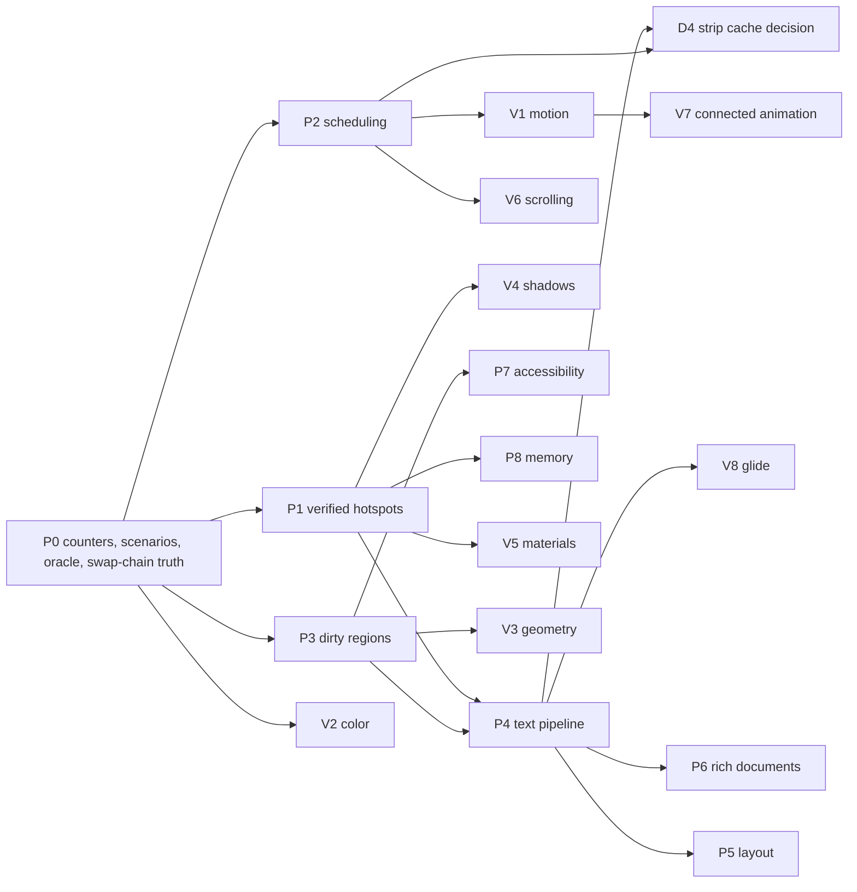

# Runtime efficiency and rendering quality, 7 November 2026 (revised 8 November 2026)

Status: REVISED SPEC — the 7 November draft was red-team reviewed on 8 November 2026 against `DxUi` at
`c0ead00a`, [`anomalyco/rune`](https://github.com/anomalyco/rune/tree/a7f276c3630f85a06a0230295da4d2bd172d8d3b)
at `a7f276c`, [`longbridge/gpui-fast`](https://github.com/longbridge/gpui-fast/tree/fb8cf9413777e43e7c38bf5917647ee984453f37)
at `fb8cf94` and [`ppmpreetham/BUI`](https://github.com/ppmpreetham/BUI/tree/e8126cab68f1b542676e83909671bc803dedb36c)
at `e8126ca` (see [BUI review](#bui-review-ppmpreethambui-at-e8126ca)). Each draft claim was checked against source;
the result is the evidence ledger below. The draft pins were rune `0772373` and gpui-fast `61dccec`. Decisions D1, D2
and D4 stand. D3 is revised and D5–D10 are new; all of these need the developer's confirmation (see
[Decisions](#decisions)). Plan only; no code has been implemented.

- **Owning contracts**: [performance and resources](../../Core/Core_PerformanceAndResources.md),
  [architecture](../../Core/Core_Architecture.md), [controls and layout](../../UI/UI_ControlsAndLayout.md),
  [theme and typography](../../UI/UI_ThemeAndTypography.md), [input and accessibility](../../UI/UI_InputAndAccessibility.md),
  [design system](../../UI/UI_DesignSystem.md), [embedded rendering](../../Rendering/Rendering_EmbeddedD3D11.md),
  [Win32 host](../../Rendering/Rendering_Win32Host.md), [toolchain and consumption](../../Build/Build_ToolchainAndConsumption.md),
  [validation](../../Testing/Testing_Validation.md) and [documentation](../../Core/Core_Documentation.md).
- **Coordinated plans**: [remaining work](RemainingWork_2026-11-04.md) owns D-P1 (the timing policy), D-Q1
  (platform/consumer acceptance) and every closed item cited below. The archived
  [production review](../Done/ProductionReview_2026-11-02.md) holds the original `CTRL-*`/`HOST-*` findings.
  This plan takes over only the open IDs it names. It never reopens a closed one.

## Verdict on the 7 November draft

The draft studied the right two projects and found real hotspots. It was not implementable as written, for these
reasons:

1. **About a fifth of its work was already done.** `EDIT-01`/`RENDER-01`/`RENDER-14` were closed in
   [EditorCosmeticPreparation](../Done/EditorCosmeticPreparation_2026-11-06.md): source guides are viewport-scoped,
   capped at 4 layouts per turn and never withhold a frame. `RENDER-02` for Source mode was closed in
   [SourceSpacingAndRadioNaming](../Done/SourceSpacingAndRadioNaming_2026-11-07.md). `RENDER-05` (color-glyph
   capability) was closed in [ScriptColorPreparation](../Done/ScriptColorPreparation_2026-11-06.md). `SEM-02` was
   closed in [SemanticAndDiagramResources](../Done/SemanticAndDiagramResources_2026-11-07.md), and `MD-05`..`07` in
   [MarkdownScanBounds](../Done/MarkdownScanBounds_2026-11-06.md).
2. **Several "facts" were wrong or invented.** There is no `6.10 ms/step` measurement and no
   `Menu-Popup4096-Keyboard` fixture anywhere. The brush and format caches are hash maps capped at 256 and 96, not
   64-entry linear scans. `GetMenuIconWicFactory` is already a cached static. `TagPicker::ComputeLayout` and the
   `tag + L" \x00D7"` concatenation do not exist. `PreparedFlowchart::Draw` zeroes no stack arrays and creates no
   per-draw geometry. `GetVisibleItemRect` is constant time. `Control` has 5 cold strings, not 4. The 8 ms
   `SetTimer` is not "125 Hz": `USER_TIMER_MINIMUM` raises it to 10 ms and the system tick quantizes it to about
   64 Hz, with jitter. The API revision is already 5, so a breaking change makes it 6.
3. **The reference projects were partly misread.** `device_wake.rs` handles D3D11 device removal, not widget
   deadline timers. `ChangedBounds` is draw-order batching, not dirty rects. `em_metrics.rs` is a font-fallback
   fix. gpui-fast's number set excludes space. rune's 4-band shadow split saves fragment overdraw in its own shader;
   with a `CLSID_D2D1Shadow` effect it would multiply effect passes by four, an anti-pattern.
4. **One rendering assumption looks wrong.** The partial-present path assumes `FLIP_SEQUENTIAL` with
   `BufferCount = 2` keeps the previous frame outside the dirty rect. DXGI documents that the reused back buffer
   holds the frame from `BufferCount` presents earlier; the source comment at `DxUi.WindowHost.cpp` around line 5071
   assumes the opposite. Extending control-driven dirty rects on this assumption would show stale pixels on
   alternating frames. P0.4 proves or disproves the behavior before anything builds on it.
5. **No usable acceptance signal.** D-P1 in the remaining-work plan records that paired timing is inconclusive:
   71 of 72 controls are unstable and the base policy is unqualified. A plan whose gates are "ms p95 improves"
   cannot close. This revision gates every item on **deterministic work counters**, such as layouts created,
   effects created, tree visits, timer wakes and heap allocations per frame. Timing stays advisory until D-P1
   qualifies the policy.
6. **Nothing addressed beauty.** The draft improved CPU work only. This revision adds a measured visual track
   (V1–V8): springs, perceptual color transitions, crisp fractional-DPI geometry, analytic shadows, real popup
   materials, scrolling feel, real connected animations and text glide stability.

## Evidence ledger

Static findings carry file references at `c0ead00a`. "Counter" means the P0.1 instrumentation must confirm the
number before the item closes. A ledger number is a hypothesis to measure, never a receipt.

| # | Claim | Verdict | Evidence | Consequence |
| --- | --- | --- | --- | --- |
| E1 | Animation dispatcher polls at 8 ms whenever any subscriber exists | Verified (effective ~64 Hz) | `kFrameIntervalMs = 8u`, `SetTimer` in [AnimationDispatcher.h](../../../src/Support/AnimationDispatcher.h) | P2.1 |
| E2 | `TextField`/`ComboBox` caret (530 ms), `RichTextEditor` caret (500 ms) and `TooltipLayer` (500 ms show, 5,000 ms hide) return `true` every tick | Verified | `DxUi.TextInput.cpp:1804`, `DxUi.ComboBox.cpp:1901`, `DxUi.RichTextEditor.cpp:5500`, `DxUi.Controls.cpp:12152` | P2.2, P2.3 |
| E3 | `TextField`/`ComboBox` ignore `GetCaretBlinkTime`, reduced motion and the caret timeout | Verified (`RichTextEditor` already honors reduced motion; `SPI_GETCARETTIMEOUT` appears nowhere) | same files | P2.2 |
| E4 | Every animation tick walks the whole tree | Verified | `Panel::Tick` visits every visible child; `EmbeddedHost::AdvanceAnimation` calls `_root->Tick` | P2.1 |
| E5 | `EmbeddedHost::Prepare` clears and repaints the whole surface for any change | Verified | `dc->Clear(...)` then `_root->Paint` in [Embedded.cpp](../../../src/Rendering/Embedded.cpp) | P3.2 |
| E6 | Control invalidation is always full-window | Verified | `ControlHost::Invalidate()` calls `InvalidateRect(_hwnd, nullptr, FALSE)` | P3.1 |
| E7 | Partial present keeps previous-frame content | **Unproven and probably false** | `BufferCount = 2`, `FLIP_SEQUENTIAL`, source comment near `DxUi.WindowHost.cpp:5071` | P0.4 decides; a latent bug in today's `WM_PAINT` partial path is possible |
| E8 | `Panel`/`ScrollPanel` paint every visible child regardless of clip | Verified | `DxUi.Controls.cpp:1533`, `11311` | P3.4 |
| E9 | The brush cache is cleared on every swap-chain resize | Verified, and cleared **twice** | `PrepareForSwapChainResize` and `RecreateBrushCache` | P1.12 |
| E10 | Brush/format caches use 64-entry linear scans | **Refuted** | `std::unordered_map`, limits 256/96 in [DxUi.h](../../../include/DxUi/DxUi.h); the clear-on-overflow cliff is real | P4.5 (low priority) |
| E11 | `DrawTextW` at "90+ call sites" | **Overstated** | 7 raw `DrawTextW` sites; `DrawCenteredText` has 63 callers; 28 `CreateTextLayout` sites | P4.1 |
| E12 | `ComboBox` popup: `1 + 2V` `UpdatePopupLayout` calls per paint, each measuring all N items | Verified (N = 500, V = 8 → 8,500 layouts per frame) | `PaintOverlay` → `GetPopupItemRect`/`GetPopupItemTextRect` → `UpdatePopupLayout` → `ComputePopupWidthDip` | P1.1 |
| E13 | Popup blur, layer, gradients and both shadow passes are recreated every paint | Verified | `DxUi.ComboBox.cpp:348/359`, `DxUi.Menu.cpp:717/728`, `DrawShadowEffectPass` `DxUi.Controls.cpp:258/283` | P1.2, V4 |
| E14 | WIC factory is created per icon | **Refuted** | function-local static in `GetMenuIconWicFactory` | dropped |
| E15 | Popup backdrop is a synchronous GDI screen capture | Verified (missed by the draft) | `CaptureBackdropScreenRegion`: `BitBlt(..., SRCCOPY \| CAPTUREBLT)` in [DxUi.cpp](../../../src/Controls/DxUi.cpp) | V5 |
| E16 | `TextField` cache hit runs `SecureClear` plus a string copy; masking applies to every field; composition state deep copy | Verified | `DxUi.SingleLineTextEditing.cpp:527`, `DxUi.TextInput.cpp:3620`, `DxUi.NativeTextInput.cpp:2094` | P1.3 |
| E17 | Multiline caret/selection create fresh layouts each paint | Verified | `DxUi.TextInput.cpp:765`, `811` | P1.4 |
| E18 | `TagPicker` per-paint string concatenation | **Refuted** | `LayoutParts()` runs on mutation only | dropped |
| E19 | `Splitter` preview rebuilds the whole-window UIA snapshot every pointer move | Verified | `DxUi.EditorControls.cpp:747` | P1.5 |
| E20 | `ProgressBar`/`Slider` value changes do full invalidation plus a general 3-pass UIA rebuild | Verified (the kind is `General`, not `Full`; `Label` already uses `ContentOnly`) | `DxUi.Controls.cpp:5186`, `6467`; `DxUi.Accessibility.cpp:1456/1460/1477` | P1.6 |
| E21 | `Label` runs an `IsControlInTree` DFS before its cheap early-out (`CTRL-02`) | Verified | `DxUi.Controls.cpp:2970` | P1.7 |
| E22 | Grid key navigation allocates and walks all rows per key (`CTRL-04`); `Tree` double lookup | Verified | `CollectVisibleRowIndices` `DxUi.Grid.cpp:5937`; `DxUi.Tree.cpp:892/901` | P1.7 |
| E23 | `FlexPanel::ApplyLayout` revalidates all N children after each `SetBounds` (O(N²)) | Verified | `DxUi.Layout.cpp:1030` | P1.8 |
| E24 | `Grid::Paint` calls `GetColumn` (by-value strings) `C + C·rows` times per frame | Verified | `DxUi.Grid.cpp:4155`, `4435` | P8.3 |
| E25 | Semantic geometry reuse is gated on `state_->document == document` and every edit creates a new document | Verified (the real cross-edit loss of math, diagrams and images) | `DxUi.RichSemanticGeometry.cpp:2436/2447`, `DxUi.RichSemanticDocument.cpp:2840` | P6.1 |
| E26 | Semantic code-fence line numbers: one `PreparedLayout` per line; all drawn every frame (`clip = box.frame`) | Verified | `DxUi.RichSemanticGeometry.cpp:2930/2941/4075` | P1.11 |
| E27 | `TokenizeCode` discards all coloring above 4,096 tokens | Verified | `output.clear(); return false;` in [DxUi.RichCodeInk.h](../../../src/Controls/DxUi.RichCodeInk.h) | P1.10 |
| E28 | `PreparedMath::DrawColored` zeroes a 32 KB stack array and calls `pow` per paint | Verified (32 KB, not "9–60 KB"); flowchart `Contrast()` also calls `pow` per paint | `DxUi.PreparedMath.h:3015/3030`, `DxUi.PreparedFlowchart.cpp:21` | P1.9 |
| E29 | `pow`-based sRGB decode on paint paths | Verified for `Utilities.h` (`TextField`/`ComboBox` style resolution), math and flowchart; theme-time only for `DxUi.Theme.cpp` | as cited | P1.9 |
| E30 | `PreparedLayout::TryVisibleRange` is linear with a `HitTestTextPosition` per line; semantic range queries scan `boxes` and ignore `paintBoxes` | Verified | `DxUi.RichTextLayout.cpp:757`, `DxUi.RichSemanticGeometry.cpp:3964` | P1.9 |
| E31 | `PaintIndex::Build` discards capacity | Verified | [DxUi.PaintIndex.h](../../../src/Controls/DxUi.PaintIndex.h) | P1.9 |
| E32 | `ComposeGifCanvas` has no fast path for alpha 0/255 | Verified | `DxUi.RichImage.cpp:158` | P1.9 |
| E33 | `RichImage::LoadFile` duplicates the encoded buffer (`RENDER-09`) | Verified | `DxUi.RichImage.cpp:251`, `506` | P1.13 |
| E34 | `MenuPopup` keyboard step costs 6.10 ms | **Not found** | no fixture or receipt | P0.2 measures; P7.4 is conditional |
| E35 | `sizeof(Control)` = 296/336 B | Unrecorded | no test or `static_assert` | P8.1 adds a recorded probe |
| E36 | Lifetime token is an eager `make_shared<int>` | Verified, 460 call sites | `DxUi.h:1853` | D3 revision: slab handle withdrawn |
| E37 | `HOST-14` dead `#else` `Render` body | Verified dead (`DXUI_ENABLE_DIAGNOSTICS` is fixed to `1` in [Configuration.h](../../../include/DxUi/Configuration.h)); it sits at lines 4708–4952, not 4601 | as cited | P1.12 |
| E38 | `HOST-03`, `HOST-09` | Verified open | `Embedded.cpp:1055`, `664` | P1.12 |
| E39 | Native host never sets text antialias mode or rendering params | Verified; embedded forces grayscale | `Embedded.cpp:283` | P4.6 |
| E40 | Color transitions are sRGB-space lerps | Verified | `BlendColor` in [DxUi.Theme.cpp](../../../src/Controls/DxUi.Theme.cpp) | V2 |
| E41 | No springs; interrupted lerp transitions restart at the wrong speed | Verified | `Slider::BeginVisualTransition` re-anchors and restarts its clock | V1 |
| E42 | Connected animation draws a placeholder outline, not content | Verified | `PageHost::PaintOverlay` | V7 |
| E43 | 1 DIP strokes at fractional DPI produce blurred 1.25/1.5 px borders | Verified | shared rounded-rect stroke helpers in `DxUi.Controls.cpp` | V3 |
| E44 | Wheel scrolling is quantized and immediate, with no inertia or edge fades | Verified | `DxUi.Grid.cpp:5891`, `DxUi.Tree.cpp:2155` | V6 |
| E45 | Windows 10 color-glyph path (`TranslateColorGlyphRun`) is absent; only `ID2D1DeviceContext7` is used | Verified; Windows 10 is in the embedded baseline ([toolchain](../../Build/Build_ToolchainAndConsumption.md)) | `DxUi.RichTextScriptRenderer.h:218` | P4.1 |

## What DxUi borrows, and what it does not

| Mechanism (source) | Transfer | DxUi item |
| --- | --- | --- |
| Lockstep incremental-versus-fresh verifier (gpui `tests/oracle.rs`, `layers/verify.rs`) | As-is | P0.3 |
| Per-thread allocation counters and debug stall warnings (rune `procwatch`, `tooling/perf_warn.rs`) | Adapted to test-only `operator new` hooks plus deterministic counters | P0.1 |
| Deadline wakes run without view, layout or GPU work unless visible state changed (rune `motion/timer_wake.rs`) | Adapted | P2.1 |
| Hover held still for 100 ms after a wheel under a stationary pointer (gpui `layers/hover_freeze.rs`) | As-is | P2.5 |
| Unseen motion lands instantly (rune `87caf2a`, `motion/unseen_presence.rs`); loop phase kept across hiding (rune `motion/loop_clock.rs`) | As-is | P2.6 |
| Sample animations at the predicted presentation time (rune `research/15` §1); back off when compositor waits return instantly (gpui `vsync.rs`) | Adapted to waitable swap chain plus `DwmGetCompositionTimingInfo` | P2.7 |
| Two-generation color-independent shaped-run cache (gpui `text.rs` `RecentShapes`, 16 Ki glyphs per generation) | Adapted: capture `DWRITE_GLYPH_RUN` through a private `IDWriteTextRenderer` and replay with `DrawGlyphRun` | P4.1 |
| Width-independent shaping, re-breaking in place on resize (rune `research/28`: 16.1 → 4.6 ms) | Adapted: `IDWriteTextLayout::SetMaxWidth` instead of recreation | P4.3 |
| Context-free numeric shaping table (gpui `number_shaping.rs`: `0123456789.,+-%$KMBT`, no `:`, no space, sampled 1/256 oracle) | Redesigned: tabular figures, every pair **proved at build time** instead of sampled at run time | P4.4 |
| Binary-searched visible lines (rune `text/glyph_emit.rs`, 200 KB note 5.45 → 0.09 ms) | As-is over cached line tops | P1.9 |
| Byte-cut fence coloring that keeps the first tokens (rune-kit `syntax/scan.rs`, 32 KiB / 8,192 tokens) | As-is | P1.10 |
| Cold rare-field sidecar with a static empty instance (rune `cold.rs`) | As-is | P8.1 |
| Clickable-span hover filter (gpui `interactive_text.rs`) | As-is | P6.5 |
| A11y scroll carry, translating cached bounds by the scroll delta (gpui `a11y.rs`) | Adapted | P7.2 |
| Lazy tab-stop order (gpui `tab_stop.rs`, `6b9c204`, `fb8cf94`) | Conditional on measurement | P7.5 |
| Opaque fill inset by half a stroke under an opaque border (rune `paint/border.rs` `fill_under`) | As-is | V3 |
| Rounded clip without a layer when content clears the corners (rune `17abbcb`: 512 cards, about 82 → 3 ms encode) | Adapted: `PushAxisAlignedClip` instead of `PushLayer` | V3 |
| Closed-form spring with duration/bounce and velocity-preserving retarget; effect channels never overshoot (rune `rune-motion/src/spring.rs`, `research/15` §7) | As-is | V1 |
| Single-pass analytic Gaussian rounded-rect shadow (gpui `shaders.hlsl` erf integral) | Adapted as a custom D2D effect | V4 |
| Scroll edge fades (rune `ScrollFade`); analytic fling (rune `research/15` §8); DirectManipulation touchpad (gpui `direct_manipulation.rs`) | Adapted | V6 |
| Text glide dead-zone: snap within 1/64 px of rest (rune `e1bd315`) | Adapted | V8 |
| Scroll-layer promotion/demotion policy (gpui `layers/policy.rs`: promote after 2 scrolled frames, demote after 8 of 16 changed, 60-frame repromotion, cooldown doubling; `layers/work.rs` `REPAINT_COST = 2`) | As-is, **only if** D4 triggers | D4 |

**Not borrowed**, with reasons:

- **Closure replay logs** (gpui `retained.rs`/`splice.rs`): DxUi already retains its control tree.
- **GPU tiles for virtual lists**: gpui `docs/scroll-layers.md` forbids them itself.
- **4-band shadow clip split** (rune `paint/bands.rs`): with D2D effects it multiplies effect passes.
- **rune's `KeyHasher` constants**: any good 64-bit hash works, and a cache must compare the full key exactly.
- **Per-word shaping cache**: rune `research/32` rejected it at 1.46–1.57× while it broke kerning and line breaking.
- **Bump arena for retained nodes**: rune `research/37` found it under 1% of busy time.
- **`em_metrics.rs`**: DirectWrite fallback already covers it.
- **`ChangedBounds`/`BoundsTree`**: a draw-order structure DxUi does not have.
- **`CompositeBatch`/`draw_state.rs`**: embedded composite is already 0.0104 ms p95
  ([Default-B1](../../../Measurements/EmbeddedInteractionLayout/Default-B1.json)); revisit only if a multi-view
  consumer measures otherwise.
- **HDR/advanced color**: no product requirement, and DWM composes SDR content correctly.
- **Continuous `opsz` axis values**: the named `Segoe UI Variable Small/Text/Display` instances already match the
  WinUI type ramp.
- **Replacing the double focus ring**: it is WinUI's standard high-visibility focus visual.
- **Reveal highlight and noise textures**: retired from Fluent; DWM supplies acrylic noise.

## Definition of done for every item

1. **Fail-before counter.** The item names its P0.2 scenario and counter. The baseline value is recorded before
   the code change. The candidate meets the stated bound on the same fixture and build profile. Counter bounds
   are exact or upper bounds and live in the test, so a regression fails the build. Timing is reported but
   gates nothing until D-P1 qualifies its policy.
2. **Parity.** Any item that adds retention, culling or partial painting passes the P0.3 incremental-versus-fresh
   oracle with **0** BGRA differences on WARP. It also keeps bit-identical bounds and an identical UIA snapshot
   for its scripts.
3. **Visual changes are separate.** A change meant to alter pixels (V-items, P4.1 replay snapping, P4.6) is
   reviewed through `gallery.ps1 -PublishDocs` harness captures, with scenario/build/DPI provenance and a
   before/after carousel. A design-system update is required. P0.3 parity never stands in for this review.
4. **Resource rules.** Steady state allocates nothing, composition does no heap/layout/raster/blocking work, idle
   blocks on events, and caches trim only at frame or preparation start. New caches report their size in
   `EmbeddedStatistics` or the diagnostics sink.
5. **Repository workflow.** One focused branch per item group, a `Changes/` fragment, `Test-Changes.ps1 -Explain`
   plus affected suites while editing, and `-Mode PrePush` before push. Normative text moves into the owning
   contract when the item closes. Behavior or API changes update `docs/` and `capabilities.json`. Focus-taking
   suites run only with the developer's agreement to the time.
6. **Platform.** No unconditional import beyond the Windows 10 embedded baseline. Windows 11-only facilities are
   detected at run time with a tested fallback.

## Decisions

Confirmed on 7 November 2026 and retained:

- [x] **D1.** This plan stays separate from [remaining work](RemainingWork_2026-11-04.md) and is sequenced after
  D9's history rewrite on shared files.
- [x] **D2.** A popup keeps publishing every row to UI Automation. The draft's "6.10 ms/step" was unsubstantiated,
  so P7.4 runs only if P0.2 measures a real cost.
- [x] **D4.** A non-virtual `ScrollPanel` bitmap strip cache waits for measurement after P3/P4/P2.5. If it is
  built, it uses gpui's promotion/demotion policy and `REPAINT_COST` work accounting, a 16 MiB cap inside the
  64 MiB per-view cap, and only row-band uploads.

Proposed on 8 November 2026; each needs the developer's confirmation before its phase starts:

- [ ] **D3 (revised). API revision 6, not 5; one bundled break.** Revision 5 already exists. Bundle every public
  break into a single revision 6 so consumers migrate once:
  1. The embedded animation request replaces `NeedsAnimation()`/`AdvanceAnimation()` (P2.4). This is a
     deliberate compile break: a silent change in meaning would stop carets blinking in unported consumers.
  2. `Control::GetVisualOverhangDip()` and region invalidation (P3.1).
  3. Zero-copy `IGridModel::GetColumn` only if the P8.3 hoist leaves allocations.
  4. **Withdrawn:** the 64-slot slab `ControlLifetimeHandle`. It would touch 460 call sites and every consumer to
     save one small allocation per control; P8.2 keeps `std::weak_ptr<int>`.
  The `Control` layout changes in P8.1 need no revision, because consumers already rebuild against an exact pin.
- [ ] **D5. Native frame pacer.** `WindowHost` continuous animation is paced by a DXGI frame-latency waitable
  object. One pacer thread per UI thread blocks on `{waitable, arm/stop event}` and posts one frame message only
  while a continuous animation is armed. When disarmed it blocks indefinitely, so this is event-driven with no
  polling. The fallback where the waitable is unavailable is a one-shot timer at the display refresh period.
  Embedded hosts are unchanged and stay owner-scheduled.
- [ ] **D6. Visual direction.** Adopt springs (V1), OKLab color transitions (V2), device-pixel hairlines (V3),
  analytic elevation shadows (V4) and smooth scrolling (V6) as design-system changes, with gallery review per
  item. Reduced motion and High Contrast keep their current semantics.
- [ ] **D7. Popup materials.** Retire the GDI `CAPTUREBLT` screen capture. HWND popups use the DWM transient
  system backdrop where available. In-window and embedded overlays blur DxUi's own retained surface. Everything
  else falls back to the solid themed fill. This also stops reading other applications' pixels.
- [ ] **D8. Text rendering params.** Pick antialias mode by presentation mode: grayscale on premultiplied or
  composition targets, the system setting on opaque HWNDs. Use per-monitor rendering params. Any change to dark-theme
  grayscale contrast requires harness A/B captures.
- [ ] **D9. Order.** P0, then P1, are mandatory first. P2 through P8 and V1 through V8 follow the
  [dependency graph](#sequencing). V-items may run in parallel with P-items when they touch different files.
- [ ] **D10. Clean-room BUI additions.** Adopt visibility-latched animated image clocks, two-buffer ping-pong and
  target-size WIC decode scaling (B1), per-corner radius masks and 1-DIP analytical bevel/emboss rims for joined
  controls (B2), and optional Blender-style numeric scrubbing and menu typeahead filtering (B3). Resolution-independent
  GPU curve text for zoomed diagrams (B4) stays a measured research option after P4.1 and P6.1. Zero GPL-2.0/3.0
  code, shader source or tables may be copied from BUI.

## P0 — Measurement foundation (blocks every other phase)

- [ ] **P0.1 Deterministic work counters.**
  - **Change**: Add a private `Detail::WorkCounters` thread-local record of plain increments. It is dormant until
    a test sink reads it. Route creation through counted helpers in [DxUi.Internal.h](../../../src/Controls/DxUi.Internal.h):
    `CreateTextLayout`, implicit `DrawText` layouts, `CreateEffect`, `CreateCommandList`, `CreateLayer`, gradient
    and solid brushes, path geometries, `CreateBitmap*`, GDI captures and UIA snapshot builds (with node counts).
    Also count tree visits in `Tick`/`Paint`/`HitTest`, timer and pacer wakes, `Prepare`/`Render`/`Present` and
    pixels painted.
  - **Allocation counting**: test executables replace `operator new`/`delete` to count per-thread allocations
    inside a `ScopedAllocationCounter`. The library stays unhooked.
  - **Enforcement**: a tooling test (`Tools/tests`) fails if `->CreateTextLayout(`, `->CreateEffect(` or
    `->DrawText(` appears outside the counted helpers.
  - **Gate**: overhead under 1% on ComplexUi clean frames. Clean frames stay at 0 allocations.
- [ ] **P0.2 Scenario fixtures and baseline receipt.** Add `Embedded.Tests.WorkCounterScenarios.h` and
  `Controls.Tests.WorkCounterScenarios.cpp`. Record every counter for these scenarios in
  `Measurements/RuntimeEfficiency_2026-11-08/baseline-counters.json` with source commit and build profile:
  - S1: focused idle single-line `TextField` for 10 s.
  - S2: tooltip shown for 6 s.
  - S3: 500-item `ComboBox` open, 60 hover frames.
  - S4: popup shadow/blur steady frame for `ComboBox` and `MenuPopup`.
  - S5: 2,048-row `Grid`, 100 wheel notches.
  - S6: 10,000-row `Tree` and grouped `Grid`, 200 arrow/page keys.
  - S7: `Slider`/`ProgressBar`, 100 value steps with a UIA client listening.
  - S8: `Splitter` dragged 200 px.
  - S9: semantic document with 3 math blocks, 2 Mermaid diagrams and 2 images; 50 keystrokes outside them.
  - S10: 4,096-row `MenuPopup`, 100 keyboard steps.
  - S11: 2,000-line fenced code block in semantic view, scrolled.
  - S12: the existing ComplexUi and the 64 Ki-unit typing benchmark.
  - S13: resize sweep, 30 sizes.
  - S14: wrapped-label resize, 30 widths.
- [ ] **P0.3 Incremental-versus-fresh oracle.**
  - **Change**: Add `Controls.Tests.IncrementalParity.cpp` and `Embedded.Tests.IncrementalParity.h`. Seeded
    mutation scripts cover text, bounds, visibility, hover/focus/press, scroll, theme, DPI 96/144/192, LTR/RTL,
    caret ticks, popup open/close and rich edits. Each step renders the incremental host and a reference: the
    same tree after a diagnostics hook `ControlHost::DebugDropRetainedStateForTest()` drops every cache and
    invalidates fully.
  - **Comparison**: BGRA output (exact on WARP), all bounds and UIA snapshot records. Failures retain the seed
    and step.
  - **Scope**: Light at first. Every later retention item adds its own scripts.
- [ ] **P0.4 Swap-chain content truth test.**
  - **Change**: Add a WARP test in [DxUi.Tests.WindowHost.cpp](../../../Tests/Controls/DxUi.Tests.WindowHost.cpp)
    that presents a full frame, then partial A, then partial B. Through a diagnostics readback of buffer 0 before
    the next draw, it establishes whether non-dirty pixels come from N−1 or N−2.
  - **Outcome**: Record the result in the Win32 host contract. If it is N−2, today's `WM_PAINT` partial path is a
    latent stale-pixel bug and P3.3's history-union design is mandatory; fix it in P1.12 with this test as the
    fail-before.

## P1 — Verified hotspots and open review IDs (independent, low risk, one PR per bullet group)

- [ ] **P1.1 `ComboBox` popup layout.**
  - **Change**:
    - Cache the widest item width keyed by items revision, filter text, typography/DPI/theme revision and font
      collection generation.
    - Compute `PopupLayout` once per paint and pass it into the row loop.
    - Derive the text rect from the row rect instead of recomputing it.
  - **Files**: [DxUi.ComboBox.cpp](../../../src/Controls/DxUi.ComboBox.cpp).
  - **Gate (S3)**: width-measurement layouts per steady frame drop from 8,500 to **0**. Total layouts per frame
    stay at most V until P4.1 makes them 0. N layouts happen only when an input of the width key changes.
- [ ] **P1.2 Retained popup and shadow resources (Phase A of V4).**
  - **Change**:
    - Retain per popup the blur effect, layer, gradient brushes (unit-space, positioned by brush transform) and
      clip geometry.
    - Replace per-call `DrawShadowEffectPass` objects with an 8-entry host `ShadowCache`. Its key is
      `{radius, blur, color, size quantized to device px}`; its value is a retained command list plus a shadow
      effect with `D2D1_PROPERTY_CACHED`.
    - Rebuild on device loss, theme or DPI change.
  - **Files**: `DxUi.Controls.cpp`, `DxUi.ComboBox.cpp`, [DxUi.Menu.cpp](../../../src/Controls/DxUi.Menu.cpp).
  - **Gate (S4)**: effect, command-list, layer and gradient creations per steady frame are **0**, and pixels are
    identical to the current output.
- [ ] **P1.3 `TextField`/`ComboBox` paint churn (`CTRL-13`).**
  - **Change**:
    - Copy or `SecureClear` the cached text only on a cache miss, and only when masked (or clearing a previously
      masked entry).
    - Add `GetDisplayTextView()` for unmasked fields.
    - Add a `HasNativeTextComposition(const Control*)` guard so paint copies no `NativeTextInputState` without
      composition.
    - Probe a stack array of 8 hit-test metrics before any heap fallback.
  - **Gate (S1)**: **0** heap allocations per focused paint frame.
- [ ] **P1.4 Multiline `TextField` layout reuse.** Caret and selection use `_cachedMultilineLayout`, whose entry
  caches line metrics. **Gate**: focused multiline frame layouts drop from 2 to **0**.
- [ ] **P1.5 `Splitter` preview accessibility.** During a drag, publish only a bounds update once per frame. Run
  the structural refresh on commit. **Gate (S8)**: at most 1 UIA update per frame and 1 structural build per drag.
- [ ] **P1.6 Value-only accessibility mutation.**
  - **Change**: Add `AccessibilityMutationKind::Value`. It updates one element's range value in the retained
    snapshot and raises the value-changed property event. Route `ProgressBar`, `Slider` and `NumericStepper` value
    changes through it.
  - **Gate (S7)**: **0** structural snapshot builds per value step; value events stay identical (UIA client test).
- [ ] **P1.7 Navigation and preparation IDs (`CTRL-02`, `CTRL-04`, `Tree`).**
  - **Change**:
    - `Label::PrepareVisualContent` checks override/mnemonic before `IsControlInTree`.
    - `Grid` caches its visible-ordinal mapping per `(modelRevision, groupStateRevision)`.
    - `Tree::SetFocusedItemId` calls `FindVisibleItemById` once.
  - **Gate (S6)**: **0** allocations and O(groups) work per key.
- [ ] **P1.8 `FlexPanel::ApplyLayout` validation.**
  - **Change**: After each `SetBounds`, check only O(1) topology/interaction revisions, then run one full
    validation after the loop. Reentrant mutation keeps its `E_ABORT` semantics.
  - **Gate**: child validations per `ApplyLayout` are at most 2N, with an existing reentrancy test plus a new one.
- [ ] **P1.9 Rich-document quick fixes.**
  - **Change**:
    - Cache line tops in `PreparedLayout` so `TryVisibleRange` binary-searches with zero hit-test calls.
    - Route semantic `TryVisibleRange`/`TryVisibleSourceRange` through `paintBoxes`.
    - Reuse `PaintIndex` capacity.
    - Add alpha 0/255 fast paths in `ComposeGifCanvas`.
    - Move math's 32 KB resolved-color array into a node-count-sized cache rebuilt only when the palette key
      `(background, ink, dark, high contrast)` changes; cache flowchart contrast results the same way.
    - Replace the paint-path sRGB `pow` decode with one shared 256-entry table in [Utilities.h](../../../src/Support/Utilities.h).
  - **Gates**: line hit-tests per visible-range query **0**; palette resolutions per paint with an unchanged
    palette **0**; `PaintIndex` allocations per rebuild **0** after warm-up.
- [ ] **P1.10 Fence coloring keeps its prefix.**
  - **Change**: Above `MaximumCodeTokens`, keep the tokens up to the last complete line inside the budget and
    leave the rest plain (rune-kit `scan.rs`). Never color half a line, and never flash the whole block plain.
  - **Gate**: a 4,097-token fence keeps every line before the cut colored, in independent expected output.
    Usage docs are updated.
- [ ] **P1.11 Semantic code line numbers, viewport-scoped.**
  - **Change**: Remove the per-line `PreparedLayout` allocation and the `box.frame` clip. Draw only visible
    numbers with a per-line clip, reusing the viewport window and the 4-per-turn budget of
    [DxUi.RichSourceGuides.h](../../../src/Controls/DxUi.RichSourceGuides.h). P4.4 later makes them 0 layouts.
  - **Gate (S11)**: layouts created are at most the visible lines plus margin; numbers drawn per frame are at most
    the visible lines.
- [ ] **P1.12 Host hygiene.**
  - **Change**:
    - `HOST-14`: delete the dead `#else` `Render` body and other dead `#if ! DXUI_ENABLE_DIAGNOSTICS` branches.
    - `HOST-03`: limit the `Ctrl` rich-title resolve to targets that can show one.
    - `HOST-09`: skip text-input activation for a non-text focus.
    - `HOST-13`: remove the tooltip string copy.
    - Keep brushes across `ResizeBuffers`. Solid brushes belong to the device context, not the target.
    - If P0.4 shows N−2 content, fix the `WM_PAINT` partial path now by adding the previous frame's rect to the
      repaint.
  - **Gates**: brush creations on resize **0** (S13); a clean embedded surface stays clean on `Ctrl`; activations
    per prepare with non-text focus **0**.
- [ ] **P1.13 `RENDER-09`.** `LoadFile` moves its buffer into `Decode`. **Gate**: peak bytes are at most the file
  size plus the decoded size.

## P2 — Scheduling and frame pacing

- [ ] **P2.1 Deadline-aware dispatcher.**
  - **Change**:
    - `Tick` keeps its meaning: `true` requests the next continuous frame.
    - Add `ControlHost::RequestWakeAt(uint64_t tickMs)`, keeping the minimum pending deadline per host.
    - When only deadlines are pending, the dispatcher arms one `SetCoalescableTimer` one-shot for
      `min(deadline) - now` with tolerance (10% for caret and tooltip). Continuous requests use P2.7 or its
      fallback.
    - A deadline wake runs `Tick` once and renders only if something invalidated (rune `timer_wake.rs`).
    - Subtree pruning is a follow-up, built only if S12 tree-visit counters justify it.
  - **Gate (S1)**: wakes in 10 s drop from about 640 to **≤ 20**; tree walks per 10 s **≤ 20**.
- [ ] **P2.2 Shared caret policy.**
  - **Change**: One `CaretBlinkClock` used by `TextField`, `ComboBox` and `RichTextEditor`:
    - Period from `GetCaretBlinkTime()`; `INFINITE` means a steady caret.
    - Stop blinking with the caret visible after `SPI_GETCARETTIMEOUT` since the last input.
    - Steady under reduced motion, as `RichTextEditor` already behaves.
    - Refresh on `WM_SETTINGCHANGE`.
  - **Gate**: **0** wakes after the timeout. Input restarts the blink.
- [ ] **P2.3 Tooltip deadlines.** The show delay and auto-hide become two deadlines. **Gate (S2)**: wakes while a
  tooltip is shown drop from about 320 to **≤ 2**.
- [ ] **P2.4 Embedded animation request (D3.1).**
  - **Change**: Replace `NeedsAnimation()`/`AdvanceAnimation()` with
    `EmbeddedAnimationRequest GetAnimationRequest() const noexcept` returning `{None | Continuous | Deadline,
    dueTickMs}`, and `EmbeddedAnimationRequest AdvanceAnimation(uint64_t nowTickMs) noexcept`.
  - **Docs**: update [hosting](../../../docs/hosting.md), [upgrade](../../../docs/upgrade.md), samples and
    `Tools/ConsumerApi`.
  - **Gate**: a scheduler simulation in `Embedded.Tests` sees **≤ 2** host wakes per blink period and 0 when idle.
    Each consumer migrates in its own repository.
- [ ] **P2.5 Hover freeze and post-scroll hover.**
  - **First**: a test documents current behavior. Wheel input moves content under a stationary pointer but does
    not update hover, so the hover may currently go stale.
  - **Change**: Hold hover for 100 ms after the last wheel while the pointer is unmoved. Then re-resolve it once on
    a single deadline (gpui `hover_freeze.rs`).
  - **Gate (S5)**: hover re-hit-tests during a notch burst **0**; exactly 1 after it; the hovered row is correct.
- [ ] **P2.6 Unseen motion and loop gating.**
  - **Change**:
    - A transition on a control that is invisible before and after lands immediately. Invisible means effective
      opacity 0, a hidden host, an empty clip intersection or off-viewport.
    - Periodic loops (indeterminate `ProgressBar`, `ThroughputGraph`) suspend while unseen and resume in phase.
  - **Gate**: S12 with a scrolled-away progress bar adds **0** wakes.
- [ ] **P2.7 Native frame pacer (D5).**
  - **Change**:
    - Create the swap chain with `DXGI_SWAP_CHAIN_FLAG_FRAME_LATENCY_WAITABLE_OBJECT` and maximum latency 1. This
      is DXGI 1.3, available on Windows 10.
    - The pacer thread posts frame messages only while a continuous animation is armed.
    - Animations sample the predicted present time from `DwmGetCompositionTimingInfo`.
    - If waits return in under 1 ms three times in a row (display off), fall back to the refresh-period timer.
  - **Gates**: **0** pacer wakes with no continuous animation (deterministic). Frame-interval jitter is recorded on
    a local hardware receipt; WARP cannot show vsync.

## P3 — Dirty regions and culling

- [ ] **P3.1 Region invalidation API (D3.2).**
  - **Change**:
    - `Control::InvalidateVisual()` invalidates the control's bounds plus `GetVisualOverhangDip()` (focus ring,
      shadow).
    - `ControlHost` accumulates a fixed 8-rect `DirtyRegion`, outward-snapped to device pixels. It merges when
      area overhead is under 25%. It falls back to full above 50% coverage, on topology/theme/DPI/size/device
      change and on smoke overlay changes.
    - `RequestInvalidate()` stays full, so this is safe by default.
    - Migrate the high-frequency sources first: caret, hover/press/focus transitions, scalar values, scroll thumb,
      tooltip.
- [ ] **P3.2 Embedded partial preparation.**
  - **Change**: For each region rect: push an aliased axis-aligned clip, clear the rect, paint with P3.4 culling,
    pop. Single retained surface, so no rotation issue.
  - **Gates**: P0.3 parity with 0 differences; pixels painted per caret blink at most the caret rect plus 2 px.
- [ ] **P3.3 Native partial present.**
  - **Change**: Paint the union of this frame's region and the previous `BufferCount − 1` regions (if P0.4 shows
    N−2 content), and present this frame's rects through `Present1`. Any failed, occluded or skipped present,
    resize, device loss or reset forces a full frame.
  - **Gate**: P0.3 parity using the P0.4 back-buffer readback after every present.
- [ ] **P3.4 Clip culling.**
  - **Change**: `ControlHost` tracks the current paint clip in DIPs. `Panel::Paint`/`PaintOverlay`, `ScrollPanel`,
    `FlexPanel` and `FormPanel` skip children whose bounds plus overhang miss it. Controls that draw outside their
    bounds declare an overhang; the oracle catches omissions.
  - **Gate (S12, scrolled)**: child paints per frame are at most the visible children plus 1 row of margin.

## P4 — Text pipeline

- [ ] **P4.1 Shaped-run cache (gpui `RecentShapes`, adapted).**
  - **Key**: exact text (stored and compared), `IDWriteTextFormat` identity plus format revision, reading
    direction, locale, font-collection generation and measuring mode. Pixels per DIP is added only for
    non-natural measuring modes.
  - **Value**: glyph runs captured once through a private `IDWriteTextRenderer` with pixel snapping disabled,
    advance width, height, baseline and overhang.
  - **Not cacheable** (keep a layout): text needing wrapping, trimming, inline objects, underline/strikethrough or
    mnemonics.
  - **Storage**: two generations backed by arenas. Flip at frame start once the current generation exceeds 16 Ki
    glyphs or 1 MiB, promoting hits in the old generation. Released on hide/detach/device/DPI/theme/font change.
    Bytes are reported in `EmbeddedStatistics`.
  - **Replay**: `DrawGlyphRun` with the color brush. The baseline is snapped to device pixels exactly as DirectWrite
    snaps it, when the transform is axis-aligned. Color glyphs use one shared helper: `ID2D1DeviceContext7` where
    available, otherwise `IDWriteFactory4::TranslateColorGlyphRun` plus `ID2D1DeviceContext4` (a new Windows 10
    path).
  - **Callers**: `DrawCenteredText` (63 callers), `DrawRawCenteredText`, `DrawTreeRow`, `ThroughputGraph` labels,
    `Grid` headers and single-line cells, `Menu` and `ComboBox` rows, and `MeasureSingleLineTextWidthDip`.
  - **Gates**:
    - **0** layouts and **0** allocations per steady ComplexUi dirty frame.
    - **Pixel-identical** replay versus `DrawTextLayout` on WARP for a corpus: Latin, Arabic/Hebrew RTL, CJK,
      emoji, combining marks and fallback fonts, at DPI 96/144/192, ClearType and grayscale. Any non-identical
      class falls back to a layout.
- [ ] **P4.2 `MeasureText` without heap.** Use a stack array of 8 line metrics with a heap fallback. Single-line
  measurement comes from P4.1. **Gate**: S12 measure allocations **0**.
- [ ] **P4.3 Re-break in place.** When only width or height changed, call `SetMaxWidth`/`SetMaxHeight` on
  `Label::_typographyLayout` and on `PreparedLayout` (whose shape inputs are unchanged) instead of recreating them.
  **Gate (S14)**: layouts created **0**, with P0.3 parity.
- [ ] **P4.4 Proved tabular numeric table.**
  - **Change**: Per `(font face, em size)`, shape `0`–`9 . , + - %` with `tnum`, singly and as all 15×15 pairs,
    once. Enable the table only if every pair advance equals the sum of its singles and every cluster maps 1:1.
    Exclude `:`, `/` and space; gpui excludes space too. The sampled run-time oracle is Debug-test only.
  - **Users**: semantic code numbers (P1.11), source guides, optional numeric `Grid` columns and percentages.
  - **Gate**: **0** layouts for line numbers in S11 and the 64 Ki source gutter.
- [ ] **P4.5 Cache cliffs.** Brush and format caches become current/previous generations swapped at frame start,
  bounded by twice the existing limits, with no clear-everything cliff. **Gate**: an S12 working set above the
  limit recreates **0** brushes in steady state.
- [ ] **P4.6 Text antialias mode and rendering params (D8).**
  - **Change**: `WindowHost` sets grayscale on composition/premultiplied targets and leaves the system mode
    otherwise. Per-monitor `CreateMonitorRenderingParams` refreshes on monitor change. Dark-theme
    grayscale-contrast tuning ships only with harness A/B captures.
  - **Gate**: no per-frame cost; gallery review.

## P5 — Layout (measure first)

- [ ] **P5.1 Measure-probe evidence, then `MeasureLog`.**
  - **First**: count measure calls with identical or alternating constraints per `ApplyLayout` in S12 and the
    form/localized fixtures.
  - **Then**: only if repeated probes exceed 1.5× unique probes, add gpui's four-entry inline measure log (spill to
    16) to `FlexPanel::ChildRecord` and `FormField::PartMeasure`. The cost is about 96 B per flex child record,
    not "0 B".
- [ ] **P5.2 Live label cutoff.** When `Label::SetText` gives an unchanged single-line desired size (from P4.1),
  skip `InvalidateMeasure()` and invalidate visually. **Gate**: a ticking label causes **0** layout passes.
- [ ] **P5.3 Width settle.** Build only if P0.3 finds a wrapped leaf drawn at a width other than its arranged one.

## P6 — Rich documents

- [ ] **P6.1 Cross-edit semantic carry (the real `SEM` gap).**
  - **Change**:
    - Replace the `state_->document == document` gate.
    - Images key on `{resolved image identity, frame epoch, raster target}`.
    - Native math and flowchart geometry key on `{block kind, exact source text plus hash, width bucket,
      typography, zoom, theme revision}`.
    - Carry previous geometry into the next preparation and translate offsets.
  - **Gate (S9)**: per keystroke outside the blocks, math/diagram rebuilds and image uploads are **0**, with P0.3
    parity.
- [ ] **P6.2 Source chunk translation.** Chunks after an edit are rejected only because
  `VerticalOrigin() != next.height`. Translate them by the delta instead. Investigate separately why Rich mode
  with a line-height multiplier uses `Phase::Reference`. **Gate**: chunks reshaped per mid-document keystroke in
  64 Ki **≤ 2**.
- [ ] **P6.3 Incremental Markdown block reparse.**
  - **First**: measure full reparse per keystroke with `Embedded.Tests.RichPreparationBenchmark`.
  - **Then**: only above 1 ms, reparse from the enclosing top-level block cut to the next stable cut (rune-kit
    `markdown/cache.rs`).
  - **Gate**: a seeded AST-equality oracle (incremental equals full), including lazy continuation and link
    reference definitions.
- [ ] **P6.4 Clickable-span hover (`HOST-08`).** Index link, footnote and image spans at preparation. Pointer moves
  over plain text cause **0** invalidations and **0** title scans.

## P7 — Accessibility

- [ ] **P7.1** Delivered by P1.5 and P1.6.
- [ ] **P7.2 Scroll carry.** A pure scroll flush translates cached descendant screen bounds by the delta in one flat
  pass. **Gate (S5)**: structural builds per notch **0**, with the UIA client test.
- [ ] **P7.3 Subtree splice.** Deferred. Build only if counters after P7.2 still show structural rebuilds
  dominating a scenario.
- [ ] **P7.4 `MenuPopup` keyboard step.** Conditional on S10. Update only changed rows' focus and bounds in the
  retained snapshot.
- [ ] **P7.5 Lazy tab order.** Conditional on a counter showing eager ordering work outside Tab navigation.

## P8 — Memory

- [ ] **P8.1 Cold control metadata.**
  - **Change**: Move the 5 strings, 2 callbacks and 4 optionals into an on-demand `std::unique_ptr<ControlCold>`
    with a static empty instance (rune `cold.rs`). Accessors return references or views. Add a recorded
    `sizeof(Control)` probe.
  - **Gate**: `sizeof(Control)` **≤ 176 B** x64 Release, and a measured ComplexUi private-bytes reduction.
- [ ] **P8.2 Lifetime token.** Keep `std::weak_ptr<int>`. A pooled `allocate_shared` is allowed only if allocation
  profiling attributes at least 2% of construction cost to it.
- [ ] **P8.3 `Grid` column queries.** Hoist `GetColumn` out of the row loop into a per-paint scratch vector held as
  a member. Change `IGridModel` (D3.3) only if allocations remain. **Gate (S5)**: **0** allocations per frame.

## Visual track — beauty with measured cost

- [ ] **V1 Motion foundation (D6).**
  - **Change**:
    - Add a private `MotionValue` with a closed-form spring (`duration`, `bounce`, SwiftUI mapping as in rune
      `spring.rs`). Retargeting preserves velocity. Opacity, color and blur channels are critically damped (no
      overshoot); spatial channels may bounce.
    - Settle within epsilon, then stop requesting frames. Reduced motion lands instantly.
    - Migrate in order: `Button`/`Toggle`/`Checkbox` state, `Slider` thumb, scrollbar expand, `Tree` expander and
      rows, then `PageHost`.
    - Add motion tokens to [tokens.json](../../DesignSystem/tokens.json).
  - **Gates**: deterministic simulations prove value/velocity continuity on retarget, a bounded settle time, 0
    allocations and 0 frames after settle. Gallery and design-system review.
- [ ] **V2 Perceptual color transitions.** Animated color transitions interpolate in OKLab, reusing the theme's
  OKLab code with table-based sRGB decode and encode. Compositing math stays unchanged. **Gate**: reference-value
  unit tests and gallery review.
- [ ] **V3 Crisp geometry.**
  - **Change**:
    - Hairline stroke width is `max(1, round(1 DIP × scale))` device pixels, centered on pixel centers.
    - Opaque fills are inset by half a stroke under opaque borders (rune `fill_under`).
    - Shared per-corner radii go through cached geometry realizations.
    - Rounded clips use `PushAxisAlignedClip` when content clears the corners (rune `17abbcb`).
  - **Gate**: at 125/150/175% DPI, a border column is exactly 1 device pixel at full alpha (pixel test).
    `PushLayer` count drops in S12.
- [ ] **V4 Analytic elevation shadows (Phase B after P1.2).**
  - **Change**: Add a `DxUi.RoundedShadow` custom D2D effect (`ID2D1EffectImpl` plus an `ID2D1DrawTransform` pixel
    shader with an erf Gaussian, as in gpui `shaders.hlsl`). It needs no intermediate surface and allows
    elevation tokens on cards and flyouts and animated elevation. Fallback is the P1.2 cached `CLSID_D2D1Shadow`.
  - **Gate**: **0** intermediate surfaces per shadow (counter), WARP pixel tests against a reference integral, and
    gallery review.
- [ ] **V5 Real popup materials (D7).**
  - **Change**:
    - HWND popups use `DWMWA_SYSTEMBACKDROP_TYPE = DWMSBT_TRANSIENTWINDOW` when the OS supports it.
    - In-window and embedded overlays blur a 2× or 4× downsampled copy of DxUi's own target region
      (`CopyFromBitmap` into a retained scratch bitmap, then blur at the reduced size).
    - Otherwise use the solid themed fill.
  - **Gates**: GDI capture calls **0**; popup-open allocations recorded; gallery review in every theme, including
    High Contrast (solid).
- [ ] **V6 Scrolling feel.**
  - **Change**:
    - Smooth wheel scrolling: a critically damped approach to a target that later notches can interrupt.
    - Precision-touchpad deltas applied fractionally, without the 3-rows-per-notch quantization.
    - Analytic fling for touch.
    - Reduced motion means immediate scrolling.
    - Later, DirectManipulation for touchpads in `WindowHost`, driven by the P2.7 pacer.
    - Edge fades: a background-colored gradient when the container background is opaque, otherwise a layer
      bounded to the 16 DIP edge band.
  - **Gates**: 0 frames once the target is reached, P0.3 parity at rest, gallery review.
- [ ] **V7 Real connected animation.** Record the source subtree into an `ID2D1CommandList` at transition start,
  then draw it transformed and cross-fade with the target. **Gate**: allocations only at transition start, **0**
  per frame.
- [ ] **V8 Text glide stability.** Snap animated translation of text-bearing content to whole device pixels on Y.
  On X, snap at rest with a 1/64 px dead-zone (rune `e1bd315`). **Gate**: no baseline change between consecutive
  frames of a slow `PageHost` slide (pixel test).

## BUI review (`ppmpreetham/BUI` at `e8126ca`)

`BUI` decouples Blender's immediate-mode widget style (`source/blender/editors/interface/`) into a C11 library with a
tile-diffing CPU rasterizer (`gpu/intern/gpu_raster.c`), a Direct3D 11 instanced backend (`gpu/intern/gpu_d3d11.c`), a
457-line HLSL uber-shader (`gpu/shaders/bui_ui.hlsl`) and a worker-pooled image/video subsystem (`kit/intern/image/`).

### License boundary (mandatory)

- `BUI` is licensed under **GPL-3.0-or-later** (`LICENSE`), with individual source and shader files carrying
  `SPDX-License-Identifier: GPL-2.0-or-later` from Blender.
- `DxUi` is **MIT** ([LICENSE.txt](../../../LICENSE.txt)).
- **Rule:** Zero source code, shader text or lookup tables from `BUI` may be copied into `DxUi`. Only high-level
  architectural concepts, standard Win32/DXGI mechanics, UX interaction ideas or independently MIT-licensed
  algorithms (such as Eric Lengyel's reference Slug algorithm) may inform clean-room `DxUi` implementations.

### Where BUI independently confirms this plan's red-team findings

1. **Flip-model partial-present hazard (`E7`, `P0.4`, `P3.3`).** `BUI` uses `DXGI_SWAP_EFFECT_FLIP_SEQUENTIAL` with
   `BufferCount = 2` and `IDXGISwapChain1::Present1` dirty rects (`gpu/intern/gpu_d3d11.c:1585-1619`). Line 1596
   documents the exact `BufferCount = 2` stale-buffer rule flagged in `E7`:
   `/* the flip model hands back an older buffer: copy the whole frame */`, followed by
   `ID3D11DeviceContext_CopyResource(g->ctx, back, g->target)` before `Present1`. `DxUi`'s `P3.3` avoids that
   full-window GPU copy by unioning the last `BufferCount − 1` dirty regions when painting directly to the back
   buffer (or copying only dirty sub-rectangles from a retained surface).
2. **Single earliest-deadline context timer (`P2.1`–`P2.3`).** `bk_ctx_arm_timer` (`kit/intern/kit_custom.c:249-300`)
   takes `due = min(bk_image_next_due(ctx), bk_te_next_toggle(editing->edit), custom->wake_at)` and arms a single
   Win32 `SetTimer(win->hwnd, ID_WAKE, ms, NULL)` only when a deadline exists and moves earlier than
   `ctx->custom_timer_due`. When idle, zero timers run (`0.0%` idle CPU).

### Clean-room items proposed for review (D10)

- [ ] **B1 Visibility-latched media clock, two-buffer ping-pong and target-size decode (extends P1.13, P2.6, P6.1).**
  - **Concept** (`kit/intern/image/play.c:24-196`, `ARCHITECTURE.md:189`):
    - An animated image in [DxUi.RichImage.cpp](../../../src/Controls/DxUi.RichImage.cpp) latches a `drawn` bit when
      its block is actually emitted inside the visible viewport clip. The next frame deadline (`dueTickMs`) is armed
      only while `drawn && !paused && !finished`; scrolling an animated GIF out of view or hiding the host drops
      timer wakes and frame decodes to **0**.
    - If playback falls more than 250 ms behind wall time (for example across minimize or slow I/O), advance the
      deadline relative to `now` (`now + frameDuration`) instead of bursting catch-up frames.
    - Frame composition recycles a two-buffer ping-pong (`current`, `spare`) with **0** per-frame heap allocations.
    - Static markdown images whose source pixel dimensions exceed their arranged display box decode through
      `IWICBitmapScaler` on the worker lane to the target device-pixel size (bounded by maximum zoom), rather than
      retaining full 4K bitmaps for thumbnail regions.
  - **Gates**: an off-viewport animated GIF in `S9` causes **0** wakes and **0** frame steps; visible GIF playback
    allocates **0** buffers after frame 2; decoded bitmap bytes in `EmbeddedStatistics` match the target box.
- [ ] **B2 Per-corner radius mask and 1-DIP analytical bevel/inner-border chrome (extends V3).**
  - **Concept** (Blender `interface_widgets.cc`, `bui_ui.hlsl` `K_WIDGET` lines 83–93 and 234–278):
    - Add a 4-bit `CornerMask` (`TopLeft = 1`, `TopRight = 2`, `BottomRight = 4`, `BottomLeft = 8`) to the shared
      rounded-box geometry and stroke helpers in [DxUi.Controls.cpp](../../../src/Controls/DxUi.Controls.cpp).
      Joined control groups (`SegmentedControl`, split `Button`, `NumericStepper` buttons, attached `SearchBox`
      actions and docked `TabStrip` items) render crisp `0 px` inner seams and rounded outer corners without extra
      clip layers.
    - Pair the `V3` hairline border with an optional 1-DIP subtle top inner specular highlight or bottom outer
      emboss rim from theme tokens, giving controls tactile depth in a single geometry pass.
  - **Gates**: **0** extra `PushLayer` calls on joined controls; WARP pixel tests at 100/125/150/200% DPI verify
    sharp inner joins and 1-device-pixel rims; gallery and design-system review.
- [ ] **B3 Blender-style numeric scrubbing and menu typeahead (optional control polish).**
  - **Concept** (Blender `interface_handlers.cc`, `interface_string_search.cc`):
    - `NumericStepper`: drag horizontally on the value body to scrub continuously (Shift for 0.1× fine step, Ctrl for
      step snap) while preserving click-without-drag for direct text entry; dragging vertically across stacked
      `NumericStepper` siblings scrubs all of them together in one gesture (high value for multi-axis transform and
      filter headers in consumers).
    - `MenuPopup`: optional typeahead filter mode that narrows items by multi-word prefix/substring match and ranks
      recently invoked commands first while keeping full keyboard arrow and UIA navigation.
  - **Gates**: deterministic interaction tests in `Controls.Tests`, UIA value/selection notifications unchanged, and
    updated `docs/controls.md` plus gallery tiles.
- [ ] **B4 Resolution-independent GPU curve text for zoomed vector surfaces (research option after P4.1 and P6.1).**
  - **Concept** (Eric Lengyel's MIT-licensed Slug algorithm, used in `bui_ui.hlsl:117-220` `K_SLUG`):
    - Keep DirectWrite + ClearType/grayscale (`P4.1`) for all 1:1 DPI-snapped UI chrome, where OS hinting,
      bidirectional shaping and font fallback are mandatory.
    - Evaluate whether a custom D2D `ID2D1DrawTransform` pixel shader integrating quadratic Bezier glyph outlines
      (extracted via `IDWriteFontFace::GetGlyphRunOutline`) is warranted for arbitrarily zoomed diagrams
      (`PreparedFlowchart`, Mermaid diagrams and zoomed math in
      [DxUi.RichSemanticGeometry.cpp](../../../src/Controls/DxUi.RichSemanticGeometry.cpp)), where bitmap caches blur
      under scale and rebuilding `IDWriteTextLayout` per zoom frame is costly.
  - **Gate**: prototype only if post-`P6.1` counters on a pinch-zoom diagram scenario still show layout/geometry
    rebuilds dominating frame work.

### BUI mechanisms explicitly rejected for DxUi

- **The "Twice as good as GPUI" startup benchmark framing:** `BUI` compares its `~5 ms` first frame (drawn on the CPU
  by `gpu_raster.c` while `D3D11CreateDevice` runs on a background thread in `gpu_raster.c:267-306`) against GPUI's
  `~220 ms` synchronous cold D3D11 + DirectWrite startup. `DxUi`'s `EmbeddedHost` borrows the application's existing
  D3D11 device (`0 ms` device init) and already prepares clean frames in `0.0003 ms` and composites in `0.0104 ms`.
- **Full-frame `CopyResource` on every `Present1` (`gpu_d3d11.c:1597`) and UI-thread `DwmFlush()`
  (`kit_window_win32.c:300`):** both cost unnecessary bandwidth or stall the UI thread compared with `P3.3`
  history-union partial present and `P2.7` waitable swap chains.
- **64×32 CPU pixel-diff tile filtering (`gpu_raster.c:405-425`):** useful for a CPU software framebuffer blitted via
  `SetDIBitsToDevice`, but redundant on a GPU D2D target once `P3.1` suppresses no-op state invalidations before
  rasterization.
- **`stb_truetype` single-font text without UIA or TSF IME:** lacks OpenType complex-script shaping, system font
  fallback, ClearType, Windows UI Automation (`IRawElementProviderSimple` / `ITextProvider`) and TSF composition, all
  of which are non-negotiable in `DxUi`.

## Sequencing

API revision 6 (D3) lands as one PR carrying P2.4, P3.1's public surface and any P8.3 interface change, together
with `capabilities.json`, `Tools/ConsumerApi`, `docs/upgrade.md` and samples.

## Risk register

| Risk | Mitigation |
| --- | --- |
| Glyph-run replay differs from `DrawTextLayout` (snapping, color fonts, fallback) | Pixel-identical corpus gate; any failing class keeps using a layout; the cache is a pure optimization behind one helper |
| Partial present shows stale pixels | P0.4 truth test first; history-union rendering; force full on any uncertain present; parity readback |
| Culling skips content drawn outside bounds | Declared overhang; P0.3 oracle; full repaint stays the default for unmigrated invalidations |
| Pacer thread lifetime or shutdown problems | One thread per UI thread, joined before detach; blocks on events only; tested hide/destroy/device-loss paths |
| Cross-edit carry shows stale math or diagrams | Exact source-text compare (not hash only); theme/zoom/width in the key; parity oracle against a fresh preparation |
| Visual changes surprise consumers | D6 sign-off; one gallery carousel per V-item; upgrade notes; reduced-motion and High Contrast unchanged |
| API 6 churn across four consumers | One bundled revision; compile-breaking rather than silent; each consumer migrates explicitly in its own repository |
| Counters themselves cost time | Coarse event granularity only; under 1% gate in P0.1 |

## Closeout gates

1. Every accepted item is ticked with its commit, its counter receipt under
   `Measurements/RuntimeEfficiency_2026-11-08/` and its tests.
2. `validate.ps1`, `format.ps1 -Check` and `Tools/Test-Changelog.ps1` are green. `test.ps1` passes in x64
   Debug/Release/ASan Debug, and all three ARM64 configurations build. Native ARM64 runtime is claimed only after
   native execution.
3. `Menu`, `NativeTextInput` and the menu resource fixtures run through `test.ps1 -Interactive` with the
   developer's agreement to the time.
4. Timing results go to D-P1 as advisory evidence. This plan claims no timing verdict until D-P1 qualifies its
   policy.
5. Normative behavior moves into the owning contracts. `docs/performance.md`, the design system, `docs/controls.md`
   and the gallery are updated. The plan then moves to `Specs/Plans/Done/`. Consumer adoption of API 6 is never
   closed here.
