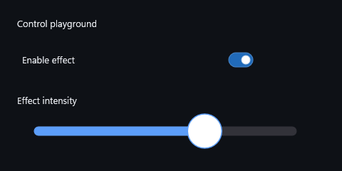
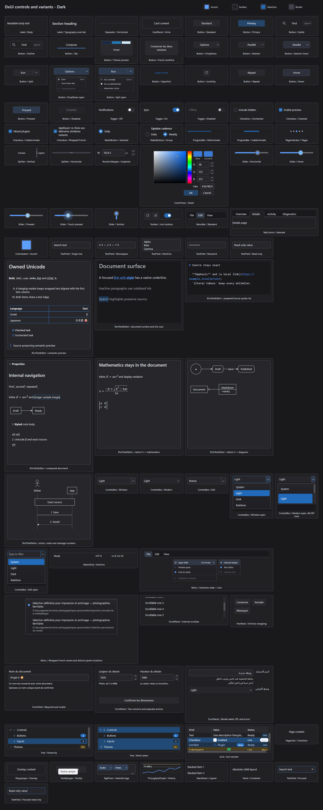
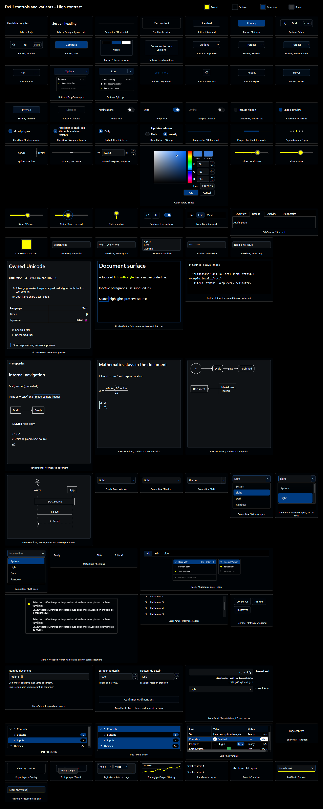
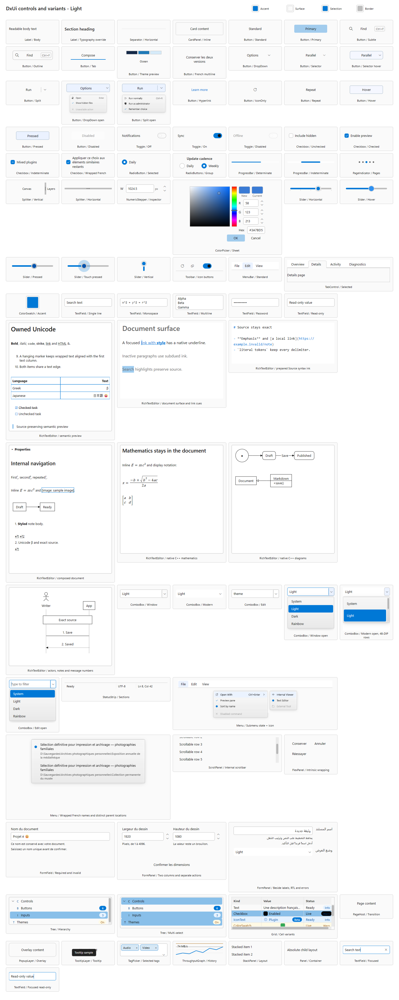
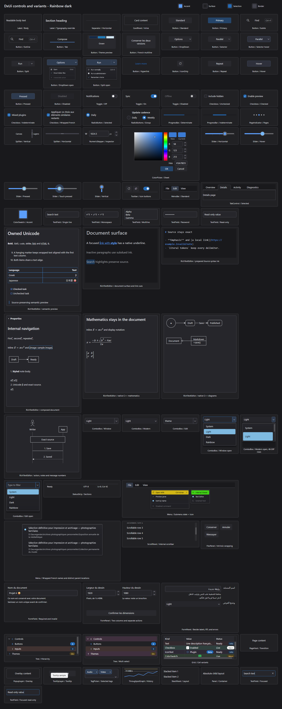
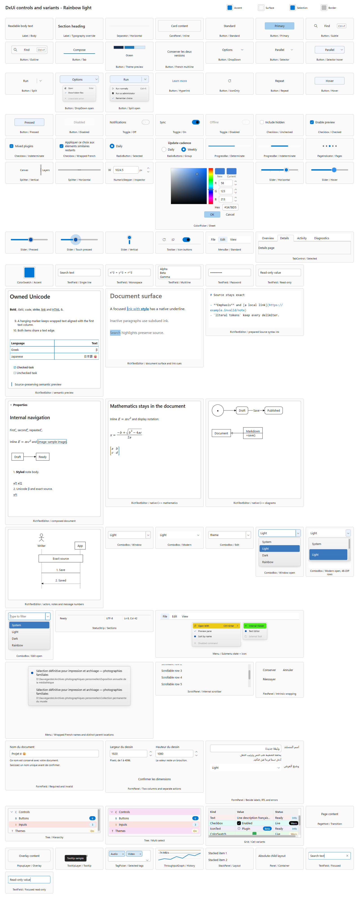

# Generated control gallery

[Usage documentation](../README.md) | [Control guide](../controls.md) | [HTML gallery](index.html)

Generated from compiled DxUi controls using the explicit local gallery.ps1 -PublishDocs command. Generated documentation is reviewed and committed through an ordinary pull request; DxUi has no hosted publication workflow. The five theme sheets cover all 35 public controls and populated interaction variants; the sixth image is the supplied-device example. Click a sheet to inspect it at full resolution. Rendering may vary with Windows fonts/DPI. These are documentation snapshots, not replacements for the original test baselines.

## Scaled tile captures

These sheets stay at 100%. Review evidence at other display scales comes from the same harness and capture path:
`gallery.ps1 -Scale 100,125,150 -Tiles StatusStrip,TextField` renders the sheets at each scale, non-activating, and writes
only the named tiles (a control, a caption or a tile file name) to `.build/gallery/<Platform>/<Configuration>/tiles`
as `<percent>/<theme>/<tile>.png`, with `receipt.json` (source commit, build profile, adapter, scales) and `tiles.tsv`
(pixel size and SHA-256 of the pixels of every tile). `-Theme light,dark,high-contrast` limits the themes and `-Warp`
renders on WARP. `gallery.ps1 -CompareBefore <capture or receipt> -CompareAfter <capture>` reports per tile and scale
whether the pixels are identical, writes the differing tiles to `differences.txt` and exits 1 on any difference. Scaled
tiles are never published here: a change retains the receipt and the tiles its gate names under `Measurements/`, as the
[first receipt](../../Measurements/PerformanceAndMotion_2026-11-13/G1/README.md) does.

## embedded-controls

## theme-controls-dark

## theme-controls-high-contrast

## theme-controls-light

## theme-controls-rainbow-dark

## theme-controls-rainbow-light

