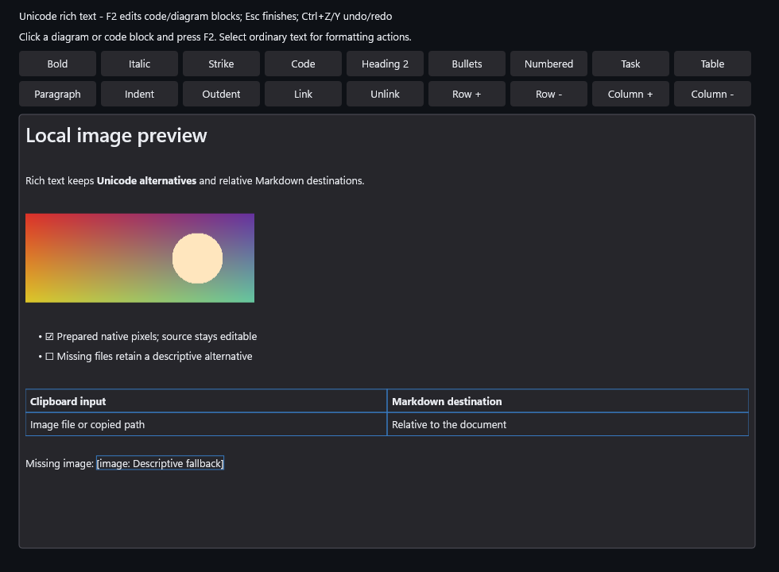

# Unicode rich text

## Current capabilities

This table describes the available library mechanisms and their limits. Supported
means the stated bounded mechanism exists; Limited identifies a preview or a
partial language profile. Neither status supplies current-source build, runtime,
performance, physical-input or consumer acceptance. Those results retain their
own source identities in [the evidence archive](../Measurements/RichText/README.md).
`capabilities.json` owns the table; `validate-specs.ps1` rejects a changed, missing
or contradictory row. API revision remains 4; pair headers with the exact library.

<!-- rich-text-capabilities:begin -->
| Feature | Status | Limits | Details |
| --- | --- | --- | --- |
| Source and history | Supported | 65,536 UTF-16 units; 128 undo items; exact counted source | [Details](#reusable-preparation-core) |
| Retained editor | Limited | Native and embedded preview; complete editor acceptance remains open | [Details](#retained-editor-preview-d2c) |
| Markdown analysis | Limited | Pinned CommonMark/GFM profiles and bounded RichMarkdown extensions | [Details](#owned-lossless-markdown-preparation) |
| Semantic rendering | Limited | Explicit opt-in; unsupported leaves preserve literal source | [Details](#semantic-rendering-preview-m4d) |
| Native HTML | Limited | Validated native subset; whole-leaf fallback; no browser or executable HTML | [Details](#semantic-rendering-preview-m4d) |
| Images | Limited | Caller-owned decoding and bounded raster publication; remote requests default off | [Details](#retained-editor-preview-d2c) |
| File-reference paste | Supported | Ordered references; document-relative destinations; one undo transaction | [Details](#retained-editor-preview-d2c) |
| File-reference drop | Limited | App-owned STA adapter; 16 files; 256 KiB medium; guarded prepared caret | [Details](#retained-editor-preview-d2c) |
| Metadata envelopes | Supported | Leading RichMarkdown YAML/TOML envelope; exact fences and source | [Details](#leading-metadata-envelopes) |
| Metadata validation | Limited | Single document; YAML 1.2.2 core schema and TOML 1.0.0; bounded capacity | [Details](#leading-metadata-envelopes) |
| Footnotes | Limited | RichMarkdown references, reordered bodies and source-exact backlinks | [Details](#footnote-rendering-and-navigation-m5b-preview) |
| In-place source editing | Supported | Scoped leaf or inline math; unchanged source ACPs and document history | [Details](#retained-editor-preview-d2c) |
| Decorations and search | Limited | 256 decorations; 4,096 mapped rectangles; source-revision retirement | [Details](#editor-presentation) |
| Link activation | Supported | Caller callback intent; no browser launch; local fragments use source navigation | [Details](#editor-presentation) |
| Source presentation | Limited | Optional wrapping, prepared line numbers and whitespace; bounded zoom | [Details](#editor-presentation) |
| Code presentation | Limited | Prepared token spans; Subtle frame and line labels; caller-owned copy transport | [Details](#editor-presentation) |
| Semantic accessibility | Limited | Source ranges, typed structure and actions; physical AT qualification separate | [Details](#semantic-accessibility-m4f) |
| Text services | Limited | Native and embedded TSF/IME and UIA adapters; physical IME qualification separate | [Details](#source-text-services-and-accessibility-d2d) |
| Native mathematics | Limited | Named DxUiMath1 subset; source-preserving per-object fallback | [Details](#native-in-document-mathematics-and-broader-diagrams) |
| Native Mermaid | Limited | Bounded flowchart, state and class profiles; unsupported syntax remains source | [Details](#native-in-document-mathematics-and-broader-diagrams) |
| Complete extension conformance | Not supported | Full-language parity is not established by bounded feature or corpus results | [Details](#current-capabilities) |
<!-- rich-text-capabilities:end -->

## Editor presentation

For a quieter Markdown document, set `markdownPresentation` to
`RichText::MarkdownPresentationStyle::Subtle` on the editor appearance or layout
options. H1/H2 gain subtle separators, tables fit their contents with horizontal
rules, standalone display equations/diagrams center, and quotes use a shaded
surface. `Default` preserves the existing presentation. This setting does not
rewrite Markdown or affect Source-view styling, selection or undo history.
Table columns measure both natural and minimum nonbreaking widths. A wrapping
column yields space to an unbreakable word before emergency character breaks
are needed; right-to-left cells use the same widths and source geometry.
Set `tableOverflow=true` to preserve the minimum widths beyond the viewport;
the retained horizontal extent then includes every column. The default retains
viewport-bounded wrapping. Column widths and scrolling never edit Markdown.
Exact library/header pairing is required when adopting the new public fields.

`RichTextEditor::SetAppearance` owns the editor's frame and text viewport. Keep
the default options for the existing input frame, or set `drawBorder=false` and
`blendWithWindowBackground=true` for a document surface. A positive
`maximumTextWidthDip` centers and bounds the text column; `paddingDip=-1` retains
the 8 DIP inset (6 when compact). Explicit body/code font families and sizes,
line-height multiplier, heading scale and per-level `headingFontSizeDip` /
`headingLineHeightMultiplier` arrays belong to the same prepared geometry,
including caret, hit-testing and UI Automation. Zero font sizes and line height
inherit the existing host/native defaults. Invalid options fail atomically.

`paragraphSpacingAfterLines` and `listItemSpacingDip` are optional semantic
spacing values, also available on pure `LayoutOptions`. With both unset, the
legacy 8-DIP gap after every native semantic box is unchanged. Setting either
engages minimum-gap spacing: an unset paragraph value means an 8-DIP minimum,
and real intervening blank-source caret lines contribute their full line-box heights
to the gap instead of adding a second margin. Set `paragraphSpacingAfterLines=1`
and `listItemSpacingDip=10` for one nominal body line after paragraphs and 10 DIP
between list items. Values accept finite 0..4 lines / 0..256 DIP; zero is an
explicit zero minimum. One separator line occupies the paragraph margin; two
real separator lines still occupy two lines. Leading, trailing, empty/container
and equal-ACP table caret sites retain their source identity and navigation.
Nested item entry and following siblings use the item minimum; continuation
paragraphs in one item use the paragraph minimum. Loose-list separator lines
contribute to the item minimum. Table row padding is unchanged. Source/v0 line
placement is unaffected. Both values belong to geometry reuse identity, and
changing them never edits source, selection or history.

These are gaps between complete content frames. Native caret rectangles use
DirectWrite hit-test extents, which may be inset and shorter than the line
advance. Compare full frames or equal-font caret-top advances when measuring
spacing; public semantic element bounds are clipped to the text viewport.

A nominal body line uses the configured body size and explicit line-height
multiplier, excluding enlarged headings and inline objects. If line height is
native, preparation measures one empty native body layout, counted against the
cooperative SDK budget. No measurement, traversal or allocation runs during
composition or caret queries. The gallery's document-presentation tile opts in.

`SetLinkUnderlinePolicy(RichTextLinkUnderlinePolicy::HoverOrCaret)` opts into
underlines on the whole link while its visible glyphs are hovered or its source
contains the focused caret. `Always` is the default. Explicit `<u>` style and
high contrast keep persistent underlines. `useAccentLinkColor=true` opts into
the theme accent ink. This presentation changes neither destinations nor link
activation policy. Source mode keeps raw syntax. Register `SetOnLinkActivated`
to receive a source-backed link intent; the application chooses whether and how
to open it. The library starts no browser or process. Without a handler, external
links have no Invoke action. Local heading fragments navigate the current source.

Temporary link and source-ink decoration follows the shared
[transient raster contract](../Specs/Core/Core_PerformanceAndResources.md#transient-raster-decoration).

`SetSourceHighlights` accepts bounded source ranges with an optional `current`
marker. These paint below selection and never alter source, selection or history;
source edits clear them so a search owner can recompute current results.
`FindInSource` returns ordered non-overlapping raw-source matches, with optional
ordinal case-insensitive and whole-word matching. Whole-word boundaries treat
letters, digits, underscore, combining marks and surrogate units as word
characters; this is a conservative source rule, not linguistic word breaking.
`SetSearchMatches` accepts the source snapshot, matches and optional active
index. `SelectSourceMatch` navigates with wraparound, while
`ReplaceSelectedSourceMatch` and `ReplaceAllSourceMatches` use undoable source
transactions. `SetSearchShortcutsEnabled(true)` opts into F3/Shift+F3; Ctrl+F
calls the consumer's `SetOnFindRequested` callback. The consumer owns the search
interface and query refresh after edits.

`SetDecorations` takes a current source snapshot and up to 256 background,
underline, squiggle or foreground annotations using accent, subdued, warning or
error theme roles. Edits retire them. Before geometry is available, the request
can be accepted with `Pending` status; current geometry rejects a replacement
over 4096 mapped rectangles before changing state. After reflow, inspect
`GetDecorationStatus`: `CapacityExceeded` retains the
request, withholds stale annotation geometry and leaves document painting
available. A later admissible layout restores it. Selection and annotations are
staged before Paint. Annotation UIA
exposure, high-contrast pixel qualification and performance evidence remain open.

`sourceTabSpaces` enables source/code Tab indentation using 1–16 spaces, or a
tab when `sourceTabUsesTabs` is set. Ctrl+Tab remains host traversal. Optional
Markdown shortcuts use Ctrl+Shift+0–6 for heading clear/levels, Ctrl+Shift+X for
strike, Ctrl+backtick for code and Ctrl+K for the consumer's link-edit request.
The feature is disabled by default. `QueryMarkdownCommandState` returns current
style/heading/list presentation and explicitly unknown applicability where a
nonallocating planner predicate is not yet available.
List state considers the complete selected source interval, including nested
and intervening list kinds, using an allocation-free syntax traversal. Beyond
64 nested items, parent-link recovery may add work proportional to ancestor depth.
For backward and forward structural join, noncollapsed selections and carets
outside supported text leaves or away from their visible edge are known to be
unavailable. Plain paragraphs without a compatible sibling are also unavailable;
ordinary document-level paragraph joins and heading removal report availability, while some
container edges still need their prefix and container predicates.
The structural backward-join command removes a heading marker when the caret
is at the start of its content; ordinary text inside the heading is unaffected.
`GetSourceCaretLocation()` reports a zero-based logical source line and UTF-16
column, independent of visual wrapping; its scan is allocation-free and linear
in the source prefix. CRLF counts as one line break.

Supplying `RichTextContextMenuLabels` opts into the default edit menu. A consumer
context callback takes precedence. HWND-less embedded consumers can obtain the
default menu model and dispatch a chosen command through the editor; the host
remains responsible for presenting that model. Native popup qualification remains
pending.
`SetFocusModeEnabled(true)` draws inactive paragraphs with subdued text while the
caret paragraph stays normal, including the final source insertion. Selection
remains fully legible; source mode and high contrast disable dimming. These options work in both hosting modes and create no timer,
worker, native editor window or consumer-owned rendering workaround.

Use `SetOnSelectionChanged` for formatting state, selected-text actions and
position status. It includes native text/TSF, UIA and programmatic routes. During
pointer selection, `IsSelectionGestureActive()` lets the callback hide a transient
toolbar and return immediately. Release/capture cancellation publishes final
inactive state even when the endpoints are unchanged. Notification deduplication
includes source revision, endpoints and gesture state: changed non-notifying
text-service previews and cancellation are observable even at unchanged ACPs,
while an identical source/selection reimport is silent. Registration is silent.
The callback may replace itself, change selection or retire the editor safely.
These notifications do not create committed-text or history events.

When both text and selection callbacks are registered, a committed edit first
synchronizes native input, invokes `SetOnTextChanged` for the committed source,
then publishes the current selection. Nested source edits, rebind, detach or
retirement supersede the outer selection event. A text callback may clear or
replace its own registration without suppressing that surviving selection event.

`colorizeMarkdownSource=true` adds source ink from the configured Markdown
analysis profile in Source view: subdued syntax delimiters, accent heading/list
markers and link-colored exact source destinations. Configure analysis with
`SetMarkdownAnalysisProfile` first. Geometry, source UTF-16 offsets, native text
services, selection and history are unchanged. Preparation publishes complete
disjoint ranges; drawing never parses. High contrast uses the ordinary text
pair. The 65,536-event presentation bound falls back to the complete uncolored
source view rather than publishing partial syntax or repeatedly retrying it. `directSourceInkPreview` separately enables an experimental direct renderer; it defaults off and remains performance-unqualified. Source coloring still uses the canonical DirectWrite path when it is off.
Source view also supports `sourceWrap=false`, `sourceLineNumbers=true`, and
`sourceWhitespaceMarks=true`. The gutter and guides are prepared from exact
source; they do not change ACPs, selections or clipboard text. Horizontal offset
is available through `GetHorizontalScrollInfo`, `SetHorizontalScrollOffsetDip`,
and `SetOnHorizontalScrollChanged`; Shift+wheel scrolls overflowing content.
Rich tables with `tableOverflow=true` use the same horizontal offset. Native
input, hit testing and accessibility geometry follow the painted position.

For opt-in Subtle code blocks, applications can register `SetCodeTokenizer`
and use `TokenizeBuiltinCode` for JSON, C-like languages, PowerShell or diff.
Prepared bounded token spans change ink only. The Subtle frame shows a language
badge and physical line numbers within the documented bounds. Register
`SetOnCodeCopyRequested` with a localized accessible name to expose pointer,
keyboard and UIA copy intent; the callback receives counted rendered code and
owns clipboard transport. All of these features still require the project's
complete platform, allocation and performance qualification before plan closeout.
List marker ink uses the parser's exact source token range, so nested, ordered,
quoted and task-list prefixes stay aligned with their original UTF-16 offsets.
Each owner preparation advance uses at most 256 work steps shared across block
markers, inline delimiter runs, link-label children, raw destination scans,
incremental event ordering and range publication. Long scans and bottom-up merge
passes resume on later advances; ranges remain hidden until the complete set is
ready. Source ink drawing uses the caller's target and borrows brushes only for
the draw call; a prepared layout retains no device-bound target or brush
capability and can be drawn on a replacement target.

The additive v0 API lives in `DxUi::RichText` and links through the single
`DxUi.lib`. Include `DxUi/RichDocument.h`, `DxUi/RichMarkdown.h` and
`DxUi/RichTextLayout.h`. The catalog also contains the retained
`DxUi::RichTextEditor` preview described below. Its bounded source TSF/IME and
UIA adapters are implemented in both hosts. Real IME/assistive-technology
qualification, complete semantic Markdown editing and accepted extensions remain
separate gates in the [active plan](../Specs/Plans/WIP/RichTextEditor_2026-10-17.md).
The explicit bounded semantic rendering preview is available under M4d below.
Decoded local images use caller-owned image services and bounded native raster
publication. Alt text remains the source and accessibility alternative, including
failed or unsupported images. File-reference paste can insert displayed images
using an explicit document location:

```markdown

```

The native extension engine choice is C++ only. `DxUiNativeFlowchart1` currently
has an internal CPU parser with focused Debug checks for rectangles, rounded nodes, circles,
diamonds, stadiums, hexagons and subroutines, four directions and bounded solid, dotted, thick and invisible edge chains. Simple state and class profiles are also available; other Mermaid families,
other expanded shapes/edges, advanced subgraph forms, styling, icons and executable directives remain
unsupported. The pinned original corpus distinguishes accepted graphs from
rejected definitions. Source-independent cooperative CPU geometry passes focused
x64 Debug checks, with stable ranks, four orientations, direct unambiguous adjacent
edges and exterior lanes for other forward/back/self/parallel edges. Unlabeled
nonoverlapping rank intervals can share a lane; labeled lanes remain exclusive. It accepts measured label sizes and creates
no SDK resources; complete extents are capped at 65,536 DIP per axis. DWrite
node and edge labels wrap at 12.5 times the selected font size; explicit line
breaks and complete label text remain visible within the resulting geometry.
Shaping and reusable native paint resources pass focused Debug checks, with intercepted
SDK-call budgets, independent Unicode/bidi/multiline raster checks, separate
typography/resource invalidation and compatible borrowed-target drawing. Edge
labels paint last over padded opaque backgrounds so routes cannot obscure them.
Source-backed objects pass focused x64 Debug/native/embedded/UIA checks:
RichMarkdown can project a prepared flowchart as one
source-backed graphic with a node/connection alternative. Quotes, lists and note
bodies retain original source provenance; unsupported, malformed, empty and
unclosed definitions remain code with diagnostics. Width/font rejection keeps
usable exact source and retries after a matching view/resource change. Source
fallback deletion edits raw graphemes/ranges; native object selection preserves
the resolved selection surface, including high contrast. F2 or UIA Invoke opens
the object's exact source in place. Esc, F2 or Ctrl+Enter finishes source editing;
committed edits remain undoable. Final extension build/runtime/resource qualification
remains pending. The generated gallery includes the native diagram and a literal
unsupported-family example in every theme.

The supporting semantic API also has a scoped source request, with focused
x64 Debug/native/embedded qualification:
`SemanticBuilder::Begin(syntax, sourceBlock)` presents a code, HTML or metadata
leaf's exact envelope while keeping other paragraphs rendered. The index belongs
to that immutable syntax; `SourceBlock()` reports it and `MarkdownNoNode` returns
to ordinary semantics. Hidden descendants of literal footnote declarations and
invalid indices are rejected before replacing pending work. The retained editor
uses an explicit `BeginSourceRegion` parser hint during editing: complete physical
lines remain literal even while fences, prefixes or body syntax are broken.
The authoritative Document, source ACPs, history and Unicode text store stay the
same. Other paragraphs remain rendered. Empty scopes have real caret geometry;
ordinary parsing removes the hint. `GetSemanticSourceRegion()` reports the active
envelope/session. Moving selection outside the envelope finishes its presentation.
Read-only inspection is allowed; active native/embedded composition blocks entry
and exit. UIA source actions preserve dispatch, lifetime and stale-provider guards
and do not acquire OS focus. Inline math F2/Invoke uses an exact raw interval within its existing paragraph, preserving neighboring formatting while source is incomplete or spans lines.
See the [focused source-editing evidence and actual application captures](../Measurements/RichText/README.md).

RichMarkdown footnote definition containers, Unicode label binding, diagnostics
and reachable numbering have focused native/embedded checks. The footer preview
renders numbered references, reordered definition
bodies and distinct generated backlinks preserve exact source ACPs. Unused and
duplicate definitions retain literal fallback; structural commands over those
envelopes remain guarded. Internal navigation selects and scrolls without editing
history; read-only navigation is allowed. Ctrl+click, Ctrl+Enter at references
and UIA Invoke share publication guards. Ctrl+Tab and Ctrl+Shift+Tab cycle outlined
generated backlinks, and Ctrl+Enter activates the selected backlink. Note-aware
structural edits retain their owning definition prefixes. F8 and Shift+F8 select
the next or previous diagnostic in exact source order. Final extension qualification remains open.
Selection across reordered content still selects one raw source interval, which
can highlight several visual fragments; source copy/deletion follows that interval.

Parser staging is independently bounded to 32,768 combined block/inline records.
Sparse table rows preflight their entire header width before allocation, then
prepare one real/padded cell per resumable event. Capacity failure retains the
previous syntax publication. The editor displays exact source fallback and
remembers only that snapshot/revision/profile, avoiding repeated idle parsing.
Edits and profile changes retry; transient memory failures remain retryable.
The focused admission/fallback implementation is in development under M6; final
capacity/latency/NUL qualification remains open and the source limit stays 65,536.

## Retained editor preview (D2c)

For explicit semantic coordinate preparation, include `DxUi/RichSemantic.h`.
`SourceDisplayMap::Build` owns validated source/display spans and supports hidden,
decoded, generated, object, repeated and reordered content. Use `DisplayRanges`
for selection fragments and `SourceRanges` for edit fragments; mapped endpoints
alone cannot describe a reordered selection. Generated text edits nothing, while
decoded values and objects expand atomically to their complete source spelling.
Range queries accept normalized scalar/CRLF boundaries. Caret affinities are
explicit; grapheme movement remains the layout/TextElements responsibility.

`ApplySourceEdits(document, expectedSnapshot, expectedRevision, edits, selection)`
stages ascending disjoint source replacements as one undoable transaction. It
rejects stale or foreign snapshots before mutation. Retain the expected snapshot
when preparing commands, and apply only while the same document revision is
current. The primitive is independent of host editability and notifications;
control adapters must enforce those before calling it. The retained
`RichTextEditor::ApplySourceEdits` adapter supplies those guards, synchronizes the
source text store and notifies once after a committed source change. No-op plans
may silently update selection. These primitives do not change the retained
editor's v0 pixels or complete semantic Markdown editing.

`DxUi/RichSemanticDocument.h` adds the pure `SemanticBuilder` preview under M4
qualification. Begin with an immutable `MarkdownParser::Published()` result,
then advance a bounded number of block/inline events on each preparation turn.
`Published()` retains the previous complete result while work is pending;
consumers must check its syntax source/revision/profile before treating it as
current. Cancel preserves that publication; Clear releases builder ownership.
Held documents remain immutable. Queries and coalesced requests do not advance
work or start a worker.

The document supplies a source/display map, style runs, semantic roles and ordered
paragraph/table-cell metadata. Its source remains exact; code/escape/entity
normalization has token-level edit affinities. Tables include padded cells;
task markers and image alternatives are atomic objects. HTML uses the bounded
native subset below with whole-leaf literal fallback. Links/images retain inert
metadata without loading or executing anything. The retained rendering opt-in
consumes this data separately; source-exact structural commands follow below;
structured UIA is described under M4f below. Admission limits combined syntax
nodes to 32,768 and geometry paragraphs to 4,096, alongside the bounded model/map.

Include `DxUi/DxUi.h`. The same control works under native `ControlHost`
and supplied-device `EmbeddedHost::Controls()`:

```cpp
auto root = std::make_unique<DxUi::Panel>();
auto* editor = root->AddChild<DxUi::RichTextEditor>(
    L"# Notes\r\nSelect **Unicode** text.");
editor->SetBounds(D2D1::RectF(16, 16, 480, 280));
editor->SetOnTextChanged([editor] {
    // Persist editor->Snapshot() through application-owned storage.
});
host.SetRoot(std::move(root)); // ControlHost, or embedded.Controls()
```

All mutable operations belong to the host/UI owner thread. Source UTF-16
anchor/caret offsets include Markdown delimiters; invalid scalar/CRLF boundaries
throw without mutation. `SetText` resets history without invoking the committed-
text callback. `SetSelection` and `SetViewMode(Source/Rich)` preserve source bytes
and do not invoke that text callback; installed selection observers follow the
source-revision, selection and gesture publication contract above.
`ReplaceSelection`, `ToggleFormatting`, `Undo` and `Redo` invoke the text callback
once per actual committed source change. The four supported v0 formatting markers
are described below. Read-only/disabled controls reject source commands; read-only
allows selection and copy. `SetOnTextChanged` runs after publication and may replace
or destroy the sender. `std::bad_alloc` is fatal; other standard exceptions are
contained and do not roll back the committed edit. A scheduling callback that
retires, rebinds or supersedes the editor stops the old notification.

The preview implements pointer selection/word selection, Shift extension, host
capture and cancellation, logical DirectWrite cluster navigation, word navigation,
line/document Home/End, Up/Down/PageUp/PageDown, Backspace/Delete, Enter in the document's first EOL spelling (CRLF when absent),
Ctrl+A/C/X/V/Z/Y, Ctrl+Shift+Z and Ctrl+B/I. Copy/cut transfers exact selected
Markdown source and original EOLs through the host's bounded Unicode clipboard;
busy/failed clipboard writes never cut. Counted U+0000 remains exact in RichText source, UTF-8 codecs, text services and UIA; CF_UNICODETEXT copy/cut refuses a selection containing it instead of truncating. Paste validates before committing and
rechecks owner/revision/selection after clipboard callbacks. Surrogate pairs
commit together, orphan halves are discarded, and AltGr Unicode input is accepted.
This does not qualify full visual bidi/UAX navigation.

File-reference paste uses `SetDocumentFilePath(L"C:\\docs\\note.md")` as explicit
document metadata. In prepared Rich mode, pasting an absolute Unicode path
(optionally quoted) or an Explorer file list inserts a Markdown image for each
recognized image suffix and a named Markdown link for every other file. For example:

```markdown


[report\.pdf](attachments/report.pdf)
```

The destination is relative to the document's parent. An unsaved document or a
different drive/UNC share uses an absolute `file:` URI. Unicode uses UTF-8 URI
escapes, punctuation in the filename-derived description is Markdown-escaped,
and directory component case is preserved. No current-directory lookup, asset
copy/move or remote request occurs. Location changes do not edit source/history
or cancel composition. Callers update this metadata when opening or saving a file.

One paste is one undoable source transaction. Multiple files preserve clipboard
order, including mixed image/link lists. Blank paragraphs retain list and quote
continuation prefixes; table cells use spaces to keep the row intact. Image
descriptions use the filename stem; text links display the complete
filename. If any structured path cannot be represented safely, the complete list
keeps its original displayed spellings as quoted literal text; Rich mode escapes
Markdown punctuation so a filename cannot become a live image or link. Malformed
Unicode, NUL, quotes and CR/LF inside structured paths reject the complete batch.
Extended-length Windows paths remain supported. Code, HTML, metadata, active source editing and Source mode keep literal
text. Partial inline code/link/image contexts also keep literal text. Pending
analysis uses ordinary Unicode paste. Read-only/disabled/composing editors reject
mutation. Native and application-owned embedded TSF clipboard routes reject stale
source/selection/base/owner state. Existing Unicode-only controls retain their
text clipboard behavior; structured file transport is an optional interface.
Embedded text clients may additionally implement `TextClipboardFilePaste` to
commit a prepared file list through the view's source-site-aware transaction;
the replacement-only transform remains available to existing clients.
Limits are 16 paths, 32767 UTF-16 units per path and 65536 total path units, plus
the existing document source limit. Clipboard paths may recognize formats whose
decoders are not available. Displaying an image also requires the application to
service its image request; a paste alone preserves the descriptive alternative.
Text file links use the existing inert underlined link presentation; paste does
not open a file or add navigation. File type classification is lexical and does
not check existence. Drag-and-drop and copying assets into the document folder
are outside this paste feature.
The [file drag-and-drop specification and native/embedded test plan](../Specs/Plans/WIP/RichTextFileDrop_2026-10-20.md)
owns the in-progress drop-at-caret implementation. `DxUi/FileDrop.h` provides an
application-owned revocable OLE adapter; the application owns registration and
routes view-local DIPs to the native or embedded host. Final validation and
performance qualification remain pending.
The [file-reference qualification packet](../Measurements/RichText/README.md)
records all six builds and 57 ordinary x64 scope passes for image/link and mixed
paste, including native/embedded transport, semantic roles, history and fault
recovery. The earlier [image-only qualification packet](../Measurements/RichText/README.md)
records source/binary identities, scope results and remaining gates. The later [native image packet](../Measurements/RichText/README.md) qualifies the decoder, async service and native/embedded raster implementation.

Native image rendering now uses immutable `RichText::RichImage` resources and
owner-thread request/completion APIs. All 19 ordinary suites pass in each x64 Debug, Release and ASan profile. Checks cover actual
native/embedded pixels, clipboard-to-worker decoding, source/history preservation
and UIA alternatives/bounds. All six build profiles pass, including ARM64 cross-builds. Final native-platform/resource qualification remains
open in M5g; this prototype does not close the D4c performance hold.

Applications call `TakePendingImageRequests` after owner preparation, inspect
`SourceKind()`, authorize each source and use their own worker service.
`LocalFile` requests expose the absolute path through `Source()` and `FilePath()`;
run `RichImage::LoadFile` for those requests.
The caller initializes COM and supplies its WIC factory. It marshals the result
back to the owner and calls `CompleteImageRequest`; a null result preserves the
alternative. Source/base/binding/visibility changes cancel tokens and reject stale
completion. Selection-only changes do not invalidate a file. `ReloadImages`
explicitly refreshes the cache; failed completions stay cached across unrelated edits until reload, document location or remote-image policy changes. The control does not watch the filesystem.
`Samples/EmbeddedControls/RichImageLoader.h` demonstrates one application-owned
threadpool callback, fixed queues and owner messages. Its default policy declines
UNC access; an application can explicitly authorize network files. Neither the
control nor composition owns a loader, thread, device, HWND or timer. The worker
uses only its owned request/pixels and posts a cookie-bearing owner message;
closing retires queues without joining a filesystem or codec call.
Draining or pruning canceled results wakes valid queued work when it frees a
completion reservation. Resource statistics describe retained admitted image
placements/sources, rather than every image token or a cumulative error count.

The raster profile is built-in PNG, JPEG, BMP, GIF and TIFF, with one static first
frame. GIF respects its logical canvas/offsets/background/transparency; JPEG/TIFF
EXIF orientation is applied to the pixels. Remote images are disabled by default;
call `SetRemoteImagesEnabled(true)` only after the application authorizes network
loading. Absolute HTTP(S) destinations then produce `RemoteHttp` requests with
the URL in `Source()` and an empty `FilePath()`. The application fetches bounded
encoded bytes on its worker and calls the existing `RichImage::Decode`; DxUi
does no HTTP, DNS, proxy lookup, authentication, cookie storage or cache I/O.
URLs are bounded to 8,192 UTF-16 units and accept ASCII DNS/punycode or bracketed
IPv6 authorities; credentials, fragments, control characters and malformed
percent escapes are refused. Path/query case remains exact. Toggling the policy
off immediately cancels remote jobs and evicts their pixels while preserving
local jobs, local completions, source, selection and history. A later opt-in
creates new remote identities. The sample loader remains local-file-only; a
consumer must provide its own explicit remote transport and failure policy.
Data URIs, SVG and unavailable formats keep their alternative. The source parser still preserves every original
destination. Limits are 16 MiB encoded, 4096 pixels per side, 4,194,304 decoded
pixels, 32 unique sources, 128 native placements shared with diagrams and 64 MiB
of unique retained CPU pixels. Shared images also share prepared GPU bitmaps.
The sample's completion queue has its own 64-MiB bound. Decode/staging/driver
overhead and transient old/new graphs are separate from those retained limits.
Cancellation is checked between 64-KiB reads, decoder phases and pixel rows;
an individual codec call is not preemptible. Painting uses fully materialized
pixels and prepared bitmaps, preserving image aspect, source ACPs, selection
tint and Unicode UIA alternatives. Composition still draws the cached surface.

The control borrows shared host fonts, DWrite/D2D, brushes, focus/capture, clipboard,
theme, DPI, invalidation and animation. It owns no HWND/device/swap chain/thread/
timer. Layout and clipped text/selection/caret rasterization happen during host
preparation; EmbeddedHost's unchanged composition path only draws its cached
surface. Layout is reused for selection/palette-only repaint, rebuilt for source/
mode/width/typography/flow/DPI changes, and retired on hiding or host rebinding.
A hidden control paints nothing even when installed directly as the host root.
Scrolling is bounded to the viewport and caret changes reveal the selection.
Wheel movement never changes source/history. The caret uses host timestamps,
including an embedded epoch of zero; read-only/reduced-motion/hidden controls
request no caret animation.

This is an explicit bounded v0 preview. The D2d source adapters described below
use the existing shared OS services; real IME/candidate-window, screen-reader and
physical-input qualification is still required before production acceptance.
Large-document layout, math/diagram rendering and validated metadata objects
remain open. The newer analysis, semantic, structural and footnote previews below
extend this original v0 surface. Unsupported presentation remains editable source.
No consumer pin is changed automatically.

## Source text services and accessibility (D2d)

Native ControlHost activates its existing text-input cache and TSF/IMM adapter
for RichTextEditor. `SetFocusControl(editor, false)` establishes logical focus
without taking HWND focus. The native host owns TSF activation, the system caret
and IME candidate placement only while its HWND owns keyboard focus. No editor
HWND or private OS service is introduced.

Embedded applications use the same `ReadTextInput`, `ApplyTextInput`,
`HitTestTextInput` and `GetTextInputRangeBounds` bridge as TextField. Keep one
TextInputServices client for the immutable focusId, reject stale revisions,
convert view DIPs to physical screen coordinates, and call NotifyLayoutChanged
after coherent preparation/placement changes. Clear the application-side client
on focus loss or view retirement. The view owns no HWND or TSF thread.

ACP offsets, service snapshots and UIA text all refer to exact Unicode Markdown
source, including hidden delimiters and original CRLF. Geometry maps source
ranges through the current prepared projection, wrapping, scroll, flow and DPI.
A hidden delimiter range has no pixel rectangles. Source mode displays its
rectangles again. Hidden/retired controls and incoherent embedded preparation do
not supply current geometry. `GetVisibleSourceRange(host)` includes complete
wrapped lines intersecting the viewport, including partial lines.

Composition Preview updates are silent and preserve undo and redo. Cancel
restores entry source and selection; Commit restores entry source before recording
one ordinary transaction and one callback, including when the result equals its
last preview. Revisions remain monotonic. The reusable Document::ReplaceTransient
performs the history-preserving update; callers must restore composition-entry
source before recording the final replacement. Invalid UTF-16, NUL, oversized
source and scalar/CRLF-splitting selections are rejected atomically. An application
edit supersedes an older service preview. Retained services cannot write through
replacement focus or a retired owner. Callback-driven removal stops old publication.
Composition uses the shared caret ink for a 1 DIP underline and a 2 DIP conversion
target underline inside the text viewport.

Both UIA hosts publish Document semantics, Text, Text2 and TextEdit patterns through
the same immutable snapshots and stable control identity. Text2 reports the actual
caret of backward selections. TextEdit reports composition/conversion ranges;
Text exposes exact source, selection, visible ranges, point hits and projected
rectangles. Read-only documents permit selection and expose IsReadOnly; disabled
controls reject actions. Multiline documents do not duplicate their content in
ValuePattern. Endpoint-to-range movement validates a common live owner and
collapses crossing endpoints. Retained rich ranges read current published source
at bounded source offsets, clamping scalar/CRLF boundaries after replacement;
they do not track the semantic identity of text shifted by an edit. Reacquire
DocumentRange for the complete grown document. Bounded GetText never returns
half a supplementary scalar. Retained providers/ranges disconnect on owner replacement. Unknown
text attributes and annotations are unsupported in source/v0 presentation.
Explicit semantic presentation adds the bounded M4f attributes/children below;
rendered-only TextPattern text and annotations remain future scope.
The bounded source range commands include scrolling, selection union/subtraction,
text search and uniform read-only attribute search. The rules below apply in both
hosts; the M4f opt-in extends them with prepared style and structure.

`ScrollIntoView(true)` aligns the range's first painted edge to the viewport top;
`false` aligns its last edge to the bottom. Document extents clamp both offsets,
and ranges taller than the viewport reveal the requested edge. A degenerate range
reveals its caret. Hidden-only markers have no painted extent and do not jump to
an offscreen anchor. Scrolling preserves source, selection and undo/redo, takes no
keyboard focus, and uses existing preparation/invalidation services. The public
owner-thread `ScrollSourceRangeIntoView` validates source boundaries; UIA clamps
retained offsets to current source before calling it.

The editor reports `SupportedTextSelection_Single`. `AddToSelection` selects a
range when there is only an insertion point, or unions overlapping/touching
ranges. `RemoveFromSelection` trims a selected prefix/suffix; removing the entire
selection leaves its active insertion point. Both preserve backward direction.
Disjoint addition or middle subtraction returns `UIA_E_INVALIDOPERATION` atomically.
A degenerate add moves the insertion point; degenerate/nonoverlapping removal is
a no-op. Selection commands preserve history/revision and emit selection events,
without text-change callbacks. Read-only permits these operations and scrolling;
disabled controls reject them. Retired/hidden providers cannot act on successors.
Native foreign-thread actions use bounded owner dispatch. Embedded mutation is
owner-thread-only (`RPC_E_WRONG_THREAD` otherwise); snapshot searches remain reads.
Other text controls without these optional range actions report
`UIA_E_NOTSUPPORTED` instead of a success-only no-op.
The contiguous union/subtraction and rejection policy follows Microsoft's
[single-selection TextRange contract](https://learn.microsoft.com/en-us/windows/win32/winauto/uiauto-implementingtextandtextrange#selecting-text-in-a-text-range).

`FindText` searches exact source within the range, forward or backward, with
ordinal Unicode case-sensitive/insensitive comparison. Hidden syntax is searchable;
matches cannot bisect a surrogate or CRLF pair. Empty/malformed search strings
return `E_INVALIDARG`, and no match returns a null range with `S_OK`.
`FindAttribute` supports `UIA_IsReadOnlyAttributeId` with `VT_BOOL`: a matching
uniform attribute returns the bounded range, and a mismatch returns null.
Unimplemented rich attributes return `UIA_E_NOTSUPPORTED` for searches.

Clone, comparison, endpoint movement/collapse, word/character/document movement,
source text, enclosing element, visible bounds and source-only empty children are
covered in both hosts. `Line` movement uses the prepared wrapped rich projection
through `GetSourceVisualLineRanges`, including exact source CRLF and hidden
syntax. In source/v0 presentation unsupported Format units promote to Word; Paragraph/Page promote to
Document. Invalid units/endpoints/lengths are rejected. Character commands now
use shared Unicode 17 default extended grapheme rules. Visual bidi/word
navigation remains separate work; rich style/structure semantics are described below.

Caret, visible, composition and conversion ranges retain source offsets and
identity while reading the published document. They do not copy the full source
per query. The supplied-device regression bounds warm caret plus visible-range
C++ allocation requests to 4 KiB for both 32-unit and maximum 65,536-unit sources;
snapshot/layout preparation and Windows/driver allocations are outside that budget.

The non-activating native IMM/TSF protocol tests, embedded preview/revision tests,
actual application-bridged UIA client navigation/event tests and WARP captures
qualify these bounded adapters. They do not substitute for real input languages,
Narrator/NVDA or native ARM64 execution. See the [input contract](../Specs/UI/UI_InputAndAccessibility.md)
and [active qualification plan](../Specs/Plans/WIP/RichTextEditor_2026-10-17.md).

## Reusable preparation core

```cpp
#include <DxUi/RichTextLayout.h>

DxUi::RichText::Document document(L"# Heading\nSelect **Unicode** text.");
document.SetSelection({2, 9});
document.ReplaceSelection(L"Title");
const auto snapshot = document.Snapshot();
auto projection = DxUi::RichText::Project(snapshot, document.Revision(),
                                          DxUi::RichText::ViewMode::Rich);
DxUi::RichText::PreparedLayout prepared;
DxUi::RichText::LayoutOptions options;
options.widthDip = 420;
options.fontFamily = L"Segoe UI";
options.fontSizeDip = 18;
prepared.Prepare(borrowedDWriteFactory, std::move(projection), options);
// During raster preparation only: caller owns BeginDraw/EndDraw, clip and target.
prepared.Draw(borrowedD2DTarget, borrowedBrush, D2D1::Point2F(8, 8));
```

`Document` is mutable on its owner's thread. `SourceSnapshot` shares immutable
buffers and can be handed to an application/shared preparation worker. Document's
source-taking methods borrow `std::wstring_view` only for the call and copy changed
source into immutable owned storage before returning. No-op admission precedes
owning-string/history construction, including Debug iterator proxies. Caller
buffers and temporary strings need no lifetime beyond the call. The WIP core's
source signatures changed from owning strings to views; rebuild against matching
headers and DxUi.lib. This does not provide compatibility with an older archive.
The core creates no worker, queue, HWND, graphics device, swap chain, timer or file. The
caller owns cancellation, request/revision keys, scheduling, stale publication
checks and view lifetime. `PreparedLayout` is also owner-thread mutable; do not
prepare or query it concurrently. Public operations can throw standard argument,
range, length/allocation exceptions, or WIL HRESULT exceptions for DirectWrite
failures. Catch at the caller's Windows/COM/callback boundary.

`Selection` stores anchor/caret UTF-16 offsets and preserves backwards direction.
Replacements are one source/selection transaction. Undo/redo restores snapshots
and selections while revisions increase. A same-content replacement only changes
selection without allocating source/history and preserves history/revision.
Invalid source, ranges or resulting
selection leave source, selection, revision and history unchanged. Reset clears
history and selection. The v0 bounds are 64 Ki UTF-16 units and 128 history items.
There is no ANSI API; UTF-8 conversion rejects malformed input and embedded NUL.
It rejects impossible byte lengths and decoded lengths above capacity before
allocating the UTF-16 result. Exact three-byte BMP and supplementary-scalar
capacity limits remain accepted. Accepted BOM and mixed line endings round-trip unchanged.

`SourceSnapshot::IsBoundary` and `Slice(first,last)` inspect shared pieces without
flattening a revision. Slices and edits preserve scalar and CRLF boundaries,
including CR/LF split across two pieces. A persistent B+ tree stores cumulative
piece/subtree ends, with 16..32 entries in each non-root node. Reads descend by
binary search and slices visit only intersecting entries. Edits copy boundary
paths, reuse untouched subtrees and rebalance split/merged nodes before publication.
Captured snapshots support concurrent immutable reads while the owner changes
its document. The Document itself remains owner-thread mutable. Changed edits
allocate the inserted buffer and copied paths; snapshot text materialization, projection
and layout still prepare the complete bounded document. The capacity is unchanged;
incremental layout and qualification beyond the bounded source remain pending.
Future selection checks run against the virtual replacement before storage/history
allocation. Reset, replacement, transient replacement, undo and redo stage all
required allocations before publishing; allocation failure preserves the full
transaction state. Default, moved-from and fully deleted snapshots are empty
queryable values. The node representation stays private behind shared ownership.

`SourceSnapshot::ChangedRangeFrom(previous)` returns a conservative replacement
interval with bounds in both immutable snapshots. Recent edits, transient
previews, undo/redo and copied-document branches use bounded numeric metadata;
the latest 96 edits are always tracked, with at most 128 retained. Missing
history or reset falls back to the complete source. Returned boundaries are
safe for `Slice`, including newly joined CRLF. Queries allocate nothing and change
no shared cache. Numeric pages keep no old source buffers alive. This source
service supports the planned incremental preparation; whole-document projection/
layout and shared scheduling are still separate work.
Whole-text IME previews are narrowed to their changed prefix/suffix interval
before replacing source. Shared fragments are compared without materializing old
text; scalar and CRLF edges remain intact and unchanged buffers stay shared.

The v0 grammar handles ATX headings, paired strong/emphasis/strike/code, nesting
and paragraphs. Unknown/incomplete syntax remains editable source. Source and
rich projections carry source/display mapping and explicit revision/mode. Hidden
markers have leading/trailing affinities. ToggleMarker supports `**`, `*`,
backtick and `~~` source transactions, including backwards selections. This is
not complete CommonMark/GFM. This legacy `Project` API does not implement math,
Mermaid, footnotes, front matter, tables, links, images or structural editing;
use the newer lossless syntax/semantic APIs below for their declared previews.

Preparation borrows a DirectWrite factory synchronously and owns its resulting
layout with WIL. Font/monospace families, locale (including DirectWrite
default empty locale), reading direction, size and width are caller settings; brush/color/transform/clip/target remain caller owned. Invalid public
projection/style/font input or DirectWrite failure retains the previous matching
projection and geometry. `Clear()` retires geometry, increments generation and
preserves the separate document/history. Draw accepts a replacement device's
caller-owned target without retaining it. Draw performs raster work: never call
it from allocation-free embedded composition. The retained preview uses the
host cached-surface preparation/composition boundary.

Rich arrows, deletion, UIA character commands and mouse hit stops use the shared
Unicode 17.0.0 default extended grapheme rules. Hangul, Indic conjuncts, contextual
emoji ZWJ and regional-indicator sequences are covered by all 766 original
conformance vectors at every UTF-16 offset. Prepared stops and password mask
indices use a forward walker with no C++ heap requests. Font glyph clusters
still belong to DirectWrite; explicit ACP caret/range geometry remains available
inside an element for text services. [Pinned data and regeneration](../ThirdParty/Unicode/README.md)
are kept in the repository. Logical grapheme support does not establish visual
bidi/word navigation or physical IME/AT behavior. This core supplies no TSF/IME/UIA,
clipboard, file persistence, retained theme/DPI invalidation or viewport scheduler.
The standalone prototype still owns those demonstration-host responsibilities.

`PreparedLayout::DeletionRange(position, backwards)` uses the prepared grapheme
stops to return a display interval. Both deletion directions enclose a complete
grapheme when an explicit ACP lies inside it. Exact-boundary deletion keeps the
usual preceding/following behavior; empty edges yield empty intervals. Invalid
positions or retired layout throw. Rich keyboard deletion maps this interval
back to source. Explicit noncollapsed source selections retain their exact
scalar/CRLF meaning, and undo restores the original source and caret ACP.

Bulk UIA character movement uses bounded forward traversal, with overflow-safe
INT_MIN/INT_MAX handling and actual signed counts. It adds no C++ heap work or
mutable index. This command improvement is separate from Default frame timing
and does not clear the performance hold.

Tests live in Controls.Tests.RichDocument, RichMarkdown and RichTextLayout under
[Tests/Controls](../Tests/Controls), registered in EditorControls. They retain the
prototype's randomized/history/codec/projection/real-DirectWrite scenarios and
add cross-piece Unicode/CRLF oracles, slice/failure/no-op contracts, font changes,
invalid projection retirement and actual drawing on two separate WARP devices.
This does not replace native/embedded retained-editor, IME, AT or large-file tests.

The migration is source-coordinated within one module; no C++ ownership crosses
plugin ABIs. It adds headers/functions without changing existing declarations,
so API revision stays 4. Consume an exact clean pin via the normal
[props/targets](../Build/DxUi.Consumer.targets); no sibling cpp enumeration.

Historical source-bound runs are retained in [the qualification history](../Measurements/RichText/2026-11-01-usage-history.md). They do not qualify a later source revision.

The next bounded preparation follow-through removes redundant source correlation
when trusted snapshot change metadata is already available, and avoids indexing
discarded old children for a full replacement. Read-spy and parser identity/event
budget tests and focused x64 Debug/native/embedded qualification pass. Source ownership
copies, line scans and complete incremental preparation remain separate work.
`Document::ReplaceWholeText` also localizes notifying
RichTextEditor service commits, sharing unchanged pieces while recording one
undo transaction. It reuses transient Unicode/CRLF boundary comparison. Focused
x64 Debug model/adapter/native/embedded, observed failure and controlled C++
storage checks pass. Complete incremental preparation, retained source-edit
integration, final profiles and frame-performance acceptance remain separate.
`PreparedProjection` is the supporting v0 line-block preparation service. Call
`Prepare(snapshot, revision, mode)` on the preparation owner, then use `ToDisplay`,
`ToSource` or immutable `Blocks()` with document-wide source/display prefixes.
Block `content` uses local offsets and revision zero; the service's `Revision()`
and `Mode()` describe the published document. Unchanged outer blocks stay shared;
adjacent equal physical lines may share one local payload. `DisplayText()` is an
explicit flat copy. `LastPreparation()` counts rebuilt/reused block slots and
widened source units, not parser calls or elapsed-time acceptance.

Updates use tracked source intervals widened to physical lines and neighbors.
Mode/reset/missing ancestry falls back to complete bounded preparation. The
prefix index remains linear in line count. All new state is staged before one
publication; failure leaves the prior revision, payload identities and mapping
intact. `Clear()` releases its state and rejects content/mapping queries until
prepared again. This helper still uses v0 syntax. Its original qualification
preceded the guarded geometry integration below and provides no shared host
scheduling. No complete Markdown claim follows.
Historical source-bound runs are retained in [the qualification history](../Measurements/RichText/2026-11-01-usage-history.md). They do not qualify a later source revision.

The retained editor prepares bounded geometry updates.
`PreparedDocumentLayout` joins source-line projections into chunks targeting
1,024 source units and caps the published document at 128 chunks. Unchanged
chunks reuse immutable DirectWrite layouts after source edits; source and geometry
publish together only after preparation succeeds. `Invalidate()` rejects stale
queries while retaining bounded reuse state. `Clear()` releases that graph.
Drawing remains owner-thread raster preparation and visits only visible chunks;
embedded composition keeps using its cached surface. `Clone()` creates an
independent projection service while sharing immutable block payloads; clearing
or preparing the clone does not change the original. Full shared scheduling,
complete Markdown/extensions and platform/performance acceptance remain pending.

The implementation reserves one of its 128 geometry slots for a canonical whole-layout
compatibility cache. The qualified positioned-line implementation prepends an invisible
origin line inside noninitial DirectWrite layouts. Its private UTF-16 units never
enter source/display mappings or text-service content. DirectWrite calculates
real lines in document coordinates and draws every chunk at the same origin.
Reuse requires the same origin: height-changing edits can rebuild the dependent
suffix. Inexact origin lines and empty displayed suffixes retain whole geometry
to preserve terminal-font behavior.
`UsesWholeGeometry()`, `UsesWholeRaster()` and the separate whole-layout preparation,
reuse and source-unit statistics make that work visible. Prefix indexing remains
linear in line count. Positioned lines pass all three x64 profiles and ARM64
cross-builds. The original height/pixel failures stay preserved; no oracle
or performance threshold is relaxed to accept the new cache.

Historical source-bound runs are retained in [the qualification history](../Measurements/RichText/2026-11-01-usage-history.md). They do not qualify a later source revision.

The cooperative core exposes `BeginPreparation`,
`AdvancePreparation` and `CancelPreparation`; synchronous `Prepare` drains those
phases for direct core users. The control uses shared host turns, never an input/
geometry callback drain. An embedded pending turn returns S_FALSE with
`NeedsPreparation()` true; process the next wakeup before composing or publishing
geometry. Source typing, history and IME remain available while glyph work waits.

Hiding a native window or making either client dimension zero cancels retained
content, even if the shaping width stays unchanged. Show/restore prepares again
without losing source, selection or undo history. Native swap-chain ownership
and WM_SETREDRAW handling stay with the host.

The default owner advance permits four SDK layouts and 4,096 block/placement
steps. A physical paragraph/whole SDK call and the bounded v0 projection pass
remain indivisible. Logical commands without current geometry may project source
without DirectWrite. No hard input latency, large-document or resumable full
parser claim follows. All ordinary x64 Debug/Release/ASan suites and all six build profiles pass; native ARM64 runtime and physical IME/AT remain separate.

Parser design references requested for the complete engine:

- [MD4C](https://github.com/mity/md4c/tree/60e8065cfccd5d7ac561115f9a9bfbdf811f5cc9)
  uses block/span/text callbacks and offers a Windows UTF-16 build. Borrow its
  parsing/rendering separation and explicit callback handling. Callback abort
  is not resumable pause; complete-document parsing still needs scheduling and
  cancellation. Current-head claims are separate from release-0.5.2 and our
  pinned conformance corpora.
- [Discount](https://github.com/Orc/discount/tree/0cc4fef6b7ccdc19a8e64ef73aa21596b47c335b)
  separates input, compilation and document generation, with explicit dialect/
  feature flags. Use that separation to inform selectable profiles; its legacy
  Markdown compatibility is not a strict CommonMark/GFM oracle.
- [cmark-gfm](https://github.com/github/cmark-gfm/tree/27d942c8b0a62d192f616e5bf3578f4b6a89e180)
  exposes an AST, source positions, input feed/finish and extension interfaces.
  Use these to inform semantic nodes, extension boundaries and independent
  tests. Feed/finish alone does not establish resumable edit reflow or bounded
  CPU time.

These are design inferences from pinned public README/API/license snapshots.
No parser implementation/dependency is adopted. The owned editor still needs
lossless anchors, explicit UTF-8/UTF-16 mappings where applicable, the accepted
extensions and full corpus qualification. An HTML output renderer or private
Microsoft engine does not replace the owned Unicode control.

The [cooperative preparation record](../Measurements/RichText/README.md) retains native/build/pixel/fault/resource evidence, all original failed/interrupted attempts and pinned parser references. This closes the scheduling component; the full engine and original frame-performance HOLD remain open.

## Owned lossless Markdown preparation

`DxUi/MarkdownSyntax.h` starts the owned parser independently of the v0 renderer.
It retains exact Unicode source, root block ranges, a container/leaf tree and an
independent complete lexical partition. Block recognition covers nested/lazy
quotes and lists, tight/loose and empty items, headings, thematic breaks,
indented/fenced code, seven HTML forms and multiline reference definitions. Original
delimiters, trivia, unknown constructs, mixed line endings and entity spellings
are preserved. The parser accepts raw NUL and supplies a replacement lexical
value; the existing editor Document/codecs/text services still reject NUL.

The three grammar targets are CommonMark0312, Gfm029 and RichMarkdown. They are
versioned grammar keys. The bounded base parser and specified GFM extensions pass
the original semantic corpora; RichMarkdown's additional extensions remain pending. Lexical
candidates include all 2,125 semicolon-terminated named references, bounded numeric
references and ASCII punctuation escapes. A candidate inside code/HTML cannot be
rendered by decoding it in isolation; use the resolved inline forest described
below. `LexemeSourceAnchor` expresses leading/trailing source affinity when one
reference expands to several UTF-16 units. It does not replace model edit-boundary
checks or provide generated-object/footnote semantic anchors.

Use opt-in analysis in either retained host:

```cpp
editor->SetMarkdownAnalysisProfile(DxUi::RichText::MarkdownProfile::CommonMark0312);
// Continue the host's ordinary preparation turns. This query never drains them.
if (auto syntax = editor->GetMarkdownSyntax())
{
    auto exactSource = syntax->Source(); // Borrow while retaining syntax.
    const auto& rootBlocks = syntax->Blocks();
    const auto& nodes = syntax->Nodes(); // nodes[0] is the document root.
    auto documentIdentity = syntax->DocumentIdentity();
}
// Optional analysis can be disabled without editing source or history.
editor->SetMarkdownAnalysisProfile(std::nullopt);
```

`MarkdownParser` is also usable without a control. Begin owns/validates bounded
source; Advance resumes stored scanning cursors with an operation budget (default
4,096). Zero budget does nothing. Cancellation and failed staging retain a prior
published result; a current control getter rejects obsolete revision/profile
results immediately. Held revisions remain immutable after edits or detachment.
No worker, timer, graphics resource or additional HWND is created. Begin's copy,
validation and same-source comparisons remain indivisible, and operation budgets
do not guarantee a wall-clock deadline. The 65,536-unit limit remains.

Prefer the `Begin(SourceSnapshot, revision, profile)` overload when maintaining
an edited document. The retained editor does so: tracked edit ranges distinguish
which identical paragraph was removed. Node identities are scoped to one parser
until Clear and reconciled under compatible parent identities. Generated missing
table cells may share empty ranges; each consumes one prior identity in traversal
order, retaining distinct IDs across unrelated edits and undo/redo. String Begin uses
common-prefix/suffix mapping; deleted/reclassified/reparented nodes may acquire
new IDs, and no unbounded syntax history is retained. Blocks are reparsed across
the bounded source before reconciliation. Per-line transitions, paragraph
finalization and tree compaction remain indivisible; step budgets are not hard
latency guarantees.
`BlockStatistics()` reports deterministic prefix inspection and container closure
counts. Prefix lookahead uses bounded thresholds and line metadata; lazy lines
share a deferred accepted container end. These counters support regression tests
and do not measure complete CPU time. Node identity is a logical handle, not a
cache-validity or geometry-generation key; also check the source revision/profile.

HTML blocks remain exact opaque source. A later semantic stage will map an
explicit safe subset to our native renderer. No browser DOM, script execution,
event handler execution or automatic remote loading is introduced. Unsupported
HTML remains editable source. Analysis alone retains the v0 preview; the explicit
semantic rendering option uses the bounded native HTML policy below.

The native tests preserve all 652 CommonMark and 672 GFM original example inputs
and check all named entity values against independently transcribed standard data.
The independent M3 semantic checks described below additionally compare every
original expected HTML output. Later sections cover implemented semantic editing,
footnote presentation and metadata envelopes; math/diagram rendering, metadata
content validity and end-to-end NUL admission remain open.
Pinned inputs, attribution and offline generators are described in
[ThirdParty/Markdown](../ThirdParty/Markdown/README.md). The control catalog,
styles and existing gallery example remain unchanged; embedded exact-pixel tests
compare the same preview with optional analysis disabled and enabled.

The [parser-stage qualification](../Measurements/RichText/README.md) retains all 57 ordinary x64 suite receipts, six root builds, 324 exact rendering pairs, complete parser failure traces/storage measurements and the original failed fixture. Full grammar/HTML conformance, semantic rendering/editing, extensions and the original platform/performance gates remain open.

The [M2 block-tree qualification](../Measurements/RichText/README.md)
adds 568 independent pinned block-structure/code-content/ordered-start expectations,
conservative snapshot-based node IDs and native/embedded grammar/Unicode edge tests.
All 57 ordinary x64 scope obligations, six root builds, eight isolated failure
probes and 324 exact raster pairs pass. It retains the original failures and the
MSVC Debug proxy-allocation fix. That historical packet does not qualify later
inline/GFM work, semantic rendering/editing or physical/platform/performance gates.

## Resolved inlines and GFM extensions (M3)

The owned parser now resolves emphasis/strong, code spans, escapes/entities,
inline and global reference links, images, URI/email autolinks, raw HTML and
line breaks. GFM options add tables with cell alignment, task metadata, two-tilde
strike, extended autolinks and tagfilter metadata. The source always stays exact.
Analysis alone retains the v0 native formatted renderer. The explicit semantic
rendering preview described below consumes the resolved document separately.

```cpp
using namespace DxUi::RichText;
MarkdownParser parser;
parser.Begin(L"~~text~~ and [reference]\n\n[reference]: /local\n", 1,
             MarkdownProfile::Gfm029); // All specified GFM extensions by default.
// Call again on a later owner turn if preparation is still pending.
parser.Advance(4096);
if (auto syntax = parser.Published(); !parser.HasPendingPreparation() && syntax)
{
    const auto& inlines = syntax->Inlines();
    // Each leaf's firstInline roots a dense firstChild/nextSibling forest.
    // Semantic values and raw enclosures are not source/display editing maps.
}
```

An optional fourth Begin argument selects `MarkdownExtensions` explicitly.
CommonMark defaults to None and rejects GFM options; Gfm029 and RichMarkdown
default to All. Request identity includes the options. RichMarkdown adds leading
metadata envelopes and footnote syntax/binding; math/diagram rendering and metadata
validation remain in development. Published inline indices belong to
one revision; stable block IDs do not validate reference-dependent semantics.
Reference edits re-resolve links even when the referring paragraph is unchanged.

Values decode ordinary escapes/entities. Code stays literal; semantic HTML uses
the explicit validated native subset below with whole-leaf literal fallback.
Extended autolinks retain their own literal entity/backslash spelling. Unicode
17 full default case folding resolves labels without normalization or OS locale
dependence. ASCII label whitespace, P versus P/S punctuation and inline declaration
rules preserve the requested dialect. Table cells unescape pipes before inlines;
tasks expose state without an interactive checkbox command. Opaque Html values
carry sorted `filteredHtmlOpeners`, pointing to '<' values filtered by GFM.
This metadata is not sanitization or a browser preview API.

The independent conformance test compares all 652 CommonMark and 672 original
GFM expected HTML vectors, including each example's extension flags and both
task vectors marked disabled by the original harness. Nine printed GFM examples
flatten directly nested redundant strong tags; the test serializer preserves
that output convention while the syntax retains every wrapper/source delimiter.
Original standards and expected values are unchanged. Directed core/native/
embedded tests also cover Unicode and profile boundaries, global reference
edit/undo/redo, immutable old trees, option identity and deep iterative forests.
The [sealed M3 qualification](../Measurements/RichText/README.md)
retains 57 fresh complete ordinary x64 scope/profile runs, six root builds,
12 isolated probes, 324 exact raster pairs and full validation/format checks.
Both hosts also verify padded-cell identity across edits/undo/redo. Parser-only
raw NUL label replacement is tested under all three profiles; Document/codecs/
text-service NUL admission stays deferred. ARM64 builds are compile-only.

M4 still owns transformed/generated/object source maps, semantic native layout,
structural editing and structured accessibility. M5 owns the accepted extensions;
M6 and the existing gates own real capacity, physical/platform and performance
acceptance. The current source limit stays 65,536 UTF-16 units. Advance budgets
count operations; construct lookahead, stack resolution, sorting and allocations
can inspect more than one character per step and are not wall-clock guarantees. Generated table padding can amplify columns times body rows; a general tree/storage capacity bound remains M6 work.

## Semantic rendering preview (M4d)

```cpp
auto editor = std::make_unique<DxUi::RichTextEditor>(
    L"# Heading\n\n| left | right |\n| :--- | ---: |\n| **bold** | &amp; |\n");
editor->SetMarkdownAnalysisProfile(DxUi::RichText::MarkdownProfile::Gfm029);
editor->SetMarkdownRenderingEnabled(true);
// Give ownership to the native or embedded ControlHost as usual.
// Its preparation turns parse, build semantics and prepare native layouts.
```

The option requires an analysis profile and defaults off. Source mode always
displays raw text; clearing the profile disables semantic rendering.
`GetMarkdownRenderingStatus()` reports Disabled, Pending, Semantic or
SourceFallback. `GetSemanticDocument()` returns completed current CPU data, which
can be ready before native geometry; neither getter advances preparation.

The preview displays resolved Unicode values, styles, headings, quote/list
indentation, rules, code/image outlines and equal-width table cells with declared
alignment and RTL columns. Images show their alternative; destinations remain
inert. By default, links are underlined in inherited theme text ink; the public
presentation options above own opt-in accent ink and conditional cues. Validated native HTML
uses the policy below. Selection, composition rectangles and scrolling
use mapped source fragments. Text services and UIA still expose exact source
ACPs, including hidden Markdown and original line endings.

Admission overflow uses exact source geometry once and reports SourceFallback;
it preserves source, requested view, selection and history. A new source/profile
request can retry. The existing source limit remains 65,536 UTF-16 units;
semantic admission adds 4,096 native layouts (including separate marker/body layouts,
cells and caret boxes) and 32,768 elements. These are
preview bounds, not large-document latency or performance qualification.

Empty, trailing and container-only source lines have distinct prepared caret
sites. `MarkdownSyntax::EmptyLines()` exposes their exact raw source/EOL ranges,
insertion ACPs and revision-local container owners. Code-body blank lines reuse
the code layout. Empty/padded table cells retain visual affinity even when they
share the same real row-end ACP. Clicking, navigation and same-source reflow do
not modify source or add undo entries. Hidden/generated source ranges still
have no selection glyph rectangles. Empty physical-line deletion uses raw
Unicode graphemes/whole CRLF; a cell scaffold owns no token to delete.

The [source-caret qualification packet](../Measurements/RichText/README.md)
records the native/embedded scenarios, nine x64 scope passes, three ARM64 builds,
fault/resource observations and actual sample capture. The separate performance
HOLD remains open, including the retained clean-frame diagnostic warning.

List markers are measured with native no-wrap layouts. A shared maximum gutter
aligns 9./10. siblings, wrapped text and loose continuations; nested lists/tables
inherit ancestor gutters. RTL mirrors placement. Marker and body share their first
baseline; block-only items retain their existing standalone marker rows. Marker
ink stays outside source selection ownership and adds no synthetic arrow stop.
Task checkboxes use `Segoe UI Symbol` for both states, avoiding color-emoji
fallback and keeping their bullet column, hit box and text stable when toggled.
This affects owned task glyphs only; body text and list numbers keep their fonts.
The [task-alignment evidence](../Measurements/RichText/README.md)
includes source/interaction regressions, native captures, profile receipts and
the unresolved performance diagnostic.

The native HTML subset accepts balanced attribute-free b/strong/i/em/u/s/del/code/
span tags, br/br / breaks, and anchors with exactly one quoted href plus optional
quoted title. One outer p/div/h1-h6/pre wrapper is allowed in an HTML block.
References use the parser's pinned decoder; decoded tag-looking text stays text.
Inline HTML preserves Markdown inline semantics. HTML-block text preserves
normalized whitespace and treats Markdown spelling literally. Empty balanced
wrappers have a real interior raw insertion, so typing retains both tag pairs.

Unknown/active tags or attributes, CSS/class/events, malformed/unbalanced/crossed
tags, nested/sibling block wrappers, overlapping Markdown/HTML anchors, more than
32 open tags or 4,096 total tags retain the complete normalized leaf contents in
literal code ink. No valid prefix is partly hidden. This local policy can still
report Semantic; whole-document capacity failures report SourceFallback.
HTML href values allow http/https/mailto and relative/fragment/empty values after
reference decoding, with ASCII spaces/C0/C1 controls, quotes/angle brackets,
backslashes and other schemes rejected. Destinations stay inert: clicks place a
caret, double-clicks select source text, and the control opens no URL/resource.
HTML lists/tables/images and DOM/CSS recovery/layout remain outside this subset.
Their supported Markdown counterparts retain native rendering.

The [native presentation qualification packet](../Measurements/RichText/README.md)
records the M4d.3 native/embedded tests, profile and resource checks, actual sample,
five-theme review and retained diagnostic comparison. The D4c HOLD remains open.

Source-exact structural editing and semantic UIA are described below. The footnote/native diagram previews and native image rendering are implemented; full math/metadata profiles, remaining object editing and physical IME/AT/platform/resource/performance qualification remain open.

Run `.build/x64/Release/DxUi.EmbeddedControls.exe --rich-text` for the current
branch's interactive semantic preview. It uses the sample application's existing
device, host loop and text-service bridge. `--rich-text --output image.png`
captures the same scene without desktop takeover. Consumer pins are unchanged.

For document-relative image and file-link paste, launch the sample with an explicit location:

```powershell
./.build/x64/Debug/DxUi.EmbeddedControls.exe --rich-text --document-path 'C:\notes\note.md'
```

This sets location metadata only; it does not load or save that Markdown file.
Copy files in Explorer, or copy one quoted absolute path, and paste in ordinary
prepared rich text. Images display through the application worker; other files
appear as underlined full-filename links. A sample without a document location
inserts absolute file URIs. These links remain inert in the current preview.

The deterministic image capture uses the same sample scene and caller-supplied
synthetic pixels, with a missing-file alternative. The independent worker test
covers real file decoding. These captures are generated offscreen by
`DxUi.EmbeddedTests.exe --capture-rich-images output.png Dark` (or `Light`).



[Light theme capture](images/rich-text-local-images-light.png).

## Source-exact structural commands (M4e)

Include `DxUi/RichTextCommands.h` for the reusable Unicode command planner. It
consumes an existing current `MarkdownSyntax` and owns its replacement strings;
it never reparses, advances preparation or calls a host. A plan binds the exact
snapshot, revision, syntax and directional source selection. Apply it once
through the existing atomic source transaction. Untouched spelling and mixed
line endings remain exact; one undo/redo restores the complete original/result,
including backward selections. A stale revision stays stale after undo returns
to the same spelling. Planning, capacity and allocation failures change no source,
selection or history. Identical and navigation-only operations add no history.

```cpp
using namespace DxUi::RichText;
MarkdownCommandRequest request;
request.command = MarkdownCommand::SetHeading;
request.headingLevel = 2;
auto status = editor->ExecuteMarkdownCommand(request);
// Changed, Unchanged, or Unavailable for an incompatible/currently pending target.
```

The retained API requires explicit semantic rendering in Rich view, an editable
control and current published analysis. `ApplyMarkdownCommand(plan)` also checks
the current syntax owner; it does not revive a plan from a replaced publication.
Composition blocks structural commands. Pending analysis never triggers an inline
parse: explicit commands report Unavailable; hardware Enter can still insert a
the document's first EOL spelling, or CRLF when none exists. Source-view Enter
and Shift+Enter use the same policy. TSF imports and programmatic replacements retain exact raw
replacement semantics. Pure plans have no host binding and are also usable with
`BuildMarkdownCommand` / `ApplyMarkdownCommand(Document&, plan)`.

| Command family | Source behavior |
| --- | --- |
| Lists | Enter continues the owned bullet/ordered marker and padding, increments its ordinal and resets a continued task to `[ ]`. Empty items exit one level. SetList changes only selected sibling markers/tasks; None removes their own list prefixes. Existing ordered numbering is preserved unless listStart is supplied. Indent needs a previous sibling; Outdent removes one proven ancestor indentation. Continuations and child indentation move with changed marker width, including 9 to 10. Untouched siblings are never renumbered. |
| Joins | Backspace/Delete at compatible paragraph boundaries joins plain paragraphs or sibling items with one paragraph each. It removes the owned boundary/prefix and inserts one space. At the first item, Backspace exits a list level. Incompatible nested/opaque/table subtrees are rejected. |
| Headings | SetHeading accepts levels 0 through 6; zero removes heading syntax. Existing ATX marker spelling/closing trivia and setext underlines are edited locally. Converting a multi-line body to ATX adds a heading marker to each affected physical content line. Empty source/container sites can start a heading. A task paragraph cannot simultaneously become an ATX heading. |
| Styles | ToggleStyle supports strong, emphasis, GFM strike and code. It unwraps an enclosing Markdown style or splits an existing style around a partial selection. New non-code styles retain existing syntax and outside whitespace; literal punctuation is escaped when the changed delimiter context would reinterpret it. Code conversion uses resolved Unicode text, chooses a sufficient backtick fence, and escapes punctuation on removal so literal code stays literal. This deliberately reserializes the affected body; untouched text and exact undo remain preserved. Cross-line code wrapping, partial multiline-code removal, images/HTML conversion, clipped nested/atomic tokens and ambiguous neighboring literal delimiters are unavailable. |
| Links | SetLink creates/updates an inert inline link with encoded Unicode metadata; RemoveLink unwraps its label without changing reference definitions. Literal URI/label punctuation is escaped where needed to preserve Unicode values and prevent automatic relinking; entity-looking autolink bytes stay literal when retargeted. A validated native HTML anchor updates only raw href/title values, preserving tag case, quote choice, attribute order and spacing. Removing it deletes only its opening/closing tags; an opening HTML-block anchor is unavailable because unlinking it would reinterpret a literal block body. The existing URI policy applies. No link activation or resource fetch is added. |
| Tasks | ToggleTask changes the checkbox state character, retaining the original marker, spaces and label. Multiple selected existing tasks invert independently; converting mixed items to tasks preserves existing states. CommonMark without TaskLists rejects the command. Pointer press stages a plan; matching release inside the checkbox commits once. Capture/focus loss, leaving the checkbox, source/layout replacement and stale selection cancel the gesture. |
| Tables | InsertTable creates a bounded GFM scaffold at an empty site or over a selected single-line paragraph. Insert/DeleteTableRow and Insert/DeleteTableColumn preserve unaffected cell bytes, escapes, edge pipes, alignment markers and EOLs. Deleting a header promotes the next body row while retaining the separator; deleting the last row/column removes the table. SetTableCell accepts raw single-line Markdown with escaped pipes. Missing padded cells materialize only the necessary delimiters/cells. Next/PreviousTableCell retain separate native affinity at equal ACPs; Tab from the final cell appends one row. |

Table commands admit at most 64 columns, 256 body rows and 4,096 declared cells,
within the existing 64 Ki UTF-16 source cap. `targetCell` is an optional index in
the exact plan syntax, required to distinguish padded cells sharing an ACP.
Creating cells/rows uses the local EOL (then the document's first EOL, then CRLF).
Marker widths use parser tab columns. Transformations that would relocate owned marker tabs across stops are unavailable. Ambiguous partially consumed tabs, missing lazy container prefixes, mixed opaque
selections, incompatible/mixed list targets and invalid metadata are rejected
as a whole. A command is not a general Markdown document reformatter.
Removing a task prefix also rejects a literal label that would become a block
marker. Metadata and deletion fragment requests are bounded before staging.

In semantic Rich view, Enter continues a list or inserts a table row; Shift+Enter
inserts a raw newline. Tab/Shift+Tab first navigate cells or indent/outdent an
eligible list, otherwise the host retains ordinary focus traversal. Ctrl+B/I
toggle styles, Ctrl+Enter toggles tasks, and Ctrl+Z/Y retain transaction history.
Typing a literal pipe/backslash in an empty/padded cell escapes it and uses the
focused cell's real source insertion. Visual deletion removes empty owned
Markdown/validated inline HTML wrappers only when their complete body is deleted;
raw TSF/programmatic replacement does not run cleanup.

The sample toolbar exercises all these families with the same retained API.
At the M4e checkpoint, structured UIA was still pending; M4f is described below.
Extended Markdown, physical IME/AT,
native ARM64 execution, consumer adoption and the D4c performance HOLD remain
separate gates. The [M4e evidence packet](../Measurements/RichText/README.md)
records 57 ordinary x64 scope/profile passes, all three ARM64 build-only results,
allocation-failure and actual transport/client tests, the reviewed toolbar sample
and gallery, preserved failures and the unresolved performance diagnostic.

## Semantic accessibility (M4f)

The semantic opt-in also supplies native and embedded UIA structure/style. There
is no application-side replacement provider to implement. TSF and TextPattern
continue to expose exact Markdown source, including hidden delimiters and CRLF.
Heading/list/quote/link/image/task/table children provide rendered names and
source-backed structure beside that editable source interface.

Text ranges report typed weight, italic, underline, strike, heading StyleId,
nominal body/monospace font name, point size and read-only attributes. Mixed and
unsupported values use UIA's reserved values. FindAttribute searches exact raw
source in either direction and validates VARIANT types. Format units include
unformatted hidden syntax: expanding inside `**bold &fjlig;**` returns
`bold &fjlig;`, preserving the entity's original spelling. Source/v0 mode keeps
the original unsupported-Format-to-Word behavior; Paragraph/Page still promote
to Document.

RangeFromChild returns a current child's exact source interval. DocumentRange
encloses the editor and enumerates its immediate semantic children; inner ranges
enclose their innermost semantic owner. Padded cells can share an empty raw ACP
while their explicit child ranges/clones retain distinct cell identity. Table
patterns provide rows, columns, cells and column headers. Bounds come from native
prepared geometry with viewport clipping, including RTL/reflow. Links remain
inert and advertise no navigation action. Images expose their Unicode alternative.

Tasks advertise Toggle. Its action changes only the source state character,
preserves directional selection and creates one undo entry. Read-only, disabled,
active composition and pending/stale owners reject the action. Queries never
prepare content or take focus. Native foreign-thread actions use the existing
bounded host dispatch; embedded clients route through the owner's COM apartment.
Committed callbacks may retire the editor safely.

`SemanticDocument::SourceRuns()` is a prepared complete source-format partition;
`Identity()` distinguishes process-local semantic publications. The retained
`GetAcknowledgedSemanticDocument(host)` and `GetSemanticElementBounds(host, index)`
read only current prepared state. `ToggleSemanticTask(host, expected, index)`
uses the same guarded source transaction as UIA. Child providers retain weak
publication identity and the owner binding epoch, so old children cannot act on
an edited, replaced or rebound successor. Reacquire children after a semantic
structure invalidation. Pure CPU semantics may survive geometry-only changes.

The bounded M4f implementation and M4 component closeout are
[functionally qualified](../Measurements/RichText/README.md):
all 57 ordinary x64 scope/profile runs, three ARM64 builds, failure/resource
probes, validation and formatting pass. Native/embedded client tests are distinct
from physical Narrator/NVDA/IME and native ARM64 acceptance. This accessibility
change alters no drawing inputs; fresh reviewed rich captures are pixel-identical
to published regions, so existing gallery assets are retained. D4c remains HOLD.

M5 follows the owner's C++-only decision: an explicit limited Mermaid grammar
will be implemented natively. Unsupported diagrams remain exact editable source;
no JavaScript or headless-browser helper is deployed.

## Leading metadata envelopes

RichMarkdown analysis now recognizes a leading YAML `---` or TOML `+++` envelope,
with an optional initial BOM. Fence lines must be exact, without spaces. YAML
closes at `---` or `...`; TOML closes at `+++`. Later thematic breaks, indented
or quoted markers and markers in code retain normal Markdown interpretation.
CommonMark0312 and Gfm029 do not acquire metadata syntax.

`MarkdownBlockKind::FrontMatter` and `MarkdownNode::frontMatterKind` identify the
source owner and language. `block.content` excludes fences; `block.source` retains
the entire envelope, comments, order, spelling and original EOLs. An incomplete
envelope extends through EOF with `block.closed == false`. No Markdown references,
headings or inline styles are extracted from metadata.
`Diagnostics()` carries a source-ranged `UnclosedFrontMatter` issue naming the
opener and final syntax node. The semantic child exposes a missing-fence
explanation through UIA HelpText; closing the envelope retires that diagnostic.
Semantic children also carry a data-only liveness revision. Source commits/reset,
service previews, presentation/profile changes and binding retirement withdraw
old children before a replacement snapshot. Pure geometry reflow may preserve
their identity. Foreign UIA reads do not dereference the control to check it.

Semantic presentation currently keeps this source fully visible as a literal
fallback, including fences. Ordinary source edits/undo/redo remain available;
Markdown style/heading/table commands reject metadata targets. Closed TOML
content is checked against TOML 1.0.0 and reports invalid input or a nesting-
capacity refusal while preserving the entire source. YAML 1.2.2 core-schema validation
distinguishes invalid syntax, duplicate mapping
keys, unresolved aliases and explicit capacity limits. Conformance-corpus,
allocation-failure and native profile qualification remain open in M5.
Earlier envelope and diagnostic transport tests passed in focused Debug/native/
embedded checks, including actual clients and allocation failures. Final qualification
pending; this does not establish YAML/TOML conformance or complete M5 support.

## Footnote rendering and navigation (M5b preview)

Select `MarkdownProfile::RichMarkdown` and enable semantic rendering for the
`DxUiFootnotes1` extension. CommonMark0312 and Gfm029 keep their pinned grammar.
Definitions use `[^label]: body`, with four-column body continuation. Unicode
case folding and whitespace collapse resolve labels without changing spelling.
The first definition wins; duplicate and missing labels retain ranged diagnostics.

References become atomic superscript numbers. Primary used definitions move to
root footer bodies in reachable first-reference order, with a distinct generated
backlink for every occurrence. Internal body lists/quotes retain their structure;
the declaration's outside container cannot add another bullet or gutter. Unused
and duplicate definitions keep their exact literal fallback.

`SemanticDocument::Navigation()` and `NavigationTarget(element)` separate action
targets from display/source ownership. A reference targets the definition content;
each zero-source backlink targets its complete original marker. Use the current
acknowledged document with `NavigateSemanticElement`; stale, disabled or composing
targets refuse the action. Navigation selects and scrolls without history edits
or focus acquisition. Read-only navigation is allowed. Ctrl+click activates an
internal link, Ctrl+Enter at a reference activates its definition, and UIA exposes
Hyperlink/Invoke with the host's existing thread/publication guards. External
destinations remain inert.
Resolved references participate in the native HTML no-overlapping-anchor rule.
A conflicting `<a>` leaf remains entirely literal rather than exposing competing
actions; its footer backlink still selects the exact raw reference. Unknown
literal markers do not introduce an action or invalidate ordinary HTML styling.

Selection remains one raw anchor/caret interval. Dragging or Shift+Down from main
text into a footer can highlight disjoint fragments. Copy, keyboard deletion,
undo, TSF and UIA preserve that exact source interval. Generated backlinks add
neither raw text nor line units. UIA source enclosure accounts for moved content;
explicit `RangeFromChild` keeps its requested child identity and raw envelope.

Focused x64 Debug proof includes both retained hosts, actual clients, complete
EditorControls/Accessibility/Embedded runs, 18 independent binding/rendering
fixtures, exact line/atomic-EOL cases, source edits and observed allocation
failures. The five themed gallery tiles show numbered/styled bodies and repeated
backlinks. Keyboard traversal and guarded note-aware structural planning are implemented; final runtime/build profiles remain M5f. This preview does not close metadata, math, diagrams or performance acceptance.

## Native in-document mathematics and broader diagrams

RichMarkdown recognizes `$...$`, `$$...$$`, `\(...\)` and `\[...\]` inside ordinary
inline leaves. Single-dollar math is single-line and requires nonspace content edges;
a closing dollar followed by a digit is currency text. Explicit `\(...\)` delimiters
permit edge whitespace and a following digit, while retaining the physical-line bound.
Escaped delimiters, code spans,
fenced/indented code and CommonMark/GFM profiles retain their existing grammar.
Display delimiters may span logical lines of one Markdown paragraph. Blank paragraphs
and GFM table boundaries still delimit leaves. Original source, delimiters, CRLF,
selection and history remain authoritative; one successful formula owns one atomic
native display position and a `SemanticRole::Math` child named with its TeX notation.

`RichMath.h` exposes the data-only `ParseMath` model. A hash-pinned KaTeX 0.16.11 symbol source supplies 411 explicit alphabetic, one-codepoint commands with native atom classes; the four vertical delimiter commands retain the paired-delimiter glyph contract. Dynamic definitions, accents, operators and spacing remain handled only by the explicit native grammar. Supported notation includes
fractions (`frac`, `dfrac`, `tfrac`), parenthesized two-row binomials (`binom`, `dbinom`, `tbinom`), indexed roots, simultaneous scripts, above/below annotations (`overset`, `underset`, `stackrel`), Greek and
operator symbols, named functions, text/operator names (including `\textbf` and
`\textit`), roman/bold/italic and blackboard, script, Fraktur, sans-serif and
monospace alphabets, accents, scalable paired delimiters, matrices, cases,
aligned and gathered rows. Matrix rows use `\\` and cells use `&`; shorter rows
are padded with empty cells to the widest row, within the total-cell limit. User macros, packages, file input, evaluation and full LaTeX
compatibility are unsupported. Rejection retains the complete literal equation with
a source-ranged diagnostic, rather than drawing a misleading partial expression.
Alphabet mapping covers ASCII letters; blackboard, sans-serif and monospace also
map ASCII digits, while other characters are preserved.

The bounded native profile records atom classes, font styles, script style and
operator limit policy in its typed model. Variables are italic by default; numbers,
text groups and named operators are upright. Binary atoms at unary positions use
ordinary spacing. Explicit math atom wrappers, display/text/script declarations,
`limits`/`nolimits`, starred `operatorname`, sized `big`/`Big`/`bigg`/`Bigg` delimiters,
and `tilde`/`widetilde` are admitted. Escaped `\|` produces a double vertical bar
as an ordinary atom and as a scalable or sized delimiter. Paired and sized
delimiters also accept `\lparen`, `\rparen`, `\lt`, `\gt`, `/`, `\backslash` and
single or double up, down and up-down arrows.
Text groups collapse source whitespace and remove grouping braces while retaining escaped literal braces. Matrix rows may
have a trailing separator; gathered rows have one column and cases at most two.
`\boldsymbol` and `\bm` request bold while retaining the current math slant;
`\mathnormal` restores default math weight and per-atom slant inside its argument.
Inside an admitted math envelope, `align`, `align*` and `split` use aligned-row
geometry; `gather`, `gather*`, `equation` and `equation*` use centered one-column
geometry. Equation forms admit one row. These bounded aliases do not add numbering.
`\substack{...}` provides up to 16 centered one-column rows, including inside
operator scripts; a trailing row separator is accepted.
`\not` admits ungrouped single relation glyphs `= < > ≤ ≥ ∈ ∋ ⊂ ⊃ ⊆ ⊇ ∼ ≡ ≈ ∣ ∥`
and substitutes their Unicode negations; other operands retain exact source.
Unsupported commands remain local exact source. This is a named native profile,
not a claim of all KaTeX functions or identical TeX font metrics. Prepared math reads bounded OpenType MATH italic corrections, selects adequate precomposed vertical delimiter variants, and assembles up to 32 distinct part records and 64 total compatible vertical glyph parts per delimiter, with 512 per formula when the active Cambria Math face supplies them. Assembly connector overlap follows the [OpenType MATH format](https://learn.microsoft.com/en-us/typography/opentype/spec/math); part origins whose ink metrics do not match their advance within two design units use vector fallback. Missing, truncated, oversized or unavailable font data also uses vector fallback. For `\widehat`, `\widetilde` and `\vec`, bounded horizontal variants or assemblies are used when their metrics fit the reserved accent envelope; missing, malformed or incompatible data retains vector fallback. Validated OpenType Device-table deltas for the supported math constants and italic corrections are applied at the formula ppem and converted from pixels to DIP using the effective DPI. Missing or malformed records fall back to the unadjusted design value; variable-font VariationIndex corrections remain unsupported. The at-most-4-MiB MATH snapshot and glyph-indexed lookup data are shared within one geometry generation; painting performs no font-table reads.
Font lookup and glyph-query HRESULT failures remain retryable; only a known
unsupported font operation or absent/invalid font data uses the vector fallback.
ASCII minus and asterisk use mathematical operator glyphs, tilde supplies spacing,
and successive primes are raised as one superscript. A second explicit superscript
on the same atom remains source with a diagnostic. Formula preparation uses the enclosing run's effective body, code or
heading font size with the shared 1.15 math scale; the caret at a formula edge
follows its text line.

Limits are 4,096 source units, 512 syntax nodes, nesting 24, 16 rows/columns and 128
cells per formula, 4,096 total mathematical records and 128 combined native objects.
Preparation shapes at most one mathematical leaf per SDK-layout event. Cached
DirectWrite glyphs and line geometry draw in the owner's target with caller brushes;
no filesystem, worker, font downloads or allocation occurs in drawing. Reflow and
device replacement regenerate prepared geometry without changing source.

Every rejected formula has its own Math element, accessible explanation and exact
source diagnostic; rejection cannot overwrite its enclosing link's title or destination.
A persistent native geometry-capacity failure falls back only the affected formula
or complete Mermaid fence, including its original container prefixes and EOLs.
Other semantic content stays rich. The presentation rejection key includes immutable
syntax, width, direction, host typography/resource generation, binding and local
appearance geometry revision. Repeated idle preparation does not retry the same
rejection; changing a key retries it. Allocation exhaustion and transient SDK/device
errors are separate failures and cannot become permanent syntax rejections.

The native Mermaid engine additionally accepts a bounded `stateDiagram` /
`stateDiagram-v2` profile: direction, simple declarations/quoted aliases,
`[*]` initial/final states, explicit `state Name <<choice>>` diamonds and `<<fork>>` / `<<join>>` bars perpendicular to graph direction, transitions with colon labels and state descriptions. Pseudostate labels are not admitted.
The first nonempty state description replaces the implicit ID label. Later quoted
or colon descriptions append in source order; empty descriptions keep the current label.
The bounded `classDiagram` profile accepts direction, simple class declarations,
colon members and bounded multiline `class Name { ... }` member blocks, directed/undirected associations and inheritance (`<|--`, `--|>`). Blocks require a standalone closing brace; nested blocks and markup retain exact source with a diagnostic. Nonempty, non-nested generic arguments such as `List~int~` display as `List<int>`; malformed and nested forms retain source.
One alphabetic `<<annotation>>` per existing class is accepted on a separate line
or inside its block and displayed as `«annotation»` above the class name; repeated,
nonalphabetic or undefined-class annotations retain source.
Quoted `note "text"` and `note for Name "text"` provide standalone and attached
class notes. Simple `namespace Name { ... }` groups can nest four levels; IDs
remain globally unique and overlapping groups retain source with a diagnostic.
State/class layouts use the deterministic native graph router; members are plain
multiline node labels. Inheritance uses a hollow triangle without a line through its
interior. Flowchart stadiums use capsule outlines and shape-aware connection ports;
`{{label}}` hexagons preserve their six-sided outlines and enclose their labels;
`[[label]]` subroutines retain their inset vertical rules and label clearance;
grouped/chained endpoints expand into bounded Cartesian edge products in source order. Flowchart edges support dotted `-.->` / `-.-`, thick `==>` / `===`, and invisible `~~~` layout constraints. Visible solid, dotted and thick edges accept bounded plain inline text (for example `A -- text --> B`, `A -. text .-> B`, `A == text ==> B`); quotes and pipe characters within that text, and invisible edge labels, remain unsupported.
Visible links can request up to 16 minimum ranks by adding dashes, dots or equals
signs, including after inline edge text. Forward links constrain the DAG ranking;
back edges and self-loops do not. Requests outside the link or 256-rank bounds
retain source with a capacity diagnostic.
Flowchart node and pipe-edge labels decode Mermaid decimal and named `#...;`
references through the pinned Markdown reference table and accept `<br>`, `<br/>`
and `<br />` line breaks. Other HTML and unsupported references retain source.
Plain hashes, comparison characters and ordinary `fa:` substrings remain text;
actual Font Awesome icon markers still retain the original diagram as source.
This is not
Mermaid coordinate compatibility. Advanced composite-state syntax, nested class generics,
other stereotypes, styling,
interaction directives and other diagram families remain exact fenced source.
Unsupported shape productions retain the complete fence instead of becoming plain
rectangle or rounded labels. Source-provenance rules remain unchanged.

Aligned rows alternate right-aligned left operands and left-aligned right operands at each ampersand pair. Cases use left-aligned expression/condition columns (at most two); ordinary matrices center their columns. Gathered rows have one column. Geometry tests compare the actual cached glyph positions consumed by drawing.

Over-capacity notation conservatively retains the remaining physical inline line (display notation: logical leaf) as literal source with a diagnostic. This prevents nested Markdown interpretation and bounds repeated failed delimiter scans. The consumer inspector uses MathMaximumSourceUnits and clears rather than accepting an oversized value.

`SetOnLinkActivated` receives external link intents without opening anything in the
library. Ctrl+click, Ctrl+Enter and UIA Invoke share this route, including read-only
editors. The callback borrows destination/title text from a retained immutable
publication and may retire the editor. Local fragments resolve heading IDs using
Unicode reference folding, spaces as hyphens and ASCII punctuation removal
(except `_` and `-`); repeated IDs gain source-ordered numeric suffixes. `#` moves
to source start. Unresolved or malformed UTF-8 fragments leave selection unchanged.

`GetScrollInfo` reports current prepared offset, viewport height and document
height. `SetScrollOffsetDip` clamps a finite owner-thread request without changing
source, selection, undo history or focus. Read-only views allow scrolling.
`SetOnScrollChanged` observes committed offsets, including caret reveal during
preparation; no-op offsets are silent. Observers may replace themselves, scroll
again or retire the editor. `showVerticalScrollbar` reserves a theme-colored
vertical lane (on the left for RTL) and enables thumb dragging and page clicks.
It defaults to false for existing layouts. Wheel input bubbles at either edge.
Geometry getters and drawing only read the offset; caret reveal runs during
owner preparation.

The native HTML presentation also hides complete `<!-- ... -->` comments,
without interpreting their bodies, and accepts `kbd` as monospace text and `ins`
as underlined inserted text. Attribute-free `mark` retains a theme surface,
including nested emphasis; high contrast outlines the range. Source view, source selection and clipboard copy
retain every original character. Other unsupported HTML remains literal for the
complete leaf; no DOM or script execution is involved.
Quoted `img src` with optional quoted `alt` and `title` uses the same atomic
alternative, base path, cancellation, resource bounds and caller-owned completion
as Markdown images. Remote images still require explicit opt-in. Unknown
attributes and unsupported source schemes keep the complete leaf as exact source.
Standalone attribute-free `hr` / `hr/` uses the same native horizontal rule as a
Markdown thematic break. Inline, attributed and closing forms remain literal.

`SetZoom` and `GetZoom` expose font scale in `.25..4`; Ctrl+wheel, Ctrl+Plus/Minus
and Ctrl+zero use the same presentation setting. Effective font sizes remain
within `1..512` DIP. Source, selection, history and focus are preserved.
`sourceMonospace` selects the code family for Source view, and `tabStopDip`
sets an explicit tab interval independently of typed indentation. Both remain
optional; existing Source view typography is preserved by default.

Flowchart, state and class diagrams accept one `accTitle: text` and one
`accDescr: text` or multiline `accDescr {` / `accDescr{` block closed by a
standalone `}`. Values are plain text, each bounded to 1024 UTF-16 units;
multiline descriptions join trimmed physical lines with LF, retaining empty
lines. Duplicate declarations, unsupported control characters and unterminated
blocks retain the original source with a diagnostic. The diagram UI Automation
name uses the authored title when present; its help text uses the authored
description, or the generated graph summary when only a title is supplied.
Without an authored title the generated graph summary remains the name.

Class diagrams also accept realization relationships `A <|.. B` and `B ..|> A`, rendered as a dotted line with the hollow triangle at the interface.

Class diagrams also accept dotted association `A .. B` without an arrowhead.

Class member blocks and colon members retain source order; a horizontal separator
precedes the first member and each subsequent attribute/method group change.
A member containing `(` starts a method group; other members are attributes.
At most 16 groups per class are admitted. Additional groups preserve the exact
source with a capacity diagnostic. Separators use measured text line positions,
including wrapped labels and bidi layout, and remain within the class box.

Class relationship endpoints may carry quoted cardinalities of at most 32 ASCII
units drawn from digits, space, `*`, `.`, `+`, `-` and `?`, for example
`A "1" --> "0..*" B`. The labels follow their original endpoints when a
relation reverses, are independently measured, painted beside those endpoints
and included in the accessible graph alternative. If a cardinality label would
overlap a node or another label, native geometry fails closed and the editor
retains the original source with its geometry diagnostic.

Flowcharts admit up to 16 `subgraph ID` or `subgraph ID[title]` containers,
nested at most four levels and closed by `end`. Each requires at least one node;
IDs and titles obey the existing bounded identifier and label grammar. Nodes
referenced inside a group belong to that group and its ancestors; sibling group
membership conflicts, group endpoints, local `direction`, empty or unclosed
containers retain exact source with a diagnostic. Group titles and containment
are exposed in the accessible graph alternative. Native geometry measures titles,
paints nested containers and fails closed when unrelated groups, nodes or labels
cannot fit without overlap. This is a limited flowchart subset, not unrestricted
Mermaid subgraph compatibility.

State diagrams admit nested `state ID { ... }` composites and
`state "title" as ID { ... }` composites under the same 16-container and
four-level limits as flowchart groups. Initial and final `[*]` pseudostates are
scoped to the enclosing composite, so separate regions do not share a terminal.
Composite boxes, titles and membership are rendered and included in the
accessible graph alternative. Empty/unclosed composites, transitions to a
composite endpoint, overlapping unrelated boxes and unsupported region syntax
retain source with a diagnostic. This profile does not claim unrestricted
Mermaid state-machine support.

State diagrams admit single-line `note left of ID: text` and `note right of
ID: text`. Notes retain their state and composite membership, use the bounded
plain-label grammar, and render a folded-corner box on the requested physical
side with a dotted attachment. Their target and text are included in the
accessible graph alternative. Multiline notes use `note left of ID` or `note right of ID` followed by
plain lines and a standalone `end note`; trimmed lines are joined with LF,
including empty lines and literal semicolons or percent characters. Text is
limited to 1024 UTF-16 units. Colliding notes, unsupported note forms and
unterminated blocks fail closed to exact source.

Class relationships admit composition (`*--`, `--*`, `*..`, `..*`) and
aggregation (`o--`, `--o`, `o..`, `..o`). The diamond remains attached to the
whole in either spelling; composition paints a filled diamond and aggregation a
hollow one. Dot variants use dotted lines. The accessible graph alternative
describes the part-to-whole relationship and preserves any endpoint cardinalities.

`LayoutOptions::dpi` is the effective device DPI for native math positioning,
defaulting to 96 for standalone callers. It must be finite, greater than zero and
at most 4096. Native and embedded editor hosts supply their current host DPI;
DPI changes invalidate reusable math geometry. Shared immutable MATH bytes
remain reusable, but device adjustments are evaluated again for each math style's
font size and DPI.
